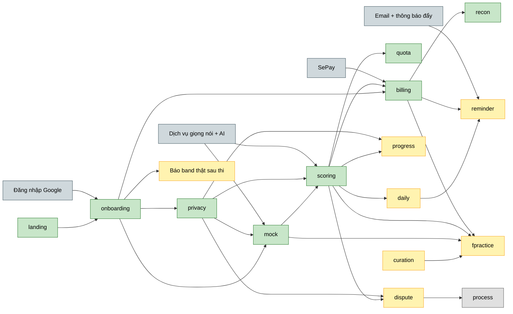

# Vox Flow — Roadmap chính thức

Bản roadmap chính thức của sản phẩm **Vox Flow**, thay thế `docs/roadmap-chamro.md` từ ngày 2026-11-05 sau khi hoàn tất đối chiếu Feature Map và PRD (Issue #6).

---

## 1. Outcome mỗi giai đoạn

### Now — Vòng lõi chạy thật từ đầu đến cuối

**Đạt được gì:** Học viên vào app bằng Google, thi thử, được chấm thật 3 lần kèm khoảng tin cậy, xem kết quả theo hạn mức miễn phí (band tổng + phân tích câu yếu nhất) và trả phí bằng QR để mở chi tiết 4 tiêu chí. Đợt này thay toàn bộ phần mô phỏng của prototype bằng ghi âm, chấm điểm và thanh toán thật.
**Đo bằng:** 60% người đăng ký hoàn thành bài thi đầu tiên, ≥ 90% bài có độ chênh giữa 3 lần chấm ≤ 0.5 band, có học viên trả phí đầu tiên (PRD Mục 1).

- **Landing giới thiệu giá trị** (`landing-page`) — dẫn người mới vào lần thi đầu với lời hứa đúng hạn mức.
- **Tạo tài khoản & thiết lập mục tiêu** (`onboarding`) — đưa học viên tới lần ghi âm đầu và thu band mục tiêu, ngày thi.
- **Quản lý quyền riêng tư dữ liệu** (`privacy-controls`) — để học viên dám ghi âm vì tự quyết được dữ liệu giọng nói (2 công tắc opt-in).
- **Thi thử với giám khảo AI** (`mock-exam`) — tạo bài nói thật đủ chất lượng để chấm.
- **Chấm điểm & xem bằng chứng** (`scoring-results`) — cho học viên biết vì sao được band đó, hành động North Star luyện lại câu yếu.
- **Hạn mức lượt miễn phí** (`free-quota`) — 3 điểm/ngày kèm trần chi phí toàn hệ thống.
- **Mua gói & thanh toán QR** (`billing`) — chuyển học viên miễn phí thành trả phí.
- **Đối soát thanh toán** (`payment-reconciliation`) — xử lý được tiền về sai hoặc trễ để học viên không mất tiền oan.

### Next — Hoàn tất MVP để ra mắt và giữ học viên quay lại

**Đạt được gì:** Học viên có việc luyện mỗi ngày, luyện được đề forecast của quý, thấy tiến bộ theo thời gian, được nhắc đúng lúc và báo được lỗi chấm. Xong đợt này đủ trọn vẹn phạm vi MVP đã chốt.
**Đo bằng:** 30% học viên luyện từ 3 ngày/tuần trở lên, dưới 3% bài bị báo lỗi chấm (PRD Mục 1).

- **Theo dõi tiến độ band** (`progress-history`) — phân biệt tiến bộ thật với dao động giữa các bài.
- **Cập nhật đề forecast** (`forecast-curation`) — có công cụ admin do PO vận hành và tự động hóa để cấp đề mới mỗi quý từ 3 nguồn.
- **Luyện đề forecast theo quý** (`forecast-practice`) — luyện đúng chủ đề có khả năng gặp và thấy độ phủ đề.
- **Luyện mỗi ngày** (`daily-practice`) — đưa ra việc hôm nay và giữ chuỗi ngày luyện.
- **Nhắc luyện & hết hạn gói** (`practice-reminder`) — giảm bỏ dở giữa chừng qua email và thông báo đẩy (tối đa 1 lần/ngày).
- **Báo lỗi chấm & Quy trình xử lý tối thiểu** (`score-dispute`) — học viên gửi báo lỗi, PO trực tiếp phản hồi trong 72 giờ.
- **Báo band thật sau ngày thi** (`real-band-report`) — thu thập ground truth đối chiếu độ sát điểm.

### Later — Khép vòng phản hồi và mở rộng

**Đạt được gì:** Quy trình xử lý báo lỗi có đội ngũ giám khảo mở rộng; xem xét gói cho giáo viên/trung tâm (`teacher-plan`).
**Đo bằng:** % báo lỗi được phản hồi trong 72 giờ khi quy mô học viên tăng cao.

---

## 2. Xếp hạng ưu tiên

> **Ghi chú liên kết nguồn đơn (Single Source of Truth):**
> Bảng xếp hạng chi tiết và điểm RICE/MoSCoW hiện đang được tiếp tục duy trì và kiểm tra trực tiếp tại `docs/roadmap-chamro.md#2-xếp-hạng-ưu-tiên` cho tới khi issue #9 (kiểm chứng mức sẵn lòng trả cho `billing`) hoàn thành. Vui lòng tham chiếu bảng tại file đó để tránh sai lệch dữ liệu.

---

## 3. Now (đang / sắp làm)

Thứ tự bám chuỗi phụ thuộc, riêng phần chấm thật nên thử sớm vì kết quả quyết định hạn mức và giá.

- **Landing giới thiệu giá trị** (`landing-page`) — người mới hiểu giá trị và vào thi thử · Tại sao bây giờ: là cửa vào của vòng lõi · Rủi ro: phải sửa lời hứa band tổng theo hạn mức · Chi tiết hóa: chưa
- **Tạo tài khoản & thiết lập mục tiêu** (`onboarding`) — học viên ghi âm được lần đầu, chỉ đăng nhập bằng Google · Tại sao bây giờ: là nền của mọi tính năng khác · Rủi ro: học viên bỏ đi vì nhiều bước hoặc micro bị chặn · Chi tiết hóa: chưa có SRS, phạm vi lấy từ PRD §4.1
- **Quản lý quyền riêng tư dữ liệu** (`privacy-controls`) — học viên chọn 2 công tắc đồng ý, xem, xuất và xóa được dữ liệu · Tại sao bây giờ: phải có trước lần ghi âm thật đầu tiên · Rủi ro: luồng xóa chủ động đang hold, chờ #8 · Chi tiết hóa: chưa có SRS, phạm vi lấy từ PRD §4.7
- **Thi thử với giám khảo AI** (`mock-exam`) — học viên thi Full Test hoặc từng Part với câu hỏi nối tiếp và ghi âm thật · Tại sao bây giờ: mọi tính năng chấm đều cần bài nói · Rủi ro: chưa chọn dịch vụ nhận dạng giọng nói · Chi tiết hóa: có brainstorm
- **Chấm điểm & xem bằng chứng** (`scoring-results`) — chấm thật 3 lần cho mọi lượt, band tổng và câu yếu nhất miễn phí, chi tiết 4 tiêu chí sau paywall · Tại sao bây giờ: là giá trị cốt lõi và rủi ro lớn nhất của sản phẩm · Rủi ro: điểm lệch xa điểm thi thật, chi phí mỗi bài chưa đo · Chi tiết hóa: chưa
- **Hạn mức lượt miễn phí** (`free-quota`) — đếm, đặt lại mỗi ngày và hiện số lượt còn lại · Tại sao bây giờ: chấm 3 lần cho mọi lượt làm chi phí gói miễn phí gấp 3 · Rủi ro: con số chưa chốt · Chi tiết hóa: chưa
- **Mua gói & thanh toán QR** (`billing`) — 4 gói 49k đến 349k, QR tự kích hoạt, quản lý gói · Tại sao bây giờ: không có doanh thu thì không nuôi được chi phí chấm · Rủi ro: chuyển khoản không tự kích hoạt, giá chưa kiểm chứng · Chi tiết hóa: chưa
- **Đối soát thanh toán** (`payment-reconciliation`) — tiền về sai hoặc trễ có đường xử lý · Tại sao bây giờ: prototype chỉ có nút giả lập, không thể thu tiền thật nếu thiếu phần này · Rủi ro: hỗ trợ thủ công vượt sức một người · Chi tiết hóa: chưa

---

## 4. Next (kế tiếp)

- **Theo dõi tiến độ band** (`progress-history`) — dashboard band ước lượng, điểm mạnh và cần cải thiện, lịch sử và biểu đồ band · Phụ thuộc: `scoring-results`, `privacy-controls` · Rủi ro: band ước lượng tạo kỳ vọng sai
- **Cập nhật đề forecast** (`forecast-curation`) — công cụ admin do PO vận hành và tự động hóa cập nhật đề mỗi quý từ 3 nguồn · Phụ thuộc: không · Rủi ro: kiểm duyệt chất lượng đề
- **Luyện đề forecast theo quý** (`forecast-practice`) — lọc, tìm, lưu danh sách ôn, gợi ý độ phủ và luyện ngay · Phụ thuộc: `mock-exam`, `scoring-results`, `billing`, `forecast-curation` · Rủi ro: đề cũ hoặc sai
- **Luyện mỗi ngày** (`daily-practice`) — việc hôm nay, chuỗi ngày, nhịp luyện theo ngày thi · Phụ thuộc: `scoring-results` · Rủi ro: gợi ý chung chung nên học viên bỏ qua
- **Nhắc luyện & hết hạn gói** (`practice-reminder`) — nhắc qua email và thông báo đẩy (tối đa 1 lần/ngày) · Phụ thuộc: `daily-practice`, `billing` · Rủi ro: nhắc quá nhiều khiến học viên tắt
- **Báo lỗi chấm & Quy trình xử lý tối thiểu** (`score-dispute`) — học viên gửi báo lỗi kèm audio và transcript; PO trực tiếp phản hồi trong 72 giờ · Phụ thuộc: `scoring-results`, `privacy-controls` · Rủi ro: khối lượng báo lỗi tăng nhanh
- **Báo band thật sau ngày thi** (`real-band-report`) — thu thập kết quả thi thật để đối chiếu độ sát điểm · Phụ thuộc: `onboarding`

---

## 5. Later (định hướng)

- **Quy trình xử lý báo lỗi chấm mở rộng** (`score-dispute-extended`) — phân công nhiều giám khảo tiếp nhận và trả lời báo lỗi khi số lượng vượt quá 5 lượt/tuần.
- **Gói dành cho giáo viên và trung tâm** (`teacher-plan`) — phân quyền lớp học, theo dõi học viên theo nhóm.

---

## 6. Phụ thuộc

---

## 7. Câu hỏi mở

> **Ghi chú liên kết nguồn đơn (Single Source of Truth):**
> Trạng thái chi tiết của câu hỏi mở OQ-6 (tư vấn luật sư về chuyển audio ra nước ngoài) đang được duy trì và cập nhật trực tiếp tại `docs/roadmap-chamro.md#7-câu-hỏi-mở` cho tới khi issue #8 đóng.
> 
> **Tóm tắt các câu hỏi đã chốt:**
> - **OQ-1:** 3 điểm/ngày cho học viên miễn phí, trần hệ thống ~33.000đ/ngày.
> - **OQ-2:** Công cụ admin đề forecast do PO trực tiếp vận hành từ 3 nguồn.
> - **OQ-3:** Nhắc luyện tối đa 1 lần/ngày qua email/push.
> - **OQ-4:** PO trực tiếp xử lý báo lỗi chấm điểm trong 72 giờ, đưa bản tối thiểu lên Next.
> - **OQ-5:** Đã chốt ngày 2026-11-13 (#7 đã đóng): dùng pipeline chấm nội bộ hiện hành (`whisper-1` + 3 lượt `gpt-6-luna` trung vị) làm chính, chuyển sang tự eval và hiệu chuẩn dần trên dữ liệu dự án tại #154 (`docs/decisions/scoring-self-eval.md`).
> - **OQ-6:** Đang chờ thực hiện tại #8.

---

## 8. Bước tiếp theo

1. Theo dõi và triển khai vòng lặp tự eval & hiệu chuẩn chấm điểm trên dữ liệu dự án tại #154 (Next / Later) khi có dữ liệu thực tế từ `score_run`, `score_dispute`, `real-band-report`.
2. Tư vấn luật sư về Nghị định 356/2025 và Luật 91/2025/QH15 tại OQ-6 (#8) để hoàn thiện hồ sơ chuyển dữ liệu âm thanh.
3. Kiểm chứng mức sẵn lòng trả cho `billing` (#9).
4. Viết tài liệu SRS cho từng tính năng của vòng lõi (bắt đầu từ `mock-exam` và `onboarding`).
