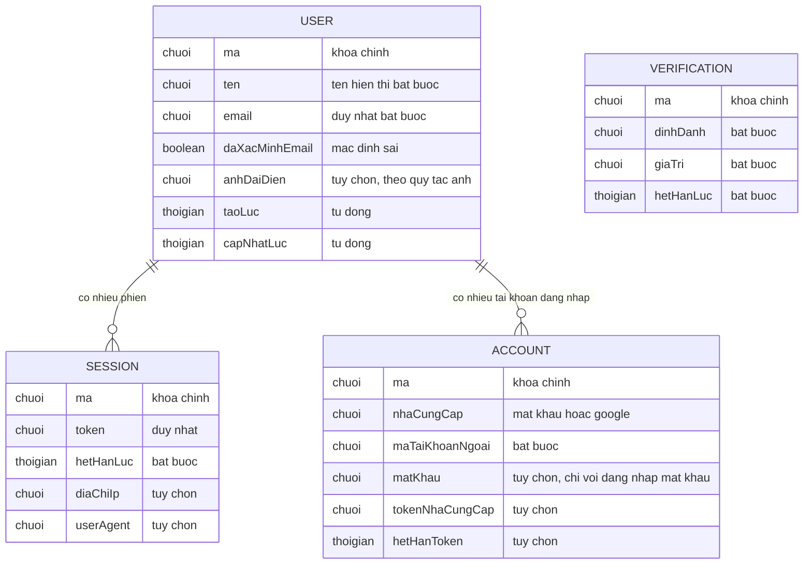

# auth-account — ERD tái lập (reverse)

## Entity Reference

| Entity | Mô tả nghiệp vụ | Thuộc tính chính | Nguồn | Nhãn |
|--------|-----------------|------------------|-------|------|
| USER (bảng `user`) | Người dùng của ứng dụng; một email chỉ một người dùng | tên (bắt buộc), email (duy nhất, bắt buộc), cờ đã xác minh email (mặc định sai), ảnh đại diện (tùy chọn), thời điểm tạo/cập nhật | packages/db/src/schema/auth.ts:4-17 | ✅ |
| SESSION (bảng `session`) | Một phiên đăng nhập trên một thiết bị/trình duyệt | token (duy nhất), hạn dùng, IP, user agent; xóa theo khi người dùng bị xóa | packages/db/src/schema/auth.ts:19-38 | ✅ |
| ACCOUNT (bảng `account`) | Một cách đăng nhập gắn với người dùng: mật khẩu hoặc nhà cung cấp ngoài (Google) | mã nhà cung cấp, mã tài khoản ngoài, mật khẩu (cột `password`, thuật toán băm 🟡), access/refresh/id token, hạn token, scope | packages/db/src/schema/auth.ts:40-68 | ✅ |
| VERIFICATION (bảng `verification`) | Bản ghi xác minh có hạn (định danh + giá trị) | định danh, giá trị, hạn | packages/db/src/schema/auth.ts:70-86 | 🟡 |

Nhãn 🟡 của VERIFICATION: bảng có trong schema nhưng không có luồng đọc/ghi trong code; chỉ được mô tả trong sổ đăng ký dữ liệu (packages/api/src/data-registry.ts:248-249) là "token OTP/email tạm thời" (N-3).

## Quan hệ

| Từ | Đến | Bản số | Ý nghĩa | Nguồn | Nhãn |
|----|-----|--------|---------|-------|------|
| USER | SESSION | 1 – 0..n | Một người dùng có nhiều phiên; phiên bị xóa khi người dùng bị xóa (xóa dây chuyền) | packages/db/src/schema/auth.ts:33-35,90-93,100-103 | ✅ |
| USER | ACCOUNT | 1 – 0..n | Một người dùng có thể có cả đăng nhập mật khẩu và Google; xóa dây chuyền | packages/db/src/schema/auth.ts:46-48,94-97,105-108 | ✅ |
| (liên quan) USER | Hồ sơ học viên | 1 – 0..1 | Hồ sơ onboarding theo mã người dùng; thuộc `onboarding-profile`, chỉ được guard đọc | packages/api/src/context.ts; apps/web/src/lib/auth-guard.ts:50-52 | 🔵 |

## Notes

* Chỉ mô hình hóa 4 thực thể xác thực. Không có quan hệ `verification` – `user` trong schema (không khóa ngoại) nên không vẽ đường nối.
* Chỉ mục: phiên theo mã người dùng, tài khoản theo mã người dùng, xác minh theo định danh (packages/db/src/schema/auth.ts:37,67,85). Ý nghĩa hiệu năng 🟡.
* Thuộc tính DB cố ý viết dạng nghiệp vụ; tên cột thật xem Nguồn.
* Hồ sơ học viên, attempt, điểm… thuộc feature khác nên không vẽ.
