# auth-account — Flows tái lập (reverse)

> **Đã duyệt (#134).** Chỉ vẽ bước CÓ trong code (kèm quyết định đã chốt ở `reverse-gaps.md`). Nguồn mỗi flow nằm dưới tiêu đề (đường dẫn repo đầy đủ). Chi tiết lỗi: `auth-account-reverse-spec.md` Mục 6. Flow legacy (`/login` → `/dashboard`) đã xóa ở #134 cùng khu `_app-legacy`.

## Flow 1: Đăng ký bằng email + mật khẩu

> Nguồn ✅: apps/web/src/features/auth/auth-screen.tsx:118-143; packages/auth/src/index.ts:34-37; packages/api/src/test/auth.test.ts:59-87,257-284. Liên quan FR-001..005, FR-012, E-002, E-004, E-005.

### Sequence — Đăng ký bằng email

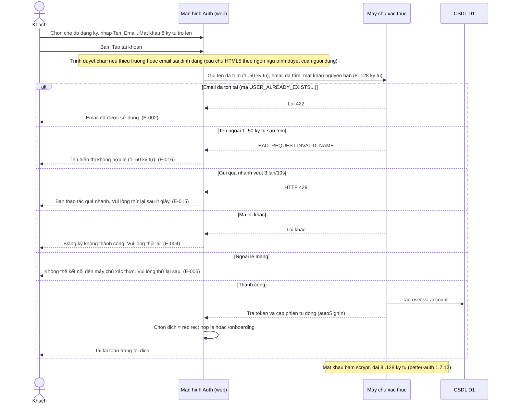

### Activity — Đăng ký bằng email

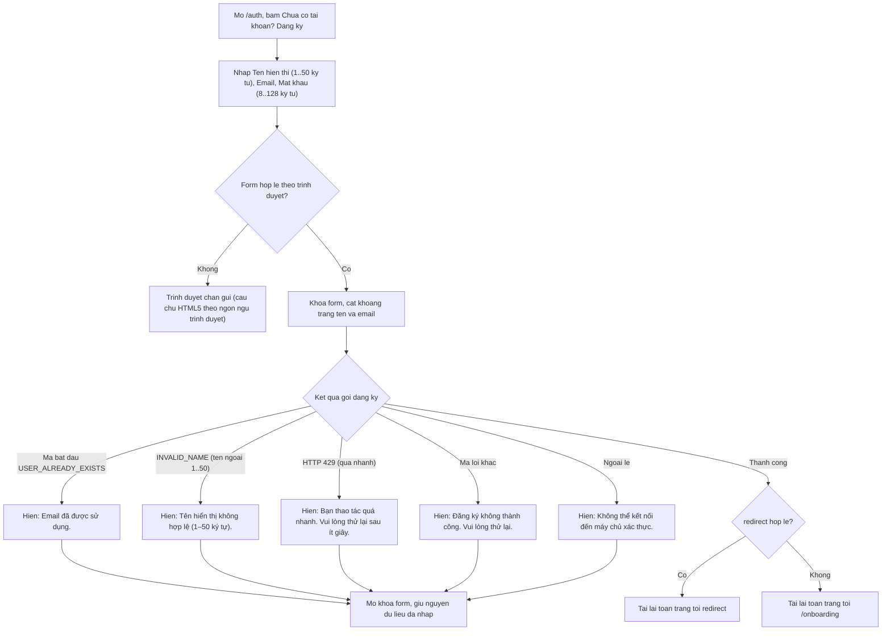

## Flow 2: Đăng nhập bằng email + mật khẩu

> Nguồn ✅: apps/web/src/features/auth/auth-screen.tsx; packages/api/src/test/auth.test.ts; apps/web/src/routes/_proto/auth.tsx (chuyển hướng khi đã onboard, #134). Liên quan FR-006..009, FR-015, FR-012, E-001, E-003, E-005, E-015.

### Sequence — Đăng nhập bằng email

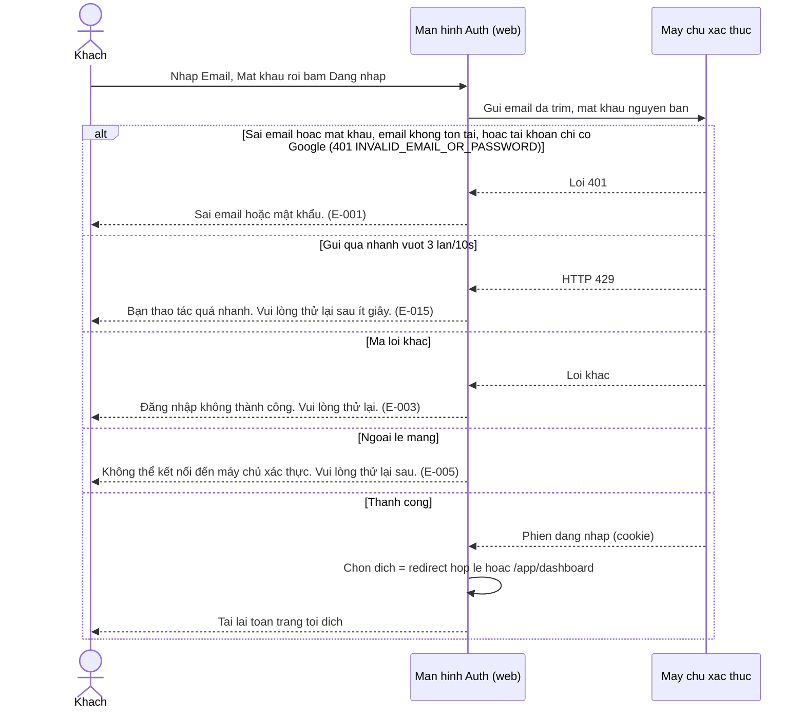

### Activity — Đăng nhập bằng email

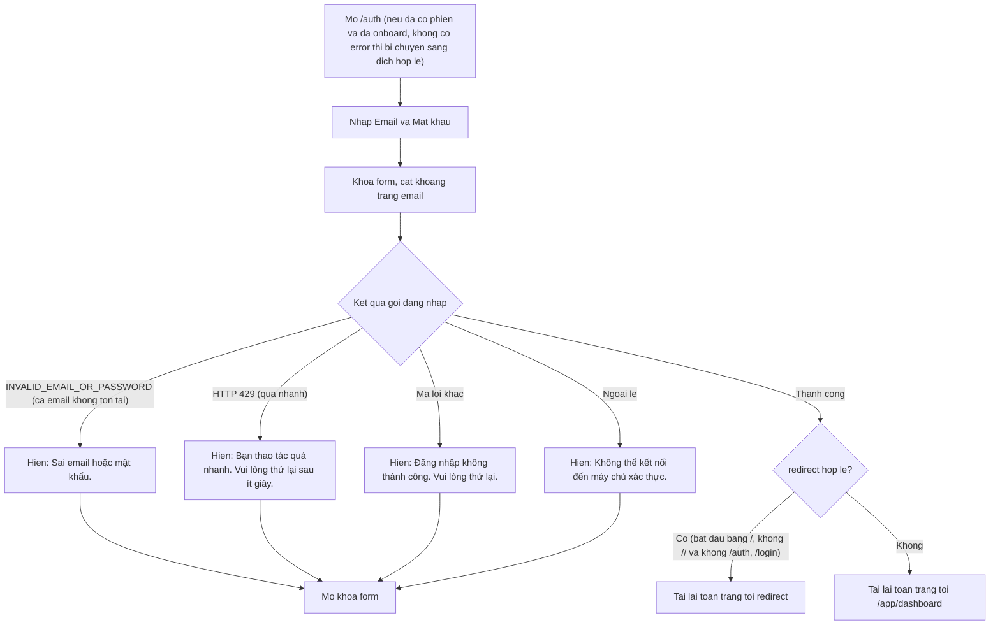

## Flow 3: Đăng nhập bằng Google

> Nguồn ✅: apps/web/src/features/auth/auth-screen.tsx; packages/auth/src/index.ts; packages/api/src/test/auth.test.ts; apps/web/src/features/__tests__/slice-a.test.tsx. Liên quan FR-013, FR-014, FR-015, E-005..E-008, E-015. Bước Google chấp thuận/hủy diễn ra ngoài hệ thống — kết quả về web qua callback hoặc tham số `error`; cơ chế `callbackURL`/`newUserCallbackURL` đã xác minh trên `better-auth@1.7.12`.

### Sequence — Đăng nhập Google

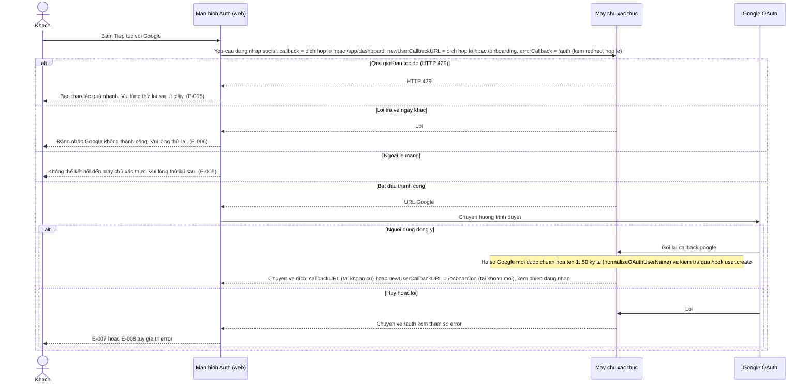

### Activity — Đăng nhập Google

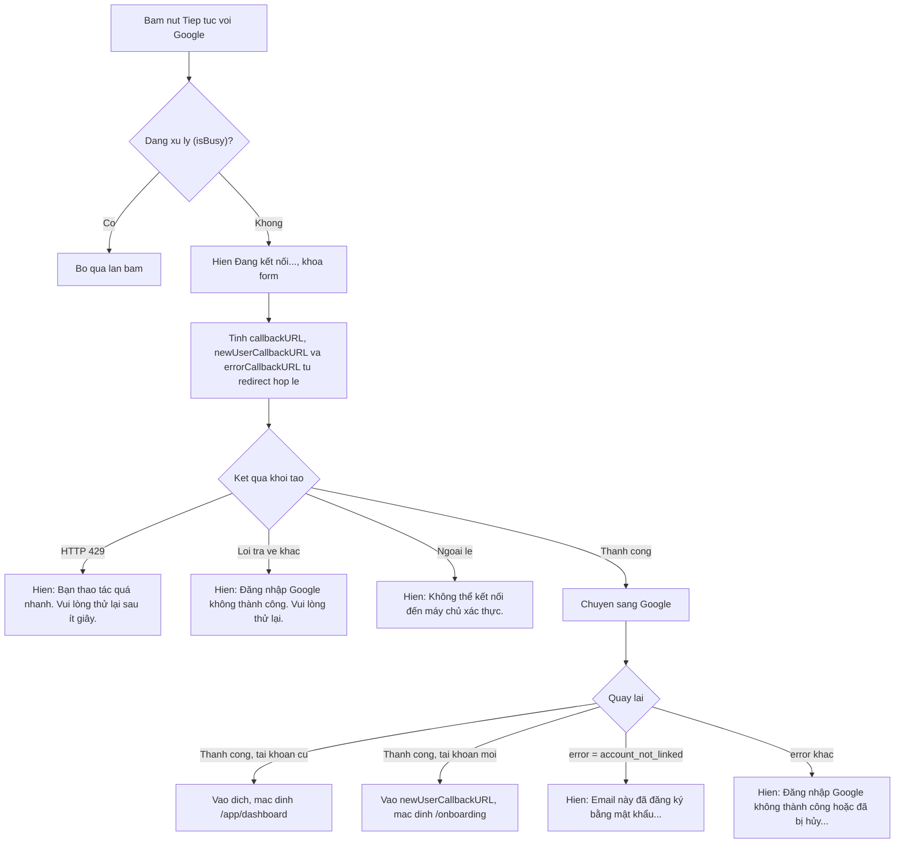

## Flow 4: Đăng xuất

> Nguồn ✅: apps/web/src/hooks/use-sign-out.ts; apps/web/src/lib/auth-guard.ts (clearOnboardedUserCache, #134); apps/web/src/features/app-state/use-profile-hydration.ts; apps/web/src/hooks/__tests__/use-sign-out.test.tsx. Liên quan FR-016..018, E-009.

### Sequence — Đăng xuất

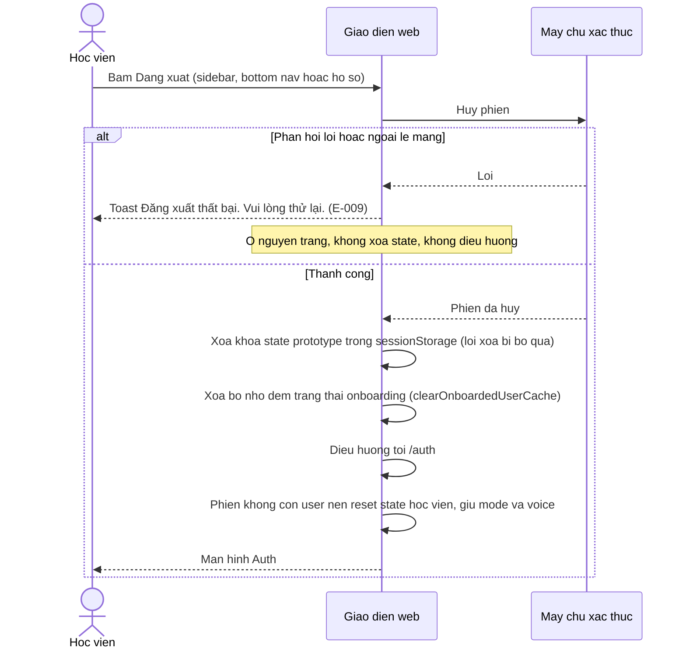

### Activity — Đăng xuất

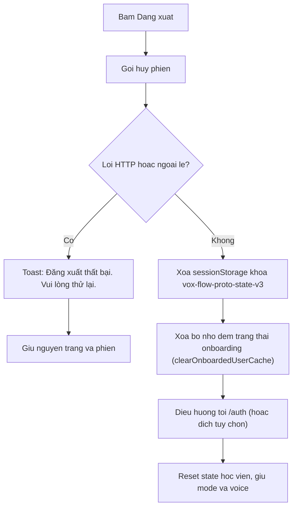

## Flow 5: Bảo vệ route theo phiên và onboarding

> Nguồn ✅: apps/web/src/lib/auth-guard.ts:24-105; apps/web/src/routes/_proto/auth.tsx:19-22; apps/web/src/routes/_proto/app/route.tsx:7; apps/web/src/routes/_proto/onboarding.tsx:7-26; apps/web/src/features/onboarding/onboarding-screen.tsx:27-34; apps/web/src/lib/__tests__/auth-guard.test.ts; apps/web/src/lib/__tests__/route-guards.test.ts. Liên quan FR-015, FR-019..023.

### Sequence — Guard route

```mermaid
sequenceDiagram
    actor H as Hoc vien
    participant R as Router web
    participant S as May chu xac thuc
    participant P as Dich vu ho so (profile)
    H->>R: Mo /app/*, /exam hoac /scoring
    R->>S: Hoi phien hien tai
    alt Khong co phien hoac loi mang
        S-->>R: Rong hoac loi
        R-->>H: Chuyen /auth kem redirect = dia chi dang vao
    else Co phien
        alt Da nho user da onboarding
            R-->>H: Cho vao, khong hoi ho so
        else Chua nho
            R->>P: Doc ho so
            alt Khong co ho so hoac onboardedAt rong
                P-->>R: null hoac chua xong
                R-->>H: Chuyen /onboarding
            else Da onboarding
                P-->>R: onboardedAt co gia tri
                R->>R: Nho user da onboarding
                R-->>H: Cho vao
            else Loi doc ho so
                P-->>R: Loi
                R-->>H: Cho vao (fail-open) va canh bao console
            end
        end
    end
    Note over R: /onboarding chi kiem tra phien, neu da onboarding thi chuyen /app/dashboard; hoan tat goi markUserOnboarded. /auth (khong co ?error=) goi redirectIfOnboarded chuyen nguoi da onboarding ve safeRedirect ?? /app/dashboard, nguoi chua onboard o lai /auth.
```

### Activity — Guard route

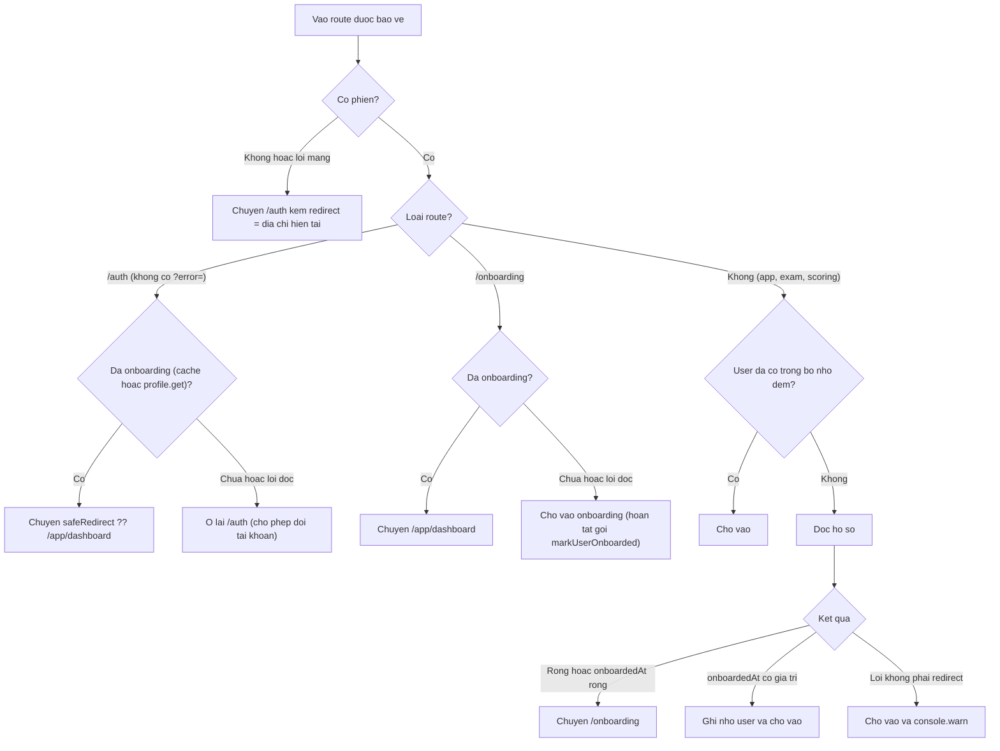

## Flow 6: Truy cập khu vực quản trị

> Nguồn ✅: apps/web/src/routes/admin/disputes.tsx:7-29; apps/web/src/routes/admin/forecast.tsx:7-29; packages/api/src/index.ts:31-45; packages/api/src/auth-utils.ts:1-13. Liên quan FR-024, FR-026, E-011.

### Sequence — Khu quản trị

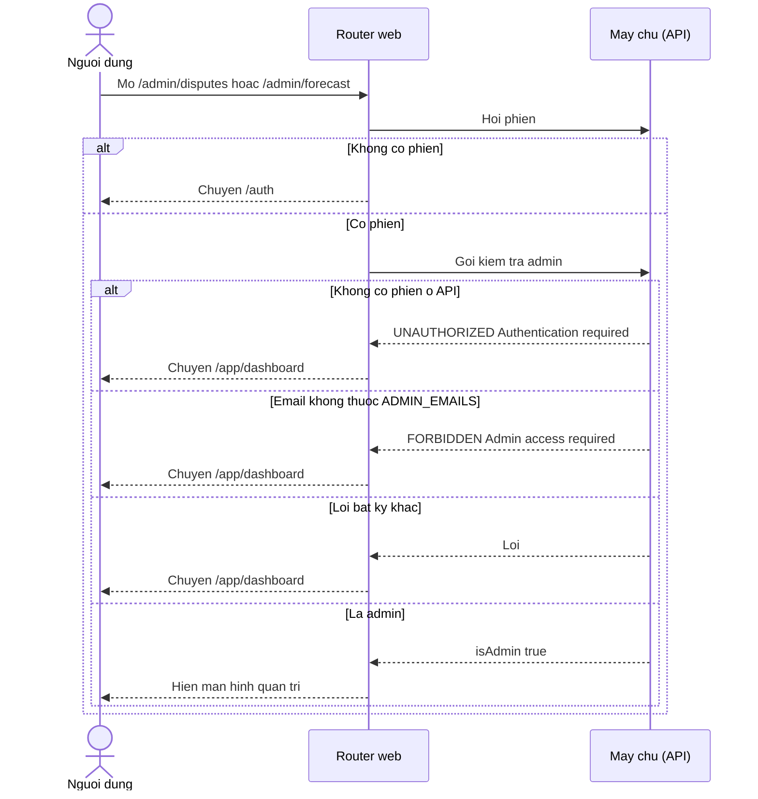

### Activity — Khu quản trị

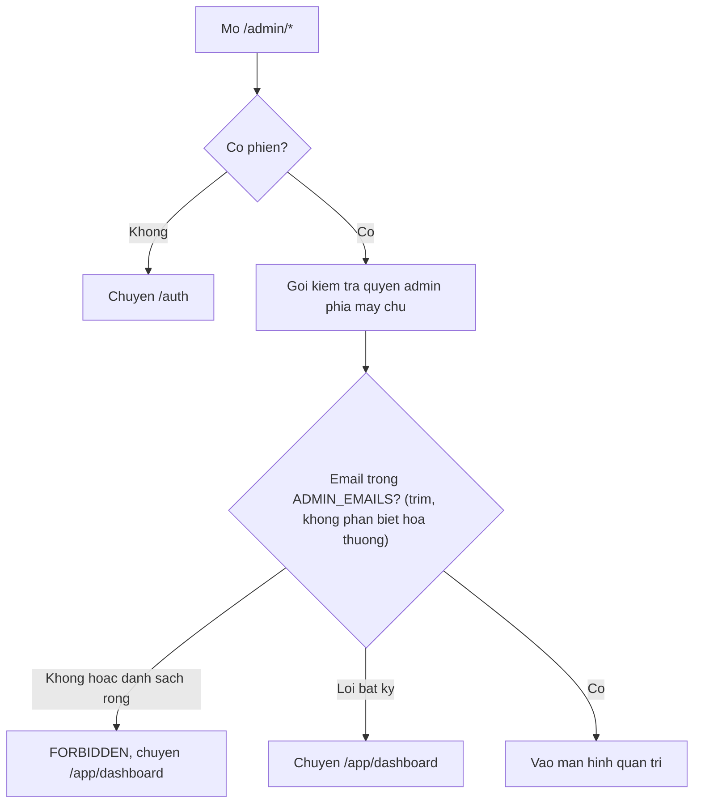

## Flow 7: Hợp lệ hóa tên hiển thị và ảnh đại diện khi tạo/cập nhật tài khoản

> Nguồn ✅: packages/auth/src/name-validation.ts; packages/auth/src/image-validation.ts; packages/auth/src/index.ts:31-61,103-112; packages/api/src/test/auth.test.ts:89-193,251-350. Liên quan FR-001, FR-028, BR-003, BR-009..017, E-012, E-016. Chỉ phần kiểm tra tại hook — luồng chọn/nén avatar thuộc `onboarding-profile`.

### Sequence — Hợp lệ hóa tên và ảnh

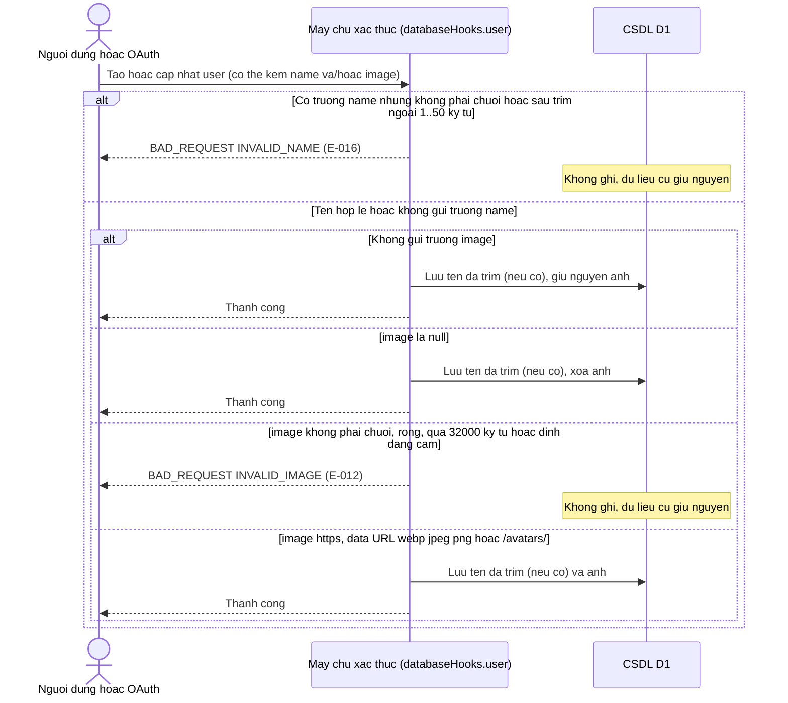

### Activity — Hợp lệ hóa tên và ảnh

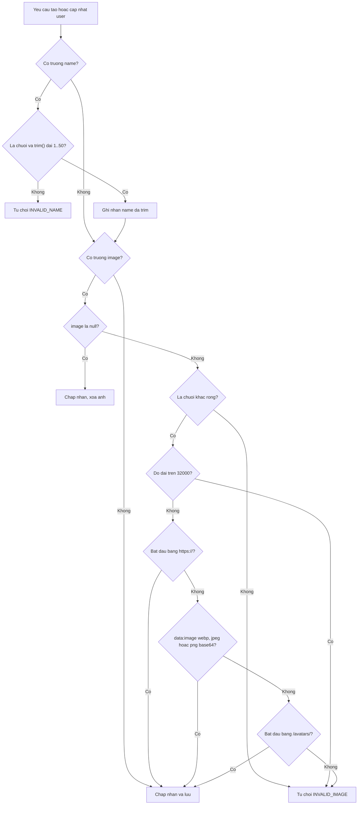
