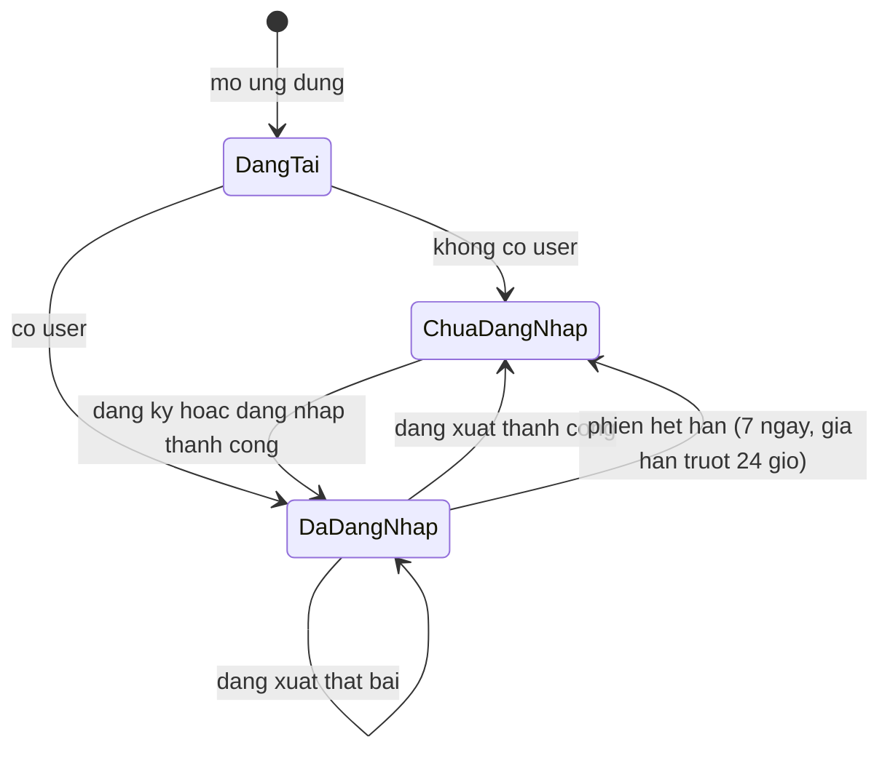
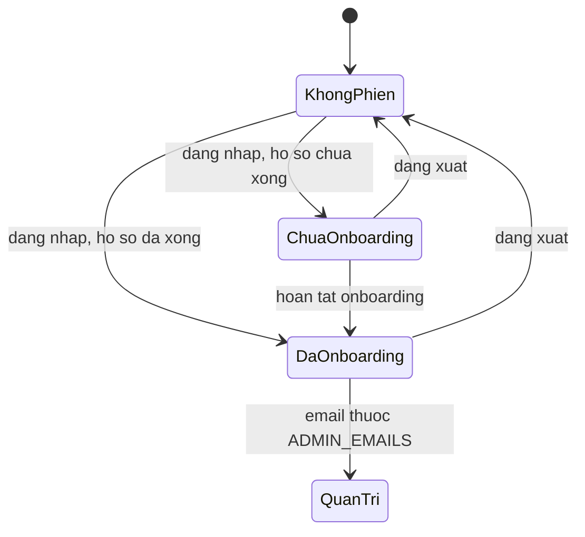
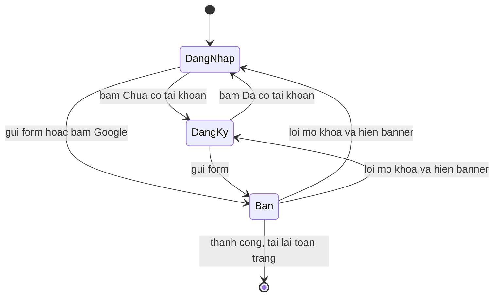

# auth-account — States tái lập (reverse)

> **Đã duyệt (#134).**

## State: Phiên đăng nhập của người dùng (phía web)

> Nguồn: ✅ [apps/web/src/routes/_proto/route.tsx; apps/web/src/lib/auth-guard.ts; apps/web/src/hooks/use-sign-out.ts; apps/web/src/features/app-state/use-profile-hydration.ts]. Code không lưu một "enum trạng thái" tường minh; sơ đồ là mô hình hóa từ hành vi quan sát được của guard và hook. Phiên kéo dài 7 ngày (604800s) với gia hạn trượt mỗi 24 giờ (86400s) — `better-auth@1.7.12` (OQ-2 đã chốt).

**Ghi chú trạng thái:**

| Trạng thái | Ý nghĩa | Vào bằng | Ra bằng | Nguồn | Nhãn |
|-----------|---------|----------|---------|-------|------|
| DangTai | Phiên đang được hỏi; chưa đụng tới state học viên | Mở ứng dụng | Có hoặc không có user | apps/web/src/routes/_proto/route.tsx:32-33; apps/web/src/features/app-state/use-profile-hydration.ts:30-31 | ✅ |
| ChuaDangNhap | Không có người dùng; guard chuyển `/auth`; state học viên được reset (giữ mode, voice) | Đăng xuất, hoặc mở ứng dụng khi chưa có phiên | Đăng ký/đăng nhập thành công (tải lại toàn trang) | apps/web/src/lib/auth-guard.ts:25-31; apps/web/src/features/app-state/use-profile-hydration.ts:33-40 | ✅ |
| DaDangNhap | Có người dùng; hydrate tên, email, hồ sơ | Đăng ký (tự đăng nhập), đăng nhập email, Google | Đăng xuất thành công | packages/auth/src/index.ts:34-37; apps/web/src/features/auth/auth-screen.tsx:136-138 | ✅ |
| (hết hạn phiên) | Chuyển DaDangNhap → ChuaDangNhap khi phiên hết hạn | Thời gian | Đăng nhập lại | Phiên 7 ngày (604800s), gia hạn trượt mỗi 24 giờ (86400s) — `better-auth@1.7.12` | ✅ |

## State: Quyền truy cập route của một học viên

> Nguồn: ✅ [apps/web/src/lib/auth-guard.ts:41-70; apps/web/src/routes/_proto/onboarding.tsx:7-26; apps/web/src/routes/admin/disputes.tsx:7-29]. Là mô hình hóa từ các nhánh guard.

| Trạng thái | Ý nghĩa | Vào bằng | Ra bằng | Nguồn | Nhãn |
|-----------|---------|----------|---------|-------|------|
| KhongPhien | Chỉ vào được `/auth` và các trang công khai (landing, terms); route bảo vệ chuyển `/auth` | Chưa đăng nhập | Đăng nhập | apps/web/src/lib/auth-guard.ts:25-31 | ✅ |
| ChuaOnboarding | Vào được `/onboarding` và vẫn mở được `/auth` (để giữ nút "Quay lại" từ bước 1 đổi tài khoản); `/app/*`, `/exam`, `/scoring` chuyển `/onboarding` | Đăng nhập khi hồ sơ rỗng hoặc `onboardedAt` rỗng | Hoàn tất onboarding (do feature `onboarding-profile`) hoặc đăng xuất | apps/web/src/lib/auth-guard.ts:50-56,77-105 | ✅ |
| DaOnboarding | Vào được `/app/*`, `/exam`, `/scoring`; `/onboarding` chuyển `/app/dashboard`; `/auth` (khi không có `?error=`) chuyển `safeRedirect ?? "/app/dashboard"` | `onboardedAt` có giá trị (ghi nhớ trong bộ nhớ trình duyệt) | Đăng xuất | apps/web/src/lib/auth-guard.ts:45-59,77-105; apps/web/src/routes/_proto/auth.tsx:19-22 | ✅ |
| QuanTri | Vào thêm được `/admin/disputes`, `/admin/forecast` | Email thuộc danh sách admin | Đổi cấu hình ADMIN_EMAILS | apps/web/src/routes/admin/disputes.tsx:16-24; packages/api/src/index.ts:31-38 | ✅ |
| (vòng đời cache onboarding) | Ghi nhớ theo mã người dùng, không lẫn người giữa các phiên | Guard đọc hồ sơ thành công, hoặc ngay khi hoàn tất onboarding (`markUserOnboarded`) | Đăng xuất thành công xóa toàn bộ (`clearOnboardedUserCache`, #134) | apps/web/src/lib/auth-guard.ts; apps/web/src/hooks/use-sign-out.ts | ✅ |

## State: Chế độ màn hình `/auth`

> Nguồn: ✅ [apps/web/src/features/auth/auth-screen.tsx:63-74,118-148]. Hai trạng thái trực giao: chế độ (đăng nhập/đăng ký) và cờ bận.

| Trạng thái | Ý nghĩa | Vào bằng | Ra bằng | Nguồn | Nhãn |
|-----------|---------|----------|---------|-------|------|
| DangNhap | Form Email + Mật khẩu, nút "Đăng nhập" | Mặc định | Chuyển chế độ / gửi | apps/web/src/features/auth/auth-screen.tsx:66,244 | ✅ |
| DangKy | Thêm ô Tên hiển thị, mật khẩu ≥ 8, nút "Tạo tài khoản" | Bấm "Chưa có tài khoản? Đăng ký" | Chuyển chế độ / gửi | apps/web/src/features/auth/auth-screen.tsx:145-148,187-203,228 | ✅ |
| Ban | Khóa mọi ô nhập và nút, hiện spinner | Gửi form hoặc bấm Google | Lỗi (mở khóa) hoặc thành công (chuyển trang, vẫn khóa) | apps/web/src/features/auth/auth-screen.tsx:71,92-95,118-123 | ✅ |
