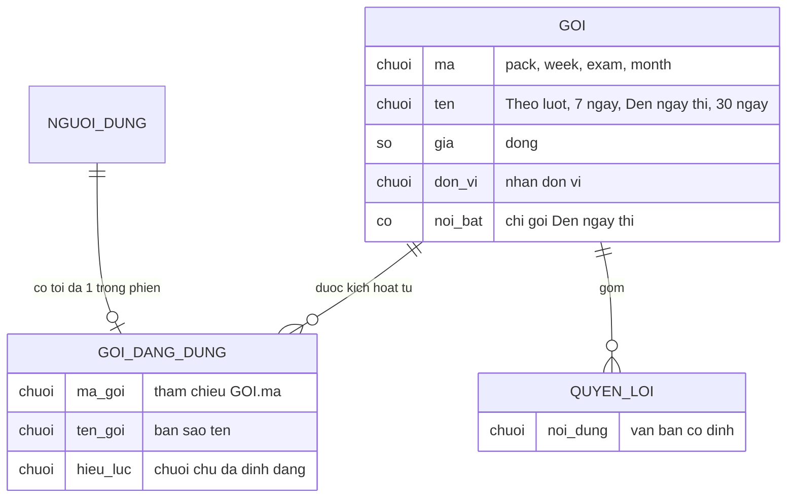

# billing — ERD tái lập (reverse)

Chỉ mô hình dữ liệu phía giao diện. Không có bảng cơ sở dữ liệu cho feature này (negative-search N3 ở `reverse-gaps.md`).

## Entity Reference

| Entity | Mô tả nghiệp vụ | Thuộc tính chính | Nguồn | Nhãn |
|--------|-----------------|------------------|-------|------|
| GOI | Gói trả phí niêm yết, 4 bản ghi cố định phía giao diện | mã, tên, giá, đơn vị, cờ nổi bật | apps/web/src/features/billing/data.ts:1-40 | ✅ |
| QUYEN_LOI | Dòng quyền lợi của gói (chữ), 3 dòng mỗi gói | nội dung | apps/web/src/features/billing/data.ts:16,23,30,38 | ✅ |
| GOI_DANG_DUNG | Gói người dùng đang có trong phiên, tối đa 1 | mã gói, tên gói, hiệu lực (chuỗi) | apps/web/src/features/app-state/types.ts:53-57,71 | ✅ |
| NGUOI_DUNG | Chủ phiên (thuộc tính liên quan: email, ngày thi, mục tiêu band) | email, ngày thi | apps/web/src/features/app-state/types.ts:65-71 | ✅ |
| DON_HANG / GIAO_DICH | Không có trong code | — | packages/db/src/schema (negative-search N3) | 🟡 |

## Quan hệ

| Từ | Đến | Bản số | Ý nghĩa | Nguồn | Nhãn |
|----|-----|--------|---------|-------|------|
| NGUOI_DUNG | GOI_DANG_DUNG | 1 - 0..1 | Tối đa một gói đang dùng, trong phiên | apps/web/src/features/app-state/types.ts:71 | ✅ |
| GOI | GOI_DANG_DUNG | 1 - 0..n | Gói đang dùng sao chép mã và tên từ gói | apps/web/src/features/billing/components/payment-panel.tsx:54 | ✅ |
| GOI | QUYEN_LOI | 1 - 3 | Mỗi gói có 3 dòng quyền lợi chữ | apps/web/src/features/billing/data.ts:16,23,30,38 | ✅ |

## Notes

* Không mô hình đơn hàng, giao dịch, hóa đơn, người đăng ký, vì code không có. Hóa đơn hiển thị là một dòng tính từ gói đang dùng (apps/web/src/features/billing/billing-screen.tsx:60-81).
* Tên thuộc tính trong ERD là tên nghiệp vụ, không phải cột DB thật (không có bảng).
* Dữ liệu GOI_DANG_DUNG không lưu qua tải lại trang (apps/web/src/features/app-state/store.tsx:94-107).
