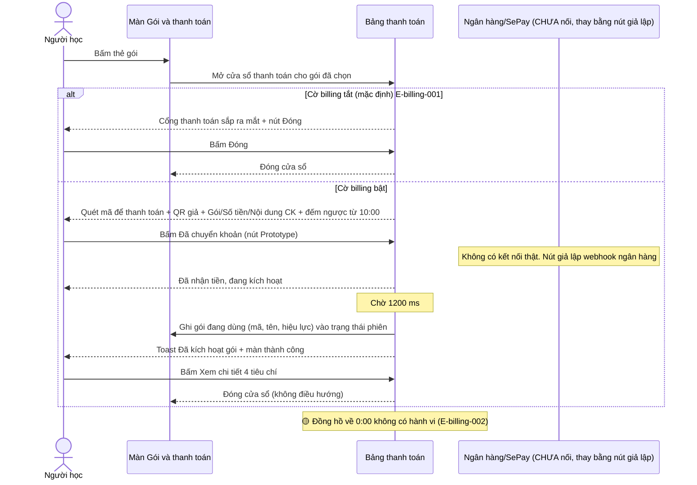
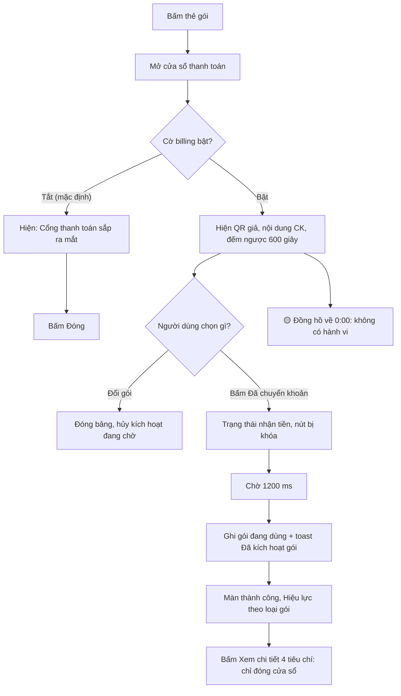
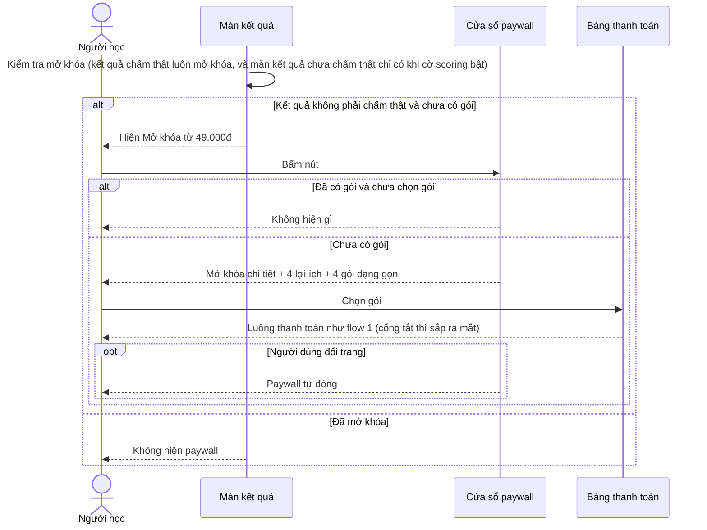
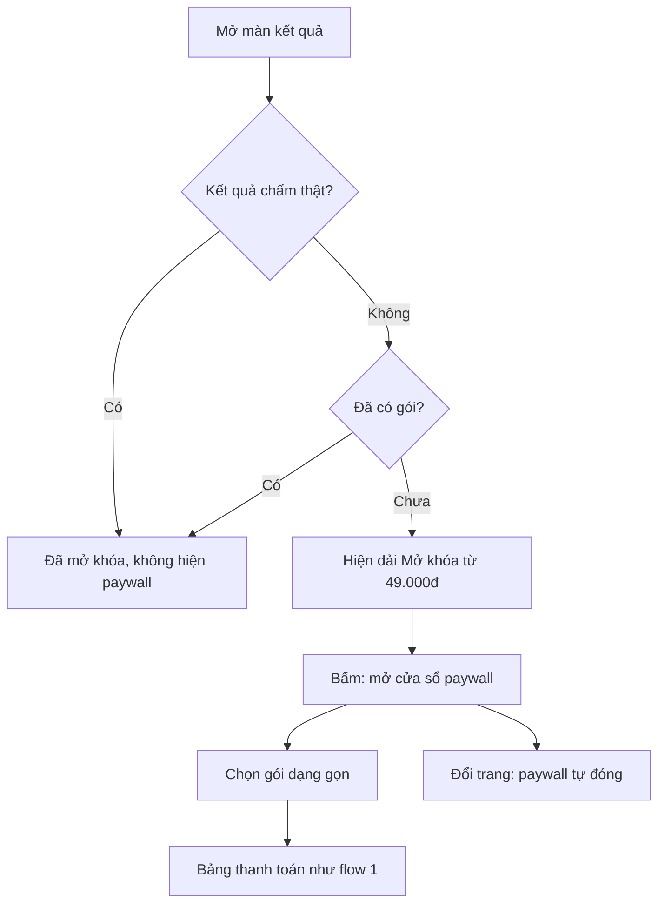
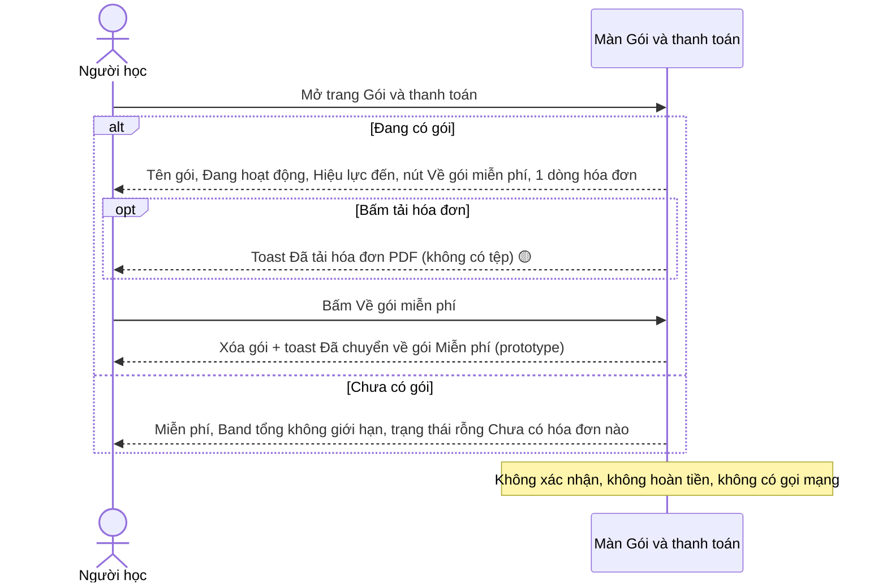
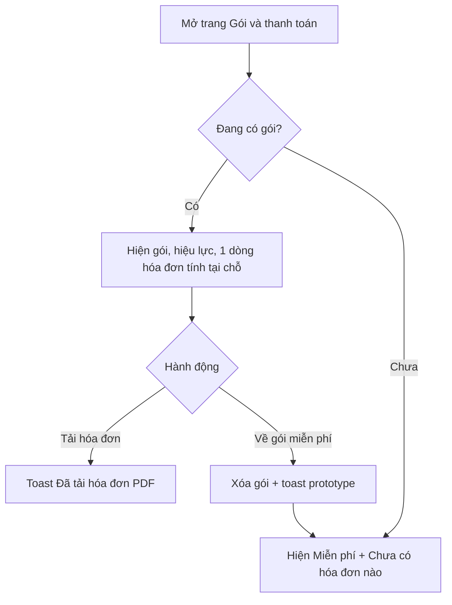

# billing — Flows tái lập (reverse)

## Flow: Chọn gói và thanh toán QR mô phỏng (hoặc thông báo sắp ra mắt)

### Sequence — Chọn gói và thanh toán

### Activity — Chọn gói và thanh toán

## Flow: Mở khóa từ màn kết quả qua paywall

### Sequence — Paywall từ kết quả

### Activity — Paywall từ kết quả

## Flow: Về gói miễn phí và xem hóa đơn

### Sequence — Về gói miễn phí

### Activity — Về gói miễn phí

