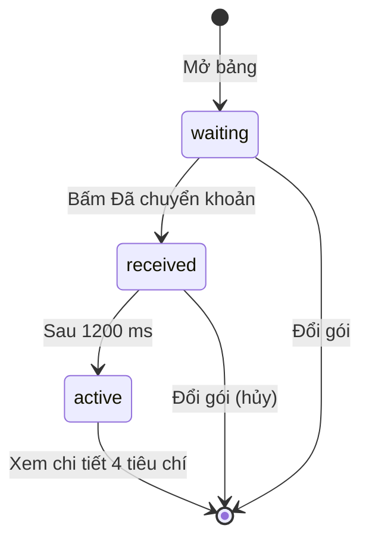
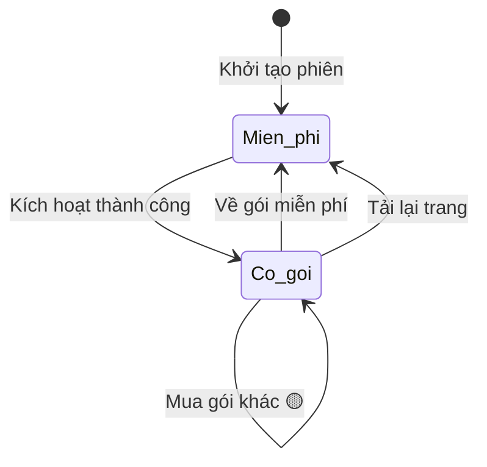

# billing — States tái lập (reverse)

## State: Phiên thanh toán (bảng thanh toán, chỉ khi cờ billing bật)

> Nguồn: ✅ [apps/web/src/features/billing/components/payment-panel.tsx:14,25,50-58,121]. Trạng thái chỉ tồn tại khi bảng mở, không lưu.

**Ghi chú trạng thái:**

| Trạng thái | Ý nghĩa | Vào bằng | Ra bằng | Nguồn | Nhãn |
|-----------|---------|----------|---------|-------|------|
| waiting | Chờ thanh toán, hiện đếm ngược, nút giả lập bật | Mở bảng | Bấm nút giả lập | apps/web/src/features/billing/components/payment-panel.tsx:25,121 | ✅ |
| received | Đã nhận tiền, lớp phủ xoay, nút khóa | Bấm nút giả lập | Hết 1200 ms (hoặc bảng bị gỡ thì hủy) | apps/web/src/features/billing/components/payment-panel.tsx:50-58,85-89 | ✅ |
| active | Đã kích hoạt, hiện màn thành công | Hết 1200 ms | Bấm nút ở màn thành công | apps/web/src/features/billing/components/payment-panel.tsx:60-73 | ✅ |
| (hết hạn / thất bại) | Không có trạng thái | — | — | apps/web/src/features/billing/components/payment-panel.tsx:14 | 🟡 |

## State: Gói của người dùng (trạng thái phiên)

> Nguồn: ✅ [apps/web/src/features/billing/components/payment-panel.tsx:54, apps/web/src/features/billing/billing-screen.tsx:46, apps/web/src/features/app-state/initial-state.ts:10]. Không lưu qua tải lại trang.

**Ghi chú trạng thái:**

| Trạng thái | Ý nghĩa | Vào bằng | Ra bằng | Nguồn | Nhãn |
|-----------|---------|----------|---------|-------|------|
| Mien_phi (plan = null) | Chưa có gói | Khởi tạo, nút Về gói miễn phí, tải lại trang | Kích hoạt | apps/web/src/features/app-state/initial-state.ts:10, apps/web/src/features/billing/billing-screen.tsx:46 | ✅ |
| Co_goi (có mã, tên, hiệu lực) | Có gói, kết quả được mở khóa | Kích hoạt | Về gói miễn phí, tải lại trang | apps/web/src/features/billing/components/payment-panel.tsx:54 | ✅ |
| Hết hiệu lực | Không có trạng thái; hiệu lực là chuỗi chữ | — | — | apps/web/src/features/app-state/types.ts:53-57 | 🟡 |
| Mua khi đã có gói | Giao diện vẫn cho chọn gói khác; kết quả ghi đè gói cũ, quy tắc nghiệp vụ chưa rõ | Chọn gói ở màn billing | — | apps/web/src/features/billing/billing-screen.tsx:56, apps/web/src/features/billing/components/payment-panel.tsx:54 | 🟡 |
