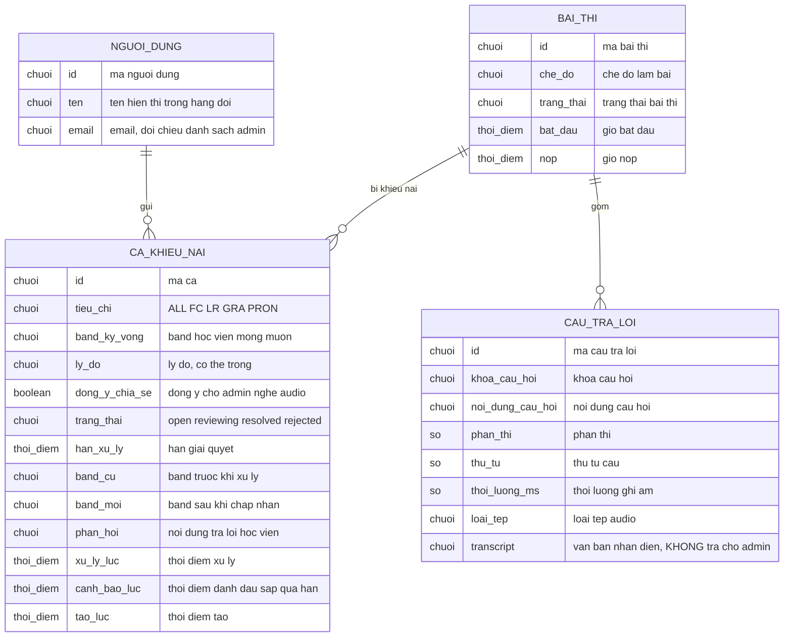

# dispute-admin — ERD tái lập (reverse)

## Entity Reference

| Entity | Mô tả nghiệp vụ | Thuộc tính chính | Nguồn | Nhãn |
|--------|-----------------|------------------|-------|------|
| CA_KHIEU_NAI (score_dispute) | Một báo lỗi chấm điểm của học viên cho một bài thi, admin xử lý | tiêu chí (ALL/FC/LR/GRA/PRON), band kỳ vọng, lý do, đồng ý chia sẻ (mặc định không), trạng thái (mặc định open), hạn xử lý, band cũ, band mới, phản hồi, thời điểm xử lý/cảnh báo/tạo/sửa | S14:7-38, S15 | ✅ |
| BAI_THI (attempt) | Bài thi bị báo lỗi; admin đọc chế độ, trạng thái, giờ bắt đầu/nộp | chế độ, trạng thái, bắt đầu, nộp | S1:183-193 | ✅ |
| CAU_TRA_LOI (attempt_answer) | Câu trả lời ghi âm của bài thi, nguồn audio | khóa câu hỏi, nội dung, phần thi, thứ tự, thời lượng, loại tệp, transcript | S22:32-57, S1:195-208 | ✅ |
| NGUOI_DUNG (user) | Học viên; chỉ tên và email được đọc | tên, email | S1:112-113, S1:128 | ✅ |

## Quan hệ

| Từ | Đến | Bản số | Ý nghĩa | Nguồn | Nhãn |
|----|-----|--------|---------|-------|------|
| NGUOI_DUNG | CA_KHIEU_NAI | 1 - N | Một học viên có nhiều ca; xóa người dùng xóa dây chuyền ca | S14:16-18 | ✅ |
| BAI_THI | CA_KHIEU_NAI | 1 - N (tối đa 1 ca đang open/reviewing cùng lúc) | Một bài có thể bị báo lỗi nhiều lần theo thời gian nhưng chỉ một ca đang xử lý; xóa bài xóa dây chuyền ca | S14:13-15, S14:44-46 | ✅ |
| BAI_THI | CAU_TRA_LOI | 1 - N | Bài gồm nhiều câu trả lời; xóa bài xóa dây chuyền | S22:34-37 | ✅ |
| CA_KHIEU_NAI | NGUOI_DUNG | N - 1 qua nối trái | Nếu người dùng không còn thì tên/email trống trong hàng đợi | S1:128 | ✅ |

## Notes

* Tên thuộc tính trong sơ đồ là tên nghiệp vụ không dấu; cột DB thật nằm ở S14 và migration S15 (không đưa vào đây để giữ ở mức nghiệp vụ).
* Không có thực thể "admin": quyền admin xác định bằng danh sách email trong cấu hình, không lưu ở DB. ✅ [S8:1-13]
* Không có thực thể "người xử lý" hay "log hành động": ca không lưu admin nào xử lý (OQ-5). ✅ [S14:7-38]
* Điểm chính thức của bài thi (bảng chấm điểm) không được mô hình vì feature này không đọc/ghi (OQ-2).
