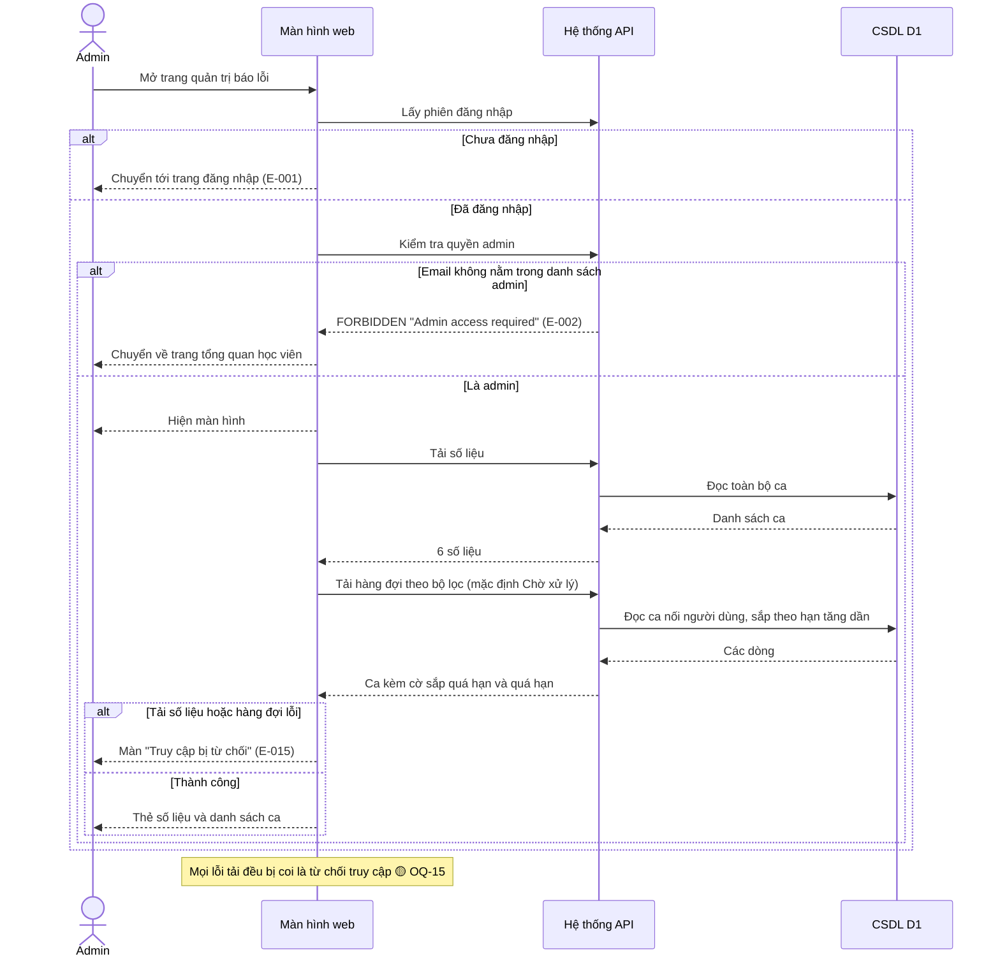
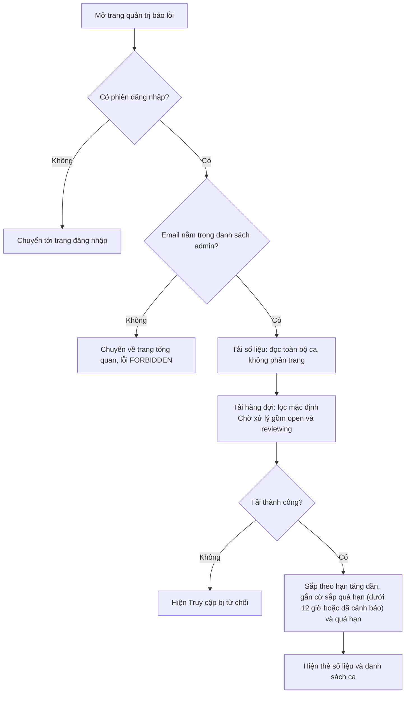
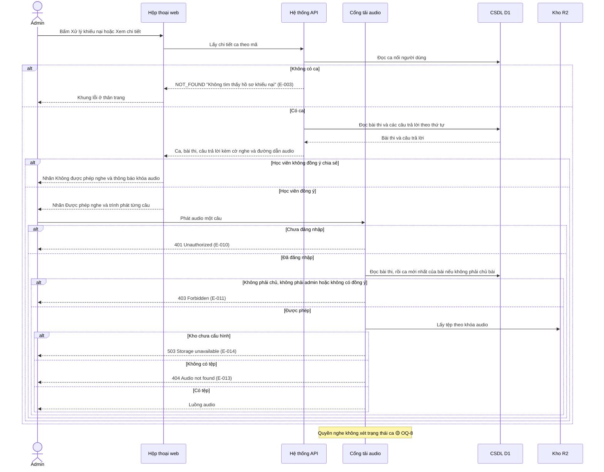
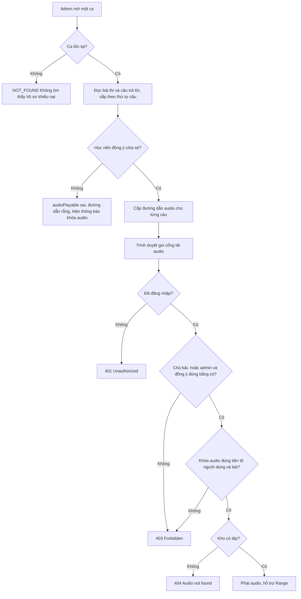
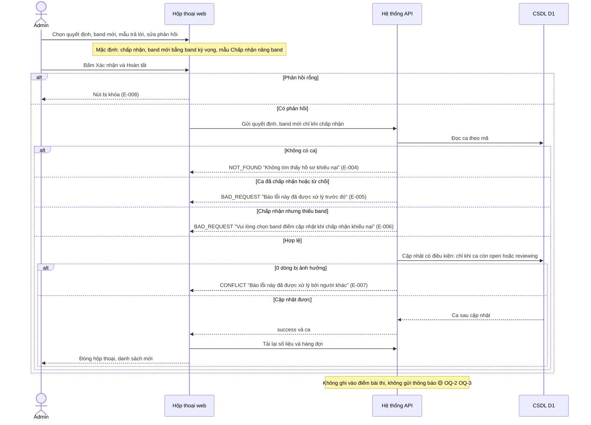
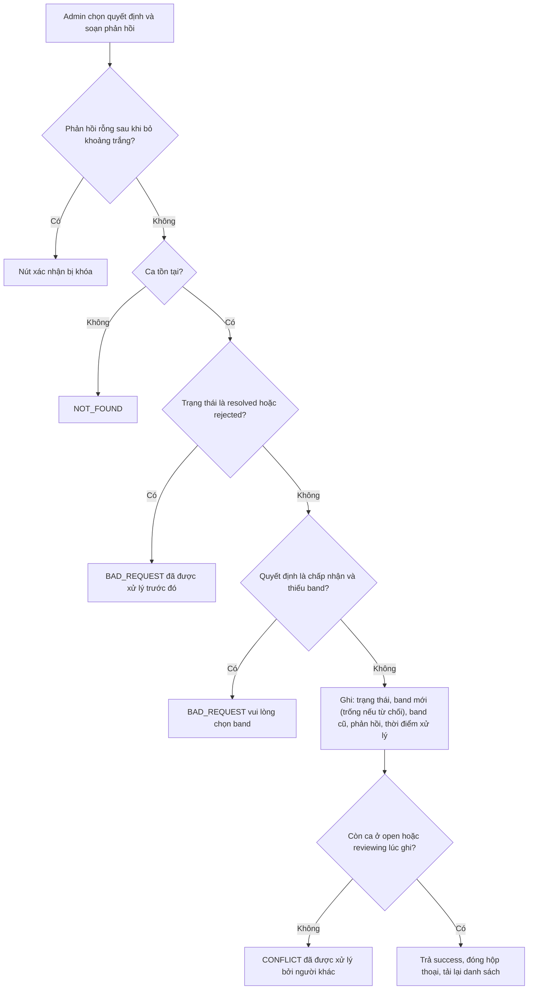
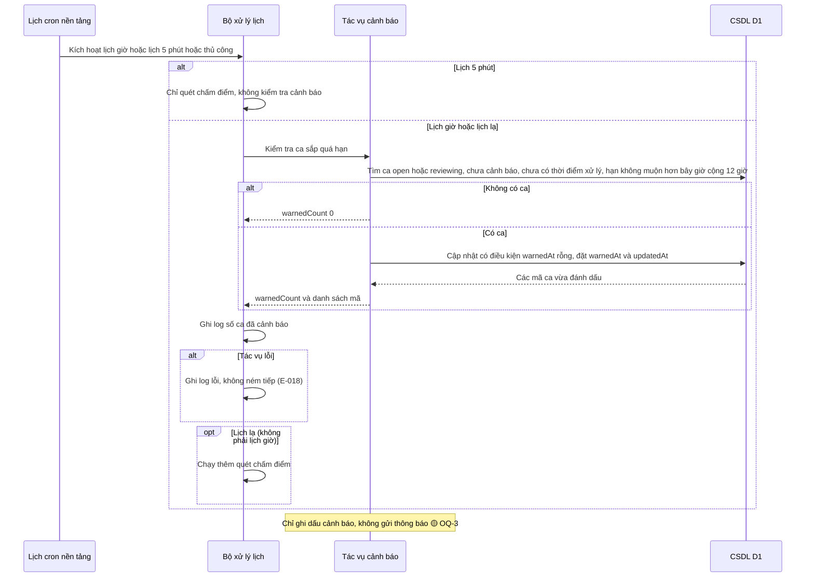
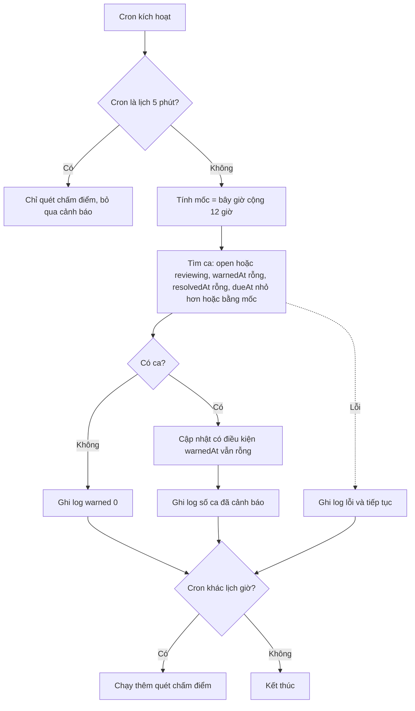

# dispute-admin — Flows tái lập (reverse)

> Chỉ vẽ bước có trong code (nguồn ở chú thích). Bước suy đoán gắn 🔵/🟡. status: draft, CHƯA duyệt.

## Flow: Vào màn quản trị và xem hàng đợi + số liệu

### Sequence — Vào màn quản trị và xem hàng đợi + số liệu

### Activity — Vào màn quản trị và xem hàng đợi + số liệu

## Flow: Xem chi tiết ca và nghe audio theo đồng ý

### Sequence — Xem chi tiết ca và nghe audio theo đồng ý

### Activity — Xem chi tiết ca và nghe audio theo đồng ý

## Flow: Giải quyết hoặc từ chối ca kèm phản hồi

### Sequence — Giải quyết hoặc từ chối ca kèm phản hồi

### Activity — Giải quyết hoặc từ chối ca kèm phản hồi

## Flow: Cảnh báo sắp quá hạn bằng tác vụ định kỳ mỗi giờ

### Sequence — Cảnh báo sắp quá hạn bằng tác vụ định kỳ mỗi giờ

### Activity — Cảnh báo sắp quá hạn bằng tác vụ định kỳ mỗi giờ

