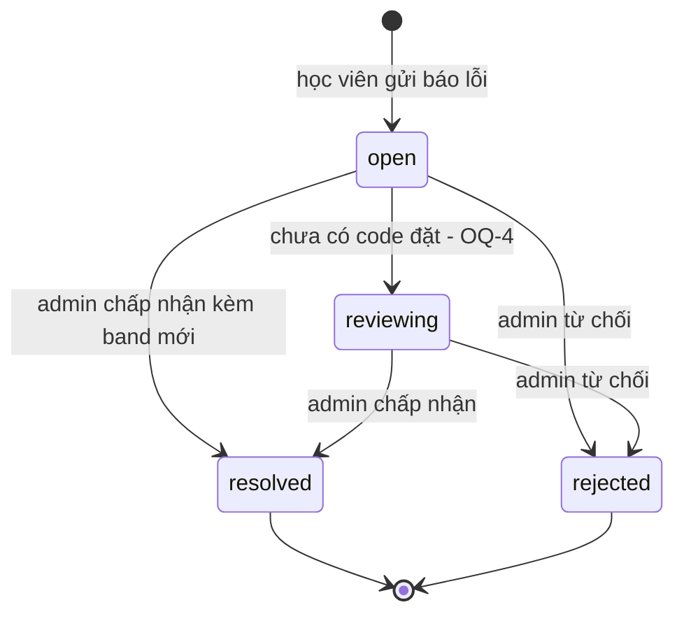
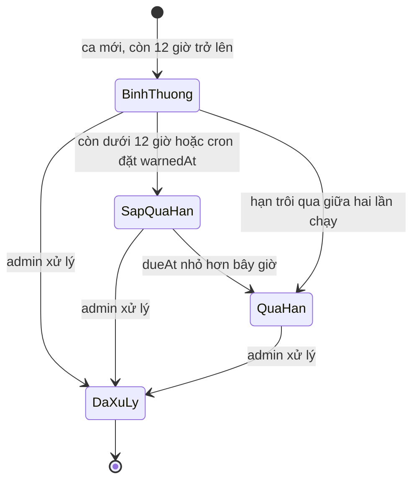

# dispute-admin — States tái lập (reverse)

## State: Ca khiếu nại (score_dispute.status)

> Nguồn: ✅ [S14:25-27][S1:244-282][S17:96]. Tạo ca thuộc feature score-dispute. Trạng thái `reviewing` được công nhận ở schema, bộ lọc, điều kiện ghi và cron nhưng KHÔNG có code đặt vào (🟡 OQ-4).

**Ghi chú trạng thái:**

| Trạng thái | Ý nghĩa | Vào bằng | Ra bằng | Nguồn | Nhãn |
|-----------|---------|----------|---------|-------|------|
| open | Ca mới, chờ xử lý (mặc định) | Học viên gửi báo lỗi (ghi trạng thái "open") | Admin chấp nhận hoặc từ chối | S14:25-27, S17:96, S1:272 | ✅ |
| reviewing | Đang xem xét; được xử lý như open ở mọi truy vấn (bộ lọc "open", điều kiện ghi, cron, ràng buộc 1 ca đang xử lý/bài) | Không có code đặt | Admin chấp nhận hoặc từ chối | S14:25, S1:102, S1:272, S3:30, S14:46 | 🟡 |
| resolved | Đã chấp nhận, có band mới, có phản hồi, có thời điểm xử lý | Admin chấp nhận từ open/reviewing | Không (cuối; không có luồng mở lại) | S1:244-267 | ✅ |
| rejected | Đã từ chối, band mới trống, có phản hồi, có thời điểm xử lý | Admin từ chối từ open/reviewing | Không (cuối) | S1:244-267 | ✅ |

## State: Dấu cảnh báo và cờ hạn của ca chưa xử lý (suy ra, không phải cột trạng thái)

> Nguồn: ✅ [S1:132-137][S3:16-65]. Đây là các cờ phái sinh, không phải trạng thái lưu; gộp lại để dễ hiểu vòng đời hạn xử lý.

| Trạng thái phái sinh | Ý nghĩa | Vào bằng | Ra bằng | Nguồn | Nhãn |
|----------------------|---------|----------|---------|-------|------|
| BinhThuong | Chưa xử lý, còn từ 12 giờ trở lên đến hạn và chưa có dấu cảnh báo | Ca mới | Qua mốc 12 giờ hoặc được xử lý | S1:134-136 | ✅ |
| SapQuaHan | Chưa xử lý và (có dấu cảnh báo hoặc còn dưới 12 giờ); cũng đúng cho ca đã quá hạn | Cron đặt dấu cảnh báo hoặc thời gian trôi | Quá hạn hoặc được xử lý | S1:134-136, S3:16-65 | ✅ |
| QuaHan | Chưa xử lý và hạn nhỏ hơn bây giờ (vẫn tính là sắp quá hạn) | Thời gian trôi | Được xử lý | S1:137 | ✅ |
| DaXuLy | Có thời điểm xử lý hoặc trạng thái resolved/rejected; cờ hạn tắt | Admin xử lý | Cuối | S1:133 | ✅ |

**Lưu ý:** dấu cảnh báo (warnedAt) không bị xóa khi ca được xử lý; cờ hạn của ca đã xử lý bị tắt bằng điều kiện "đã xử lý", không bằng việc xóa dấu. ✅ [S1:133-137, S1:259-268]
