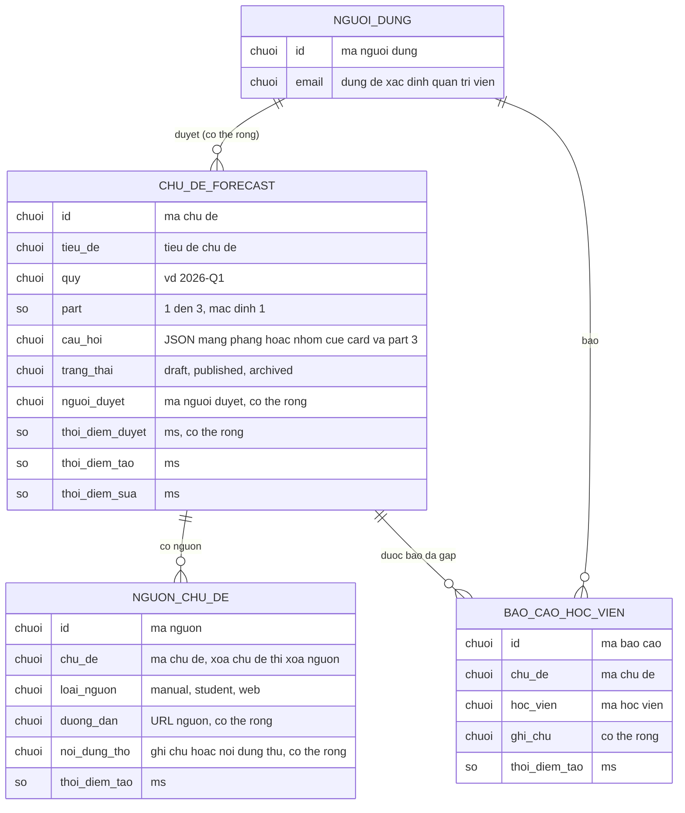

# forecast-curation — ERD tái lập (reverse)

## Entity Reference

| Entity | Mô tả nghiệp vụ | Thuộc tính chính | Nguồn | Nhãn |
|--------|-----------------|------------------|-------|------|
| Chủ đề forecast | Một đề dự đoán theo quý và part, có vòng đời nháp → đã duyệt → lưu trữ | tiêu đề, quý, part (mặc định 1), câu hỏi (JSON, mặc định mảng rỗng), trạng thái (mặc định nháp), người duyệt, thời điểm duyệt, thời điểm tạo/sửa | packages/db/src/schema/forecast.ts:6-36 | ✅ |
| Nguồn chủ đề | Nguồn gốc của một đề, phục vụ đối chiếu | loại (manual / student / web), đường dẫn, nội dung thô | packages/db/src/schema/forecast.ts:38-58 | ✅ |
| Báo cáo học viên | Một học viên báo đã gặp một đề; feature này chỉ đọc để đếm | ghi chú, thời điểm tạo | packages/db/src/schema/forecast.ts:60-82 | ✅ |
| Người dùng | Chủ thể xác thực, là người duyệt và học viên báo | id, email | packages/db/src/schema/forecast.ts:4,19-22,69-71 | ✅ |
| Ý nghĩa nghiệp vụ của "nguồn student" so với "báo cáo học viên" | Hai khái niệm tách bảng, chưa rõ quan hệ | — | packages/db/src/schema/forecast.ts:38-82 | 🟡 |

## Quan hệ

| Từ | Đến | Bản số | Ý nghĩa | Nguồn | Nhãn |
|----|-----|--------|---------|-------|------|
| Người dùng | Chủ đề forecast | 1 - 0..N | Người duyệt; xóa người dùng thì người duyệt đặt rỗng | packages/db/src/schema/forecast.ts:19-22 | ✅ |
| Chủ đề forecast | Nguồn chủ đề | 1 - 0..N | Đề có nhiều nguồn; xóa đề thì xóa nguồn | packages/db/src/schema/forecast.ts:44-46 | ✅ |
| Chủ đề forecast | Báo cáo học viên | 1 - 0..N | Đề được nhiều học viên báo; xóa đề thì xóa báo cáo | packages/db/src/schema/forecast.ts:66-68 | ✅ |
| Người dùng | Báo cáo học viên | 1 - 0..N | Học viên báo; xóa người dùng thì xóa báo cáo; mỗi cặp (học viên, đề) tối đa một báo cáo | packages/db/src/schema/forecast.ts:69-71,78 | ✅ |

## Notes

* Tên thực trong cơ sở dữ liệu: `forecast_topic`, `forecast_source`, `forecast_report` (packages/db/src/schema/forecast.ts:7,39,61). ERD dùng tên nghiệp vụ không dấu để mermaid sạch.
* Cột câu hỏi là chuỗi JSON, hai dạng: mảng chuỗi, hoặc object có `cueCards`, `part3` và `isNew` tùy chọn. Cột trạng thái không có CHECK trong migration (packages/db/src/migrations/20261105120834_parallel_zzzax/migration.sql:21-33). ✅
* Không mô hình: bảng người dùng đầy đủ (thuộc `auth-account`), các chỉ mục (quý, trạng thái, người duyệt, loại nguồn, mã đề) — có trong packages/db/src/schema/forecast.ts:31-35,54-57,77-81.
* Không có khóa duy nhất theo (quý, part, tiêu đề): hai đề trùng tiêu đề cùng tồn tại được. ✅ (đọc toàn bộ schema) 
