# forecast-curation — Flows tái lập (reverse)

> Chỉ vẽ bước CÓ trong code. Bước suy đoán chú thích 🔵/🟡. Nguồn từng flow ghi ngay dưới tiêu đề.

## Flow: F1 Vào màn hình quản trị

Nguồn ✅: apps/web/src/routes/admin/forecast.tsx:9-27; packages/api/src/index.ts:15-38; packages/api/src/routers/forecast-admin.ts:17-19.

### Sequence — F1 Vào màn hình quản trị

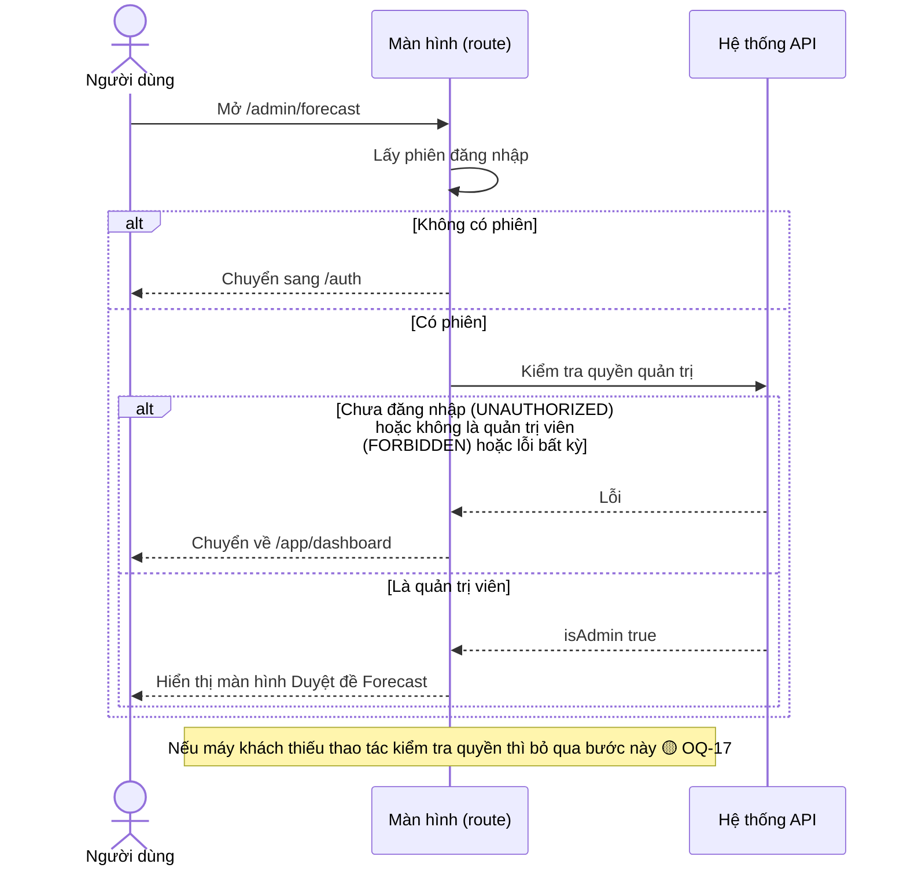

### Activity — F1 Vào màn hình quản trị

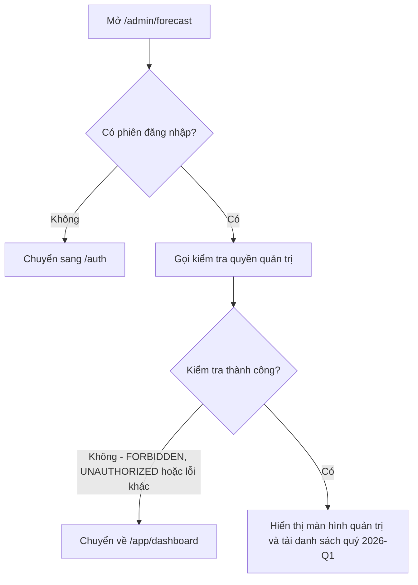

## Flow: F2 Xem danh sách bản nháp theo quý

Nguồn ✅: apps/web/src/features/admin/forecast-admin-screen.tsx:73-100,249-252; packages/api/src/routers/forecast-admin.ts:21-105.

### Sequence — F2 Xem danh sách bản nháp

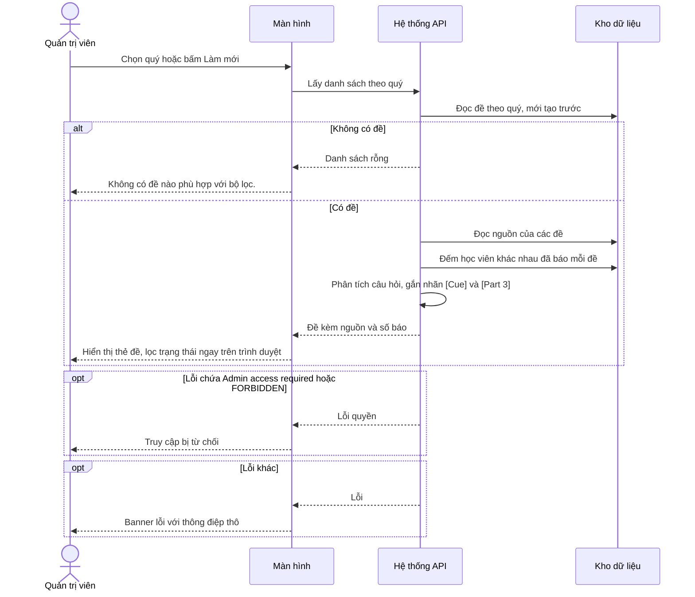

### Activity — F2 Xem danh sách bản nháp

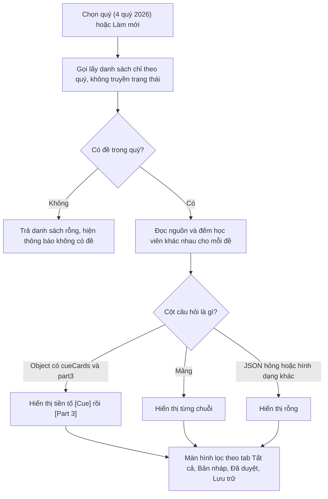

## Flow: F3 Tạo bản nháp thủ công

Nguồn ✅: apps/web/src/features/admin/forecast-admin-screen.tsx:166-233; packages/api/src/routers/forecast-admin.ts:107-193.

### Sequence — F3 Tạo bản nháp thủ công

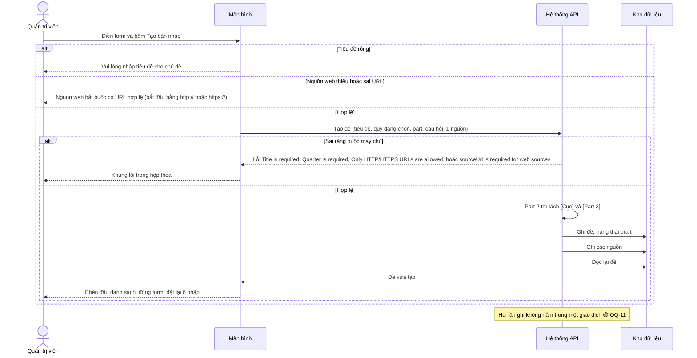

### Activity — F3 Tạo bản nháp thủ công

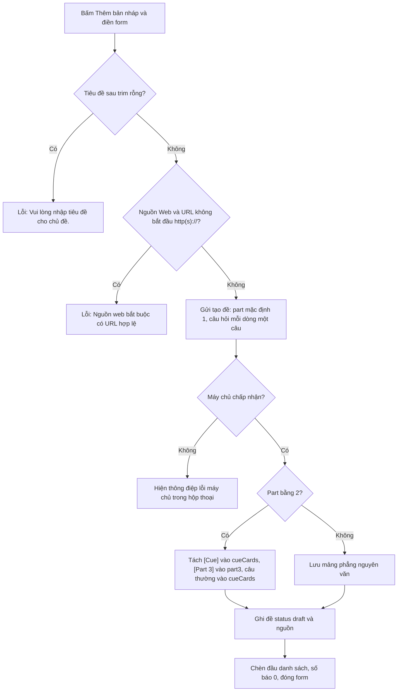

## Flow: F4 Nhập nguồn thô và gộp trùng

Nguồn ✅: packages/api/src/routers/forecast-admin.ts:368-438; packages/api/src/forecast/dedupe.ts:124-239. Không có màn hình gọi flow này 🟡 (OQ-2). Actor gọi là quản trị viên qua API.

### Sequence — F4 Nhập nguồn thô và gộp trùng

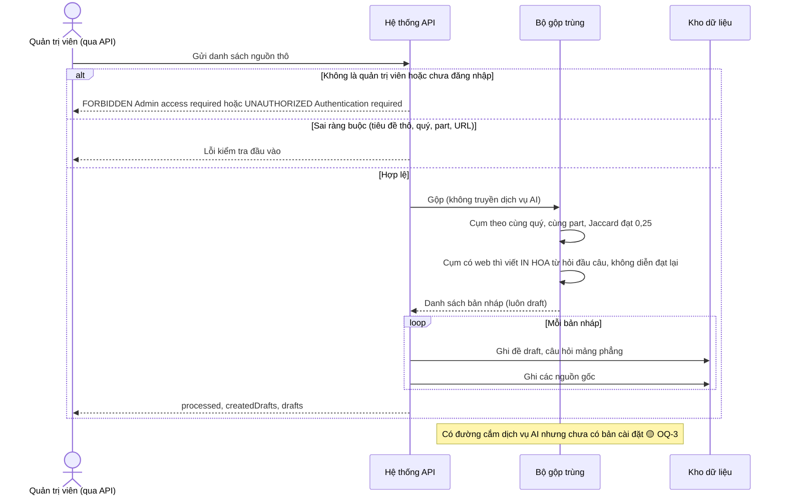

### Activity — F4 Nhập nguồn thô và gộp trùng

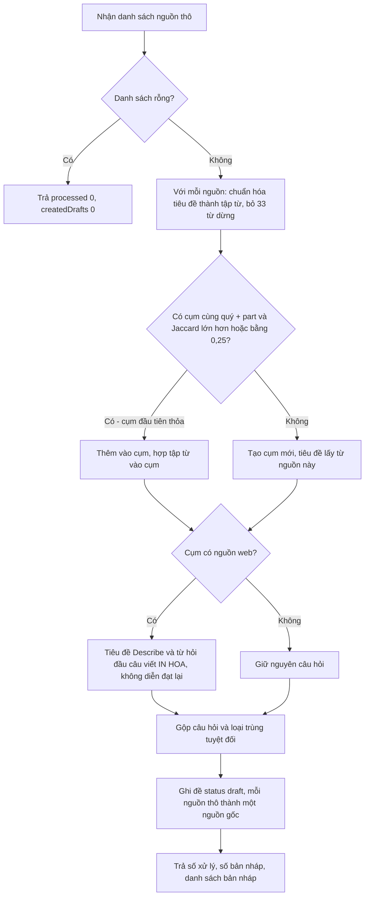

## Flow: F5 Sửa bản nháp

Nguồn ✅: apps/web/src/features/admin/forecast-admin-screen.tsx:136-164,418-430,463-508; packages/api/src/routers/forecast-admin.ts:195-274.

### Sequence — F5 Sửa bản nháp

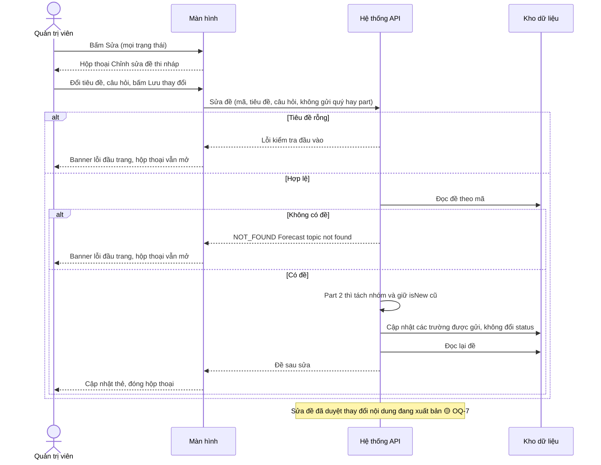

### Activity — F5 Sửa bản nháp

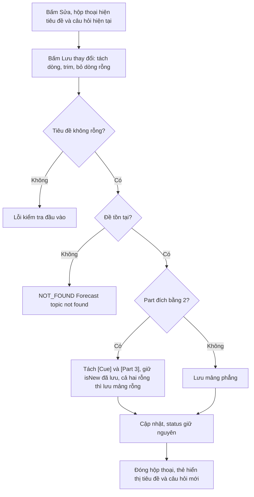

## Flow: F6 Duyệt (xuất bản) đề

Nguồn ✅: apps/web/src/features/admin/forecast-admin-screen.tsx:102-119,432-441; packages/api/src/routers/forecast-admin.ts:276-323.

### Sequence — F6 Duyệt đề

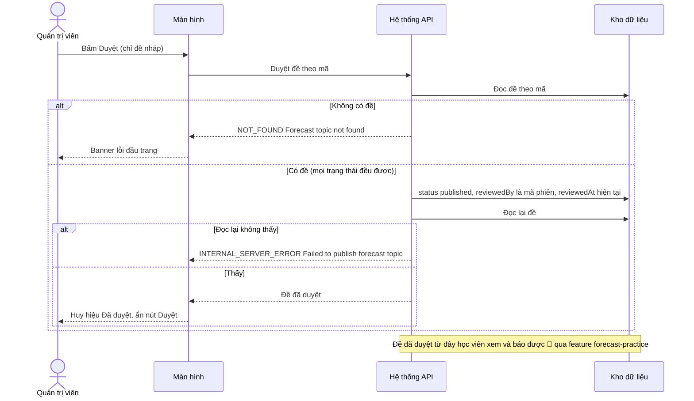

### Activity — F6 Duyệt đề

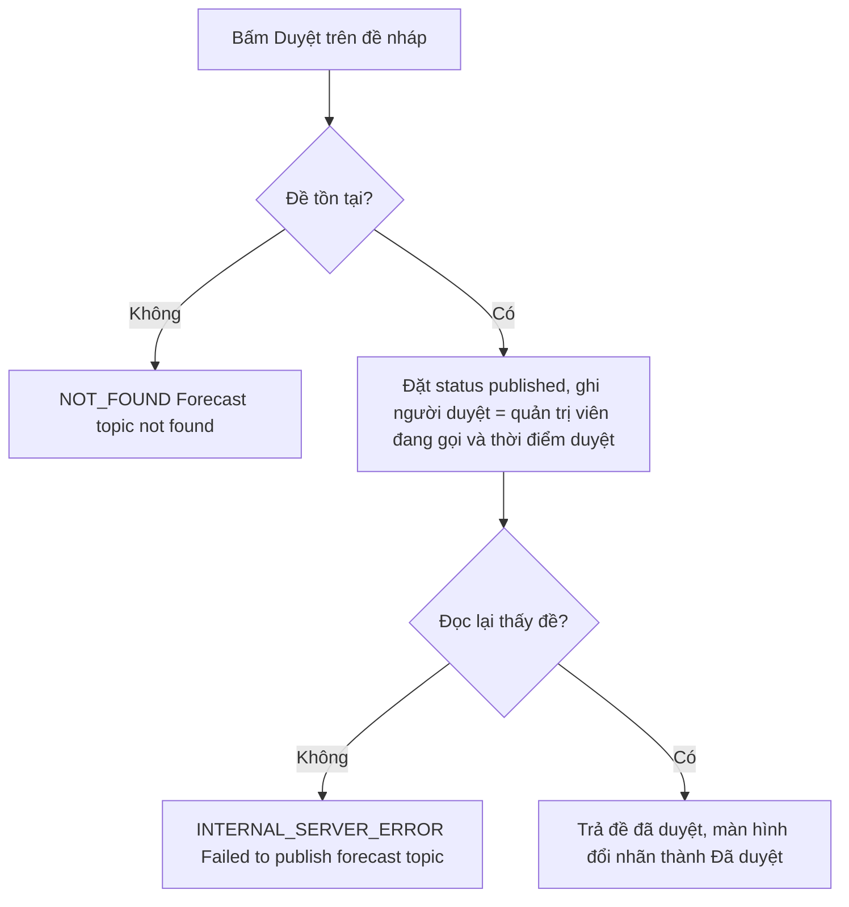

## Flow: F7 Lưu trữ đề

Nguồn ✅: apps/web/src/features/admin/forecast-admin-screen.tsx:121-134,443-453; packages/api/src/routers/forecast-admin.ts:325-366.

### Sequence — F7 Lưu trữ đề

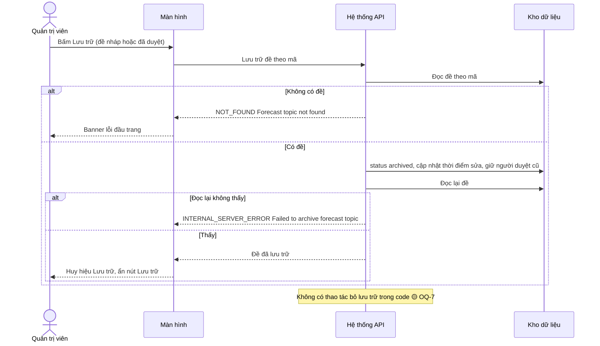

### Activity — F7 Lưu trữ đề

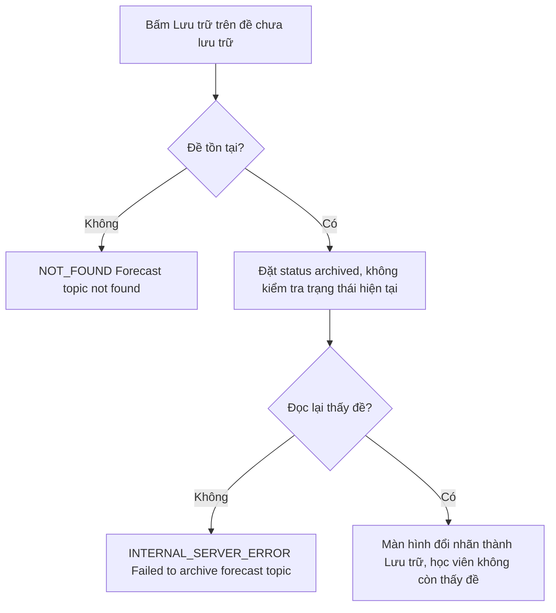
