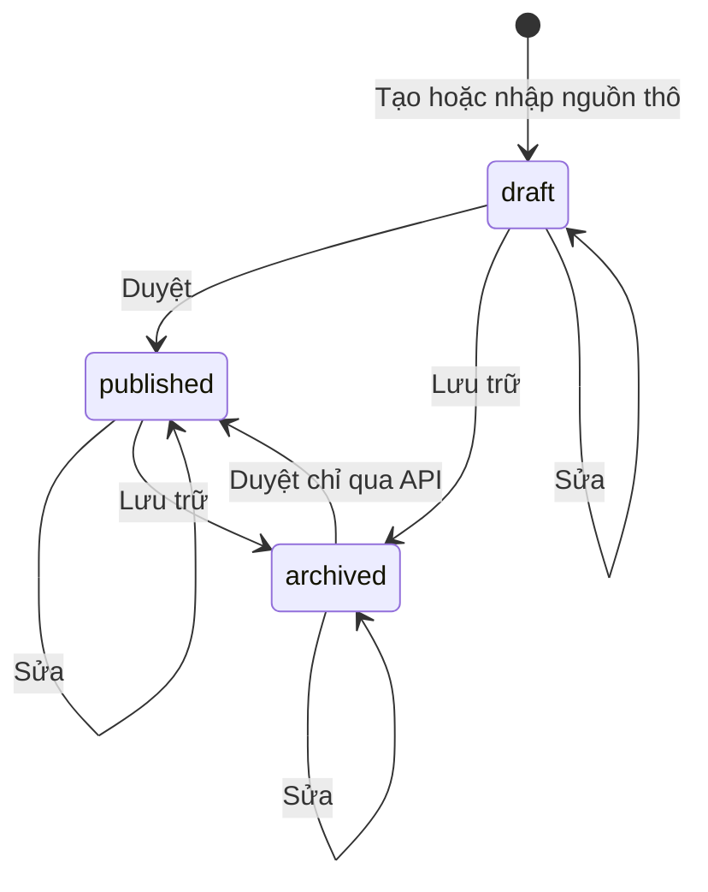

# forecast-curation — States tái lập (reverse)

Chỉ entity Chủ đề forecast có nhiều trạng thái. Nguồn và báo cáo học viên không có trạng thái (xem ERD), nên không vẽ state diagram riêng.

## State: Chủ đề forecast (draft / published / archived)

> Nguồn: ✅ [packages/db/src/schema/forecast.ts:16-18; packages/api/src/routers/forecast-admin.ts:162,303,347,406]. Mọi cạnh dưới đây là khả năng của máy chủ; giao diện che bớt cạnh (xem ghi chú). Không có cạnh nào đi về draft.

**Ghi chú trạng thái:**

| Trạng thái | Ý nghĩa | Vào bằng | Ra bằng | Nguồn | Nhãn |
|-----------|---------|----------|---------|-------|------|
| draft | Bản nháp, chưa có người duyệt/thời điểm duyệt, học viên không thấy | Tạo tay, nhập nguồn thô, kết quả AI (luôn draft) | Duyệt → published; Lưu trữ → archived | packages/api/src/routers/forecast-admin.ts:162,406; packages/api/src/forecast/dedupe.ts:150,233 | ✅ |
| published | Đã duyệt: ghi người duyệt và thời điểm duyệt; học viên xem và báo được | Duyệt từ bất kỳ trạng thái (máy chủ không kiểm tra), UI chỉ cho từ draft | Lưu trữ → archived; Duyệt lại → published (ghi đè người duyệt) | packages/api/src/routers/forecast-admin.ts:283-308; packages/api/src/routers/forecast.ts:38 | ✅ |
| archived | Lưu trữ: học viên không còn thấy; người duyệt cũ giữ nguyên | Lưu trữ từ bất kỳ trạng thái | Duyệt → published (máy chủ cho, UI không có nút); không có đường về draft | packages/api/src/routers/forecast-admin.ts:332-351; apps/web/src/features/admin/forecast-admin-screen.tsx:432,443 | ✅ |
| Ý nghĩa nghiệp vụ "đã duyệt = đang xuất bản", "lưu trữ = rút khỏi học viên" (suy luận; hành vi học viên chỉ thấy published đã nêu ở các dòng trên) | Suy từ lọc của phía học viên chỉ lấy published | — | — | packages/api/src/routers/forecast.ts:38,101-106 | 🟡 |
| Có chủ ý cho phép các cạnh archived → published, published → published và Sửa ở mọi trạng thái | Code không có kiểm tra, không có test, không có tài liệu | — | — | packages/api/src/routers/forecast-admin.ts:206-259,283-308 | 🟡 |

**Cạnh bị che bởi giao diện:** nút Duyệt chỉ ở draft (apps/web/src/features/admin/forecast-admin-screen.tsx:432); nút Lưu trữ ẩn ở archived (dòng 443); nút Sửa luôn hiện (dòng 418-430). Test khẳng định: draft → published ghi người duyệt (packages/api/src/routers/forecast-admin.test.ts:182-202); tạo ra draft (packages/api/src/routers/forecast-admin.test.ts:105-142); sửa giữ draft (packages/api/src/routers/forecast-admin.test.ts:161-180); lưu trữ (packages/api/src/routers/forecast-admin.test.ts:204-217). Không test nào phủ cạnh còn lại.

**Trạng thái bổ sung (không phải máy trạng thái):** hình dạng dữ liệu câu hỏi có hai dạng — mảng phẳng và nhóm cue card / Part 3 (kèm cờ đề mới tùy chọn); sự chuyển giữa hai dạng xảy ra khi sửa câu hỏi đổi part đích (packages/api/src/routers/forecast-admin.ts:225-257). ✅
