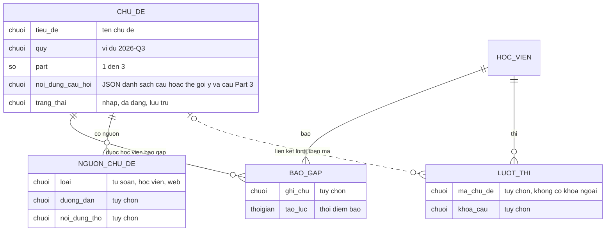

# forecast-practice — ERD tái lập (reverse)

## Entity Reference

| Entity | Mô tả nghiệp vụ | Thuộc tính chính | Nguồn | Nhãn |
|--------|-----------------|------------------|-------|------|
| CHU_DE | Chủ đề dự đoán của một quý; chỉ chủ đề đã đăng hiện cho học viên | tiêu đề, quý, Part (mặc định 1), nội dung câu hỏi (mặc định "[]"), trạng thái (mặc định nháp), người duyệt, thời điểm duyệt | packages/db/src/schema/forecast.ts:6-36 | ✅ |
| BAO_GAP | Một học viên báo đã gặp một chủ đề; cơ sở của "số thí sinh báo gặp" | chủ đề, học viên, ghi chú tùy chọn, thời điểm | packages/db/src/schema/forecast.ts:60-82 | ✅ |
| NGUON_CHU_DE | Nguồn gốc chủ đề, phục vụ quản trị, học viên không thấy | loại nguồn, đường dẫn, nội dung thô | packages/db/src/schema/forecast.ts:38-58 | ✅ |
| LUOT_THI | Lượt thi có thể gắn chủ đề và khóa câu khi luyện forecast (thuộc `mock-exam`) | mã chủ đề, khóa câu | packages/db/src/schema/attempt.ts:22-23 | ✅ |
| HOC_VIEN | Tài khoản người dùng (thuộc xác thực), chỉ nêu quan hệ | — | packages/db/src/schema/forecast.ts:19,69-71 | ✅ |

## Quan hệ

| Từ | Đến | Bản số | Ý nghĩa | Nguồn | Nhãn |
|----|-----|--------|---------|-------|------|
| CHU_DE | BAO_GAP | 1 - 0..n | Xóa chủ đề thì xóa báo gặp | packages/db/src/schema/forecast.ts:66-68 | ✅ |
| HOC_VIEN | BAO_GAP | 1 - 0..n | Xóa tài khoản thì xóa báo gặp; duy nhất theo cặp học viên và chủ đề | packages/db/src/schema/forecast.ts:69-71,78 | ✅ |
| CHU_DE | NGUON_CHU_DE | 1 - 0..n | Xóa chủ đề thì xóa nguồn | packages/db/src/schema/forecast.ts:44-46 | ✅ |
| CHU_DE | LUOT_THI | 0..1 - 0..n (liên kết lỏng) | Lượt thi lưu mã chủ đề dạng chữ, không có khóa ngoại | packages/db/src/schema/attempt.ts:22 | ✅ |
| CHU_DE | HOC_VIEN (người duyệt) | n - 0..1 | Người duyệt đặt null khi tài khoản bị xóa | packages/db/src/schema/forecast.ts:19-21 | ✅ |

## Notes

* Danh sách lưu, band đã luyện, phiên luyện là trạng thái trình duyệt, không phải bảng nên không vẽ trong ERD (xem Mục 8 của spec).
* Thuộc tính kỹ thuật (khóa chính, chỉ mục, dấu thời gian cập nhật) cố ý không đưa vào; có trong nguồn.
* Bảng lượt thi chỉ vẽ phần liên quan đến chủ đề; chi tiết thuộc `mock-exam`.
