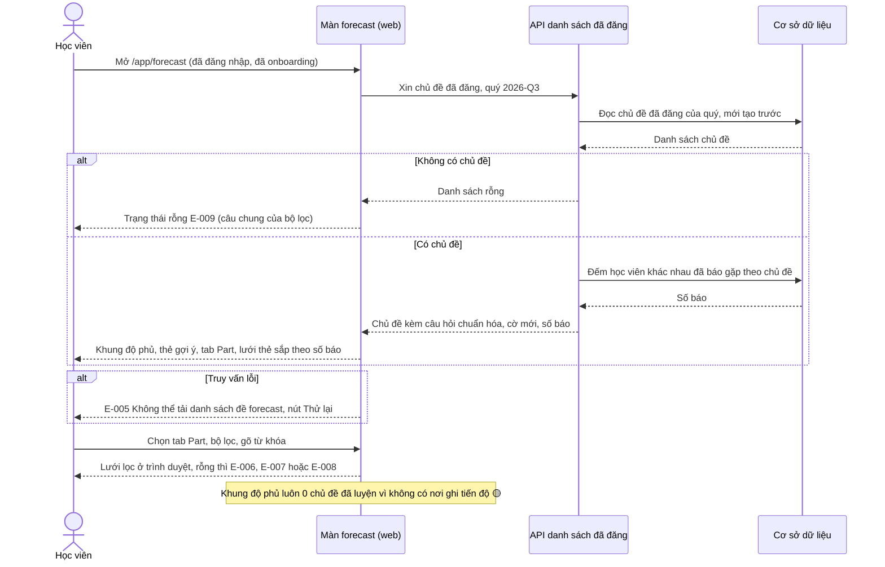
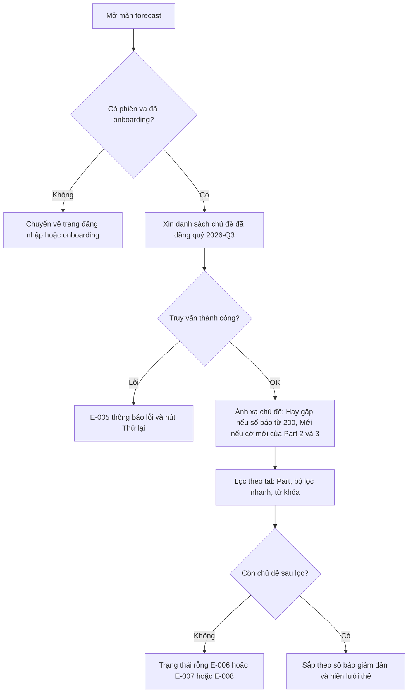
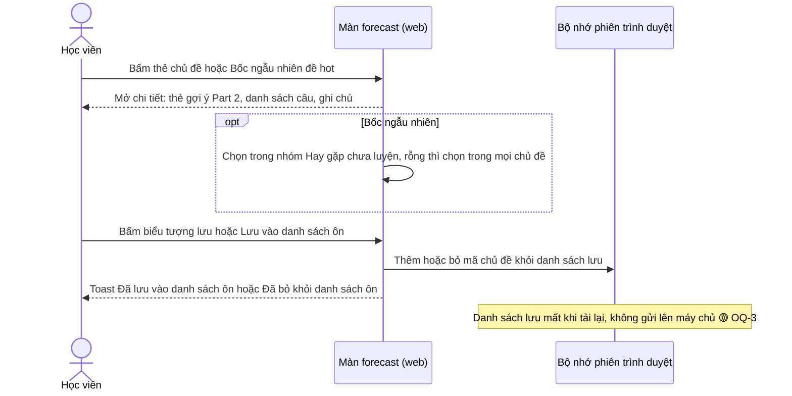
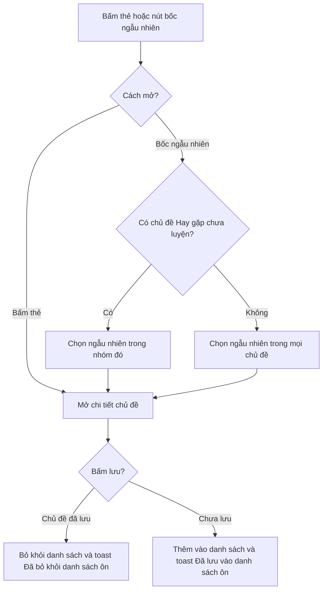
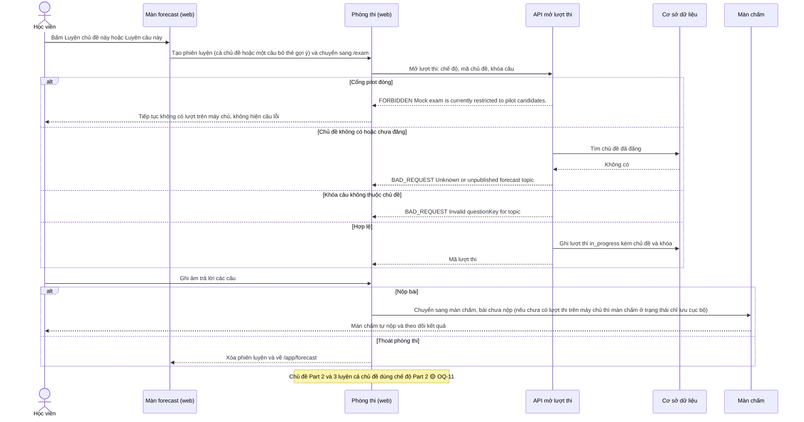
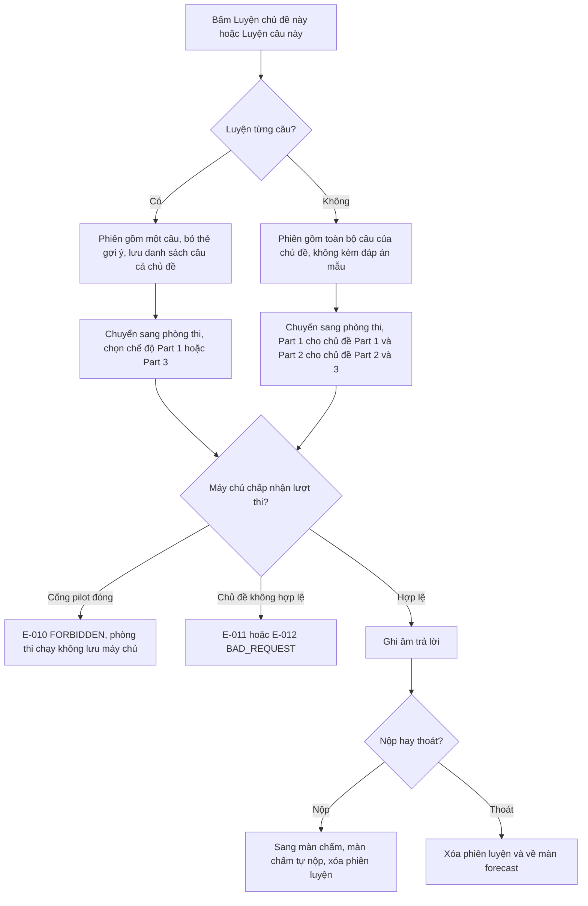
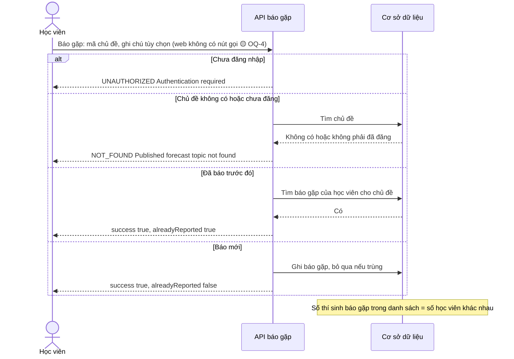
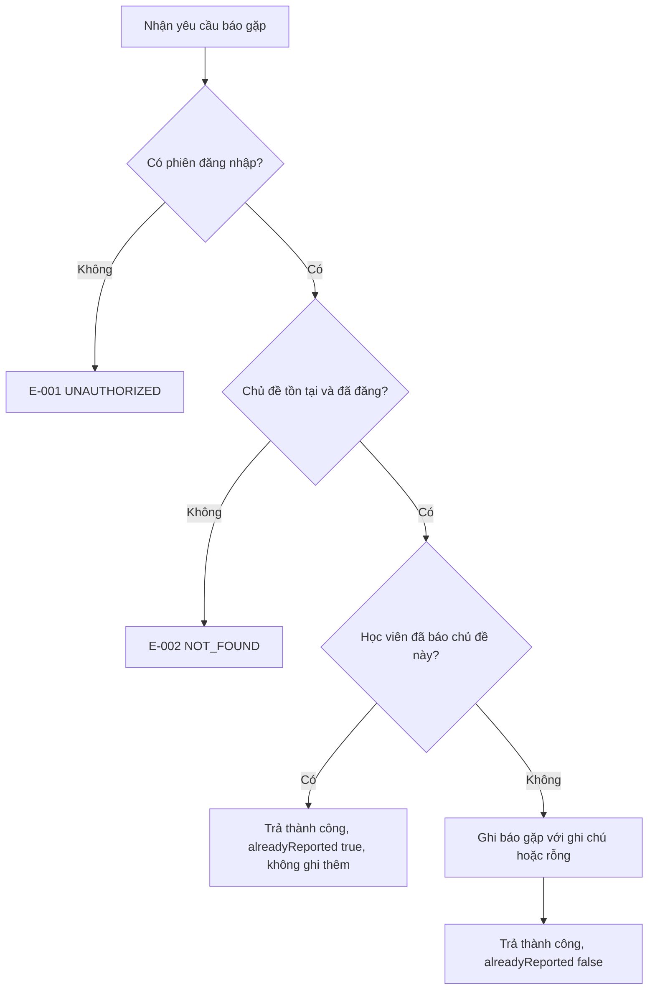
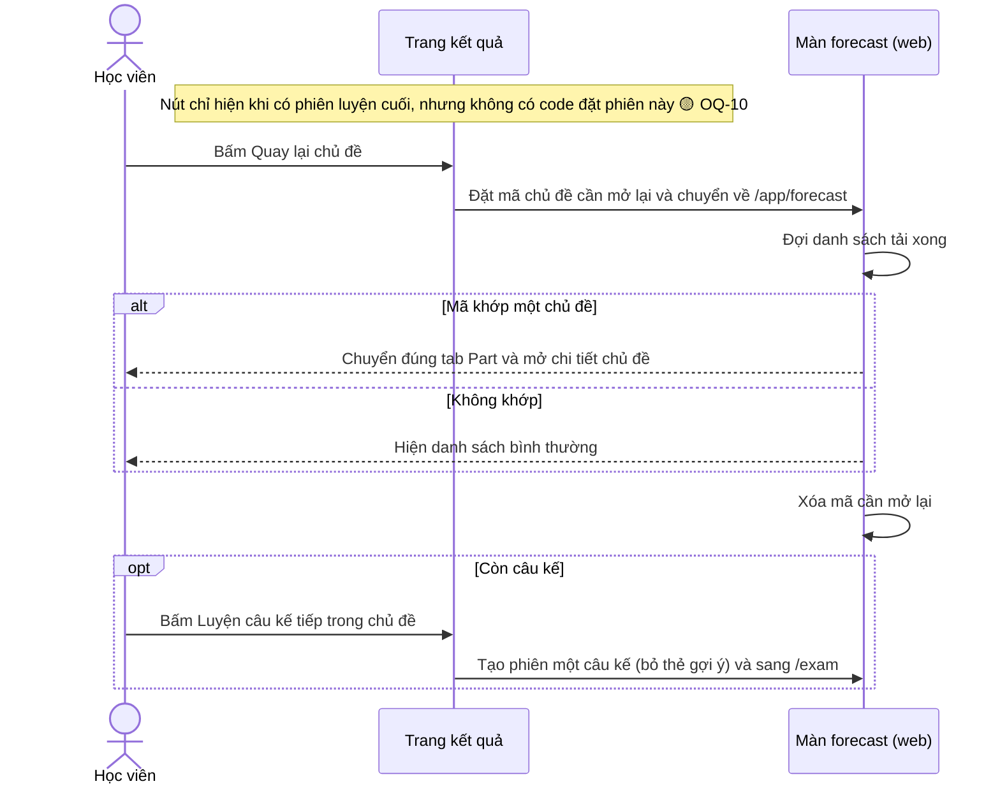
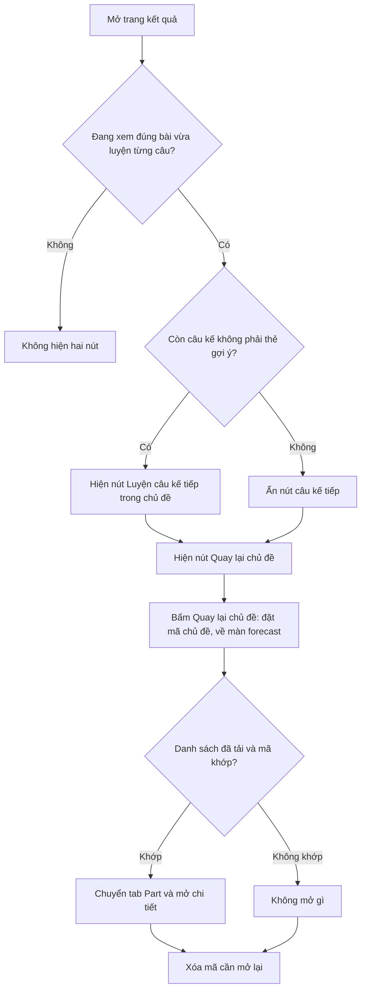

# forecast-practice — Flows tái lập (reverse)

> Nguồn và nhãn theo `../forecast-practice-reverse-spec.md`. Chỉ vẽ bước có trong code. Bước suy đoán ghi chú 🔵/🟡.

## Flow: F1 Xem, lọc và tìm chủ đề

### Sequence — F1 Xem, lọc và tìm chủ đề

### Activity — F1 Xem, lọc và tìm chủ đề

## Flow: F2 Xem chi tiết và lưu chủ đề

### Sequence — F2 Xem chi tiết và lưu chủ đề

### Activity — F2 Xem chi tiết và lưu chủ đề

## Flow: F3 Luyện cả chủ đề hoặc từng câu

### Sequence — F3 Luyện cả chủ đề hoặc từng câu

### Activity — F3 Luyện cả chủ đề hoặc từng câu

## Flow: F4 Báo đã gặp chủ đề

### Sequence — F4 Báo đã gặp chủ đề

### Activity — F4 Báo đã gặp chủ đề

## Flow: F5 Quay lại chủ đề sau kết quả

### Sequence — F5 Quay lại chủ đề sau kết quả

### Activity — F5 Quay lại chủ đề sau kết quả

