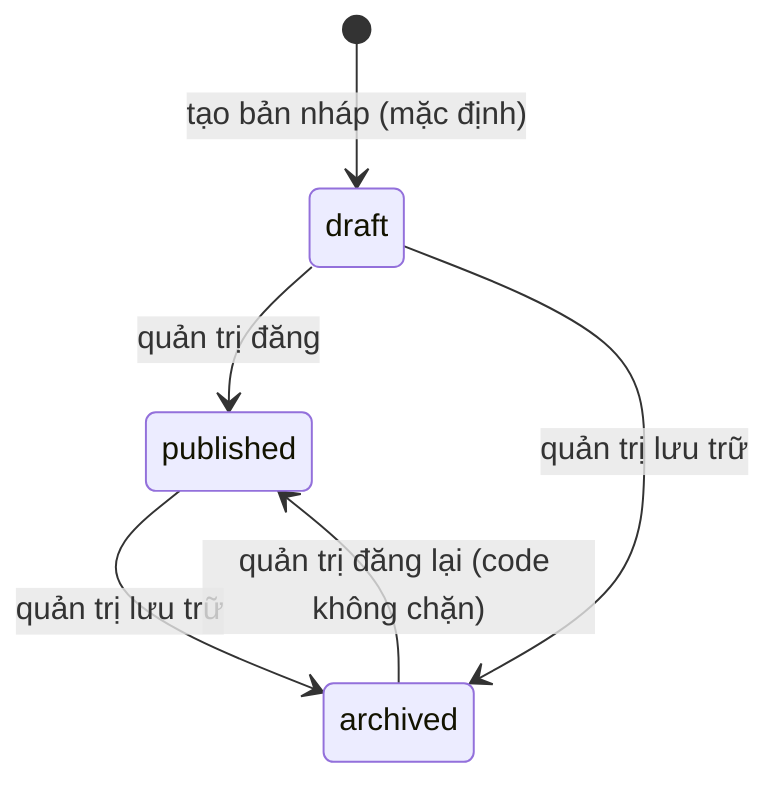
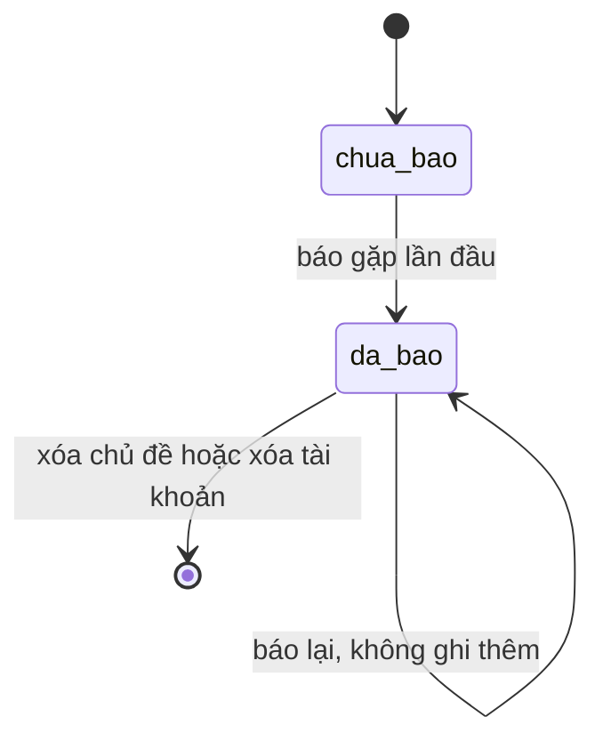
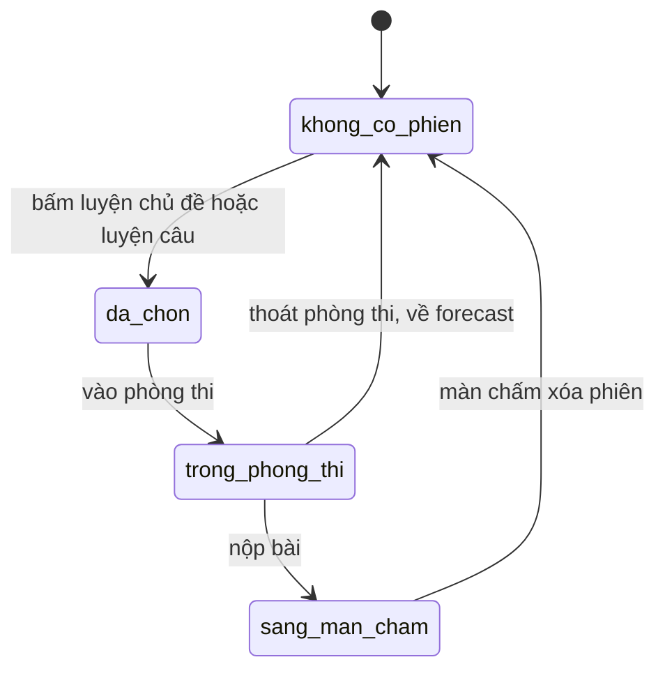

# forecast-practice — States tái lập (reverse)

## State: Chủ đề dự đoán (trạng thái đăng)

> Nguồn: ✅ [packages/db/src/schema/forecast.ts:16-18, packages/api/src/routers/forecast-admin.ts:276-362]. Học viên chỉ thấy trạng thái "đã đăng". Chuyển trạng thái do quản trị thực hiện (`forecast-curation`), chỉ nêu để biết điều kiện hiển thị. Code đăng và lưu trữ không kiểm tra trạng thái nguồn (từ bất kỳ trạng thái nào cũng chuyển được).

**Ghi chú trạng thái:**

| Trạng thái | Ý nghĩa | Vào bằng | Ra bằng | Nguồn | Nhãn |
|-----------|---------|----------|---------|-------|------|
| draft | Nháp, học viên không thấy, không báo/luyện được | Tạo mới (mặc định) | Đăng | packages/db/src/schema/forecast.ts:16-18 | ✅ |
| published | Hiện trong danh sách, báo gặp và mở lượt thi được | Quản trị đăng, ghi người duyệt và thời điểm | Lưu trữ | packages/api/src/routers/forecast-admin.ts:296-310 | ✅ |
| archived | Không còn hiện cho học viên | Quản trị lưu trữ | Code không chặn đăng lại | packages/api/src/routers/forecast-admin.ts:344-352 | 🟡 |

## State: Báo gặp của một học viên cho một chủ đề

> Nguồn: ✅ [packages/api/src/routers/forecast.ts:108-134, packages/db/src/schema/forecast.ts:78]. Trạng thái đơn giản, không có đường quay lại.

**Ghi chú trạng thái:**

| Trạng thái | Ý nghĩa | Vào bằng | Ra bằng | Nguồn | Nhãn |
|-----------|---------|----------|---------|-------|------|
| chua_bao | Chưa có bản ghi | Mặc định | Báo gặp | packages/api/src/routers/forecast.ts:108-117 | ✅ |
| da_bao | Có đúng một bản ghi, tính vào số thí sinh báo gặp | Báo gặp lần đầu | Xóa theo chủ đề hoặc tài khoản (cascade) | packages/api/src/routers/forecast.ts:124-134, packages/db/src/schema/forecast.ts:66-71 | ✅ |

## State: Phiên luyện chủ đề (phía trình duyệt)

> Nguồn: ✅ [apps/web/src/features/forecast/forecast-screen.tsx:100-121, apps/web/src/features/exam/exam-screen.tsx:131-139,179-184, apps/web/src/features/scoring/scoring-screen.tsx:31-36]. Phiên luyện được giữ ở sessionStorage; không phải bảng cơ sở dữ liệu.

**Ghi chú trạng thái:**

| Trạng thái | Ý nghĩa | Vào bằng | Ra bằng | Nguồn | Nhãn |
|-----------|---------|----------|---------|-------|------|
| khong_co_phien | Không có phiên luyện (thi thử thường) | Khởi tạo, thoát, sau chấm | Bấm luyện | apps/web/src/features/app-state/initial-state.ts:14 | ✅ |
| da_chon | Phiên gồm cả chủ đề hoặc một câu đã đặt | Bấm Luyện chủ đề / Luyện câu | Vào phòng thi | apps/web/src/features/forecast/forecast-screen.tsx:100-121 | ✅ |
| trong_phong_thi | Đang ghi âm trả lời | Chuyển /exam | Nộp hoặc thoát | apps/web/src/features/exam/exam-screen.tsx:131-139 | ✅ |
| sang_man_cham | Màn chấm nhận bài chưa nộp, tự nộp | Nộp bài | Màn chấm xóa phiên | apps/web/src/features/scoring/scoring-screen.tsx:31-36 | ✅ |

Phiên "luyện cuối" (dùng cho nút Quay lại chủ đề) không có trạng thái vì không có code đặt: 🟡 [OQ-10].
