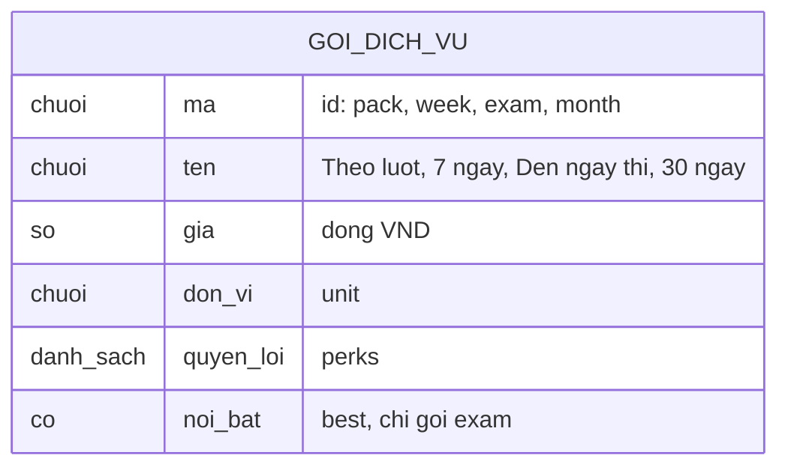

# landing-page — ERD tái lập (reverse)

## Lý do ERD rút gọn

Feature không đọc/ghi bảng nào ở máy chủ; không có migration hay schema thuộc landing (negative-search: không có import `@vox-flow/db` trong apps/web/src/features/landing). Chỉ có một danh sách gói tĩnh trong mã client dùng chung với billing. ERD dưới đây chỉ mô hình hoá danh sách đó. ✅ [apps/web/src/features/billing/data.ts:1-40]

## Entity Reference

| Entity | Mô tả nghiệp vụ | Thuộc tính chính | Nguồn | Nhãn |
|--------|-----------------|------------------|-------|------|
| Gói dịch vụ (tĩnh) | Gói trả phí hiển thị trên bảng giá; 4 gói, trang chủ hiển thị 3 (bỏ gói 30 ngày) | mã, tên, giá (49.000 / 99.000 / 349.000 / 249.000), đơn vị, quyền lợi, cờ nổi bật (chỉ "Đến ngày thi") | apps/web/src/features/billing/data.ts:10-40 | ✅ |
| Thẻ gói Miễn phí | Không thuộc danh sách gói; viết cứng trong thành phần bảng giá | tên, giá 0đ, 3 gạch đầu dòng | apps/web/src/features/landing/components/pricing-teaser.tsx:18-29 | ✅ |

## Quan hệ

Không có quan hệ giữa các thực thể (dữ liệu tĩnh, không khoá ngoại).

| Từ | Đến | Bản số | Ý nghĩa | Nguồn | Nhãn |
|----|-----|--------|---------|-------|------|
| — | — | — | — | — | — |

## Notes

* Không mô hình hoá: hồ sơ/phiên người dùng (thuộc auth/profile), kết quả chấm (thuộc scoring). Thẻ xem trước ở hero là dữ liệu minh hoạ cứng, không phải thực thể (apps/web/src/features/landing/components/hero.tsx:8-13).
* Lý do bảng giá dùng danh sách gói dùng chung thay vì dữ liệu riêng: code không nói (🟡, OQ-12).
