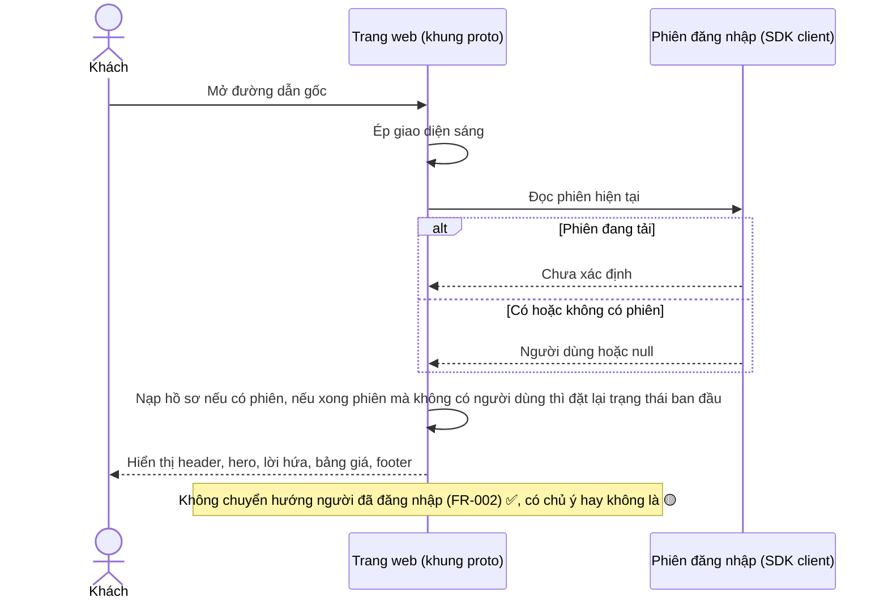
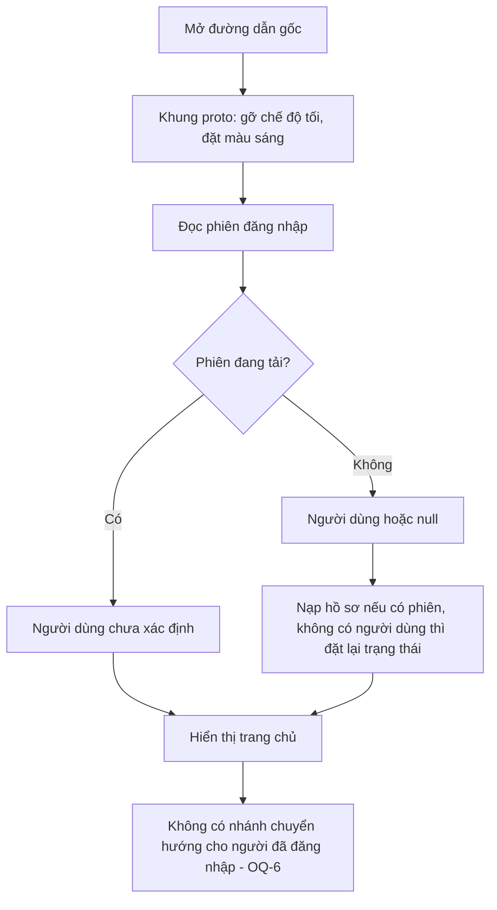
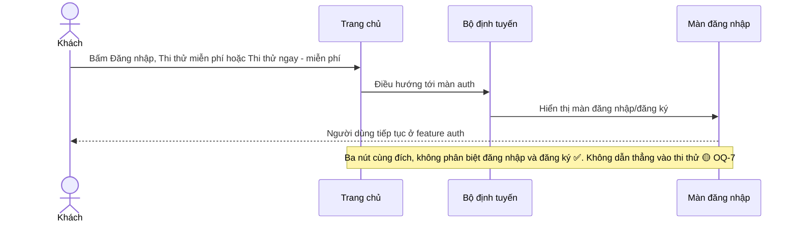
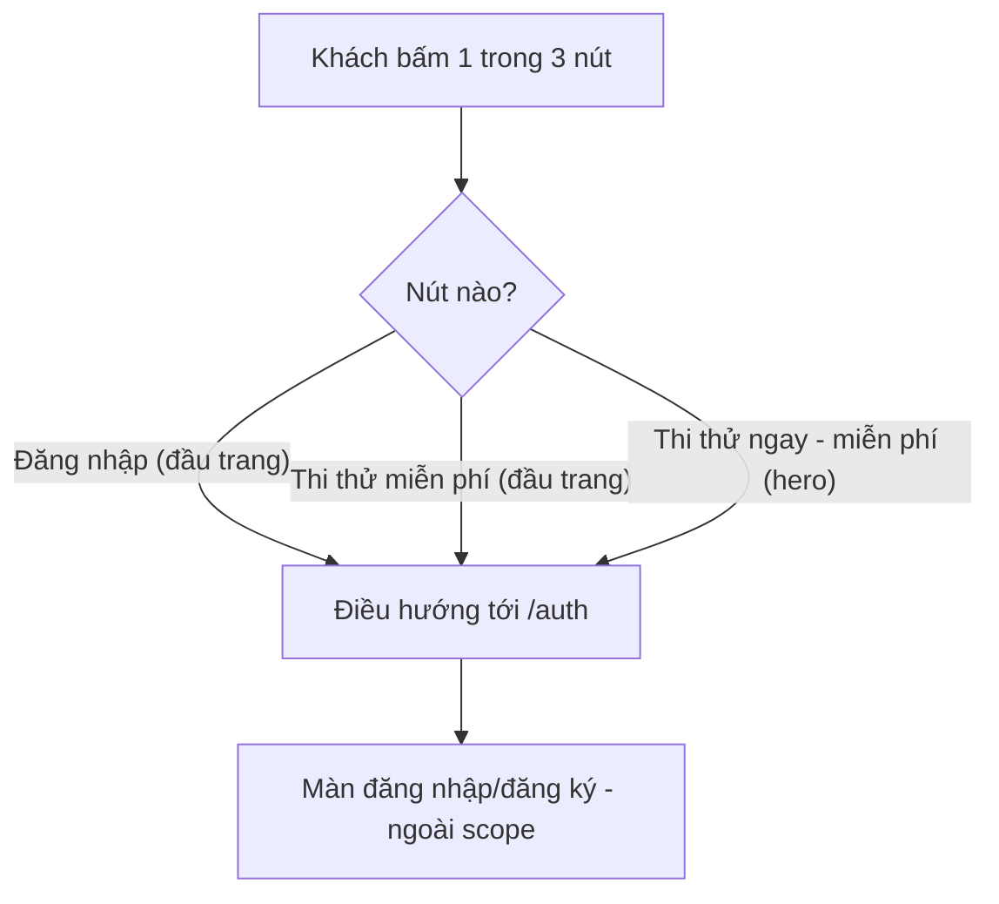
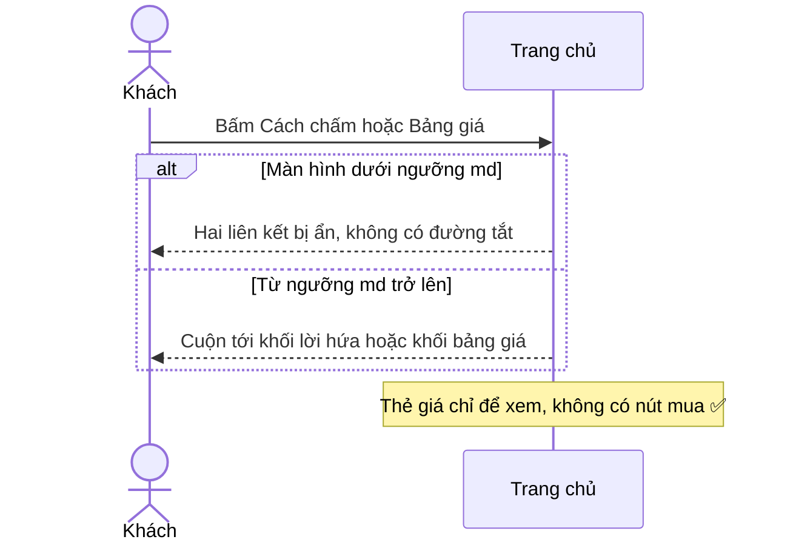
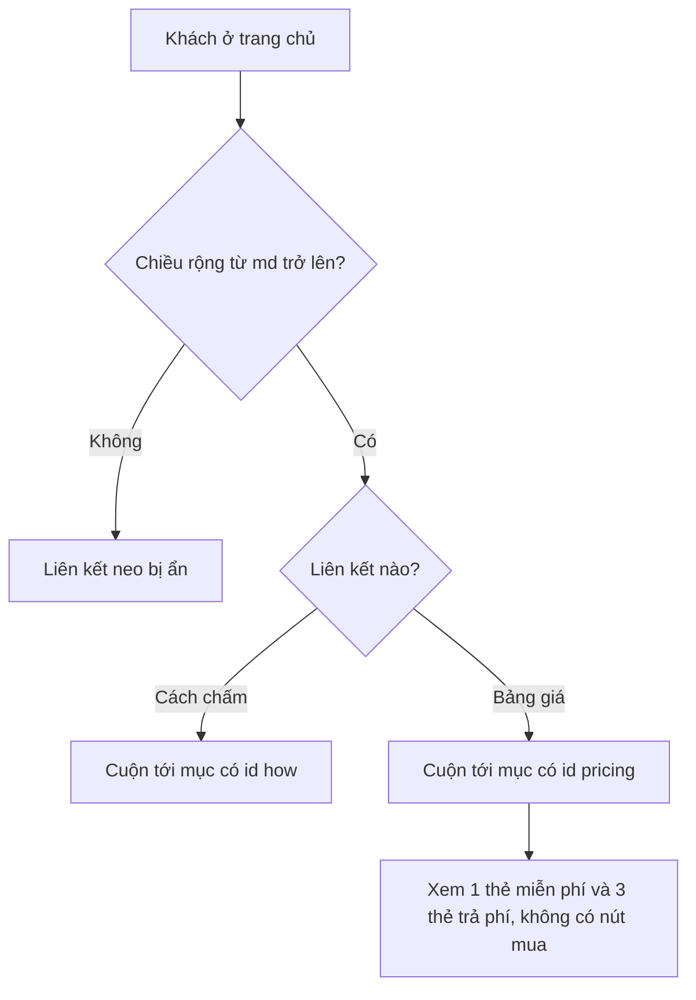
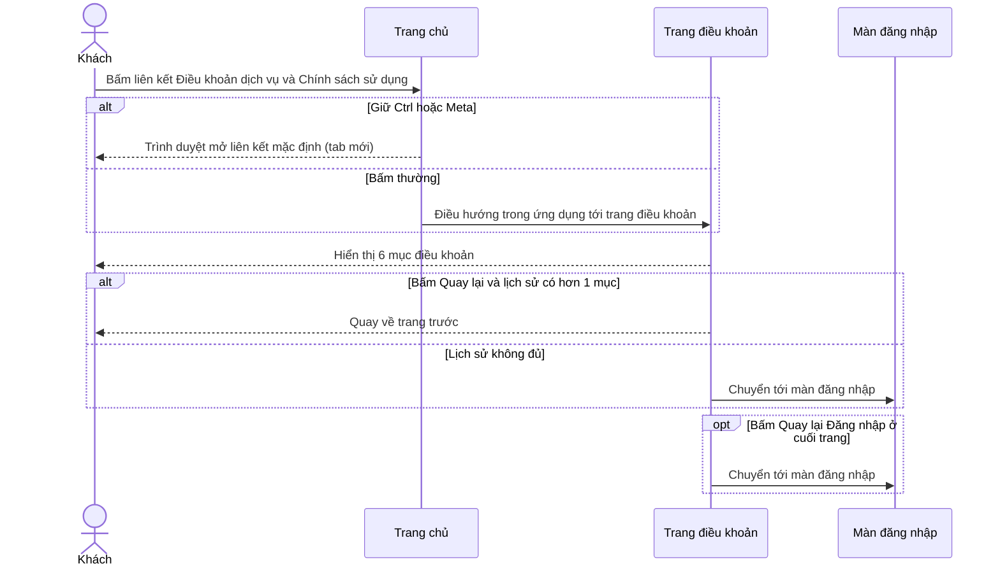
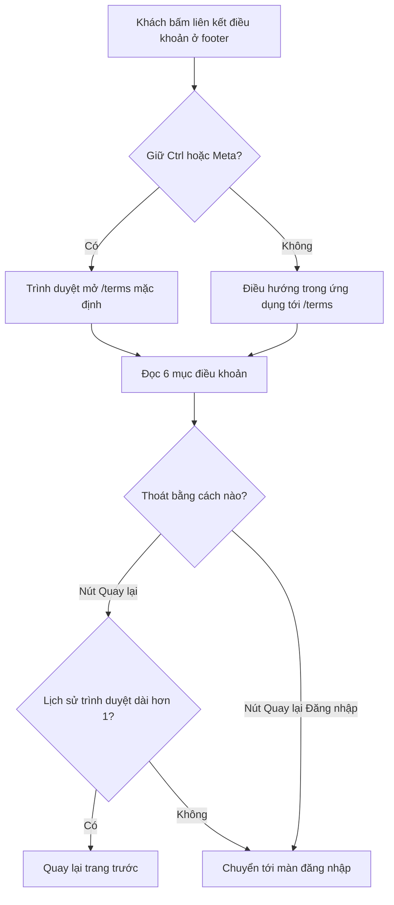

# landing-page — Flows tái lập (reverse)

## Flow: Mở và duyệt trang chủ

Nguồn: apps/web/src/routes/_proto/index.tsx:5-7; apps/web/src/routes/_proto/route.tsx:15-44; apps/web/src/features/app-state/use-profile-hydration.ts:29-41; apps/web/src/features/landing/landing-screen.tsx:9-47. Nhãn ✅.

### Sequence — Mở và duyệt trang chủ

### Activity — Mở và duyệt trang chủ

## Flow: Bấm nút kêu gọi để vào đăng nhập/đăng ký

Nguồn: apps/web/src/features/landing/landing-screen.tsx:20-21; apps/web/src/features/landing/components/hero.tsx:31; apps/web/src/features/app-state/routes.ts:9; test apps/web/src/features/__tests__/slice-a.test.tsx:155-173. Nhãn ✅.

### Sequence — Bấm nút kêu gọi

### Activity — Bấm nút kêu gọi

## Flow: Cuộn tới mục bằng liên kết đầu trang

Nguồn: apps/web/src/features/landing/landing-screen.tsx:15-18; apps/web/src/features/landing/components/promises-section.tsx:5; apps/web/src/features/landing/components/pricing-teaser.tsx:9. Nhãn ✅.

### Sequence — Cuộn tới mục

### Activity — Cuộn tới mục

## Flow: Đọc điều khoản và quay lại

Nguồn: apps/web/src/features/landing/landing-screen.tsx:31-42; apps/web/src/routes/_proto/terms.tsx:11-99; test apps/web/src/features/__tests__/slice-a.test.tsx:174-176. Nhãn ✅.

### Sequence — Đọc điều khoản

### Activity — Đọc điều khoản

