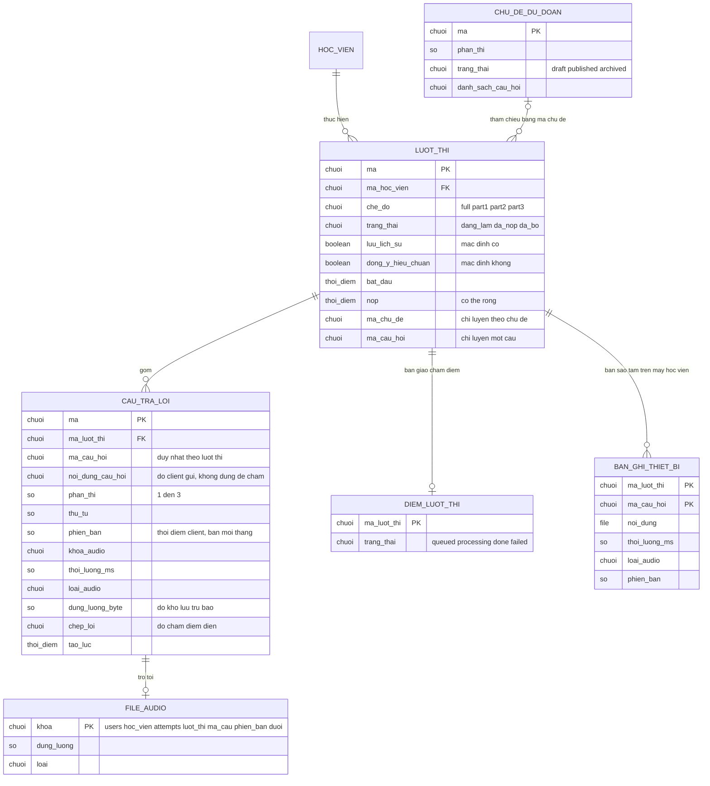

# mock-exam — ERD tái lập (reverse)

## Entity Reference

| Entity | Mô tả nghiệp vụ | Thuộc tính chính | Nguồn | Nhãn |
|--------|-----------------|------------------|-------|------|
| HOC_VIEN | Người dùng đã đăng nhập sở hữu lượt thi; xóa người dùng thì xóa lượt thi | Mã, email (dùng cho cổng pilot) | [S16: packages/db/src/schema/attempt.ts:9-11] [S1: packages/api/src/routers/attempt.ts:49] | ✅ |
| LUOT_THI | Một lần thi của học viên (thi thử, luyện theo chủ đề hoặc luyện một câu) | Chế độ, trạng thái, cờ lưu lịch sử, cờ hiệu chuẩn, thời điểm bắt đầu/nộp, mã chủ đề, mã câu hỏi | [S16: packages/db/src/schema/attempt.ts:5-30] | ✅ |
| CAU_TRA_LOI | Bản ghi âm của một câu trong một lượt thi; mỗi cặp (lượt thi, mã câu) tối đa một dòng | Mã câu, nội dung câu do client gửi, Part, thứ tự, phiên bản, khóa audio, thời lượng, loại, dung lượng, transcript | [S16: packages/db/src/schema/attempt.ts:32-60] | ✅ |
| DIEM_LUOT_THI | Dòng điểm của lượt thi, tạo khi nộp (bàn giao sang chấm điểm) | Trạng thái queued/processing/done/failed | [S16: packages/db/src/schema/score.ts:11-33] [S1: packages/api/src/routers/attempt.ts:284-291] | ✅ |
| CHU_DE_DU_DOAN | Chủ đề dự đoán do feature khác quản lý; lượt thi tham chiếu qua mã, không có khóa ngoại | Phần, trạng thái, danh sách câu hỏi | [S16: packages/db/src/schema/forecast.ts:6-20] [S1: packages/api/src/routers/attempt.ts:62-70] | ✅ |
| FILE_AUDIO | File audio trong kho đối tượng, tên do máy chủ dựng | Khóa theo học viên/lượt thi/câu/phiên bản/đuôi, dung lượng, loại | [S9: packages/api/src/audio.ts:71-84] [S13: apps/server/src/index.ts:226-228] | ✅ |
| BAN_GHI_THIET_BI | Bản sao tạm của bản ghi trên máy học viên (IndexedDB), xóa sau khi máy chủ xác nhận | Mã lượt thi, mã câu (khóa), file, thời lượng, loại, Part, thứ tự, câu hỏi, phiên bản, thời điểm tạo | [S19: apps/web/src/features/exam/storage.ts:3-15, 41] | ✅ |
| Ngân hàng đề thi thử | Không phải bảng: 6 mục hằng số trong mã nguồn, dùng chung web/máy chủ | Mã mục, Part, câu hỏi, cue card, nối tiếp | [S10: packages/api/src/scoring/mock-exam-bank.ts:26-70] | ✅ |

## Quan hệ

| Từ | Đến | Bản số | Ý nghĩa | Nguồn | Nhãn |
|----|-----|--------|---------|-------|------|
| HOC_VIEN | LUOT_THI | 1 - nhiều | Mỗi lượt thi thuộc đúng một học viên, xóa học viên thì xóa lượt thi | [S16: packages/db/src/schema/attempt.ts:9-11] | ✅ |
| LUOT_THI | CAU_TRA_LOI | 1 - nhiều | Xóa lượt thi thì xóa câu trả lời; duy nhất theo (lượt thi, mã câu) | [S16: packages/db/src/schema/attempt.ts:36-38, 58] | ✅ |
| LUOT_THI | DIEM_LUOT_THI | 1 - 0..1 | Khóa chính của dòng điểm là mã lượt thi; chèn "không làm gì khi trùng" | [S16: packages/db/src/schema/score.ts:14-16] [S1: packages/api/src/routers/attempt.ts:286-290] | ✅ |
| CHU_DE_DU_DOAN | LUOT_THI | 0..1 - nhiều | Lượt thi luyện theo chủ đề mang mã chủ đề; thi thử không có. Không có ràng buộc khóa ngoại | [S16: packages/db/src/schema/attempt.ts:22] [S1: packages/api/src/routers/attempt.ts:61-70] | ✅ |
| CAU_TRA_LOI | FILE_AUDIO | 1 - 0..1 | Dòng lưu khóa file; file có thể thiếu trong kho (404) hoặc mồ côi sau khi thua đua (bị xóa) | [S16: packages/db/src/schema/attempt.ts:45] [S13: apps/server/src/index.ts:253-263] | ✅ |
| LUOT_THI | BAN_GHI_THIET_BI | 1 - nhiều (phía client) | Khóa theo (mã lượt thi hoặc mã phiên cục bộ, mã câu); không có ràng buộc với máy chủ | [S19: apps/web/src/features/exam/storage.ts:41-42] | 🔵 |

## Notes

* **Không mô hình hóa:** bảng người dùng/phiên (feature auth), bảng tranh chấp điểm (chỉ đọc cờ chia sẻ khi tải audio về), bảng ghi nhận đồng ý (còn tồn tại ở backend theo D-10 nhưng không có code đọc/ghi trong phạm vi này), các cột chấm điểm chi tiết (feature scoring-results).
* **Thuộc tính DB thật cố ý không đưa:** chỉ mục `attempt_userId_idx`, `attempt_status_idx`, `attempt_topicId_idx`, `attempt_answer_attemptId_idx` (xem packages/db/src/schema/attempt.ts:25-29, 56-59).
* Cột lượt thi có chỗ thông tin "chế độ" là chuỗi tự do ở DB (không enum); chỉ 4 giá trị mới được tạo qua đường tạo lượt thi (xem FR-012) nhưng đường tải audio chấp nhận mọi giá trị đã lưu theo cách "đóng" (chế độ lạ → từ chối tất cả).
* Quan hệ LUOT_THI ↔ BAN_GHI_THIET_BI ghi 🔵 vì chỉ suy ra từ khóa lưu và test, không có ràng buộc dữ liệu.
