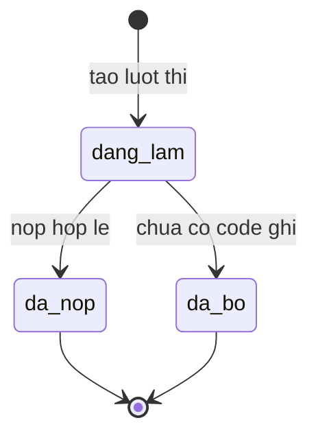
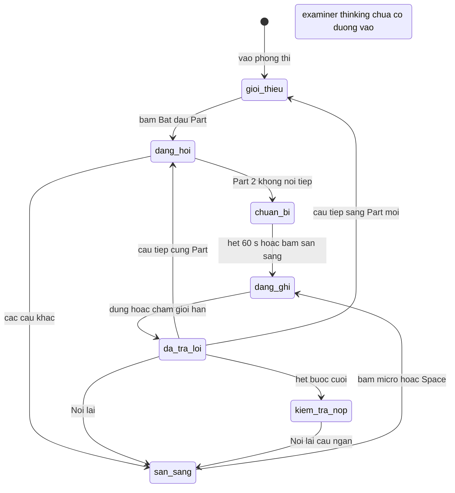
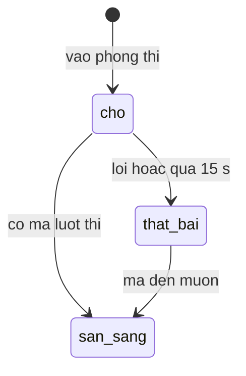
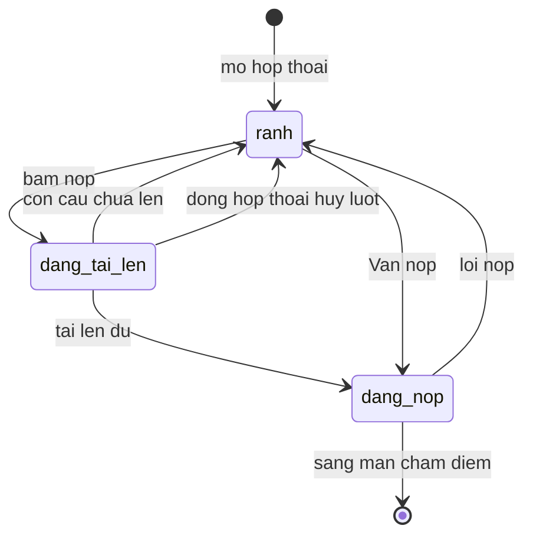

# mock-exam — States tái lập (reverse)

Bốn thực thể nhiều trạng thái có đủ nguồn: Lượt thi (máy chủ), Bước thi trong phòng thi (client), Đồng bộ lượt thi (client), Quy trình nộp (client). Bản ghi audio một câu không vẽ riêng vì đã thể hiện ở Flow 4 (không có enum trạng thái trong code).

## State: Lượt thi (máy chủ)

> Nguồn: ✅ [S16: packages/db/src/schema/attempt.ts:13] [S1: packages/api/src/routers/attempt.ts:92-102, 270-277]. Trạng thái "đã bỏ" 🟡 không có đoạn code nào ghi (OQ-4).

**Ghi chú trạng thái:**

| Trạng thái | Ý nghĩa | Vào bằng | Ra bằng | Nguồn | Nhãn |
|-----------|---------|----------|---------|-------|------|
| dang_lam (in_progress) | Lượt thi mở, nhận audio, nhận follow-up, nhận nộp | Tạo lượt thi (mặc định của cột) | Nộp hợp lệ | [S16: packages/db/src/schema/attempt.ts:13-15] [S1: packages/api/src/routers/attempt.ts:96] | ✅ |
| da_nop (submitted) | Đã nộp, có dòng điểm queued; không nhận audio nữa, nộp lại bị từ chối "Attempt is already submitted" | Nộp hợp lệ kèm thời điểm nộp | — (trạng thái cuối trong phạm vi feature; chấm điểm thuộc scoring-results) | [S1: packages/api/src/routers/attempt.ts:272-276, 230-232] [S13: apps/server/src/index.ts:154-156] | ✅ |
| da_bo (abandoned) | Có trong enum; nộp bị từ chối "Attempt is abandoned" | Chưa có đường vào trong code | — | [S16: packages/db/src/schema/attempt.ts:13] [S1: packages/api/src/routers/attempt.ts:233-235] | 🟡 |

## State: Bước thi trong phòng thi (client)

> Nguồn: ✅ [S22: apps/web/src/features/exam/types.ts:46] [S17: apps/web/src/features/exam/use-exam-session.ts:191-372]. Pha "examiner-thinking" 🟡 có trong kiểu nhưng không có chuyển vào (N-1).

**Ghi chú trạng thái:**

| Trạng thái | Ý nghĩa | Vào bằng | Ra bằng | Nguồn | Nhãn |
|-----------|---------|----------|---------|-------|------|
| gioi_thieu (intro) | Màn giới thiệu Part | Vào phòng thi; sang Part mới (reset đồng hồ Part) | Bấm "Bắt đầu Part n" | [S17: apps/web/src/features/exam/use-exam-session.ts:60, 331-336, 360] | ✅ |
| dang_hoi (asking) | Giám khảo đọc, chữ hiện dần 28 ms/ký tự | Bấm bắt đầu Part; câu tiếp cùng Part | Hiện đủ độ dài + 12 nhịp | [S17: apps/web/src/features/exam/use-exam-session.ts:191-206] | ✅ |
| chuan_bi (prep) | Part 2: cue card, đếm ngược 60 s, ghi chú nháp | Hỏi xong ở Part 2 không nối tiếp | Hết 60 s (tự ghi) hoặc bấm Sẵn sàng | [S17: apps/web/src/features/exam/use-exam-session.ts:204-206, 316-318] | ✅ |
| san_sang (ready) | Chờ học viên ghi | Hỏi xong (câu khác); Nói lại; quay lại câu từ hộp thoại kiểm tra | Bấm micro hoặc Space | [S17: apps/web/src/features/exam/use-exam-session.ts:205, 361-372] | ✅ |
| dang_ghi (recording) | Đang ghi, hiện thời gian đã ghi / tối đa | Bắt đầu ghi | Dừng hoặc chạm 40/120/60 s | [S17: apps/web/src/features/exam/use-exam-session.ts:231-236, 312-314] | ✅ |
| da_tra_loi (answered) | Đã có bản ghi (kể cả khi không có file audio — 🟡 E-037) | Dừng ghi | Câu tiếp, Nói lại, hoặc hết bước → mở hộp thoại kiểm tra | [S17: apps/web/src/features/exam/use-exam-session.ts:238-249, 320-337] | ✅ |
| kiem_tra_nop (review) | Hộp thoại kiểm tra trước khi nộp (cờ tách riêng, không phải pha) | Câu tiếp ở bước cuối; hoặc quay lại từ Nói lại | Nộp, đóng, hoặc Nói lại câu ngắn | [S17: apps/web/src/features/exam/use-exam-session.ts:68, 320-337] | ✅ |
| examiner-thinking | Khối "Giám khảo AI đang phân tích câu trả lời…" | Không có đường vào | — | [S22: apps/web/src/features/exam/types.ts:46] [S21: apps/web/src/features/exam/components/live-transcript.tsx:11-22] | 🟡 |

## State: Đồng bộ lượt thi (client)

> Nguồn: ✅ [S17: apps/web/src/features/exam/use-exam-session.ts:75, 103-118, 120-181]

**Ghi chú trạng thái:**

| Trạng thái | Ý nghĩa | Vào bằng | Ra bằng | Nguồn | Nhãn |
|-----------|---------|----------|---------|-------|------|
| cho (pending) | Chưa có mã lượt thi; nút nộp khóa "Đang đồng bộ phiên thi…" | Mở phòng thi | Có mã, lỗi, hoặc 15 s | [S17: apps/web/src/features/exam/use-exam-session.ts:75, 128-130] [S21: apps/web/src/features/exam/components/pre-submit-modal.tsx:113-115] | ✅ |
| san_sang (ready) | Có mã; tải lên và nộp được | Nối lại lượt thi hoặc tạo mới thành công | — | [S17: apps/web/src/features/exam/use-exam-session.ts:103-118] | ✅ |
| that_bai (failed) | Không có mã; nộp đi nhánh chỉ cục bộ | Lỗi khởi tạo hoặc quá 15 s | Mã đến muộn → sẵn sàng | [S17: apps/web/src/features/exam/use-exam-session.ts:128-130, 171-174] [S27: apps/web/src/features/exam/__tests__/exam-submit.test.tsx:746-781] | ✅ |

## State: Quy trình nộp (client)

> Nguồn: ✅ [S20: apps/web/src/features/exam/exam-screen.tsx:34-53, 110-129, 60-91, 161-184]

**Ghi chú trạng thái:**

| Trạng thái | Ý nghĩa | Vào bằng | Ra bằng | Nguồn | Nhãn |
|-----------|---------|----------|---------|-------|------|
| ranh (idle) | Chưa nộp hoặc đã dừng với thông báo lỗi | Mở hộp thoại; lỗi; hủy | Bấm nộp / Vẫn nộp | [S20: apps/web/src/features/exam/exam-screen.tsx:34-53] | ✅ |
| dang_tai_len (flushing) | Nhãn "Đang tải lên bản ghi…"; các nút đổi câu trả lời bị khóa | Bấm nộp có mã lượt thi | Còn câu chưa lên (E-033), kho không đọc được (E-036), đủ → đang nộp; đóng hộp thoại hoặc thoát → hủy lượt | [S20: apps/web/src/features/exam/exam-screen.tsx:110-129, 169-176] [S21: apps/web/src/features/exam/components/pre-submit-modal.tsx:80-87] | ✅ |
| dang_nop (submitting) | Nhãn "Đang nộp…"; lượt chạy sống sót khi đóng hộp thoại | Flush đủ hoặc Vẫn nộp | Thành công / đã nộp → màn chấm điểm; lỗi → E-034/E-035 | [S20: apps/web/src/features/exam/exam-screen.tsx:60-91, 169-176] | ✅ |
