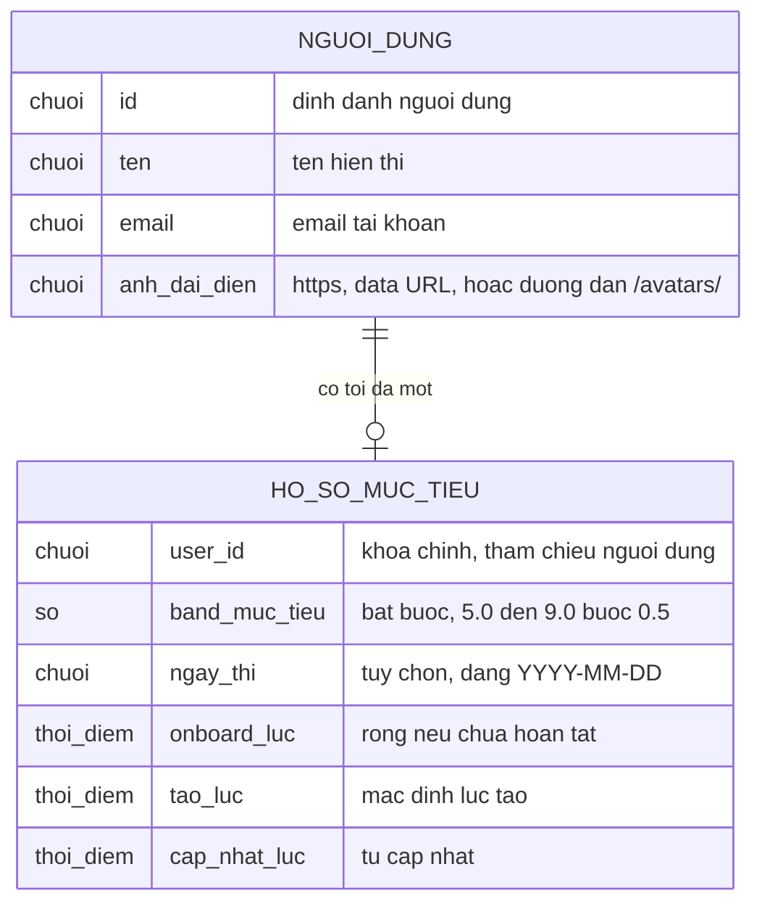

# onboarding-profile — ERD tái lập (reverse)

## Entity Reference

| Entity | Mô tả nghiệp vụ | Thuộc tính chính | Nguồn | Nhãn |
|--------|-----------------|------------------|-------|------|
| Hồ sơ mục tiêu (bảng `user_profile`) | Mục tiêu band, ngày thi và dấu mốc hoàn tất onboarding của một học viên | user_id, target_band (bắt buộc), exam_date (chuỗi), onboarded_at, created_at, updated_at | [S2: packages/db/src/schema/profile.ts:6-17] [S3: packages/db/src/migrations/20261105235801_bitter_madripoor/migration.sql:1-9] | ✅ |
| Người dùng (bảng `user`, phần liên quan) | Danh tính học viên; tên và ảnh đại diện sửa được từ màn Hồ sơ | id, name, email, emailVerified, image | [S6: packages/api/src/routers/profile.test.ts:11-19] [S5: packages/auth/src/index.ts:60-71] | ✅ |
| Trạng thái ứng dụng (trình duyệt) | Bản sao tạm của mục tiêu để các màn khác dùng; không bền vững | target (mặc định 7.0), examDate, name, email | [S34: apps/web/src/features/app-state/initial-state.ts:5-8] | ✅ |

## Quan hệ

| Từ | Đến | Bản số | Ý nghĩa | Nguồn | Nhãn |
|----|-----|--------|---------|-------|------|
| Người dùng | Hồ sơ mục tiêu | 1 – 0..1 | Khóa chính hồ sơ là mã người dùng; xóa người dùng xóa hồ sơ | [S2: packages/db/src/schema/profile.ts:7-9] [S3: packages/db/src/migrations/20261105235801_bitter_madripoor/migration.sql:2, 8] | ✅ |

## Notes

* Chi tiết định kiểu: `target_band` kiểu số thực, `onboarded_at`/`created_at`/`updated_at` là số nguyên mili-giây (timestamp_ms), `exam_date` là chuỗi không múi giờ — chỉ ghi ở mức nghiệp vụ gọn, không phải DDL đầy đủ. ✅ [S2: packages/db/src/schema/profile.ts:10-17]
* `updated_at` không có giá trị mặc định khi tạo (chỉ tự cập nhật khi đổi) — khi hồ sơ mới tạo bằng lưu mục tiêu, cột này có thể rỗng. 🔵 [S2: packages/db/src/schema/profile.ts:16-17] [S3: packages/db/src/migrations/20261105235801_bitter_madripoor/migration.sql:7]
* Không mô hình hóa: bảng phiên, tài khoản đăng nhập, `consent_event`, gói thanh toán (thuộc feature khác). Hồ sơ cũng nằm trong danh bạ xuất/xóa dữ liệu người dùng [S33: packages/api/src/data-registry.ts:57-65].
* Ảnh đại diện lưu thẳng trong cột `image` của người dùng (không có bảng ảnh/tệp riêng); ảnh upload là data URL tối đa 32000 ký tự. ✅ [S4: packages/auth/src/image-validation.ts:8, 27]
