# onboarding-profile — Flows tái lập (reverse)

> Chỉ vẽ bước CÓ trong code. Bước suy đoán chú thích 🔵/🟡. Nguồn tổng: `_evidence.md`. Nhãn trong sơ đồ mermaid viết không dấu để tránh lỗi cú pháp; wording thật (có dấu, nguyên văn) xem Mục 6 của spec và §3 của `_evidence.md`.

## Flow 1: Thiết lập mục tiêu khi onboarding (bước 1)

Nguồn: apps/web/src/features/onboarding/components/goal-step.tsx:31-49, packages/api/src/routers/profile.ts:53-89. FR-001..006. Nhãn ✅.

### Sequence — Thiết lập mục tiêu

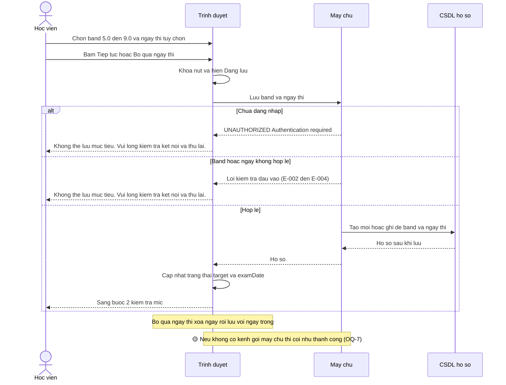

### Activity — Thiết lập mục tiêu

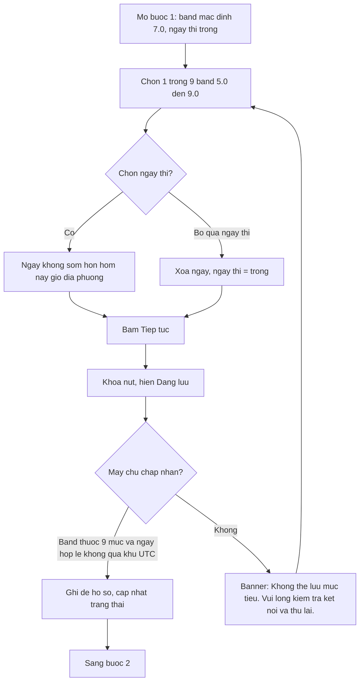

## Flow 2: Kiểm tra mic và hoàn tất onboarding (bước 2)

Nguồn: apps/web/src/features/onboarding/components/mic-check.tsx:23-62, apps/web/src/hooks/use-mic-level.ts:40-98, apps/web/src/features/onboarding/onboarding-screen.tsx:17-30, packages/api/src/routers/profile.ts:91-134. FR-007..012. Nhãn ✅.

### Sequence — Kiểm tra mic và hoàn tất

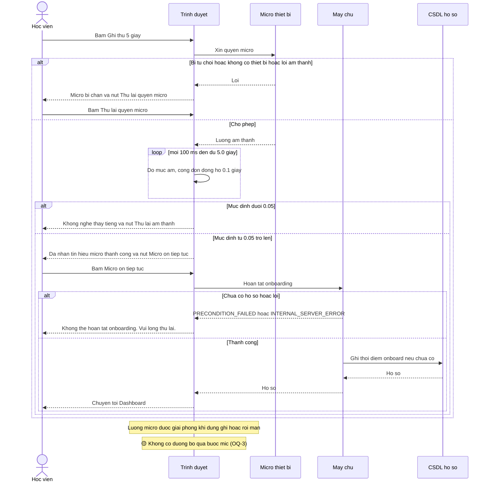

### Activity — Kiểm tra mic và hoàn tất

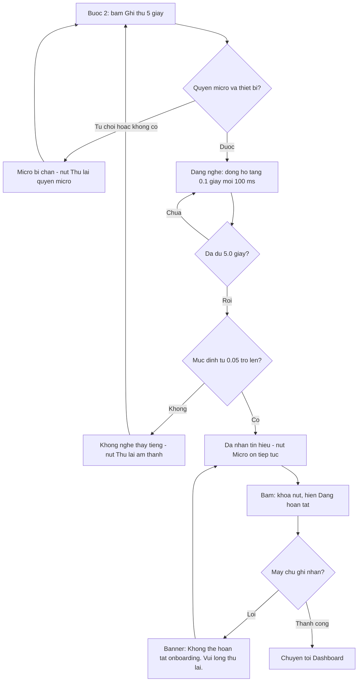

## Flow 3: Cổng truy cập (trang onboarding và khu vực ứng dụng)

Nguồn: apps/web/src/routes/_proto/onboarding.tsx:8-25, apps/web/src/lib/auth-guard.ts:24-70, apps/web/src/routes/_proto/app/route.tsx:7. FR-014, FR-015. Nhãn ✅.

### Sequence — Cổng truy cập

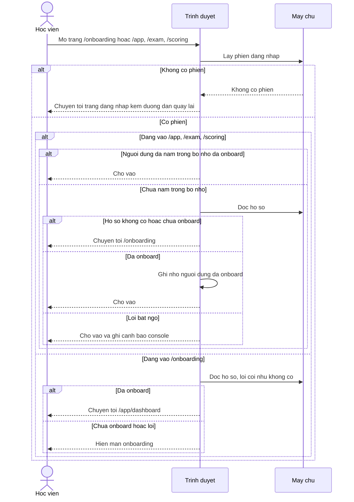

### Activity — Cổng truy cập

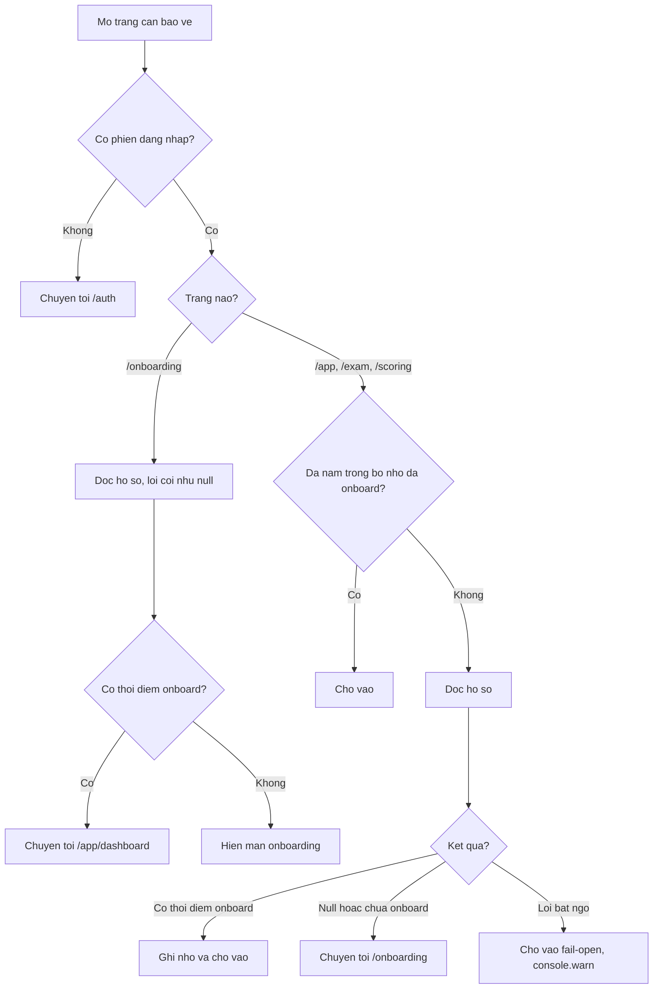

## Flow 4: Đồng bộ hồ sơ khi đăng nhập/đăng xuất

Nguồn: apps/web/src/features/app-state/use-profile-hydration.ts:29-105, apps/web/src/routes/_proto/route.tsx:29-35. FR-017. Nhãn ✅.

### Sequence — Đồng bộ hồ sơ

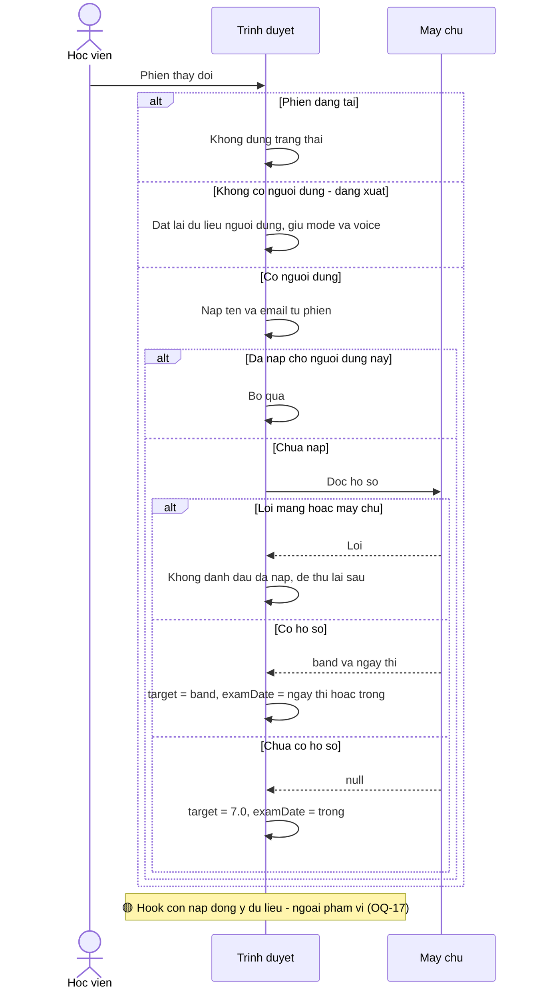

### Activity — Đồng bộ hồ sơ

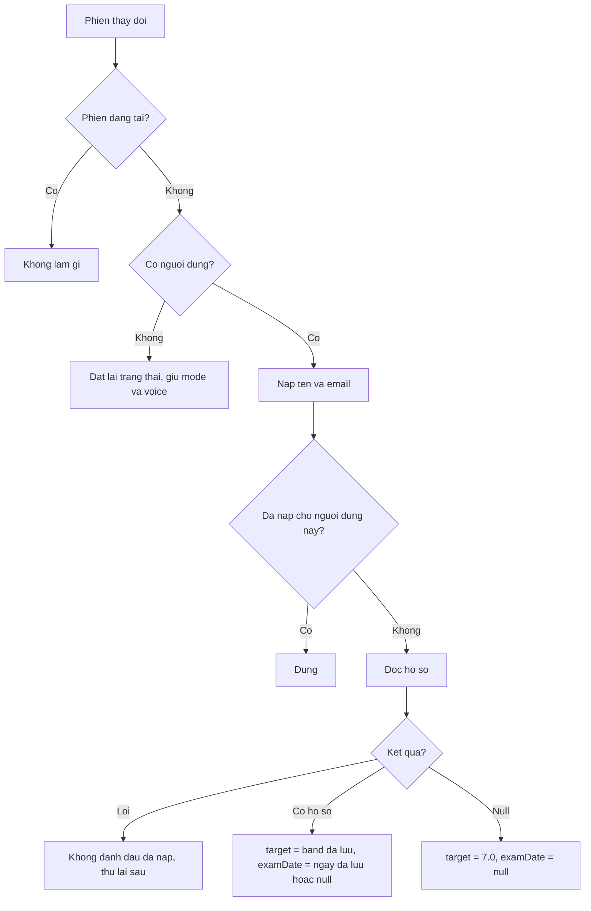

## Flow 5: Sửa mục tiêu trên màn Hồ sơ

Nguồn: apps/web/src/features/profile/profile-screen.tsx:126-158. FR-020. Nhãn ✅.

### Sequence — Sửa mục tiêu

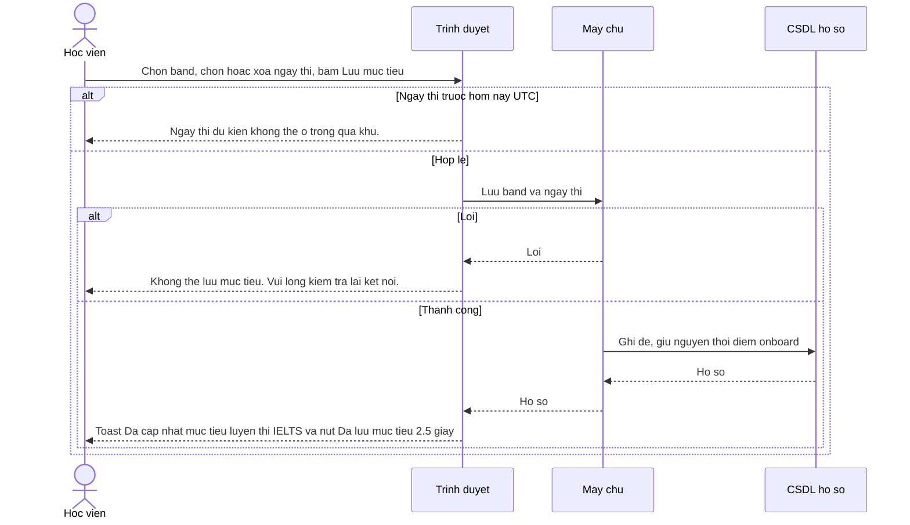

### Activity — Sửa mục tiêu

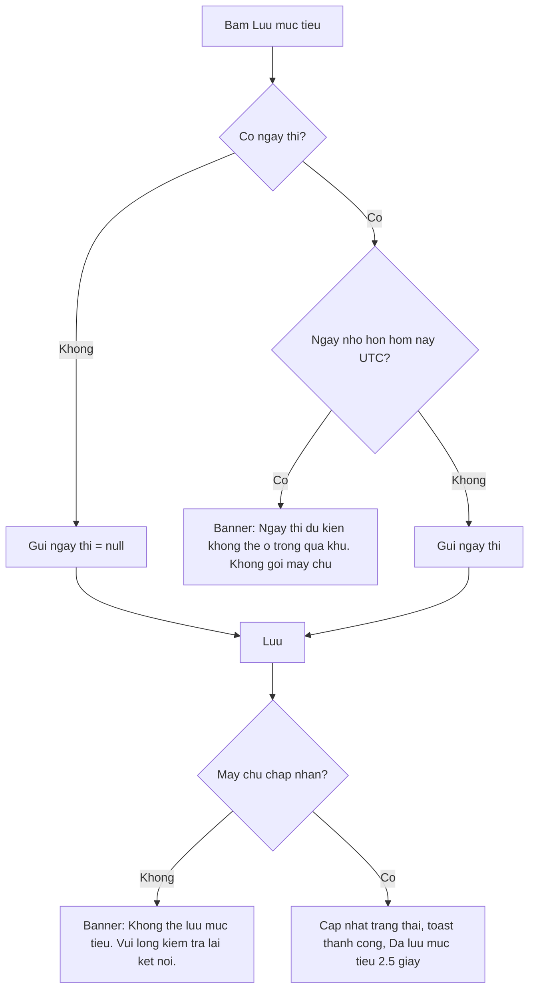

## Flow 6: Sửa tên hiển thị

Nguồn: apps/web/src/features/profile/profile-screen.tsx:70-99. FR-019. Nhãn ✅.

### Sequence — Sửa tên

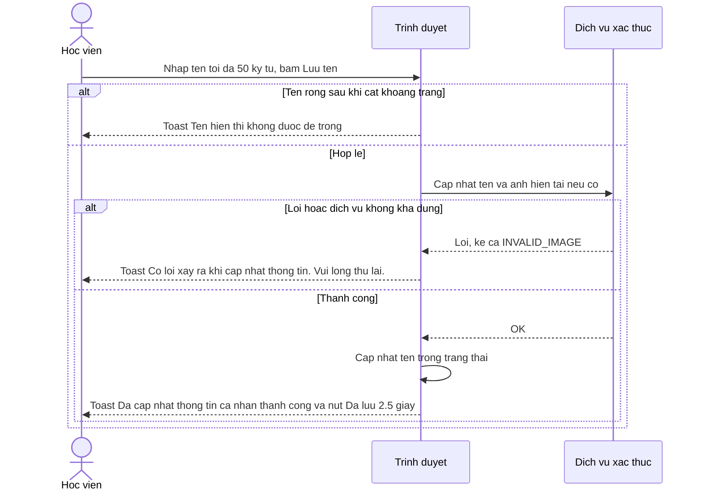

### Activity — Sửa tên

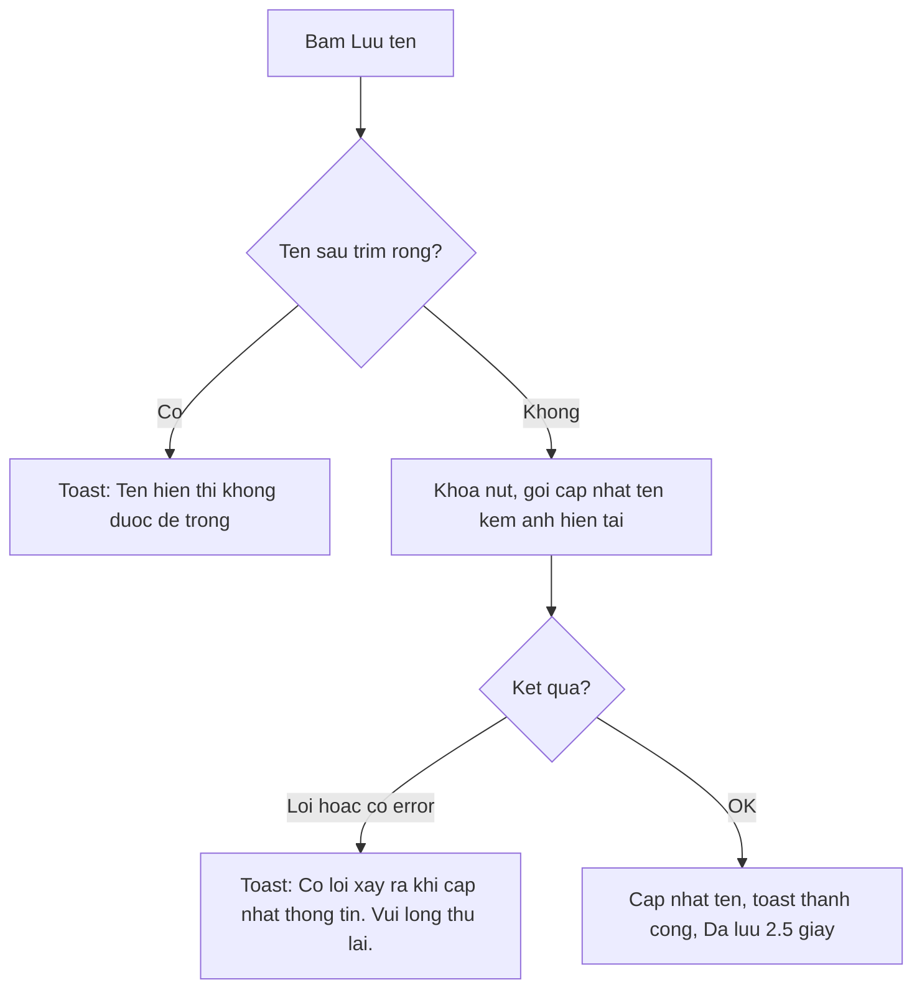

## Flow 7: Đổi ảnh đại diện

Nguồn: apps/web/src/features/profile/components/avatar-modal.tsx:26-67, apps/web/src/features/profile/utils/image-compress.ts:9-106, apps/web/src/features/profile/profile-screen.tsx:102-123, packages/auth/src/image-validation.ts:17-31. FR-021..024. Nhãn ✅.

### Sequence — Đổi ảnh đại diện

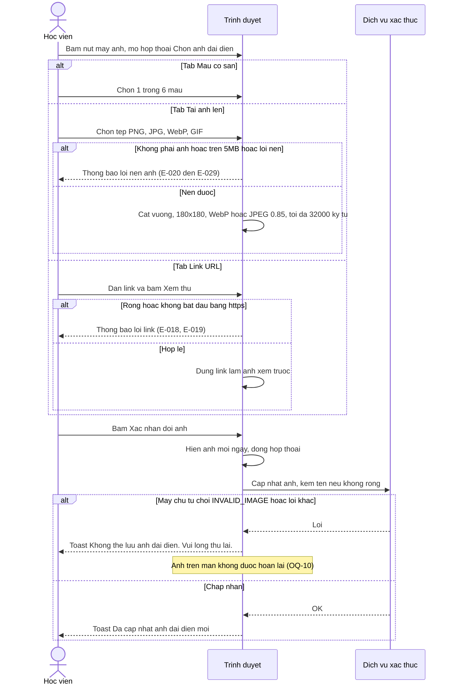

### Activity — Đổi ảnh đại diện

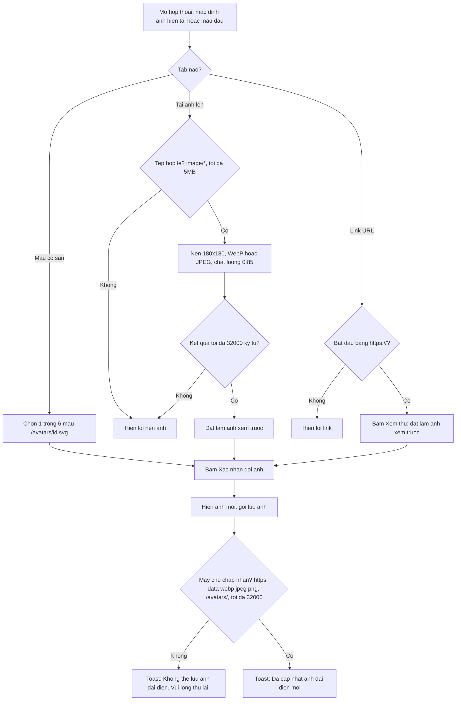
