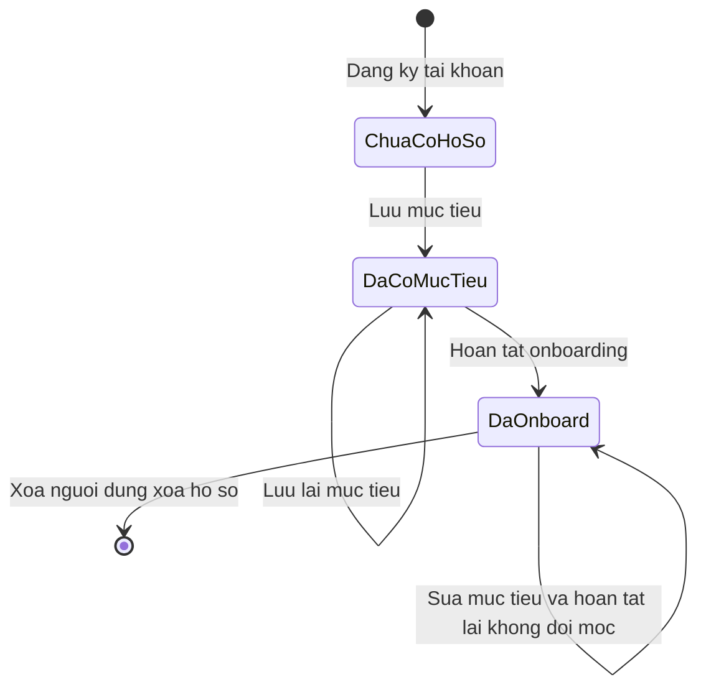
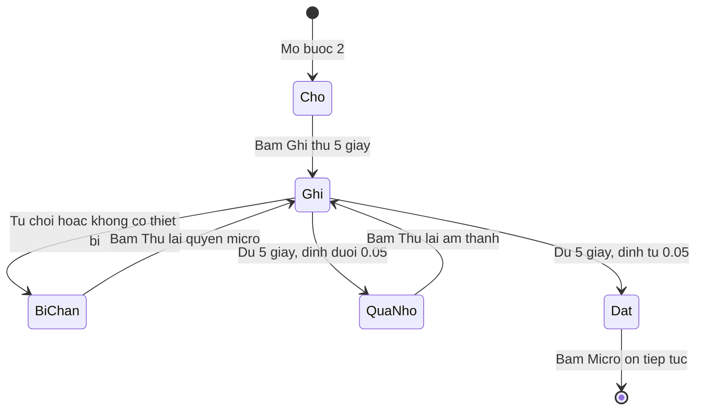

# onboarding-profile — States tái lập (reverse)

> Hai entity có nhiều trạng thái thật trong code: (1) trạng thái onboarding của hồ sơ học viên, (2) pha kiểm tra micro. Ảnh đại diện và tên không có state machine (chỉ giá trị), nên không vẽ.

## State: Hồ sơ học viên (onboarding)

> Nguồn: ✅ [S1: packages/api/src/routers/profile.ts:59-73, 108-118] [S14: apps/web/src/lib/auth-guard.ts:52-56]. Trạng thái "Chưa có hồ sơ" và "Có hồ sơ chưa onboard" suy ra từ giá trị bản ghi (không có cột trạng thái riêng).

**Ghi chú trạng thái:**

| Trạng thái | Ý nghĩa | Vào bằng | Ra bằng | Nguồn | Nhãn |
|-----------|---------|----------|---------|-------|------|
| ChuaCoHoSo | Không có dòng hồ sơ; cổng chặn đẩy sang onboarding; trạng thái trình duyệt dùng band 7.0 | Tài khoản mới | Lưu mục tiêu | [S1: packages/api/src/routers/profile.ts:50] [S13: apps/web/src/features/app-state/use-profile-hydration.ts:75-77] | ✅ |
| DaCoMucTieu | Có band (và ngày thi tùy chọn), chưa có thời điểm onboard; cổng chặn vẫn đẩy sang onboarding | Lưu mục tiêu lần đầu | Hoàn tất onboarding | [S6: packages/api/src/routers/profile.test.ts:99-116] [S14: apps/web/src/lib/auth-guard.ts:52-56] | ✅ |
| DaOnboard | Có thời điểm onboard; được vào /app, /exam, /scoring; vào /onboarding thì về Dashboard; thời điểm không đổi khi sửa mục tiêu hoặc hoàn tất lại | Hoàn tất onboarding | Xóa người dùng (xóa dây chuyền) | [S1: packages/api/src/routers/profile.ts:108-118] [S6: packages/api/src/routers/profile.test.ts:118-141] [S15: apps/web/src/routes/_proto/onboarding.tsx:14-17] | ✅ |
| (chuyển ngược DaOnboard → trước đó) | Không có đường quay lại trạng thái chưa onboard trong code | — | — | negative-search: không có thủ tục đặt lại `onboardedAt` trong packages/api/src/routers/profile.ts:41-135 | 🔵 |

## State: Pha kiểm tra micro (bước 2)

> Nguồn: ✅ [S10: apps/web/src/features/onboarding/components/mic-check.tsx:16-62]. Trạng thái "bị chặn" và "quá nhỏ" là cờ phủ lên pha idle.

**Ghi chú trạng thái:**

| Trạng thái | Ý nghĩa | Vào bằng | Ra bằng | Nguồn | Nhãn |
|-----------|---------|----------|---------|-------|------|
| Cho (phase idle) | Chưa ghi; nút "Ghi thử 5 giây" | Mở bước 2; sau lỗi | Bấm ghi thử | [S10: apps/web/src/features/onboarding/components/mic-check.tsx:16, 173-184] | ✅ |
| Ghi (phase rec) | Đang xin quyền/đo; đồng hồ chỉ chạy khi micro báo đang nghe | Bấm ghi thử hoặc thử lại | Bị chặn / đủ 5 giây | [S10: apps/web/src/features/onboarding/components/mic-check.tsx:29-41, 56-62] | ✅ |
| BiChan | Cờ "bị chặn": tiêu đề "Micro bị chặn"; về pha idle | Từ chối quyền / không khả dụng / khởi tạo lỗi | Bấm "Thử lại quyền micro" | [S10: apps/web/src/features/onboarding/components/mic-check.tsx:31-35, 64, 165-168] | ✅ |
| QuaNho | Cờ "quá nhỏ"; về pha idle | Đủ 5 giây mà đỉnh dưới 0.05 | Bấm "Thử lại âm thanh" | [S10: apps/web/src/features/onboarding/components/mic-check.tsx:44-53, 169-172] | ✅ |
| Dat (phase done) | Hiện "Đã nhận tín hiệu micro thành công" và nút tiếp tục; không có đường quay lại ghi lại trong cùng bước | Đủ 5 giây, đỉnh từ 0.05 | Bấm "Micro ổn, tiếp tục" (hoặc nút Quay lại của khung) | [S10: apps/web/src/features/onboarding/components/mic-check.tsx:44-47, 126-130, 161-164] | ✅ |
