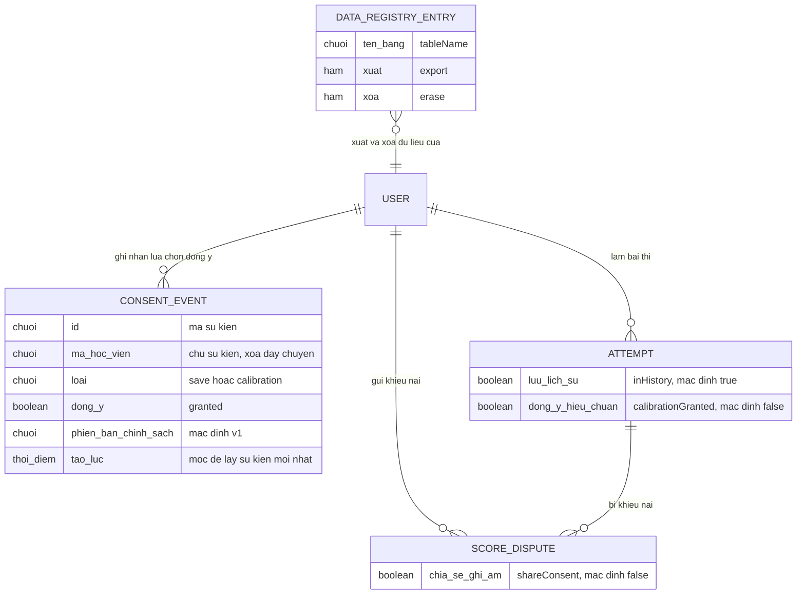

# privacy-controls — ERD tái lập (reverse)

Phạm vi: thực thể lõi của quyền riêng tư (sự kiện đồng ý) và các thực thể có cờ / danh mục liên quan. Các bảng dữ liệu cá nhân khác (hồ sơ, bài thi, điểm...) chỉ nêu ở mức tham chiếu vì thuộc feature khác.

## Entity Reference

| Entity | Mô tả nghiệp vụ | Thuộc tính chính | Nguồn | Nhãn |
|--------|-----------------|------------------|-------|------|
| CONSENT_EVENT (bảng consent_event) | Một lần học viên chọn đồng ý / không đồng ý cho một loại; lịch sử chỉ thêm | id, ma_hoc_vien, loai (save/calibration), dong_y, phien_ban_chinh_sach (mặc định v1), tao_luc (mili-giây); index (user), (user, loại) | S6:6-24 | ✅ |
| USER | Học viên; chủ mọi dữ liệu cá nhân; xoá user sẽ xoá dây chuyền sự kiện đồng ý | (thuộc auth-account) | S6:12-14 | ✅ |
| ATTEMPT (cờ liên quan) | Bài thi mang hai cờ: lưu vào lịch sử, đồng ý hiệu chuẩn | luu_lich_su (mặc định true), dong_y_hieu_chuan (mặc định false) | S14:16-17 | ✅ |
| SCORE_DISPUTE (cờ liên quan) | Khiếu nại điểm mang cờ cho phép giám khảo nghe ghi âm | chia_se_ghi_am (mặc định false) | S18:24 | ✅ |
| DATA_REGISTRY_ENTRY | Mô tả theo bảng: cách xuất, cách xoá (không phải bảng DB mà là cấu trúc trong mã) | ten_bang, xuat, xoa | S3:33-37, S3:47 | ✅ |
| NON_PERSONAL_TABLE | Bảng được code khai báo là không chứa dữ liệu cá nhân + lý do (verification, forecast_topic, forecast_source); tính đúng của khai báo chưa kiểm chứng (OQ-13) | ten_bang, ly_do | S3:247-254 | 🟡 |

## Quan hệ

| Từ | Đến | Bản số | Ý nghĩa | Nguồn | Nhãn |
|----|-----|--------|---------|-------|------|
| USER | CONSENT_EVENT | 1 - N | Một học viên có nhiều sự kiện đồng ý; xoá user xoá dây chuyền | S6:12-14 | ✅ |
| USER | ATTEMPT | 1 - N | Bài thi thuộc học viên, xoá dây chuyền | S14:9-11 | ✅ |
| ATTEMPT | SCORE_DISPUTE | 1 - N | Khiếu nại tham chiếu bài thi, xoá dây chuyền | S18:13-15 | ✅ |
| USER | SCORE_DISPUTE | 1 - N | Khiếu nại thuộc học viên, xoá dây chuyền | S18:16-18 | ✅ |
| DATA_REGISTRY_ENTRY | USER | N - 1 (logic) | Mỗi mục xuất / xoá dữ liệu của một học viên; không phải khóa ngoại DB | S3:256-280 | 🔵 |

## Notes

* Bảng `consent_event` KHÔNG có cột trạng thái "hiện hành"; trạng thái hiện hành là sự kiện mới nhất theo loại (xem states).
* Cột `createdAt` dùng làm thứ tự "mới nhất"; hai sự kiện cùng loại có cùng mili-giây thì thứ tự không xác định trong code (không có tie-break) — *🟡 nghi vấn, chưa có test* (S1:63-68).
* Các thực thể dữ liệu cá nhân khác (USER_PROFILE, SESSION, ACCOUNT, FORECAST_REPORT, ATTEMPT_SCORE, SCORE_RUN, ATTEMPT_ANSWER, SCORING_RETRY_LOG) không vẽ chi tiết ở đây vì thuộc feature khác; tên bảng nằm trong Mục 3 FR-015 của spec.
* Tên thuộc tính trong sơ đồ là tiếng Việt không dấu để mermaid sạch; tên cột DB thật nằm ở cột Nguồn (S6).
