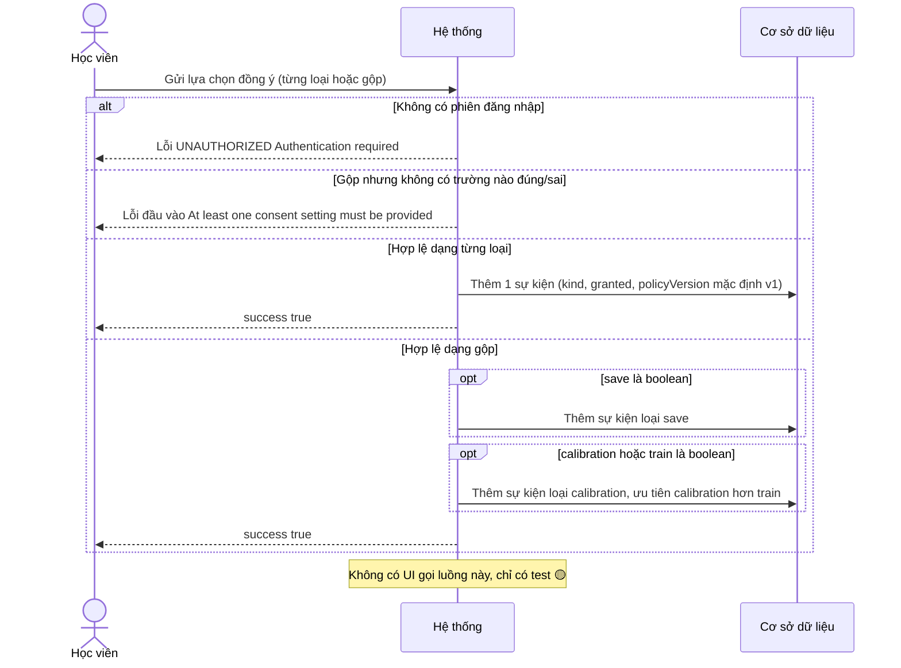
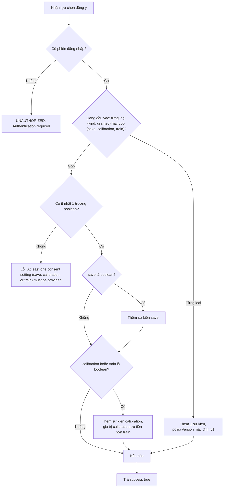
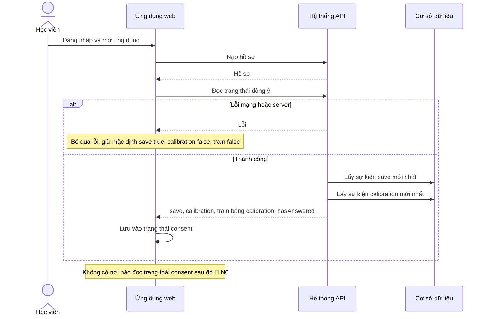
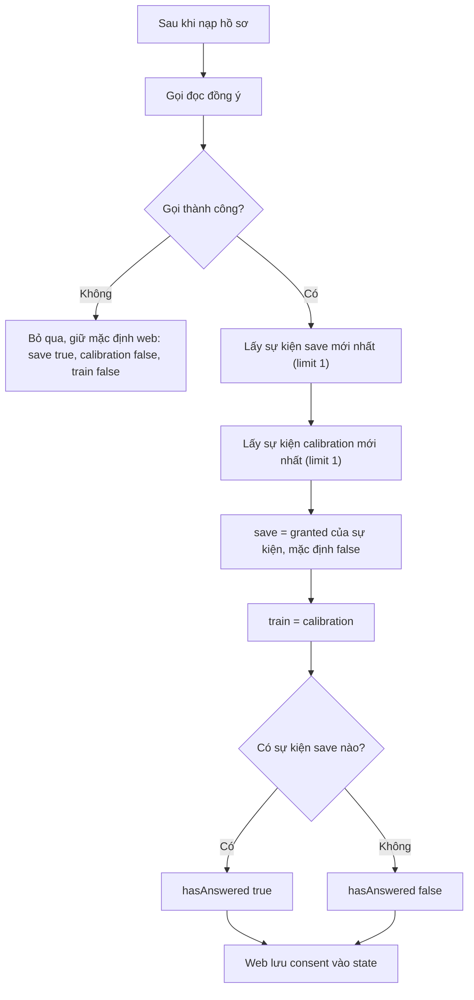
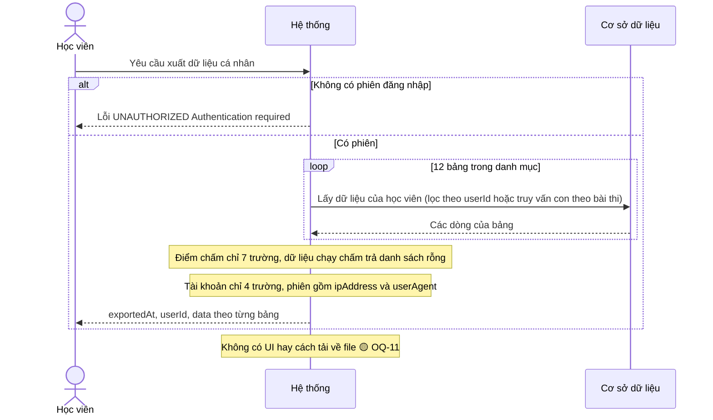
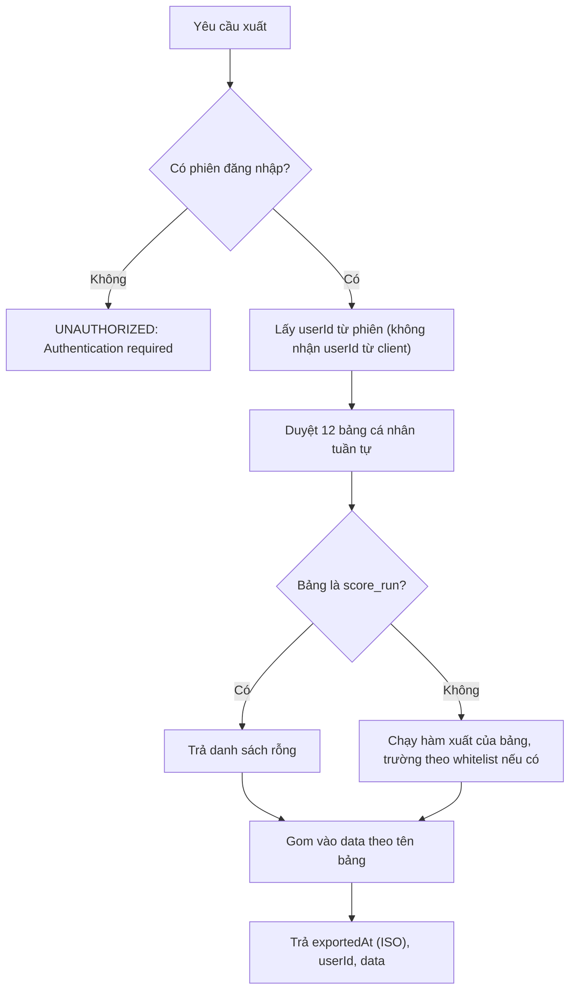
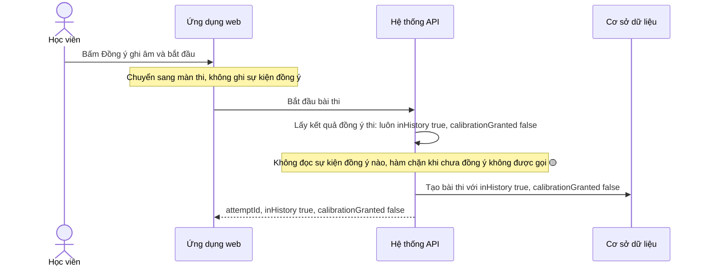
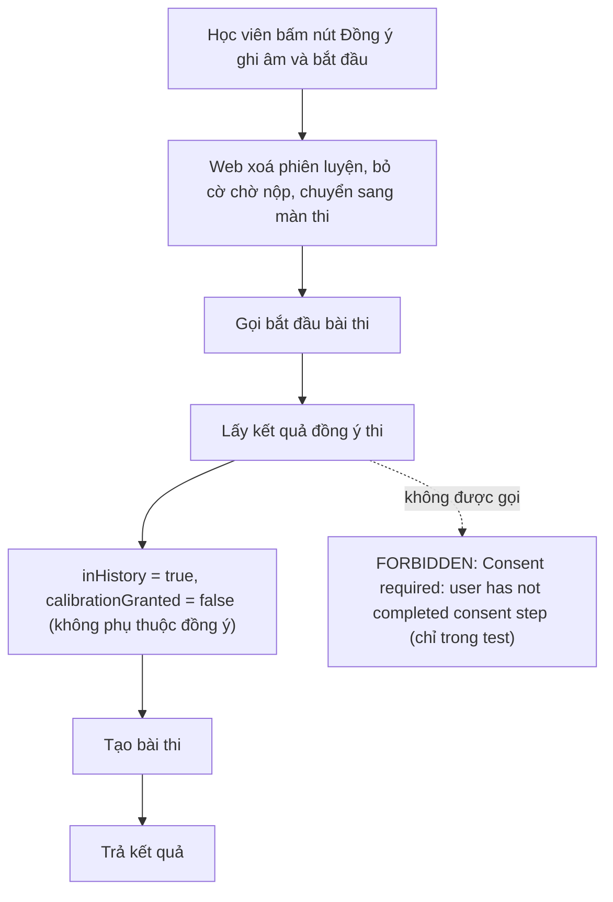
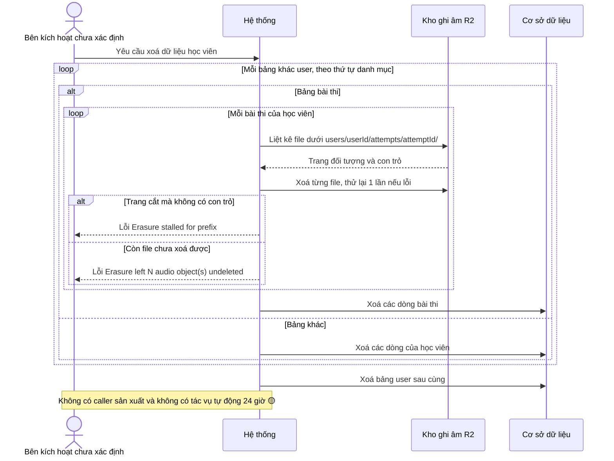
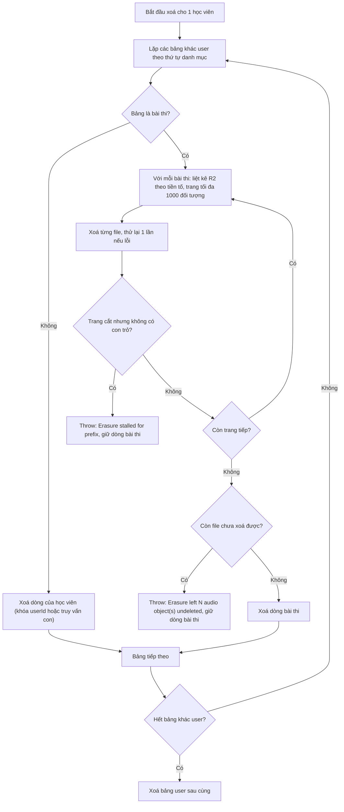

# privacy-controls — Flows tái lập (reverse)

Chỉ vẽ bước CÓ trong code. Cite dạng `S#:line` theo `../reverse-sources.md`. Các flow 1 và 3 chưa có UI gọi (🟡 OQ-1).

## Flow: Ghi nhận / rút lại đồng ý

Nguồn: S1:37-57, S1:88-122; S2:82-124. Không có màn hình gọi (🟡, OQ-1).

### Sequence — Ghi nhận / rút lại đồng ý

### Activity — Ghi nhận / rút lại đồng ý

## Flow: Đọc trạng thái đồng ý và nạp lên web

Nguồn: S1:60-86; S10:79-96; S11:9.

### Sequence — Đọc trạng thái đồng ý và nạp lên web

### Activity — Đọc trạng thái đồng ý và nạp lên web

## Flow: Xuất dữ liệu cá nhân

Nguồn: S1:124-127; S3:47-266; S4:527-582. Không có màn hình gọi (🟡).

### Sequence — Xuất dữ liệu cá nhân

### Activity — Xuất dữ liệu cá nhân

## Flow: Bắt đầu bài thi (xác nhận ghi âm, lưu vô điều kiện)

Nguồn: S12:28-38; S5:8-17; S7:88-110; S1:9-35 (hàm kiểm tra không được gọi).

### Sequence — Bắt đầu bài thi

### Activity — Bắt đầu bài thi

## Flow: Xoá toàn bộ dữ liệu cá nhân (có file ghi âm)

Nguồn: S3:163-204, S3:268-280; S4:110, S4:583-679. Không có điểm kích hoạt (🟡 OQ-3).

### Sequence — Xoá dữ liệu cá nhân

### Activity — Xoá dữ liệu cá nhân

