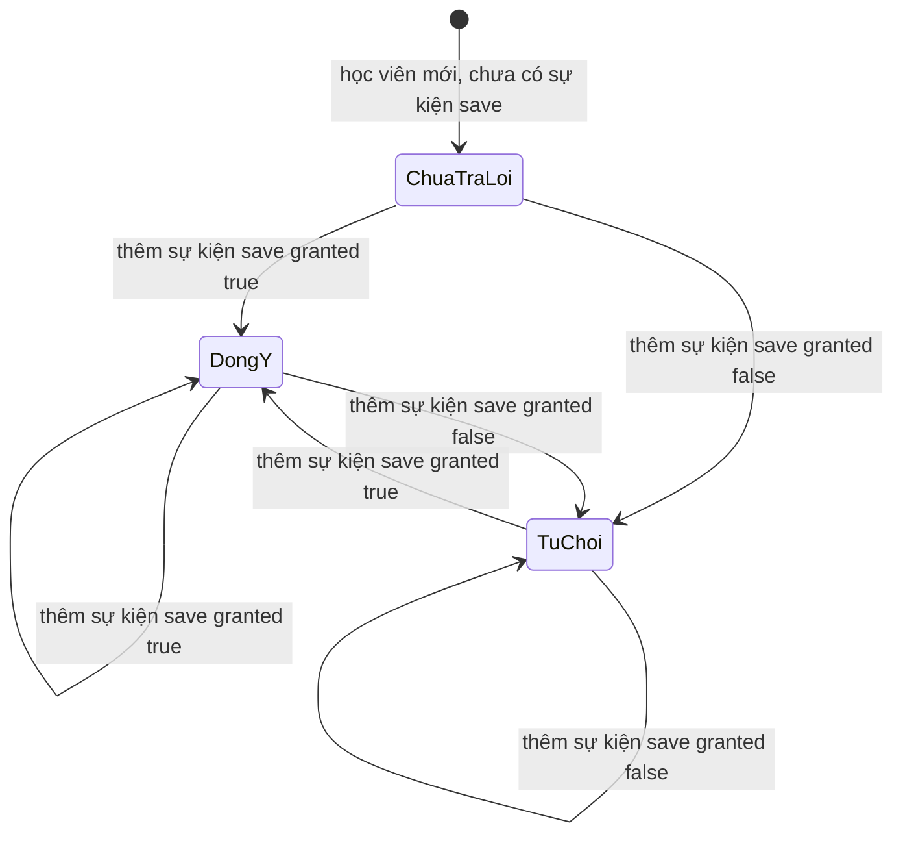
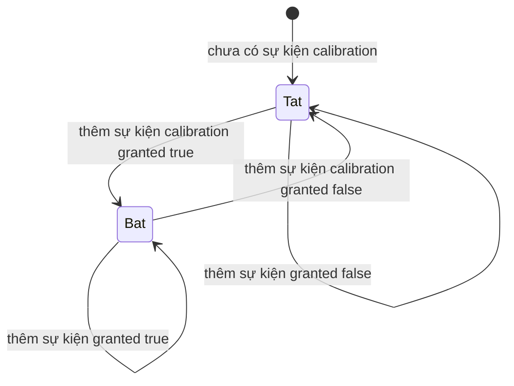

# privacy-controls — States tái lập (reverse)

## State: Đồng ý lưu bài (save) của một học viên

> Nguồn: ✅ [S1:17-22, S1:60-86; S2:73-111, S2:136-159]. Không có cột trạng thái trong DB: trạng thái được suy ra từ sự kiện mới nhất theo loại. Chuyển trạng thái = thêm sự kiện mới (chỉ thêm, không sửa). Tên trạng thái bên dưới là nhãn của tài liệu này, không phải enum trong code.

**Ghi chú trạng thái:**

| Trạng thái | Ý nghĩa | Vào bằng | Ra bằng | Nguồn | Nhãn |
|-----------|---------|----------|---------|-------|------|
| ChuaTraLoi | Chưa có sự kiện save nào: đọc đồng ý trả save=false, hasAnswered=false; hàm kiểm tra đồng ý ném FORBIDDEN | Mặc định | Có sự kiện save đầu tiên | S1:17-22, S1:77-85; S2:73-80 | ✅ |
| DongY | Sự kiện save mới nhất có granted=true | Thêm sự kiện save granted=true | Thêm sự kiện save granted=false | S1:77, S2:97-100 | ✅ |
| TuChoi | Sự kiện save mới nhất có granted=false; hasAnswered=true; hàm kiểm tra đồng ý vẫn cho qua | Thêm sự kiện save granted=false | Thêm sự kiện save granted=true | S1:17-34; S2:113-124, S2:144-148 | ✅ |
| Hiệu lực nghiệp vụ của từng trạng thái đối với việc lưu bài | Bài thi luôn lưu bất kể trạng thái (D-10) | — | — | S5:12-16 | 🟡 (code không dùng trạng thái này để chặn gì; OQ-2, OQ-5) |

## State: Đồng ý hiệu chuẩn (calibration, bí danh train)

> Nguồn: ✅ [S1:70-85, S1:110; S2:82-124]. Cấu trúc giống trạng thái save nhưng không có nhãn "chưa trả lời" riêng: thiếu sự kiện thì coi là không đồng ý (calibration=false) và `hasAnswered` không phụ thuộc loại này.

**Ghi chú trạng thái:**

| Trạng thái | Ý nghĩa | Vào bằng | Ra bằng | Nguồn | Nhãn |
|-----------|---------|----------|---------|-------|------|
| Tat | calibration=false, train=false (kể cả khi chưa có sự kiện) | Mặc định hoặc sự kiện granted=false | Sự kiện granted=true | S1:78, S1:82-83; S2:73-80, S2:102-111 | ✅ |
| Bat | calibration=true, train=true | Sự kiện granted=true (từ dạng từng loại, hoặc calibration / train trong dạng gộp) | Sự kiện granted=false | S1:110-118; S2:113-124 | ✅ |
| Hiệu lực của Bat với bài thi | Bài thi luôn calibrationGranted=false dù trạng thái là Bat | — | — | S5:16 | 🟡 (OQ-5) |

## Không mô hình hoá thêm

- **Vòng đời bài thi (attempt.status)** thuộc feature mock-exam.
- **Vòng đời khiếu nại** thuộc score-dispute / dispute-admin; chỉ cờ chia sẻ ghi âm (không đổi sau khi gửi trong code đã đọc) được nêu ở BR-019..021 trong spec.
- **Xoá dữ liệu cá nhân** không có thực thể nhiều trạng thái (không có cột trạng thái xoá / yêu cầu xoá) — nên không vẽ.
