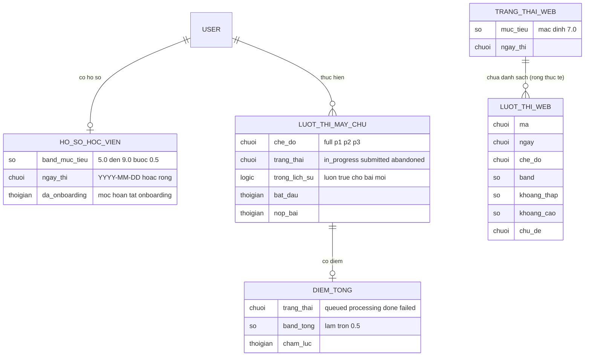

# progress-history — ERD tái lập (reverse)

## Entity Reference

| Entity | Mô tả nghiệp vụ | Thuộc tính chính | Nguồn | Nhãn |
|--------|-----------------|------------------|-------|------|
| USER | Học viên (thuộc feature đăng nhập) | — | packages/db/src/schema/profile.ts:7-9 | ✅ |
| HO_SO_HOC_VIEN | Mục tiêu band và ngày thi của học viên; 1-1 với học viên | band mục tiêu, ngày thi, mốc onboarding | packages/db/src/schema/profile.ts:6-12 | ✅ |
| LUOT_THI_MAY_CHU | Một lượt thi đã lưu ở máy chủ | chế độ, trạng thái, cờ trong lịch sử, thời điểm bắt đầu/nộp | packages/db/src/schema/attempt.ts:5-24 | ✅ |
| DIEM_TONG | Điểm tổng của một lượt, tạo khi nộp; 1-1 với lượt | trạng thái chấm, band tổng làm tròn 0.5, thời điểm chấm | packages/db/src/schema/score.ts:11-39 | ✅ |
| TRANG_THAI_WEB | Trạng thái ứng dụng phía trình duyệt cho Dashboard/Lịch sử | mục tiêu, ngày thi, danh sách lượt | apps/web/src/features/app-state/types.ts:65-75 | ✅ |
| LUOT_THI_WEB | Bản ghi lượt thi để hiển thị (giả lập, không khớp bảng máy chủ) | mã, ngày, chế độ, band, khoảng thấp-cao, chủ đề | apps/web/src/features/history/types.ts:3-10 | ✅ |

## Quan hệ

| Từ | Đến | Bản số | Ý nghĩa | Nguồn | Nhãn |
|----|-----|--------|---------|-------|------|
| USER | HO_SO_HOC_VIEN | 1-0..1 | Mỗi học viên tối đa một hồ sơ (khóa chính là mã học viên) | packages/db/src/schema/profile.ts:7-9 | ✅ |
| USER | LUOT_THI_MAY_CHU | 1-N | Học viên có nhiều lượt thi | packages/db/src/schema/attempt.ts:9-11 | ✅ |
| LUOT_THI_MAY_CHU | DIEM_TONG | 1-0..1 | Điểm tổng khóa chính theo mã lượt | packages/db/src/schema/score.ts:14-16 | ✅ |
| TRANG_THAI_WEB | LUOT_THI_WEB | 1-N | State chứa danh sách lượt; thực tế rỗng và không có nơi gán | apps/web/src/features/app-state/types.ts:74; apps/web/src/features/app-state/initial-state.ts:13 | 🔵 |
| LUOT_THI_MAY_CHU | LUOT_THI_WEB | — | **Không có ánh xạ nào trong code** | packages/api/src/routers/index.ts:11-28 | 🟡 |

## Notes

* Không có ánh xạ giữa lượt thi máy chủ và bản ghi hiển thị phía web: web cần ngày dạng chuỗi, khoảng band thấp-cao và chủ đề, trong khi máy chủ lưu mốc thời gian, chế độ, band tổng và (trong điểm tổng) điểm tiêu chí dạng JSON; khoảng band không thấy lưu ở bảng điểm tổng (chỉ các lần chấm riêng lẻ trong `score_run` có điểm từng lần). 🟡 OQ-3.
* Bảng `attempt_answer`, `score_run`, `consent_event` và các bảng tranh chấp/forecast không mô hình hóa vì không dùng bởi hai màn này.
* Tên thuộc tính DB thật cố ý chuyển sang thuật ngữ nghiệp vụ.
