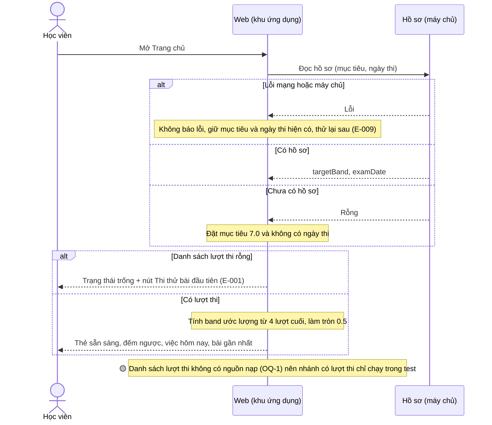
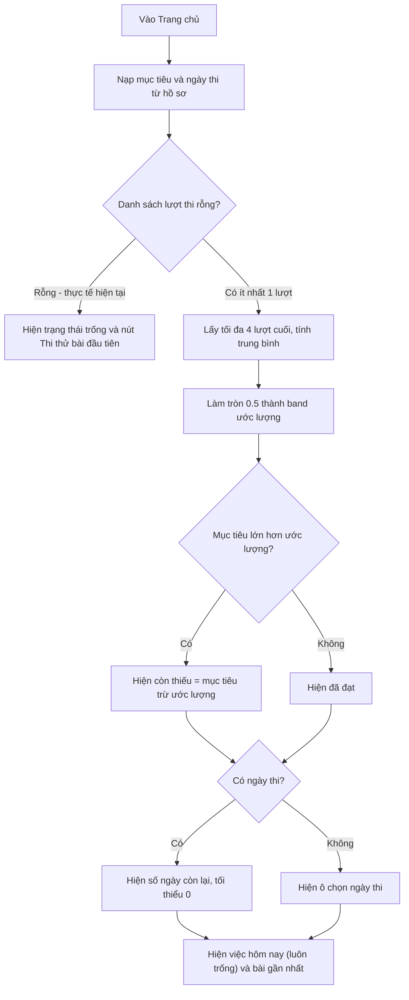
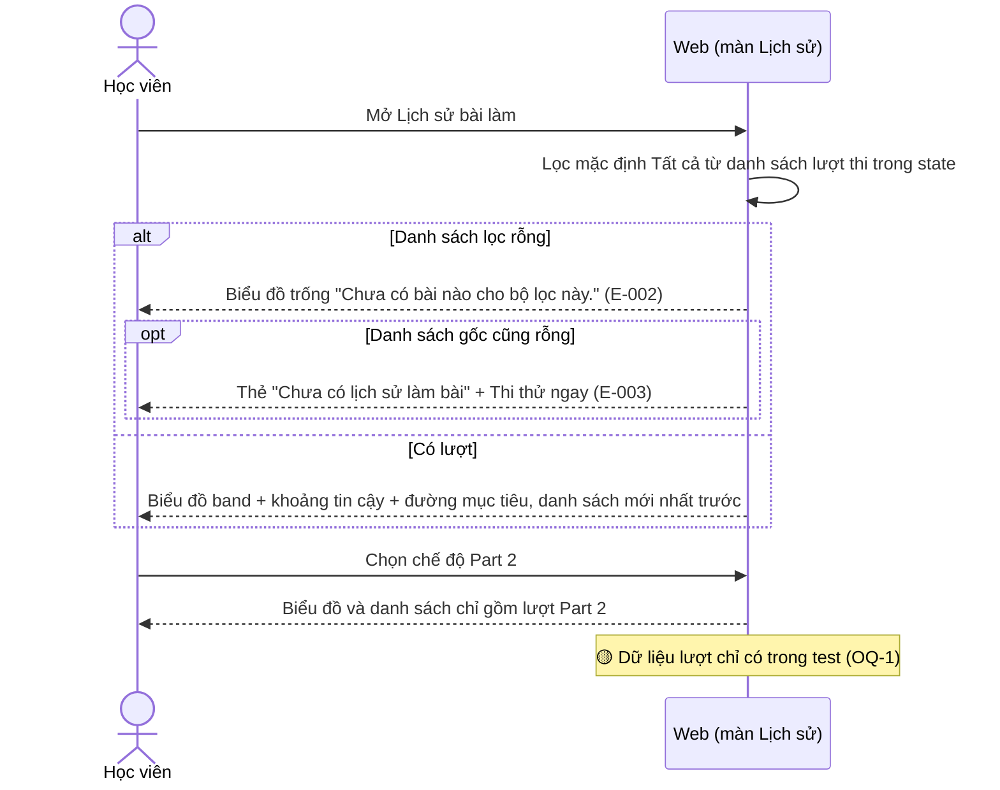
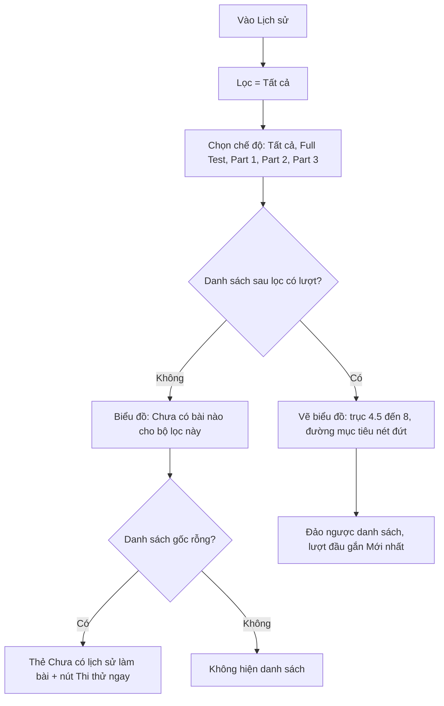
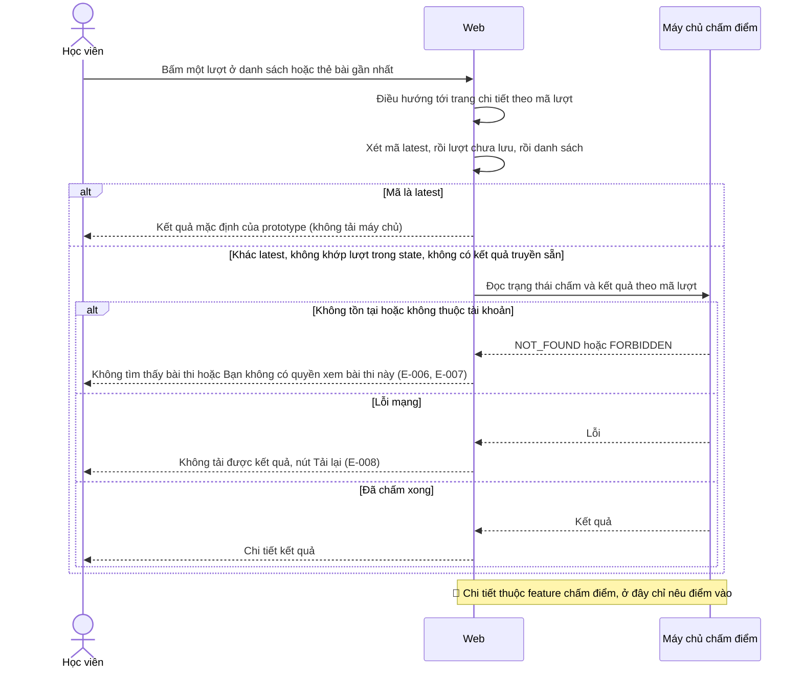
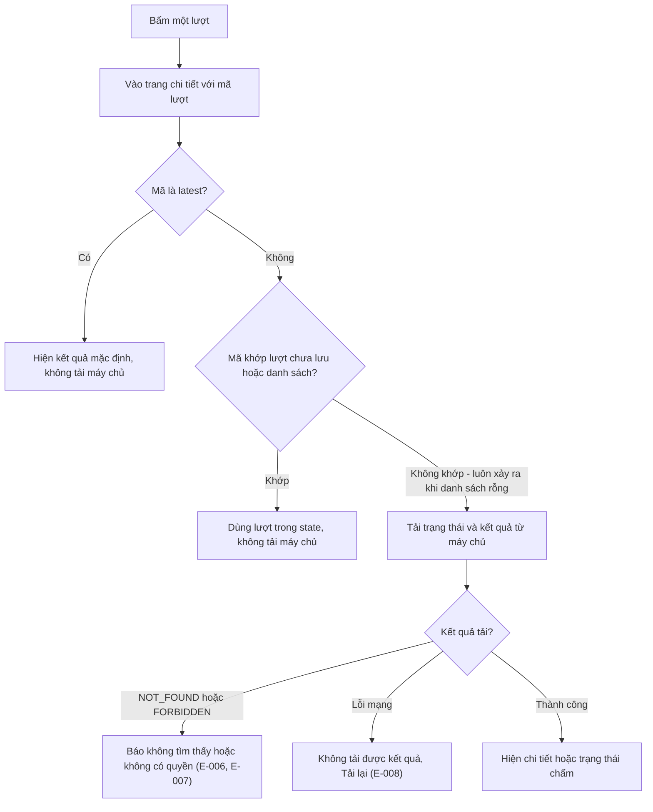
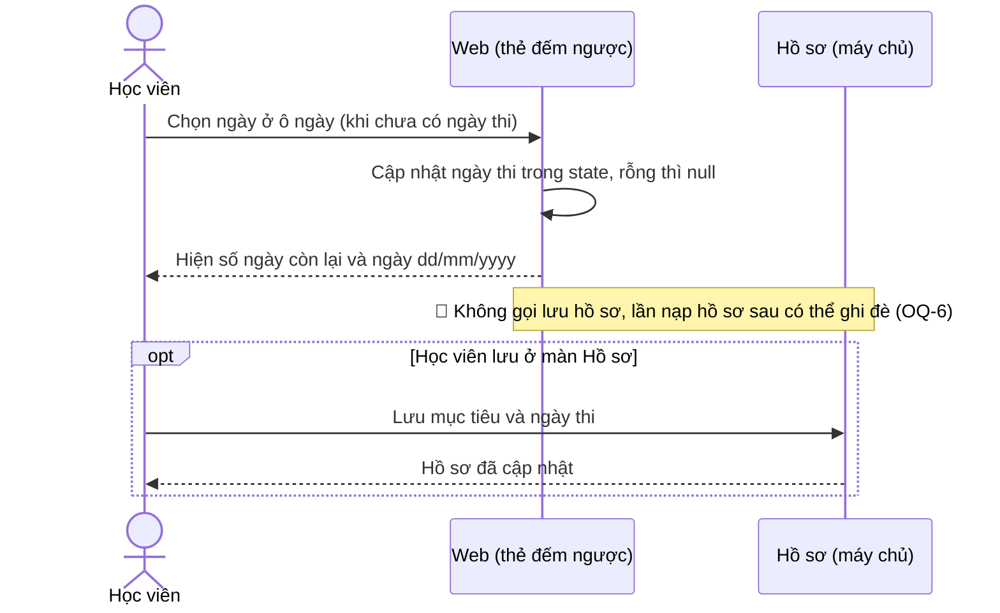
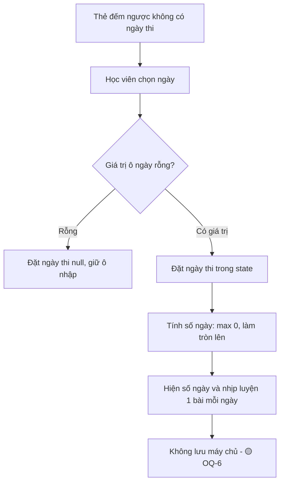

# progress-history — Flows tái lập (reverse)

> Lưu ý: ở production danh sách lượt thi luôn rỗng (OQ-1). Các nhánh "có dữ liệu" mô tả hành vi UI khi được cấp dữ liệu, được xác nhận bằng test với dữ liệu giả lập.

## Flow: Xem Trang chủ (Dashboard)

### Sequence — Xem Trang chủ

### Activity — Xem Trang chủ

## Flow: Xem Lịch sử và lọc theo chế độ

### Sequence — Xem Lịch sử

### Activity — Xem Lịch sử

## Flow: Mở chi tiết một lượt thi

### Sequence — Mở chi tiết lượt

### Activity — Mở chi tiết lượt

## Flow: Nhập ngày thi từ thẻ đếm ngược

### Sequence — Nhập ngày thi

### Activity — Nhập ngày thi

