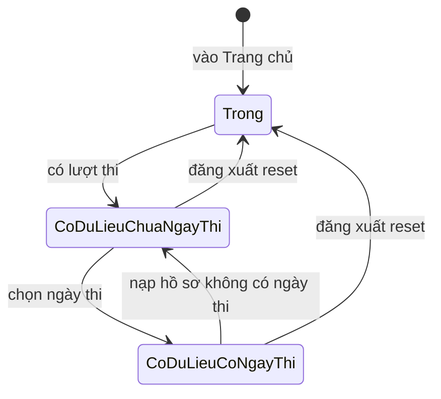
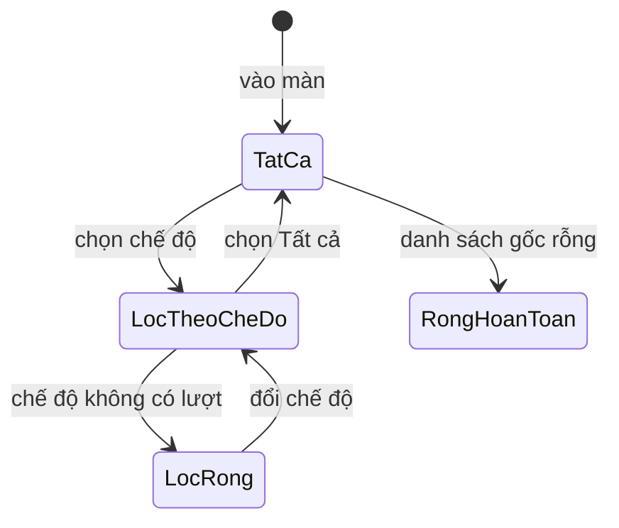

# progress-history — States tái lập (reverse)

> Lược: phía web, lượt thi (`Attempt`) là bản ghi chỉ-đọc không có trường trạng thái (apps/web/src/features/history/types.ts:3-10) nên không có vòng đời để vẽ. Trạng thái `in_progress/submitted/abandoned` của lượt và `queued/processing/done/failed` của điểm thuộc feature thi và chấm điểm. Dưới đây chỉ vẽ trạng thái hiển thị của hai màn (suy từ nhánh điều kiện trong code), không phải vòng đời dữ liệu.

## State: Hiển thị Trang chủ

> Nguồn: ✅ [apps/web/src/features/dashboard/dashboard-screen.tsx:17-40,59-65; apps/web/src/features/dashboard/components/countdown-card.tsx:16,38-46]. Hai trạng thái "CoDuLieu..." chỉ đạt được khi danh sách lượt thi có phần tử (🟡 OQ-1).

**Ghi chú trạng thái:**

| Trạng thái | Ý nghĩa | Vào bằng | Ra bằng | Nguồn | Nhãn |
|-----------|---------|----------|---------|-------|------|
| Trong | Chưa có lượt thi: chỉ chào + nút thi thử đầu tiên | Vào màn khi danh sách rỗng (mặc định thực tế) | Danh sách có phần tử | apps/web/src/features/dashboard/dashboard-screen.tsx:17-40 | ✅ |
| CoDuLieuChuaNgayThi | Có lượt thi, thẻ đếm ngược hiện ô chọn ngày | Danh sách có phần tử, ngày thi null | Chọn ngày | apps/web/src/features/dashboard/components/countdown-card.tsx:38-46 | ✅ |
| CoDuLieuCoNgayThi | Có lượt thi, thẻ đếm ngược hiện số ngày | Ngày thi khác null | Ngày thi null (nạp hồ sơ không có ngày thi) | apps/web/src/features/dashboard/components/countdown-card.tsx:16-24 | ✅ |
| Chuyển "có phần tử" cho danh sách | Không có hành động nào trong code gán danh sách | — | — | apps/web/src/features/app-state/initial-state.ts:13 | 🟡 |

## State: Hiển thị Lịch sử

> Nguồn: ✅ [apps/web/src/features/history/history-screen.tsx:17-18,47-75].

**Ghi chú trạng thái:**

| Trạng thái | Ý nghĩa | Vào bằng | Ra bằng | Nguồn | Nhãn |
|-----------|---------|----------|---------|-------|------|
| TatCa | Bộ lọc Tất cả, hiện biểu đồ + danh sách | Vào màn | Chọn chế độ | apps/web/src/features/history/history-screen.tsx:17 | ✅ |
| LocTheoCheDo | Chỉ lượt cùng chế độ | Bấm nút chế độ | Bấm nút khác | apps/web/src/features/history/history-screen.tsx:18,25-30 | ✅ |
| LocRong | Chế độ không có lượt: biểu đồ báo trống, ẩn danh sách | Lọc ra rỗng khi danh sách gốc có phần tử | Đổi bộ lọc | apps/web/src/features/history/history-screen.tsx:47-57,60-75 | ✅ |
| RongHoanToan | Danh sách gốc rỗng: biểu đồ trống + thẻ Chưa có lịch sử làm bài | Danh sách rỗng (mặc định thực tế) | Có lượt (chưa có đường) | apps/web/src/features/history/history-screen.tsx:62-74 | ✅ |
