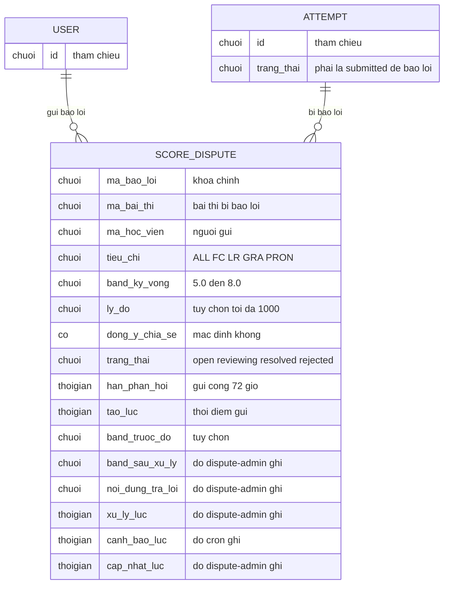

# score-dispute — ERD tái lập (reverse)

## Entity Reference

| Entity | Mô tả nghiệp vụ | Thuộc tính chính | Nguồn | Nhãn |
|--------|-----------------|------------------|-------|------|
| SCORE_DISPUTE (báo lỗi chấm) | Một yêu cầu rà soát điểm của học viên cho một bài thi | tiêu chí, band kỳ vọng, lý do, đồng ý chia sẻ, trạng thái, hạn, thời điểm tạo, band trước đó; (band sau xử lý, trả lời, thời điểm xử lý, cảnh báo, cập nhật: các feature khác ghi) | packages/db/src/schema/dispute.ts:8-47 | ✅ |
| ATTEMPT (bài thi) | Bài thi bị báo lỗi; chỉ bài `submitted` mới được báo lỗi | trạng thái, chủ sở hữu | packages/api/src/routers/dispute.ts:55-60 | ✅ |
| USER (học viên) | Người gửi báo lỗi, bằng chủ bài thi | id | packages/db/src/schema/dispute.ts:18 | ✅ |

## Quan hệ

| Từ | Đến | Bản số | Ý nghĩa | Nguồn | Nhãn |
|----|-----|--------|---------|-------|------|
| ATTEMPT | SCORE_DISPUTE | 1-N (nhưng tối đa 1 hoạt động mỗi bài thi) | Một bài thi có thể có nhiều báo lỗi theo thời gian, chỉ một đang open/reviewing | packages/db/src/schema/dispute.ts:15,44-46 | ✅ |
| USER | SCORE_DISPUTE | 1-N | Người gửi; xóa người dùng xóa báo lỗi (xóa dây chuyền) | packages/db/src/schema/dispute.ts:18 | ✅ |
| ATTEMPT | USER | N-1 | Chủ bài thi phải trùng người gửi (kiểm tra ở nghiệp vụ, không có ràng buộc khóa) | packages/api/src/routers/dispute.ts:48 | ✅ |

## Notes

* Khóa ngoại: xóa bài thi hoặc người dùng thì xóa báo lỗi theo (ON DELETE CASCADE) ✅ [packages/db/src/migrations/20261105123206_careful_paladin/migration.sql:13-14].
* Chỉ mục duy nhất có điều kiện: mỗi bài thi tối đa 1 bản ghi có trạng thái open hoặc reviewing ✅ [packages/db/src/migrations/20261105123206_careful_paladin/migration.sql:20].
* Chỉ mục phụ: theo người dùng, bài thi, trạng thái, hạn ✅ [packages/db/src/schema/dispute.ts:40-43, packages/db/src/migrations/20261105131332_tranquil_sharon_ventura/migration.sql:6].
* Tên thuộc tính ERD dùng tiếng Việt không dấu để mermaid hợp lệ; tên cột DB thật cố ý không đưa vào hình (xem Entity Reference và `_evidence.md`).
* Bảng sau xử lý/quản trị (các cột ghi bởi `dispute-admin`) chỉ nêu tên để thấy bức tranh, thuộc feature khác.
