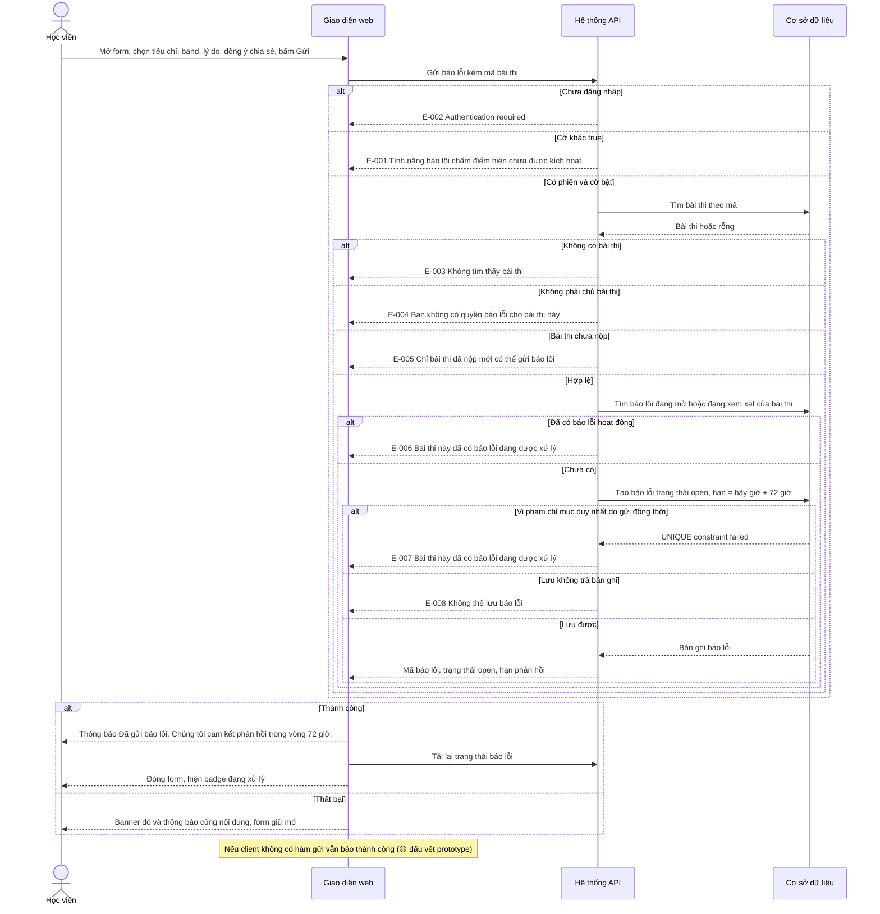
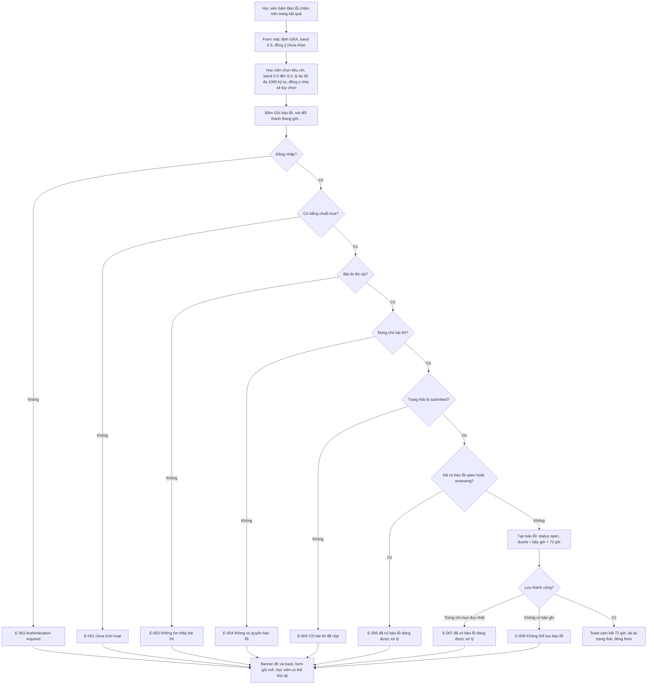
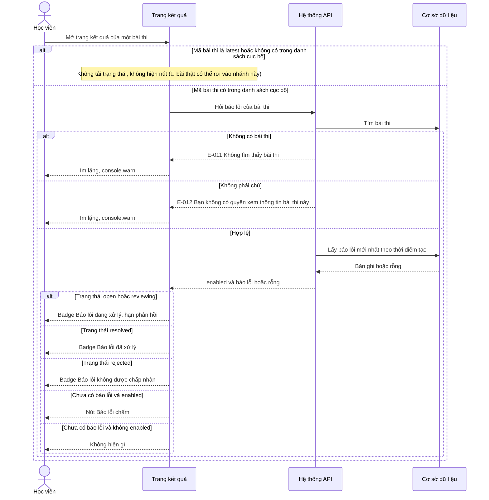
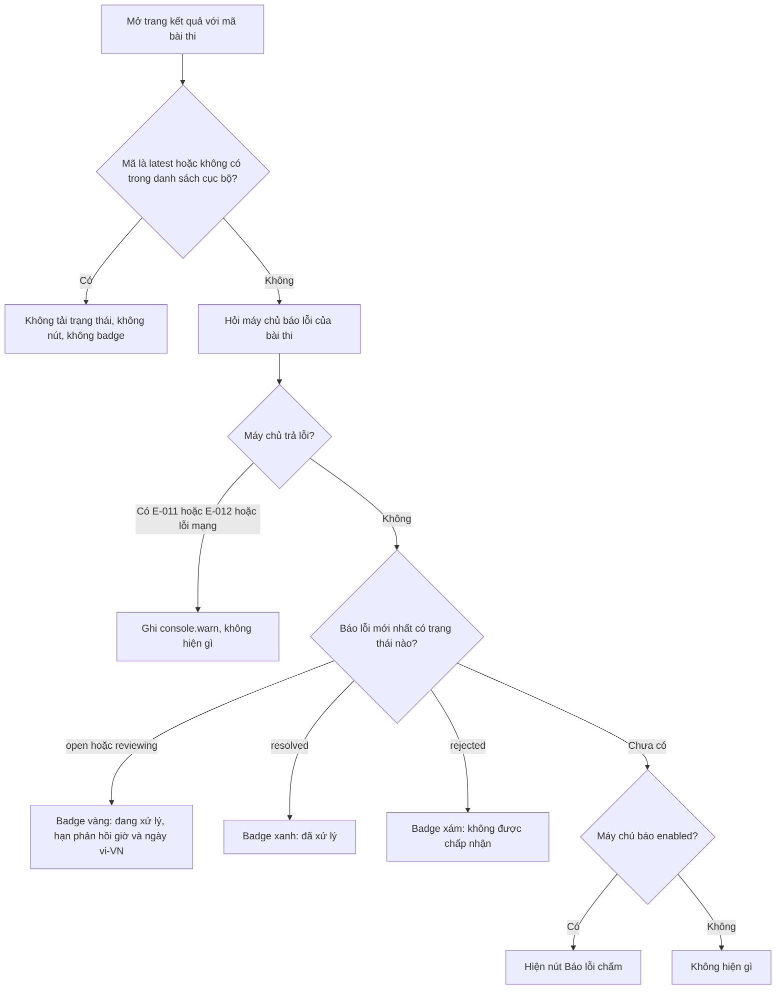
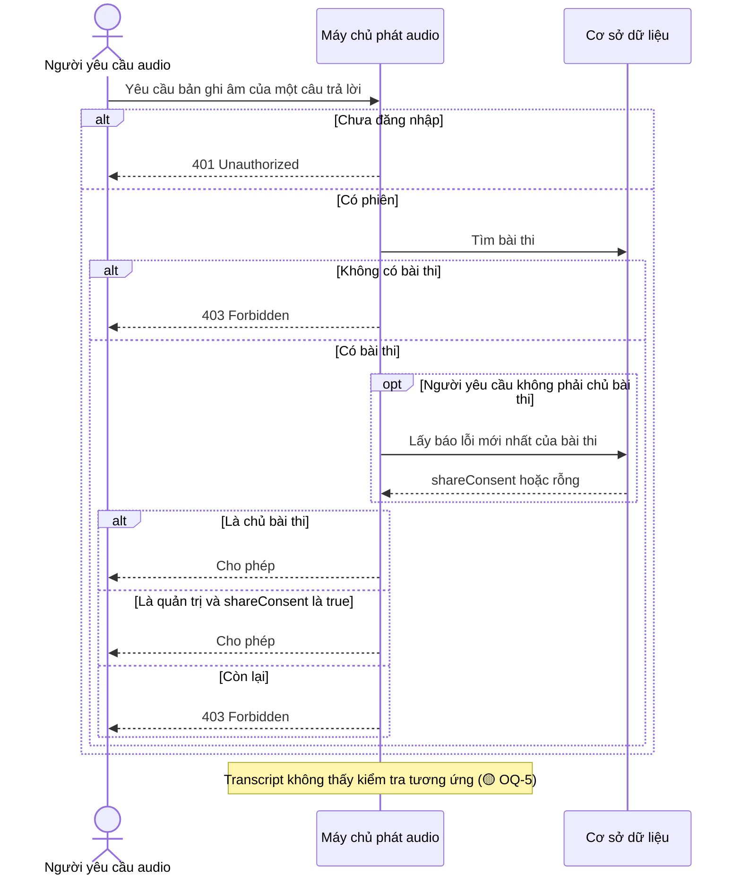
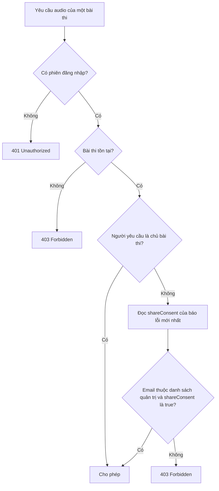

# score-dispute — Flows tái lập (reverse)

> Mọi bước vẽ ra đều có trong code (nguồn ở chú thích). Bước suy đoán đánh dấu 🔵/🟡. Cờ `SCORE_DISPUTE_ENABLED` mặc định tắt: nhánh gửi chỉ chạy khi cờ bằng chuỗi `true` 🟡 (chưa biết giá trị thật).

## Flow: Gửi báo lỗi chấm

Nguồn: packages/api/src/routers/dispute.ts:24-131; apps/web/src/features/results/components/report-modal.tsx:40-69.

### Sequence — Gửi báo lỗi chấm

### Activity — Gửi báo lỗi chấm

## Flow: Xem trạng thái báo lỗi trên trang kết quả

Nguồn: packages/api/src/routers/dispute.ts:133-169; apps/web/src/features/results/results-screen.tsx:75-91,318-344.

### Sequence — Xem trạng thái báo lỗi

### Activity — Xem trạng thái báo lỗi

## Flow: Đồng ý chia sẻ quyết định quyền nghe audio (điểm bàn giao)

Nguồn: apps/server/src/index.ts:301-344; packages/api/src/auth-utils.ts:23-37. Thuộc kênh phát audio, vẽ để thấy hệ quả của ô đồng ý.

### Sequence — Quyền nghe audio theo đồng ý

### Activity — Quyền nghe audio theo đồng ý

