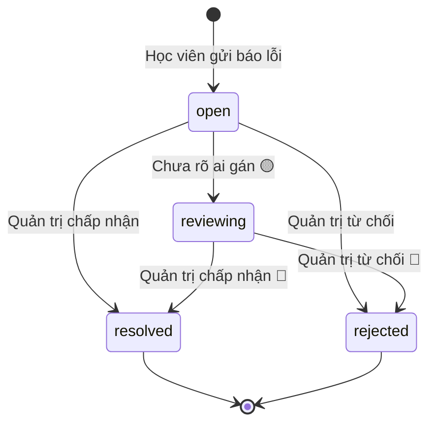

# score-dispute — States tái lập (reverse)

## State: Báo lỗi chấm (score dispute)

> Nguồn: ✅ [packages/db/src/schema/dispute.ts:25-27] (bốn giá trị trạng thái), ✅ [packages/api/src/routers/dispute.ts:96] (khởi tạo open). Chuyển sang resolved/rejected do feature `dispute-admin` thực hiện ✅ [packages/api/src/routers/dispute-admin.ts:244-281]. Chuyển sang reviewing: KHÔNG có code gán 🟡.

**Ghi chú trạng thái:**

| Trạng thái | Ý nghĩa | Vào bằng | Ra bằng | Nguồn | Nhãn |
|-----------|---------|----------|---------|-------|------|
| open | Báo lỗi vừa gửi, chờ xử lý, hạn phản hồi 72 giờ. Là "hoạt động": chặn báo lỗi mới cùng bài thi; giao diện hiện badge "đang xử lý". | Học viên gửi báo lỗi thành công | Quản trị chuyển resolved hoặc rejected (chỉ từ open/reviewing) | packages/api/src/routers/dispute.ts:96; packages/api/src/routers/dispute-admin.ts:244-281 | ✅ |
| reviewing | Đang xem xét. Được coi là "hoạt động" ở mọi nơi kiểm tra (chặn trùng, cảnh báo quá hạn, badge). Không có nơi nào gán. | Không có code gán | resolved hoặc rejected (theo điều kiện cập nhật chấp nhận cả open lẫn reviewing) | packages/db/src/schema/dispute.ts:25; packages/api/src/routers/dispute-admin.ts:272 | 🟡 |
| resolved | Đã xử lý, có band sau xử lý và nội dung trả lời; không còn "hoạt động". Học viên thấy badge "Báo lỗi đã xử lý". | Quản trị chấp nhận (cần chọn band cập nhật) | Không có chuyển tiếp (báo lỗi đã đóng không xử lý lại) | packages/api/src/routers/dispute-admin.ts:244-249,251-256; apps/web/src/features/results/results-screen.tsx:329-333 | ✅ |
| rejected | Không chấp nhận. Học viên thấy badge "Báo lỗi không được chấp nhận". | Quản trị từ chối | Không có | packages/api/src/routers/dispute-admin.ts:10,262; apps/web/src/features/results/results-screen.tsx:334-338 | ✅ |

> Học viên KHÔNG có chuyển trạng thái nào (không hủy/rút báo lỗi) — negative-search: không có hàm hủy trong packages/api/src/routers/dispute.ts 🟡 (OQ-4).
