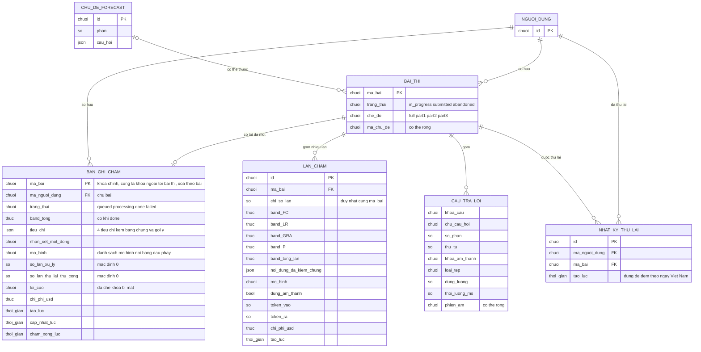

# scoring-results — ERD tái lập (reverse)

> Chỉ vẽ ba bảng do feature sở hữu (bản ghi chấm, lần chấm, nhật ký thử lại) và các thực thể tham chiếu ở dạng rút gọn. Kiểu cột ghi theo ngôn ngữ nghiệp vụ gọn (chuoi, so, thuc, thoi_gian, dung_sai, json). Nguồn dùng ID trong [`../reverse-sources.md`](../reverse-sources.md).

## Entity Reference

| Entity | Mô tả nghiệp vụ | Thuộc tính chính | Nguồn | Nhãn |
|--------|-----------------|------------------|-------|------|
| BAN_GHI_CHAM | Điểm tổng hợp duy nhất của một bài thi; theo dõi vòng đời chấm | trạng thái; band tổng; JSON 4 tiêu chí; nhận xét một dòng; mô hình; số lần xử lý; số lần thử lại thủ công (tối đa 1); lỗi cuối; chi phí; ba mốc thời gian | S14: packages/db/src/schema/score.ts:11-46 | ✅ |
| LAN_CHAM | Một lần chấm độc lập của AI; không bao giờ hiển thị cho học viên | chỉ số lần, 4 band + band tổng của lần, JSON đã kiểm chứng, mô hình, có dùng âm thanh, token, chi phí; duy nhất theo (bài, chỉ số lần) | S14: packages/db/src/schema/score.ts:48-85 | ✅ |
| NHAT_KY_THU_LAI | Mỗi dòng = một lượt thử lại thủ công đã được chấp nhận; nền cho hạn mức 3 lần/ngày/người | người dùng, bài, thời điểm | S14: packages/db/src/schema/score.ts:87-109 | ✅ |
| BAI_THI | Tham chiếu (thuộc mock-exam): chủ sở hữu bài; trạng thái bài; chế độ; chủ đề | trạng thái, chế độ, mã chủ đề | S2: packages/api/src/scoring/score-attempt.ts:239; S10: packages/api/src/scoring/types.ts:37 | 🔵 |
| CAU_TRA_LOI | Tham chiếu: câu trả lời và ghi âm của bài; nơi lưu phiên âm | khóa câu, chữ câu hỏi, phần, thứ tự, khóa âm thanh, loại tệp, dung lượng, thời lượng, phiên âm | S2: packages/api/src/scoring/score-attempt.ts:244-248, packages/api/src/scoring/score-attempt.ts:357; S1: packages/api/src/routers/scoring.ts:206-216 | 🔵 |
| CHU_DE_FORECAST | Tham chiếu: nguồn câu hỏi chuẩn của bài theo chủ đề | id, tiêu đề, phần, danh sách câu hỏi | S2: packages/api/src/scoring/score-attempt.ts:264-277 | 🔵 |
| NGUOI_DUNG | Tham chiếu: chủ bài thi, bản ghi chấm và nhật ký | id | S14: packages/db/src/schema/score.ts:17-19 | 🔵 |

## Quan hệ

| Từ | Đến | Bản số | Ý nghĩa | Nguồn | Nhãn |
|----|-----|--------|---------|-------|------|
| BAI_THI | BAN_GHI_CHAM | 1 — 0..1 | Mỗi bài có tối đa một bản ghi chấm (khóa chính là mã bài); xóa bài thì xóa theo | S14: packages/db/src/schema/score.ts:14-16 | ✅ |
| BAI_THI | LAN_CHAM | 1 — 0..N | Một bài có nhiều lần chấm, duy nhất theo chỉ số lần; xóa bài thì xóa theo | S14: packages/db/src/schema/score.ts:54-56, packages/db/src/schema/score.ts:76 | ✅ |
| NGUOI_DUNG | BAN_GHI_CHAM | 1 — 0..N | Chủ bản ghi; xóa người dùng thì xóa theo | S14: packages/db/src/schema/score.ts:17-19 | ✅ |
| NGUOI_DUNG | NHAT_KY_THU_LAI | 1 — 0..N | Mỗi lượt thử lại thủ công của người dùng; xóa người dùng thì xóa theo | S14: packages/db/src/schema/score.ts:93-95 | ✅ |
| BAI_THI | NHAT_KY_THU_LAI | 1 — 0..N | Lượt thử lại gắn với bài (một bài tối đa 1 lượt theo luật nghiệp vụ, nhưng cấu trúc cho phép nhiều) | S14: packages/db/src/schema/score.ts:96-98; S1: packages/api/src/routers/scoring.ts:123 | ✅ |
| BAI_THI | CAU_TRA_LOI | 1 — 0..N | Câu trả lời của bài | S2: packages/api/src/scoring/score-attempt.ts:244-248 | 🔵 |
| CHU_DE_FORECAST | BAI_THI | 0..1 — 0..N | Bài có thể thuộc chủ đề Forecast; bài thi thử không có chủ đề | S2: packages/api/src/scoring/score-attempt.ts:264-277 | 🔵 |

## Notes

* Trạng thái `not_scored` KHÔNG được lưu: do lớp API sinh khi không có bản ghi chấm. Cột trạng thái chỉ cho `queued`, `processing`, `done`, `failed`. ✅ [S14: packages/db/src/schema/score.ts:20, S1: packages/api/src/routers/scoring.ts:66]
* Thuộc tính vật lý (tên cột, chỉ mục, khóa ngoại) cố ý không đưa hết; tên nghiệp vụ gọn thay cho tên cột thật. Hai chỉ mục theo người dùng/trạng thái trên bản ghi chấm và chỉ mục (người dùng, thời điểm) trên nhật ký phục vụ truy vấn đếm theo ngày. ✅ [S14: packages/db/src/schema/score.ts:42-43, packages/db/src/schema/score.ts:104-105]
* Bài thi, câu trả lời, chủ đề, người dùng chỉ vẽ phần feature này đọc; cấu trúc đầy đủ thuộc mock-exam / forecast-practice / auth-account.
* Cột band tổng có comment "Median overall band, rounded to the nearest 0.5" lỗi thời so với code (xem C-1 ở `reverse-gaps.md`).
* Theo feature privacy-controls: cả ba bảng được xóa theo người dùng; bản ghi chấm được xuất một phần cột (không có lỗi, chi phí, số lần xử lý), nhật ký thử lại được xuất, còn lần chấm KHÔNG được xuất (hàm xuất trả rỗng). ✅ [S28: packages/api/src/data-registry.ts:124-157, packages/api/src/data-registry.ts:236-243]
