# scoring-results — Flows tái lập (reverse)

> Mỗi flow có hai sơ đồ: `sequenceDiagram` (tương tác giữa các bên) và `flowchart` (bước, quyết định, số liệu thật). Chỉ vẽ bước có trong code; bước suy đoán được chú thích riêng. Nguồn dùng ID trong [`../reverse-sources.md`](../reverse-sources.md). Nhãn: ✅ code/test khẳng định · 🔵 suy đoán có ít nhất 2 chỗ hậu thuẫn · 🟡 cần xác nhận.

## F1: Nộp bài và xếp hàng chấm ✅ [S16, S7, S17]

### Sequence F1

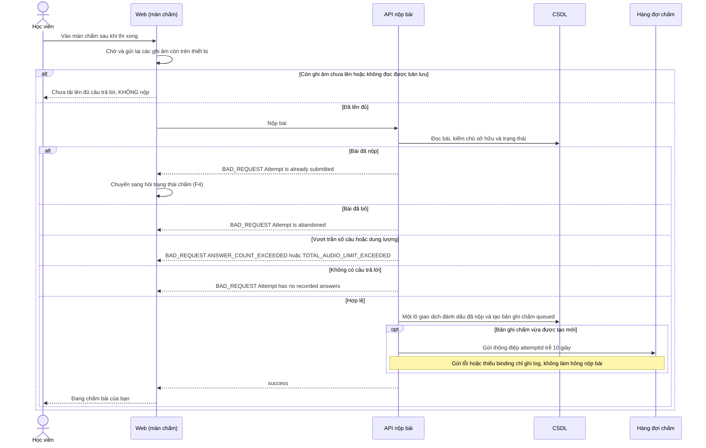

### Flowchart F1

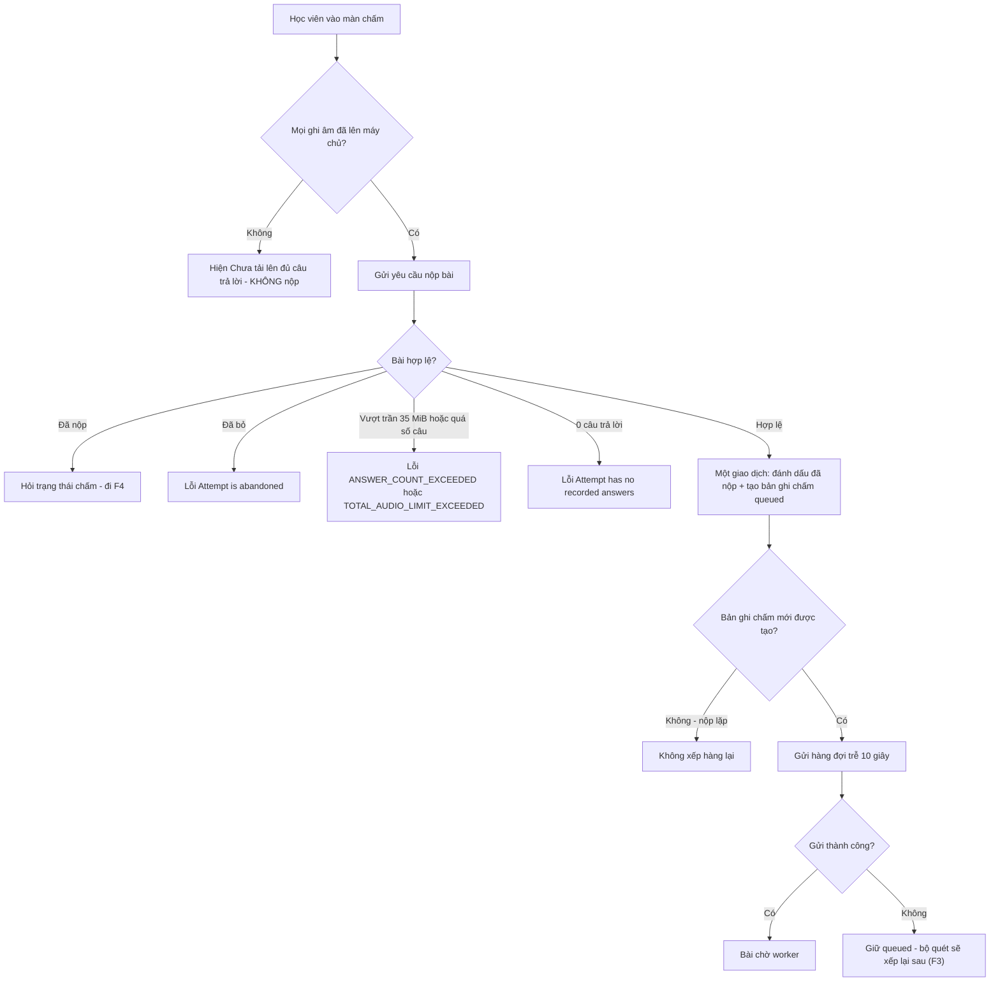

## F2: Worker chấm bài ✅ [S2, S12, S5, S6, S3, S18]

### Sequence F2

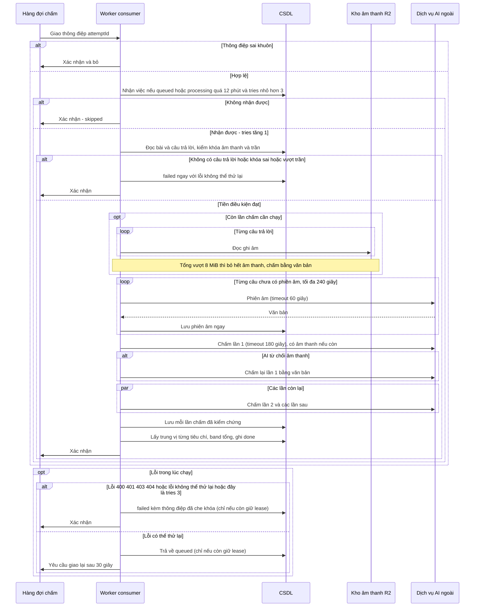

### Flowchart F2

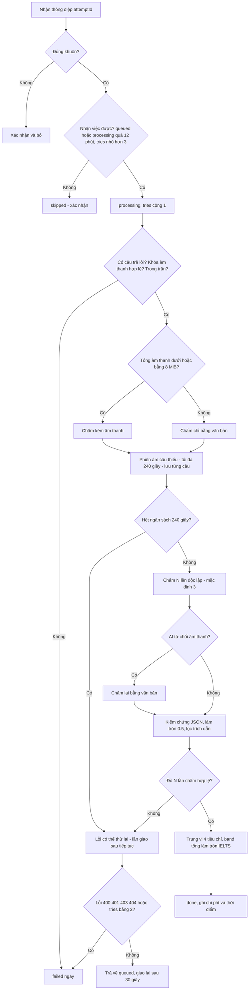

## F3: Quét bài kẹt mỗi 5 phút ✅ [S8, S13]

### Sequence F3

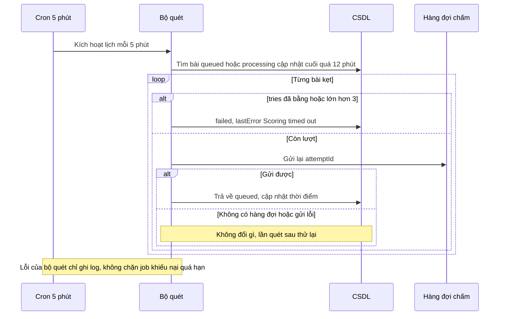

### Flowchart F3

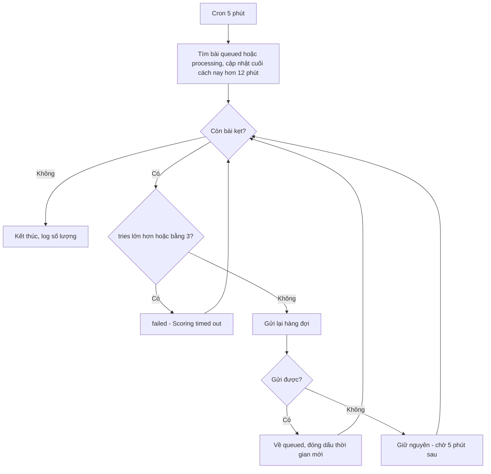

## F4: Theo dõi tiến trình trên màn chấm ✅ [S19, S20, S21]

### Sequence F4

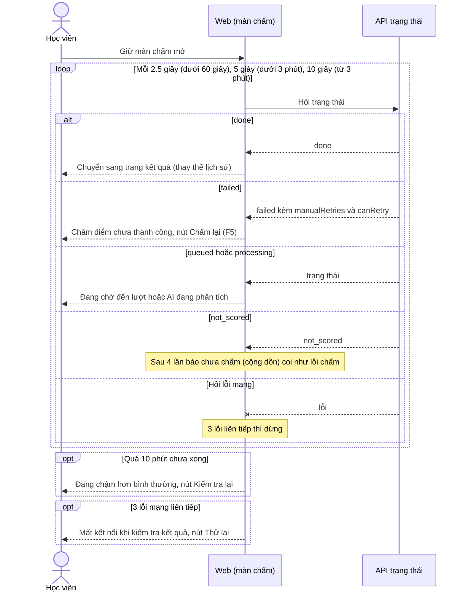

### Flowchart F4

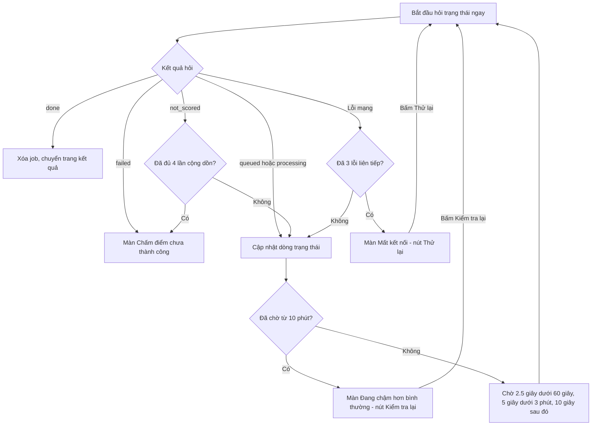

## F5: Thử lại chấm (thủ công hoặc đường cứu) ✅ [S1, S17, S19]

### Sequence F5

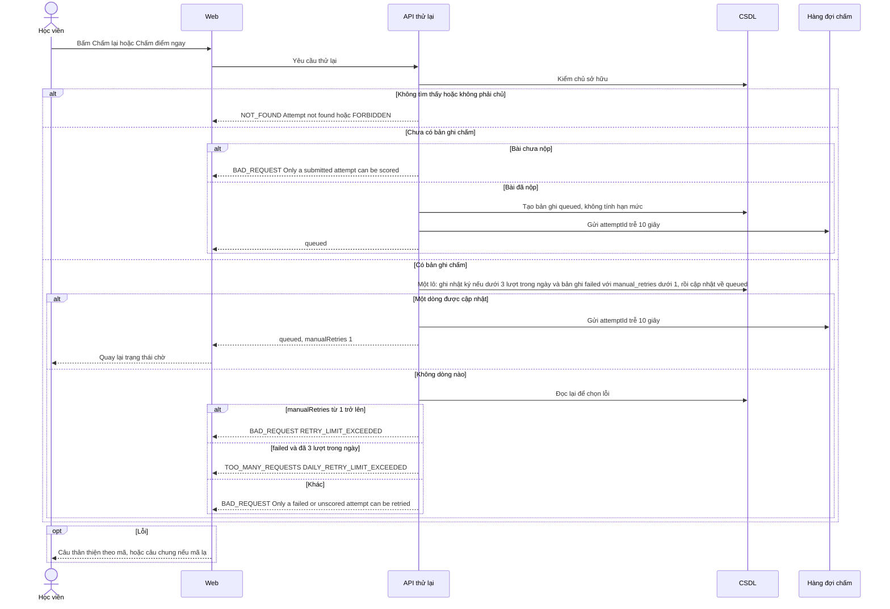

### Flowchart F5

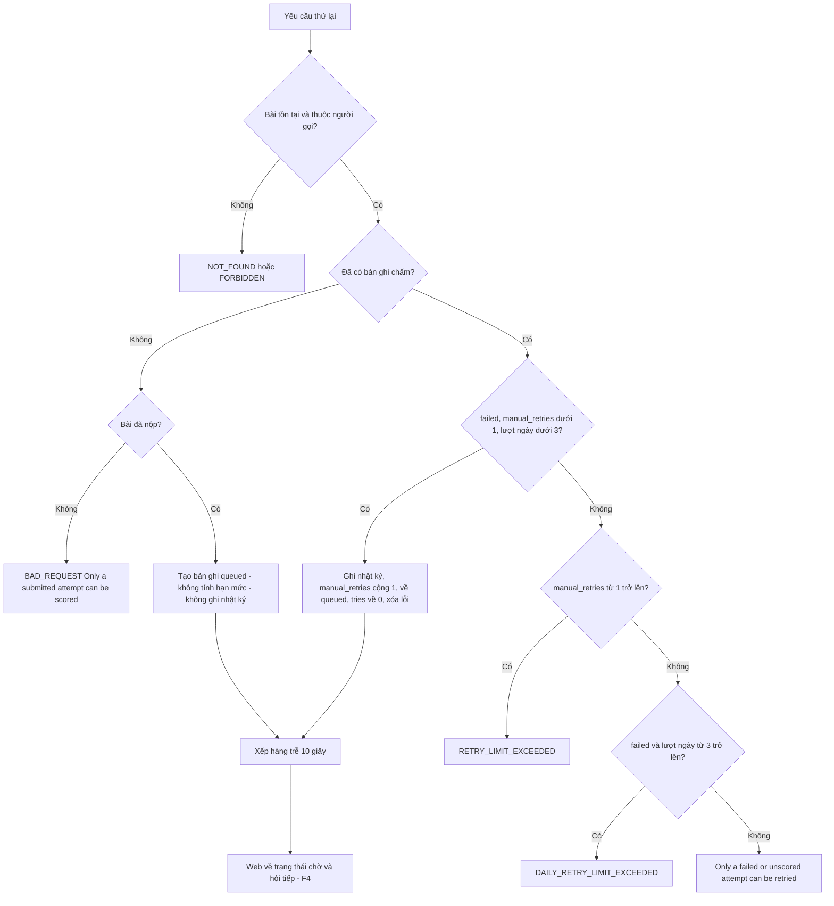

## F6: Xem kết quả ✅ [S22, S23, S1]

### Sequence F6

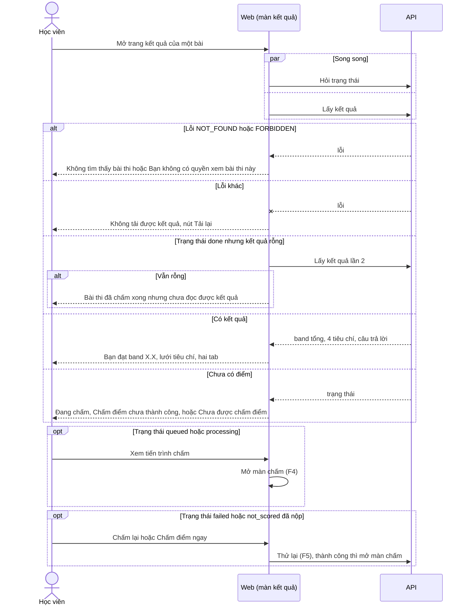

### Flowchart F6

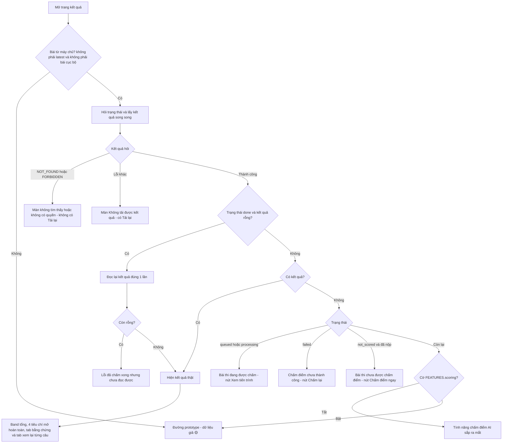
