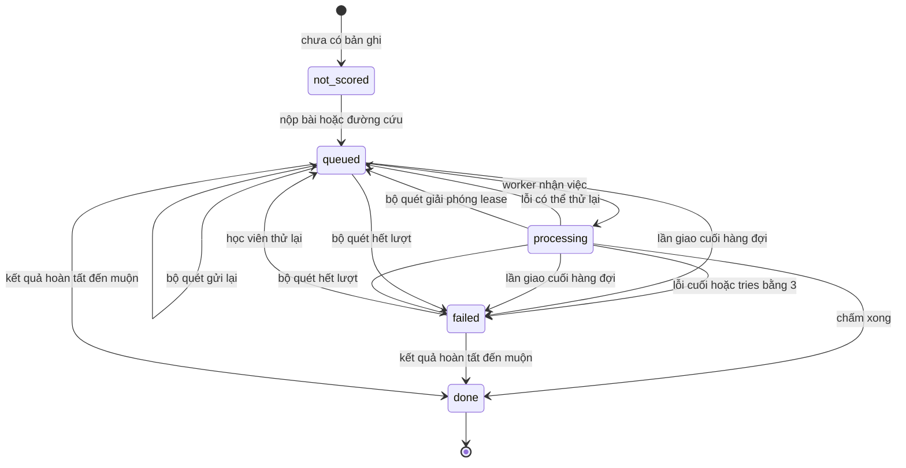
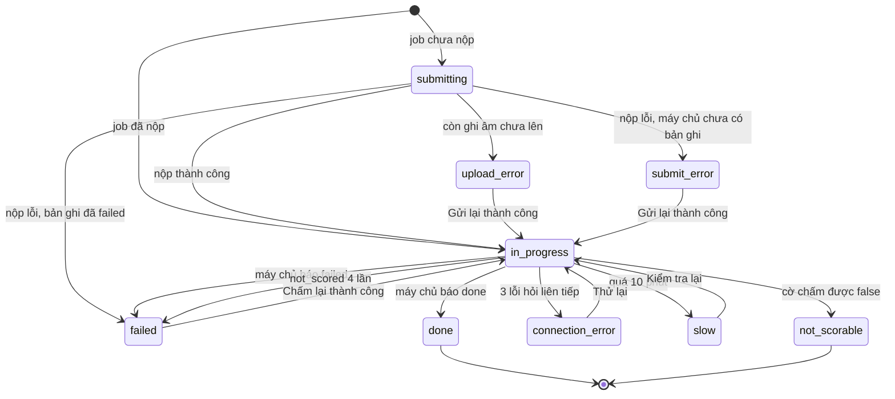

# scoring-results — States tái lập (reverse)

> Hai máy trạng thái: (1) bản ghi chấm điểm phía máy chủ, (2) góc nhìn trên màn chấm phía web. Nguồn dùng ID trong [`../reverse-sources.md`](../reverse-sources.md). Entity "bài thi" (trạng thái đã nộp/bỏ) thuộc feature mock-exam, không vẽ lại ở đây.

## State: Bản ghi chấm điểm (phía máy chủ)

> Nguồn: ✅ [S14: packages/db/src/schema/score.ts:20, S2: packages/api/src/scoring/score-attempt.ts:156-229, S1: packages/api/src/routers/scoring.ts:78-177, S8: packages/api/src/scoring/requeue.ts:25-61]. `not_scored` không phải giá trị lưu: lớp API tự sinh khi chưa có bản ghi.

**Ghi chú trạng thái:**

| Trạng thái | Ý nghĩa | Vào bằng | Ra bằng | Nguồn | Nhãn |
|-----------|---------|----------|---------|-------|------|
| not_scored (tổng hợp, không lưu) | Bài chưa có bản ghi chấm | Mặc định khi không có dòng | Nộp bài tạo bản ghi `queued`, hoặc đường cứu tạo bản ghi `queued` (bài phải đã nộp) | S1: packages/api/src/routers/scoring.ts:66, packages/api/src/routers/scoring.ts:87-103; S16: packages/api/src/routers/attempt.ts:283-291 | ✅ |
| queued | Chờ worker | Tạo mới lúc nộp/cứu; thử lại thủ công; lỗi có thể thử lại trả về; bộ quét xếp lại | Worker nhận việc (khi tries nhỏ hơn 3) → processing; lần giao cuối hoặc bộ quét hết lượt → failed | S2: packages/api/src/scoring/score-attempt.ts:160-180, packages/api/src/scoring/score-attempt.ts:201-216; S8: packages/api/src/scoring/requeue.ts:45-58 | ✅ |
| processing | Worker đang giữ lease (tối đa 12 phút) | Worker nhận việc, tries cộng 1 | done; queued (lỗi thử lại được hoặc bộ quét giải phóng); failed | S2: packages/api/src/scoring/score-attempt.ts:37, packages/api/src/scoring/score-attempt.ts:160-180, packages/api/src/scoring/score-attempt.ts:201-216 | ✅ |
| done | Có band tổng và kết quả | Pipeline ghi kết quả (thắng cả khi bản ghi đang `failed`) | Không có đường ra: worker không nhận bản ghi `done`, đánh dấu lỗi chỉ áp dụng cho `queued`/`processing`, bộ quét bỏ qua `done`, thử lại chỉ cho `failed` | S2: packages/api/src/scoring/score-attempt.ts:126-141, packages/api/src/scoring/score-attempt.ts:478-493; S18: packages/api/src/scoring/score-attempt.test.ts:242, packages/api/src/scoring/score-attempt.test.ts:600 | ✅ |
| failed | Hết cách tự chấm (hoặc lỗi không thể thử lại) | Lỗi cuối; lần giao cuối hàng đợi; bộ quét hết lượt với thông điệp "Scoring timed out" | Học viên thử lại (nếu còn lượt) → queued; hoặc kết quả hoàn tất đến muộn → done | S2: packages/api/src/scoring/score-attempt.ts:190-229; S12: apps/server/src/queue.ts:67-74; S1: packages/api/src/routers/scoring.ts:125-142 | ✅ |
| Đường failed → done | Kết quả của worker khác hoàn tất sau khi bản ghi bị ghi `failed` | Ràng buộc cập nhật chỉ loại `done` | — (comment trong code: "A finished result wins over a failure recorded meanwhile by another worker") | S2: packages/api/src/scoring/score-attempt.ts:492-493 | ✅ |
| Lý do thiết kế các chuyển trạng thái (lease, 3 lượt, ghi đè done) | — | — | — | Không có tài liệu nghiệp vụ; chỉ comment kỹ thuật (OQ-10, OQ-15) | 🟡 |

## State: Góc nhìn màn chấm (phía web)

> Nguồn: ✅ [S19: apps/web/src/features/scoring/use-scoring-job.ts:27-42, apps/web/src/features/scoring/use-scoring-job.ts:131-261, S20: apps/web/src/features/scoring/scoring-screen.tsx:51-58]. Không phải entity lưu trữ, chỉ là trạng thái hiển thị.

**Ghi chú trạng thái:**

| Trạng thái | Ý nghĩa | Vào bằng | Ra bằng | Nguồn | Nhãn |
|-----------|---------|----------|---------|-------|------|
| submitting | "Đang gửi bài thi…" | Job chưa đánh dấu đã nộp | Nộp xong → in_progress; lỗi → upload_error / submit_error / failed / in_progress | S19: apps/web/src/features/scoring/use-scoring-job.ts:131, apps/web/src/features/scoring/use-scoring-job.ts:166-198 | ✅ |
| upload_error | Còn ghi âm chưa lên máy chủ hoặc không đọc được bản lưu | Bước chờ tải lên báo chưa đủ | Gửi lại (kiểm lại) hoặc nộp bỏ qua → in_progress | S19: apps/web/src/features/scoring/use-scoring-job.ts:159-164, apps/web/src/features/scoring/use-scoring-job.ts:280-326 | ✅ |
| submit_error | Nộp lỗi và máy chủ chưa có bản ghi chấm | Nộp lỗi, hỏi trạng thái trả `not_scored` hoặc hỏi cũng lỗi | Gửi lại → in_progress | S19: apps/web/src/features/scoring/use-scoring-job.ts:179-196 | ✅ |
| in_progress (queued/processing) | Đang chờ/đang chấm, hỏi giãn dần | Nộp thành công, thử lại thành công, job đã nộp, Kiểm tra lại, Thử lại | done / failed / connection_error / slow / not_scorable | S19: apps/web/src/features/scoring/use-scoring-job.ts:112, apps/web/src/features/scoring/use-scoring-job.ts:200-261 | ✅ |
| failed | Màn "Chấm điểm chưa thành công" với nút Chấm lại (có thể vô hiệu) | Máy chủ báo failed; hoặc not_scored 4 lần; hoặc phục hồi sau nộp lỗi | Chấm lại thành công → in_progress | S19: apps/web/src/features/scoring/use-scoring-job.ts:114-121, apps/web/src/features/scoring/use-scoring-job.ts:225-234 | ✅ |
| connection_error | Mất kết nối khi kiểm tra | 3 lần hỏi lỗi liên tiếp | Thử lại → in_progress | S19: apps/web/src/features/scoring/use-scoring-job.ts:243-246 | ✅ |
| slow | Chậm hơn bình thường | Đã chờ từ 10 phút | Kiểm tra lại → in_progress | S19: apps/web/src/features/scoring/use-scoring-job.ts:248-252 | ✅ |
| done | Chuyển sang trang kết quả | Máy chủ báo done | Rời màn (thay thế mục lịch sử) | S19: apps/web/src/features/scoring/use-scoring-job.ts:220-224; S20: apps/web/src/features/scoring/scoring-screen.tsx:46-49 | ✅ |
| not_scorable | Màn "Bài thi đã được ghi nhận!" | Máy chủ báo cờ chấm được false (máy chủ hiện luôn trả true) | Kết thúc | S19: apps/web/src/features/scoring/use-scoring-job.ts:215-219; S1: packages/api/src/routers/scoring.ts:67 | 🟡 |
