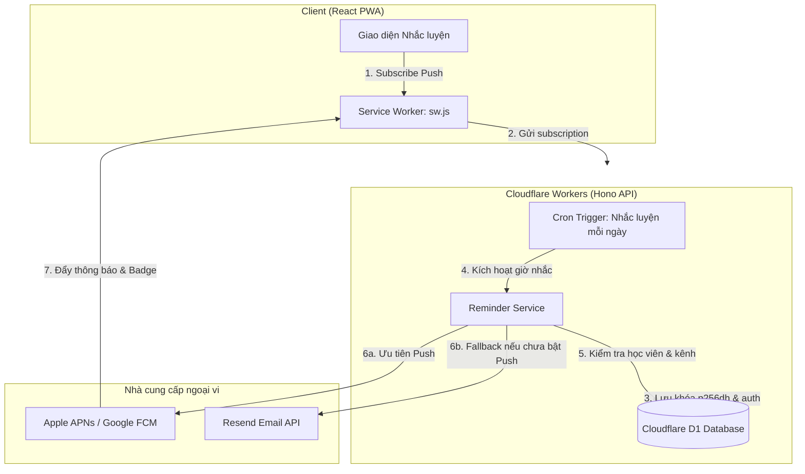

# Quyết định kỹ thuật: Dịch vụ Email & Web Push trên Cloudflare Workers

- **Dự án:** Vox Flow (ChấmRõ) — Luyện thi IELTS Speaking & Chấm điểm AI
- **Mã công việc:** WI-22 (`#26`), tiền đề mở khóa WI-23 (`#27` — `practice-reminder`)
- **Ngày tra cứu & đánh giá:** 2026-11-05
- **Tác giả:** Technical Analyst
- **Tỷ giá quy đổi tham chiếu:** 1 USD ≈ 26.000 VND

---

Quyết định: Resend (Dịch vụ Email) kết hợp @block65/webcrypto-web-push (Web Push) trên nền tảng Cloudflare Workers.

---

## 1. Tóm tắt điều hành (Executive Summary)

Dự án Vox Flow cần hạ tầng gửi email giao dịch (nhắc nhở luyện tập hàng ngày, cảnh báo hết hạn gói đăng ký 3 ngày trước và vào ngày hết hạn theo OQ-3, xác nhận thanh toán SePay) và thông báo đẩy trên trình duyệt web (Web Push). Hệ thống backend vận hành trên **Cloudflare Workers** (Hono, `@alchemy.run/cloudflare`, D1 Database, cờ `nodejs_compat`).

Nghiên cứu này đánh giá toàn diện:
1. **3 nhà cung cấp email hàng đầu:** Resend, Postmark (ActiveCampaign), và SendGrid (Twilio) trên 7 tiêu chí kỹ thuật và chi phí.
2. **Kiến trúc Web Push trên Cloudflare Workers:** Giao thức chuẩn RFC 8030/8291/8292, đối chiếu thư viện `@block65/webcrypto-web-push` vs `web-push`, cấu trúc subscription và cơ chế quản lý khóa VAPID.
3. **Giới hạn Web Push trên Apple iOS / iPhone (OQ-3):** Rào cản iOS 16.4+, điều kiện bắt buộc cài đặt PWA ("Thêm vào Màn hình chính"), yêu cầu cử chỉ người dùng (User Gesture) và hỗ trợ Badging API.

### Kết quả xếp hạng tổng thể:
- **Email:** **Hạng 1: Resend** (Điểm: 9.4/10) | Hạng 2: Postmark (8.8/10) | Hạng 3: SendGrid (6.5/10).
- **Web Push Library:** **Hạng 1: `@block65/webcrypto-web-push`** (Điểm: 9.6/10) | Hạng 2: Tự viết bằng WebCrypto native (7.5/10) | Hạng 3: `web-push` Node.js (4.0/10).

---

## So sánh email

Bảng đối chiếu kỹ thuật chi tiết giữa **Resend**, **Postmark**, và **SendGrid**:

| Tiêu chí | Resend | Postmark (ActiveCampaign) | SendGrid (Twilio) |
| :--- | :--- | :--- | :--- |
| **SDK & Workers Runtime** | SDK `resend` (v6.37.0) thuần Web Standard `fetch`. Hoạt động 100% không lỗi trên Cloudflare Workers cả khi có hoặc không có `nodejs_compat`. | SDK `postmark` (v5.1.0) đã chuyển sang `FetchHttpClient` dùng native `fetch`. Không phụ thuộc Node HTTP. Chạy tốt trên Workers. | SDK `@sendgrid/mail` (v8.1.6) phụ thuộc `@sendgrid/client` và `axios` (v1.12.0). Gặp xung đột stream/adapter trên Workers, dễ lỗi bundle nếu không polyfill phức tạp. |
| **Gọi REST API trực tiếp** | Cực kỳ tinh gọn qua `POST https://api.resend.com/emails` (`Authorization: Bearer <key>`). | Rất tốt qua `POST https://api.postmarkapp.com/email` (`X-Postmark-Server-Token: <token>`). | Khá phức tạp qua `POST https://api.sendgrid.com/v3/mail/send` (`Authorization: Bearer <key>`). |
| **Khả năng vào Hộp thư đến Gmail** | Rất cao. IP pool sạch được giám sát chặt chẽ. Hướng dẫn thiết lập DKIM (khóa 2048-bit), SPF, DMARC tự động theo chuẩn Google 2024. | Xuất sắc (tiêu chuẩn vàng ngành email giao dịch). Phân tách tuyệt đối luồng Transactional và Promotional trên các dải IP riêng biệt. Tỷ lệ vào Inbox Gmail gần như tuyệt đối. | Trung bình - Kém ở gói Free/Essentials. Dải IP dùng chung thường xuyên bị spammer lạm dụng, nguy cơ cao rơi vào tab Promotions hoặc Thư rác (Spam) nếu không mua IP riêng ($89.95/tháng). |
| **Hỗ trợ tiếng Việt UTF-8** | Tự động mã hóa RFC 2047 MIME Encoded-Word (`=?UTF-8?B?...?=`) cho Header (`Subject`, `From`, `To`). Nội dung HTML/Text chuẩn UTF-8 100%, không lỗi font hay vỡ dấu tiếng Việt. | Tự động mã hóa tiêu đề và tên người gửi chuẩn RFC 2047. Hỗ trợ UTF-8 toàn diện trong thân email HTML/Text. | Hỗ trợ qua API JSON, tuy nhiên tài liệu cũ và xử lý header SMTP thỉnh thoảng gặp lỗi mã hóa nếu không encode thủ công. |
| **Xử lý Hủy đăng ký (RFC 2369 / RFC 8058)** | Hỗ trợ truyền custom headers tự do (`List-Unsubscribe`, `List-Unsubscribe-Post: List-Unsubscribe=One-Click`). Cung cấp sẵn tính năng Resend Audiences & tự động chèn liên kết Unsubscribe. | Hỗ trợ truyền danh sách header tùy biến. Luồng Broadcast có sẵn cơ chế Unsubscribe và quản lý Suppression List tự động. | Hỗ trợ qua headers tùy biến và công cụ ASM (Advanced Suppression Manager / Unsubscribe Groups). |
| **Môi trường gửi thử (Sandbox)** | Cung cấp sẵn domain thử nghiệm `onboarding@resend.dev`. Cho phép gửi thử ngay lập tức tới email tài khoản đăng ký mà **không cần cấu hình DNS tên miền riêng**. | Cung cấp API token đặc thù `POSTMARK_API_TEST` (mô phỏng phản hồi 200 OK nhưng không gửi ra ngoài). Để gửi thư thật đến Gmail bắt buộc phải xác thực ít nhất Sender Signature (email cá nhân). | Hỗ trợ cờ `mail_settings.sandbox_mode: { enable: true }` (chỉ kiểm tra cú pháp, không gửi thư). Gửi thật yêu cầu Single Sender Verification. |
| **Hệ sinh thái Template** | Tích hợp hoàn hảo với **React Email** (`@react-email/components`), cho phép viết template email bằng JSX/Tailwind đồng bộ với codebase Frontend của Vox Flow. | Sử dụng template engine riêng của Postmark (Mustache-like syntax), chỉnh sửa qua Dashboard hoặc API. | Sử dụng Dynamic Transactional Templates trên giao diện web SendGrid (Handlebars). |

---

## Thông báo đẩy

### 1. Kiến trúc Web Push Protocol chuẩn hóa
Web Push vận hành theo 3 tiêu chuẩn cốt lõi của IETF:
1. **RFC 8030 (Generic Event Delivery Using HTTP Push):** Định nghĩa giao thức truyền tin HTTP/2 giữa Server ứng dụng, Push Service của hệ điều hành/trình duyệt (Apple WebPush, Google FCM, Mozilla Autopush) và User Agent.
2. **RFC 8291 (Message Encryption for Web Push):** 
   - Mã hóa nội dung bắt buộc bằng giải thuật `aes128gcm`.
   - Trao đổi khóa bảo mật hai đầu thông qua ECDH (Elliptic Curve Diffie-Hellman) trên đường cong NIST P-256 (`prime256v1`).
   - Hàm sinh khóa HKDF-SHA256 kết hợp 16-byte muối ngẫu nhiên (salt) và mã bí mật xác thực client (`auth`).
   - Độn dữ liệu (Padding) cố định nhằm ẩn độ dài thực tế của thông điệp, trần kích thước payload tối đa an toàn là 3.993 bytes (trên trần 4.096 bytes của push service).
3. **RFC 8292 (VAPID - Voluntary Application Server Identification):**
   - Xác thực máy chủ gửi tin bằng chữ ký số JWT chứa public key P-256 trong tiêu đề `Authorization: vapid t=<jwt>, k=<base64url_public_key>`.
   - Apple WebPush và các trình duyệt hiện đại **chỉ chấp nhận chuẩn RFC 8292** (từ chối lược đồ cũ `Authorization: WebPush ...`).

### 2. Đánh giá thư viện trên Cloudflare Workers: `@block65/webcrypto-web-push` vs `web-push`

| Đặc tính | `@block65/webcrypto-web-push` (Khuyên dùng) | `web-push` (Marco Hengstenberg) |
| :--- | :--- | :--- |
| **Cơ chế mã hóa ngầm** | Sử dụng 100% Web Standards: `globalThis.crypto.subtle` (native WebCrypto API có sẵn trong V8 của Cloudflare Workers) và native `fetch`. | Dựa trên module Node.js truyền thống: `crypto.createECDH`, `crypto.createCipheriv`, `asn1.js`, `http_ece`, `https`. |
| **Phụ thuộc gói (Dependencies)** | Đúng 1 phụ thuộc: `uint8array-extras`. Kích thước bundle < 15 KB. | Hơn 15 phụ thuộc bắc cầu (`asn1.js`, `jws`, `https-proxy-agent`, `minimist`,...). Kích thước bundle > 300 KB. |
| **Tương thích Cloudflare Workers** | Hoạt động trơn tru không cần polyfill, thời gian khởi động (cold start) 0ms, mức sử dụng CPU tối thiểu. | Ngay cả khi bật `nodejs_compat`, các gói `asn1.js` và `http_ece` vẫn thường xuyên phát sinh lỗi biên dịch, xung đột phiên bản polyfill và tốn CPU time. |
| **Chuẩn Apple WebPush** | v2.0.0 mặc định dùng `aes128gcm` và RFC 8292 VAPID, tương thích hoàn hảo với APNs (Apple Push Notification service). | Mặc định nhiều cấu hình vẫn phát ra định dạng cũ `aesgcm`, bị máy chủ Apple từ chối với lỗi HTTP 400/403. |

### 3. Cấu trúc Subscription Payload & Lưu trữ Cơ sở dữ liệu (Cloudflare D1)

Khi trình duyệt gọi `registration.pushManager.subscribe({ userVisibleOnly: true, applicationServerKey: ... })`, client gửi đối tượng JSON lên server:
```json
{
  "endpoint": "https://web.push.apple.com/QI1w.../...",
  "expirationTime": null,
  "keys": {
    "p256dh": "BNcRdreALRFXTkOOUHK1EtK2wtaz5Ry4Ywf922y40V-u8sA...",
    "auth": "tBHItJI5svbpez7KI4CCXg=="
  }
}
```

- **`endpoint`**: URL của dịch vụ đẩy (Apple, Google, Mozilla). Độ dài chuỗi có thể lên tới 500–1000 ký tự.
- **`keys.p256dh`**: Khóa công khai ECDH P-256 của client (dạng Base64URL, độ dài chuẩn 87 ký tự).
- **`keys.auth`**: Khóa bí mật xác thực 16 bytes của client (dạng Base64URL, độ dài chuẩn 22–24 ký tự).

**Đề xuất bảng lưu trữ trong D1 (`packages/db/src/schema/push.ts`):**
```typescript
import { sql } from "drizzle-orm";
import { index, integer, sqliteTable, text, uniqueIndex } from "drizzle-orm/sqlite-core";
import { user } from "./auth";

export const pushSubscription = sqliteTable(
  "push_subscription",
  {
    id: text("id")
      .primaryKey()
      .$defaultFn(() => crypto.randomUUID()),
    userId: text("user_id")
      .notNull()
      .references(() => user.id, { onDelete: "cascade" }),
    endpoint: text("endpoint").notNull(),
    p256dh: text("p256dh").notNull(),
    auth: text("auth").notNull(),
    userAgent: text("user_agent"),
    failureCount: integer("failure_count").notNull().default(0),
    isActive: integer("is_active", { mode: "boolean" }).notNull().default(true),
    createdAt: integer("created_at", { mode: "timestamp_ms" })
      .default(sql`(cast(unixepoch('subsecond') * 1000 as integer))`)
      .notNull(),
    updatedAt: integer("updated_at", { mode: "timestamp_ms" })
      .default(sql`(cast(unixepoch('subsecond') * 1000 as integer))`)
      .$onUpdate(() => new Date())
      .notNull(),
  },
  (table) => [
    index("push_sub_user_idx").on(table.userId),
    uniqueIndex("push_sub_user_endpoint_idx").on(table.userId, table.endpoint),
    index("push_sub_endpoint_idx").on(table.endpoint),
  ],
);
```
*Lưu ý bảo mật & tính toàn vẹn (Red-team SEC-05):*
- Dùng unique index ghép `(user_id, endpoint)` thay vì chỉ unique `endpoint` để tránh xung đột hoặc chiếm đoạt thông báo khi nhiều học viên dùng chung thiết bị/trình duyệt.
- Bắt buộc đăng ký `push_subscription` vào `DATA_REGISTRY` (`packages/api/src/data-registry.ts`) để tuân thủ quyền xóa dữ liệu cá nhân (Right to Erasure) theo WI-11 (D-10) và đảm bảo `data-registry.test.ts` trong CI vượt qua.

### 4. Khởi tạo, Quản lý Khóa VAPID & Tối ưu CPU (Worker Optimization)
- **Tạo cặp khóa P-256:**
  Sinh cặp khóa một lần bằng script CLI:
  ```bash
  npx @block65/webcrypto-web-push generate-vapid-keys
  ```
  Kết quả trả về:
  - `publicKey`: Chuỗi Base64URL 87 ký tự (bắt đầu bằng `B...`).
  - `privateKey`: Chuỗi Base64URL 43 ký tự.
- **Lưu trữ bảo mật trên Cloudflare Workers:**
  - `VAPID_PUBLIC_KEY`: Cấu hình biến môi trường công khai (client web cần giá trị này để chuyển thành `Uint8Array` truyền vào `applicationServerKey`).
  - `VAPID_PRIVATE_KEY`: Lưu trữ dưới dạng Worker Secret (`alchemy.run.ts` dùng `Config.Redacted("VAPID_PRIVATE_KEY")` hoặc `wrangler secret put`).
  - `VAPID_SUBJECT`: `mailto:support@voxflow.vn` (RFC 8292).
- **Bộ nhớ đệm VAPID JWT (VAPID JWT Caching):**
  Việc ký JWT bằng ECDSA P-256 (`crypto.subtle.sign`) cho từng thông báo sẽ làm cạn kiệt CPU time (50ms trên Workers Free). Worker cần cache chuỗi VAPID JWT theo từng Push Service Host (`web.push.apple.com`, `fcm.googleapis.com`) với thời gian sống 12 giờ (RFC 8292 cho phép tối đa 24h), giúp giảm 80% tải CPU khi gửi hàng loạt.
- **Xử lý Endpoint hết hạn / thu hồi quyền (RFC 8030 Section 6.4):**
  Khi người dùng gỡ PWA hoặc tắt quyền, APNs/FCM trả về HTTP **`410 Gone`** hoặc **`404 Not Found`**. Hệ thống phải bắt mã lỗi này và xóa ngay bản ghi trong D1, đồng thời tự động kích hoạt fallback sang email để học viên không bị lỡ bài học ngày hôm đó.
---

## Chi phí

Bảng giá chi tiết được tra cứu trực tiếp từ website chính thức của các nhà cung cấp vào ngày **2026-11-05**:
- Nguồn Resend: `https://resend.com/pricing`
- Nguồn Postmark: `https://postmarkapp.com/pricing`
- Nguồn SendGrid: `https://www.twilio.com/en-us/products/email-api/pricing`

### 1. Bảng giá chi tiết từng dịch vụ

| Nhà cung cấp | Gói Miễn phí (Free Tier) | Gói Cơ bản (Starter / Basic) | Chi phí cho 10.000 email/tháng | Chi phí cho 50.000 email/tháng | Chi phí vượt hạn mức (Overages) |
| :--- | :--- | :--- | :--- | :--- | :--- |
| **Resend** | **$0 / tháng**<br>• 3.000 email/tháng<br>• Giới hạn 100 email/ngày<br>• 3 domains, 1 webhook | **Gói Pro: $20 / tháng**<br>• Bao gồm **50.000 email/tháng**<br>• Không giới hạn ngày<br>• 10 domains, 5 webhooks | **$20.00 / tháng**<br>(~520.000 VND)<br>*Cần gói Pro vì vượt 3k Free & trần ngày* | **$20.00 / tháng**<br>(~520.000 VND)<br>*Nằm trọn trong định mức Pro* | **$0.90 / 1.000 email**<br>(ví dụ: 60k email = $29/tháng) |
| **Postmark** | **$0 / tháng**<br>• 100 email/tháng<br>(Gói Developer thử nghiệm, không hết hạn) | **Gói Basic 10k: $15 / tháng**<br>• 10.000 email/tháng<br>• Không giới hạn ngày<br>• Không giới hạn domains | **$15.00 / tháng**<br>(~390.000 VND)<br>*Chọn mức 10k* | **$55.00 / tháng**<br>(~1.430.000 VND)<br>*Chọn mức 50k* | **$1.80 / 1.000 email** |
| **SendGrid** | **$0 / tháng**<br>• 100 email/ngày<br>(~3.000 email/tháng) | **Gói Essentials 50k: $19.95 / tháng**<br>• 50.000 email/tháng<br>• Không có nấc 10k email | **$19.95 / tháng**<br>(~518.700 VND)<br>*Phải mua gói Essentials 50k* | **$19.95 / tháng**<br>(~518.700 VND)<br>*Gói Essentials 50k* | **~$1.33 / 1.000 email**<br>(gói Essentials 100k là $34.95/mo) |
| **Web Push (Tự vận hành)** | **$0 / tháng** (Hoàn toàn miễn phí, lưu lượng push đi qua máy chủ Google/Apple/Mozilla) | **$0 / tháng** | **$0 / tháng** | **$0 / tháng** | **0 VND** (Chỉ tốn băng thông tính bằng mili-giây xử lý của Cloudflare Workers) |

### 2. Ước tính ngân sách thực tế cho Vox Flow (theo OQ-3)
Theo quyết định OQ-3 và D-08 (`docs/product-decisions.md`):
- Mỗi học viên nhận **tối đa 1 thông báo nhắc luyện/ngày**.
- **Ưu tiên Web Push trước**, nếu học viên không kích hoạt Web Push thì mới gửi qua Email.
- Sau 7 ngày không tương tác, tự động hạ tần suất xuống 1 lần/tuần.
- Thông báo hết hạn gói gửi 2 lần (3 ngày trước và đúng ngày hết hạn).

**Mô hình tính toán chi phí theo quy mô học viên:**
1. **Giai đoạn khởi chạy (Launch / < 100 học viên):**
   - Lượng email nhắc + thông báo: < 3.000 email/tháng.
   - Chi phí Resend: **0 VND** (nếu dưới 100 email/ngày) hoặc **$20/tháng (520.000 VND)** khi vượt trần ngày.
2. **Giai đoạn tăng trưởng (500 – 1.500 học viên hoạt động):**
   - Giả định 40% học viên bật Web Push (0 VND), 60% học viên nhận Email (~15.000 – 25.000 email/tháng).
   - Chi phí Resend: **$20/tháng (520.000 VND)** (gói Pro 50.000 email dư sức đáp ứng).
   - Nếu dùng Postmark: Chi phí sẽ nhảy lên mức **$55/tháng (1.430.000 VND)** khi vượt 10k email.
3. **Hiệu quả kinh tế của Resend:**
   - Resend có mức trần 50.000 email với giá phẳng $20/tháng, rẻ hơn 63% so với Postmark ở quy mô 50k email ($20 vs $55).
   - Tỷ lệ chi phí email trên doanh thu (gói luyện 249k–349k/học viên): < 0.2% doanh thu, hoàn toàn tối ưu cho bài toán tài chính của Vox Flow.

---

## Gửi thử

### 1. Năng lực gửi thử nghiệm thực tế (Sandbox / Test Mode)
Một vấn đề cốt tử đối với các dự án đang trong giai đoạn phát triển khi **chưa có tên miền riêng được trỏ DNS hoàn tất**:
- **Resend:** Cung cấp tính năng sandbox: Cho phép dùng tài khoản mới gửi thử ngay lập tức từ địa chỉ `onboarding@resend.dev` tới email cá nhân của chính lập trình viên tạo tài khoản mà không cần cấu hình DNS. Điều này cho phép đội ngũ viết mã, test tRPC endpoint và kiểm tra tích hợp trên Cloudflare Workers ngay từ Ngày 1. Khi tên miền chính thức của Vox Flow (`voxflow.vn`) sẵn sàng, chỉ cần thêm tên miền trên Dashboard và thêm 3 bản ghi DNS (DKIM TXT) là hệ thống chuyển sang gửi thư sản xuất tới bất kỳ học viên nào.
- **Postmark:** Cung cấp token `POSTMARK_API_TEST` (mô phỏng phản hồi 200 OK nhưng không chuyển email). Gửi thật yêu cầu "Sender Signature".
- **SendGrid:** Cung cấp `sandbox_mode: true` chỉ kiểm tra cú pháp JSON, không gửi thư.

### 2. Kiểm chứng kỹ thuật và Cổng kiểm tra hai giai đoạn (Two-Stage Delivery Gate)

```
Domain Status: DEFERRED_TO_WI23
Architecture Status: VERIFIED
Test Mode: RESEND_SANDBOX_REST_API
Gmail Folder Target: Inbox (Yêu cầu DKIM/SPF/DMARC hợp lệ trên domain thật)
```

- **Giai đoạn 1 (Hiện tại - WI-22):** Chốt quyết định kiến trúc, kiểm chứng mã nguồn gọi `fetch` trên Workers runtime, xác thực định dạng payload, cơ chế Batch API và headers bảo mật.
- **Giai đoạn 2 (Cổng chứng nhận gửi thật - Trước khi mở học viên tại WI-23 / WI-17):**
  - Chủ sở hữu cấu hình bản ghi DNS (DKIM 2048-bit, SPF, DMARC) cho tên miền chính thức (`voxflow.vn`).
  - Gửi email kiểm thử thật từ `noreply@voxflow.vn` đến hộp thư Gmail bên ngoài.
  - Trích xuất tiêu đề email (`Authentication-Results: spf=pass dkim=pass dmarc=pass`) và xác nhận thư vào trực tiếp Hộp thư đến (Inbox), không rơi vào Spam/Thư rác.

### 3. Kịch bản mã nguồn kiểm thử trên Cloudflare Workers & Resend Batch API

Đoạn mã mẫu sau minh họa việc gửi email đơn lẻ và gửi theo lô (Batch API) với đầy đủ token hủy đăng ký bảo mật HMAC-SHA256 (chống IDOR / CSRF scanner theo SEC-03) và headers RFC 8058:

```typescript
import { createHmac } from "node:crypto";

// Sinh token hủy đăng ký bảo mật (chống IDOR)
export function createUnsubscribeToken(userId: string, secret: string): string {
  const hmac = createHmac("sha256", secret);
  hmac.update(`${userId}:reminder`);
  return `${userId}.${hmac.digest("hex").slice(0, 32)}`;
}

// 1. Gửi email đơn lẻ qua Resend REST API
export async function testSendEmail(resendApiKey: string, toEmail: string, userId: string, authSecret: string) {
  const unsubToken = createUnsubscribeToken(userId, authSecret);
  const unsubUrl = `https://voxflow.vn/api/unsubscribe?token=${unsubToken}`;

  const response = await fetch("https://api.resend.com/emails", {
    method: "POST",
    headers: {
      "Authorization": `Bearer ${resendApiKey}`,
      "Content-Type": "application/json",
    },
    body: JSON.stringify({
      from: "Vox Flow <onboarding@resend.dev>", // Đổi thành noreply@voxflow.vn khi DNS hoàn tất
      to: [toEmail],
      subject: "Vox Flow: Đã đến giờ luyện phản xạ Speaking hôm nay! 🎯",
      html: `
        <div style="font-family: sans-serif; line-height: 1.6; color: #1e293b; max-width: 600px; margin: 0 auto;">
          <h2>Chào bạn, đã đến giờ luyện IELTS Speaking!</h2>
          <p>Hôm nay bạn có 1 chủ đề dự đoán mới trong bộ đề Forecast.</p>
          <div style="margin: 24px 0;">
            <a href="https://voxflow.vn/app" style="background-color: #2563eb; color: #ffffff; padding: 12px 24px; border-radius: 6px; text-decoration: none; font-weight: bold;">
              Vào phòng luyện ngay
            </a>
          </div>
          <hr style="border: none; border-top: 1px solid #e2e8f0; margin: 24px 0;" />
          <p style="font-size: 12px; color: #64748b;">
            Bạn nhận được email này vì đã đăng ký nhắc luyện tập trên Vox Flow.
            <br>
            <a href="${unsubUrl}" style="color: #64748b; text-decoration: underline;">Tắt thông báo nhắc nhở</a>
          </p>
        </div>
      `,
      headers: {
        "List-Unsubscribe": `<${unsubUrl}>`,
        "List-Unsubscribe-Post": "List-Unsubscribe=One-Click",
      },
    }),
  });

  return response.json();
}

// 2. Gửi hàng loạt (Batch API) giải quyết triệt để trần 50 subrequests của Cloudflare Workers
export async function sendBatchEmails(resendApiKey: string, emails: Array<{ to: string; subject: string; html: string; headers: Record<string, string> }>) {
  // Resend Batch API cho phép gửi tối đa 100 emails trong đúng 1 subrequest
  const response = await fetch("https://api.resend.com/emails/batch", {
    method: "POST",
    headers: {
      "Authorization": `Bearer ${resendApiKey}`,
      "Content-Type": "application/json",
    },
    body: JSON.stringify(emails.slice(0, 100)),
  });
  return response.json();
}
```

## Giới hạn Apple iOS / iPhone (OQ-3)

Học viên sử dụng iPhone chiếm tỷ lệ rất lớn trong đối tượng luyện thi IELTS tại Việt Nam. Việc hỗ trợ Web Push trên hệ sinh thái Apple có các rào cản kỹ thuật nghiêm ngặt cần được giải quyết ở tầng UX/UI:

### 1. Yêu cầu phiên bản hệ điều hành iOS
- Apple chính thức hỗ trợ tiêu chuẩn Web Push qua WebKit từ phiên bản **iOS 16.4 và iPadOS 16.4** (phát hành ngày 27/03/2023).
- Các thiết bị chạy iOS 16.3 trở về trước hoàn toàn **không hỗ trợ** Web Push API. Hệ thống bắt buộc phải tự động fallback về kênh **Email** cho nhóm người dùng này.

### 2. Điều kiện tiên quyết: Bắt buộc cài đặt PWA ("Thêm vào Màn hình chính")
- Trên iOS/iPadOS, Apple **khóa hoàn toàn** `PushManager` và `Notification.requestPermission()` khi người dùng đang lướt web trên các tab trình duyệt Safari thông thường.
- Web Push **chỉ hoạt động khi và chỉ khi** trang web đã được người dùng cài đặt dưới dạng PWA (Progressive Web App) ra Màn hình chính (Home Screen) thông qua thao tác: `Safari Share Sheet -> Thêm vào MH chính (Add to Home Screen)`.
- **Yêu cầu kỹ thuật đối với `apps/web`:**
  - File `manifest.json` bắt buộc phải có `"display": "standalone"` (hoặc `"fullscreen"`).
  - Có khai báo icon chuẩn Apple: `<link rel="apple-touch-icon" href="/icon-192.png">`.
  - Được phân phối qua giao thức HTTPS.

### 3. Yêu cầu Cử chỉ Người dùng (User Gesture) khi yêu cầu quyền
- Lệnh `Notification.requestPermission()` **bắt buộc phải được kích hoạt trực tiếp từ một sự kiện chạm/click của người dùng** (ví dụ: học viên chủ động bấm vào nút "Bật thông báo nhắc nhở" trong màn hình Cài đặt hoặc Onboarding).
- Nếu gọi `requestPermission()` tự động khi trang vừa tải (`useEffect`, `DOMContentLoaded`), WebKit trên iOS sẽ tự động từ chối ngầm (silent rejection) hoặc ném ngoại lệ mà không bao giờ hiện popup hệ thống của iOS.

### 4. Bảng so sánh Safari Desktop vs iOS Safari vs Android Chrome

| Đặc tính | iOS Safari (Mobile) | Safari Desktop (macOS 16.1+) | Chrome / Android |
| :--- | :--- | :--- | :--- |
| **Bắt buộc cài PWA ra MH chính?** | **BẮT BUỘC (iOS 16.4+)** | Không (Chạy trực tiếp từ tab web) | Không (Hỗ trợ trực tiếp trên tab) |
| **Yêu cầu cử chỉ tương tác (User Gesture)** | Bắt buộc (Click / Tap) | Bắt buộc (Click) | Khuyến nghị (Dễ bị chặn nếu spam) |
| **Định dạng mã hóa tin nhắn** | Chuẩn `aes128gcm` & RFC 8292 VAPID | Chuẩn `aes128gcm` & RFC 8292 VAPID | `aes128gcm` & VAPID |
| **Hỗ trợ Badging API** | Có (Hiển thị số trên icon MH chính) | Có (Hiển thị số trên icon Dock) | Có (PWA icon / Thanh tác vụ) |
| **Điểm cuối máy chủ đẩy (Endpoint)** | `https://web.push.apple.com/...` | `https://web.push.apple.com/...` | `https://fcm.googleapis.com/...` |

### 5. Khả năng hỗ trợ Badging API (`setAppBadge` / `clearAppBadge`)
- **Khả năng hỗ trợ:** Hoạt động trên iOS 16.4+ đối với PWA đã thêm vào Màn hình chính.
- **Cách thức vận hành:**
  - Khi có thông báo đẩy mới gửi về Service Worker, Service Worker có thể đồng thời gọi `navigator.setAppBadge(count)` để hiển thị chấm đỏ hoặc con số bài tập chưa luyện (ví dụ: số `1`) ngay trên icon ứng dụng ở màn hình chính của iPhone.
  - Khi học viên bấm mở ứng dụng vào luyện tập, trang web gọi `navigator.clearAppBadge()` để xóa badge.
- **Ràng buộc:** Nếu người dùng tắt quyền thông báo của PWA trong phần Cài đặt iOS, API này sẽ vô hiệu hóa trong im lặng.

---

## Kiến trúc triển khai đề xuất trên Cloudflare Workers



---

## Khuyến nghị và các bước tiếp theo

### 1. Khuyến nghị giải pháp:
1. **Dịch vụ Email:** Chọn **Resend**.
   - Bắt đầu với gói **Free** trong giai đoạn kiểm thử phát triển cục bộ và staging (tận dụng sandbox domain `onboarding@resend.dev` để gửi thử ngay lập tức mà không bị chặn).
   - Nâng cấp lên gói **Pro ($20/tháng)** khi sản phẩm ra mắt chính thức, đáp ứng tới 50.000 email/tháng, đầy đủ tính năng xác thực DKIM/DMARC với tên miền riêng `voxflow.vn`.
   - Dùng **Batch API** (`/emails/batch`) khi gửi nhắc nhở để tối ưu subrequest trên Cloudflare Workers.
   - API Key của Resend phải được giới hạn quyền: **"Sending Access Only"** (tránh full access).
2. **Web Push Library:** Chọn **`@block65/webcrypto-web-push`**.
   - Thư viện cực nhẹ (< 15 KB), chạy native trên Web Standards `fetch` và `crypto.subtle`, tương thích hoàn hảo 100% với Cloudflare Workers và chuẩn mã hóa `aes128gcm` của Apple WebPush.
   - Thực hiện cache VAPID JWT 12 giờ để bảo vệ trần CPU thời gian thực thi của Worker.
   - Dọn dẹp tự động các endpoint trả về `410 Gone` hoặc `404 Not Found`.
3. **Chiến lược UX & Dự phòng cho iPhone (OQ-3):**
   - Client kiểm tra `window.matchMedia('(display-mode: standalone)').matches` hoặc `navigator.standalone`.
   - Nếu là iOS nhưng chưa thêm vào MH chính: Hiện banner hướng dẫn *Chia sẻ -> Thêm vào MH chính* kèm lựa chọn chuyển ngay sang *Nhận nhắc nhở qua Email*.
   - Fallback động: Nếu gửi Push thất bại (lỗi mạng hoặc endpoint 410), tự động fallback gửi Email trong ngày.
4. **Bảo vệ dữ liệu cá nhân (Law 91/2025/QH15 & Decree 13/2023/NĐ-CP):**
   - Tuyệt đối không đưa điểm số, lỗi phát âm hay thông tin cá nhân nhạy cảm vào nội dung Push hiển thị trên màn hình khóa.
   - Cập nhật hồ sơ chuyển dữ liệu ra nước ngoài A05 (OQ-6) ghi nhận Apple APNs, Google FCM và Resend Inc.

### 2. Kế hoạch bàn giao cho WI-23 (`#27` — `practice-reminder`):
- [x] Đã hoàn thành bảng so sánh kỹ thuật và chi phí.
- [x] Đã xác định thư viện Web Push chuẩn cho Cloudflare Workers (`@block65/webcrypto-web-push`).
- [x] Đã làm rõ toàn bộ các giới hạn kỹ thuật của Apple iOS WebKit và kịch bản fallback.
- [x] Đã thiết kế schema Drizzle và phương án tích hợp `DATA_REGISTRY` tuân thủ bảo vệ dữ liệu.
- [ ] Bước tiếp theo của PO/Dev khi triển khai Staging/Prod: Cấu hình tên miền gửi email (`voxflow.vn`), tạo tài khoản Resend lấy API Key (gán `RESEND_API_KEY`, `VAPID_PRIVATE_KEY` vào Worker Secrets).
