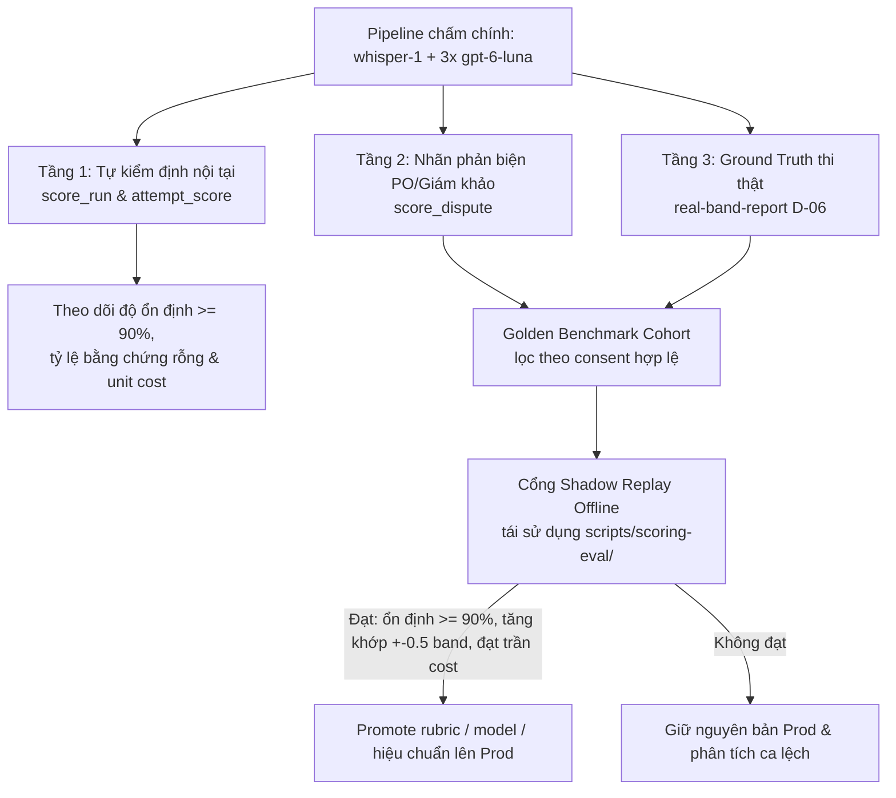

# Quyết định: Chốt pipeline chấm điểm hiện hành làm chính & chuyển OQ-5 sang Tự Eval trên dữ liệu dự án

## 1. Bối cảnh

- Issue [#7](https://github.com/vinh19410/vox-flow/issues/7) (`OQ-5`, `TD-01`) ban đầu yêu cầu thu thập 30 bài nói mẫu có văn bản đồng ý + điểm giám khảo độc lập để thử nghiệm chéo 6 cấu hình nhà cung cấp (`Azure Speech` / `Whisper + SpeechSuper` × `Claude Opus / Sonnet / Haiku 5.5`) trước khi chọn dịch vụ cho `#17` (`scoring-results`).
- Thực tế dự án chưa có sẵn nguồn 30 bài mẫu chuẩn ngoài, trong khi pipeline chấm điểm nội bộ đã được xây dựng, triển khai và nghiệm thu trên Beta cho cả luyện Forecast lẫn toàn bộ mode Thi thử (`#90`, `#130`).

## 2. Quyết định đã chốt (2026-11-13)

1. **Đóng Issue `#7` (`not planned` cho phương án tiền kiểm 30 bài mẫu ngoài)** và **gỡ cổng chặn cứng** này khỏi `#17`, `#18`, `#19`, `#20`, `#21`.
2. **Chốt pipeline chấm điểm hiện hành trong `packages/api/src/scoring/` làm thuật toán chấm điểm chính:**
   - **ASR:** OpenAI `whisper-1` (`transcribeAudioStrict` tại `packages/api/src/exam/transcribe.ts:40-75`), lưu từng transcript vào `attempt_answer.transcript`.
   - **LLM Grader:** `SCORING_MODEL` mặc định `gpt-6-luna` (`packages/api/src/scoring/config.ts:1`), chạy `SCORING_RUNS = 3` lượt độc lập qua Cloudflare Queue (`packages/api/src/scoring/score-attempt.ts:150-231`).
   - **Chống ảo giác & bảo mật prompt:** Nạp câu hỏi chuẩn từ server (`forecast_topic`, `mock-exam-bank.ts`, R2 linked prompt), bọc dữ liệu trong `<answer>`, `<question_text>`, `<candidate_transcript>`, và lọc bỏ trích dẫn không khớp nguyên văn qua `isVerbatimQuote` (`packages/api/src/scoring/prompt.ts:74-117,150-199`).
   - **Tổng hợp điểm:** Tính `median` cho từng tiêu chí (`FC`, `LR`, `GRA`, `P`) rồi lấy `ieltsRound` trên trung bình 4 tiêu chí (`packages/api/src/scoring/aggregate.ts:34-74`).
3. **Chuyển việc đo độ chính xác và cải thiện chất lượng chấm sang vòng lặp Tự Eval & Hiệu chuẩn dần trên dữ liệu thực tế của chính dự án**, theo dõi tại [#154](https://github.com/vinh19410/vox-flow/issues/154) (giai đoạn Next / Later).
4. **Giữ nguyên thư mục `scripts/scoring-eval/` và `scripts/speaking-scraper/`** làm khung đánh giá offline (Shadow Replay) khi có bộ dữ liệu chuẩn từ chính dự án.

## 3. Đánh giá hiện trạng & Giới hạn ghi nhận

Bên cạnh các nền tảng bảo mật, chống chạy trùng và tổng hợp trung vị đã vận hành ổn định trên Beta (`plans/reports/130-beta-pot.md`), thuật toán hiện tại còn 3 giới hạn cần theo dõi khi tích lũy dữ liệu thật:

1. **Pronunciation (`P`) hiện chấm gián tiếp qua transcript (`audio_used = 0`):** Trên Beta (`plans/reports/130-beta-pot.md:53`), `gpt-6-luna` từ chối phần `input_audio` nên `18/18` lượt chạy đều lùi về `audio_used = 0` (`packages/api/src/scoring/score-attempt.ts:430-444`). Tiêu chí `P` đang ước lượng gián tiếp thay vì nghe âm học trực tiếp.
2. **Chưa tự động ghi nhận `cost_usd`:** `SCORING_PRICE_INPUT_PER_1M` và `SCORING_PRICE_OUTPUT_PER_1M` đang để rỗng (`packages/infra/alchemy.run.ts:46-47`) nên `cost_usd` là `null` và chưa tính gộp phí Whisper STT theo `attempt_answer.duration_ms`.
3. **Chưa gắn phiên bản prompt (`prompt_sha`):** Bảng `score_run` và `attempt_score` (`packages/db/src/schema/score.ts:11-78`) chưa lưu mã băm prompt để phân nhóm kết quả trước/sau khi tinh chỉnh rubric.

## 4. Kiến trúc Vòng lặp Tự Eval & Hiệu chuẩn 3 tầng

- **Tầng 1 — Tự kiểm định nội tại không cần nhãn (100% bài chấm):** Đo trực tiếp từ `score_run` và `attempt_score` (`MAX(overall) - MIN(overall) <= 0.5`, mục tiêu PRD `>= 90%`), tỷ lệ tiêu chí bị lọc rỗng `evidence`, tỷ lệ lỗi/retry và unit cost thực tế.
- **Tầng 2 — Nhãn chuẩn từ phản biện (`score_dispute` — Active Learning):** Các ca `resolved` (`previous_band` vs `resolved_band`) cung cấp nhãn sai số từ PO/giám khảo; ca `rejected` xác nhận sự đồng thuận. Khi triển khai `#154`, cần mở rộng dải `resolvedBand` trong `packages/api/src/routers/dispute-admin.ts:11` từ `5.0..8.0` thành `0.0..9.0` bước `0.5`, snapshot `previous_band` phía server, và chỉ xuất audio vào bộ mẫu khi có đồng ý hợp lệ (`share_consent` hoặc `calibration_granted`, tuân thủ `OQ-6` `#8`).
- **Tầng 3 — Ground Truth điểm thi IELTS thật (`real-band-report` — `D-06`):** Đối chiếu điểm thi thật học viên báo sau `user_profile.exam_date` (`packages/db/src/schema/profile.ts:11`) với trung vị bài Full Test gần nhất để đo `signed bias` và tỷ lệ lệch `<= 0.5 band` (mục tiêu PRD `>= 80%`).
- **Cổng cải thiện khép kín (Offline Shadow Replay Gate):** Mọi thay đổi (`SYSTEM_PROMPT`, few-shot mẫu biên, model hỗ trợ `audio_used = 1`, hiệu chỉnh độ lệch) phải chạy replay 3 lượt trên Golden Benchmark Cohort qua `scripts/scoring-eval/` và đạt đồng thời độ ổn định `>= 90%`, cải thiện khớp nhãn chuẩn `+-0.5 band`, và nằm trong trần chi phí trước khi đưa lên production.

## 5. Hệ quả & Tài liệu liên quan

- Mở khóa `#17` (`scoring-results`), `#18` (`free-quota`), `#19` (`billing`), `#21` (mốc mở cho học viên thật) khỏi phụ thuộc cứng vào 30 bài mẫu ngoài của `#7`.
- Rủi ro độ sát điểm so với giám khảo thật trước khi có dữ liệu Tầng 2/Tầng 3 vẫn được ghi nhận minh bạch tại `docs/tech-debt.md` (`TD-01`).
- Theo dõi triển khai vòng lặp tự eval tại [#154](https://github.com/vinh19410/vox-flow/issues/154).
