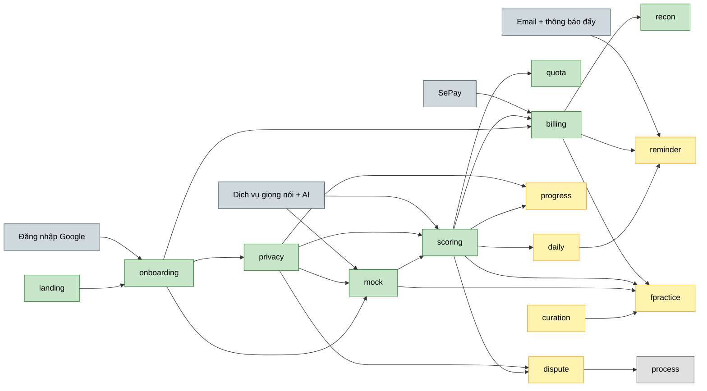

# Vox Flow (ChấmRõ) — Roadmap đề xuất theo Feature Map

Bản đề xuất này dựng từ feature map ngày 2026-11-04 (21 feature, 6 khoảng trống), đặt song song với `docs/_product/roadmap.md` và chưa thay thế bản đó. Feature map chưa được đưa vào PRD, nên các điểm lệch với PRD được liệt kê ở Mục 7.

## 1. Outcome mỗi giai đoạn

### Now — vòng lõi chạy thật từ đầu đến cuối

**Đạt được gì:** Học viên vào app bằng Google, thi thử, được chấm thật 3 lần kèm khoảng tin cậy, xem kết quả theo hạn mức miễn phí và trả phí bằng QR để mở chi tiết. Đợt này thay phần mô phỏng của prototype bằng ghi âm, chấm điểm và thanh toán thật.
**Đo bằng:** 60% người đăng ký hoàn thành bài thi đầu tiên, ≥ 90% bài có độ chênh giữa 3 lần chấm ≤ 0.5 band, có học viên trả phí đầu tiên (PRD Mục 8)

- **Landing giới thiệu giá trị** (`landing-page`) — dẫn người mới vào lần thi đầu với lời hứa đúng hạn mức.
- **Tạo tài khoản & thiết lập mục tiêu** (`onboarding`) — đưa học viên tới lần ghi âm đầu và thu band mục tiêu, ngày thi.
- **Quản lý quyền riêng tư dữ liệu** (`privacy-controls`) — để học viên dám ghi âm vì tự quyết được dữ liệu giọng nói.
- **Thi thử với giám khảo AI** (`mock-exam`) — tạo bài nói thật đủ chất lượng để chấm.
- **Chấm điểm & xem bằng chứng** (`scoring-results`) — cho học viên biết vì sao được band đó.
- **Hạn mức lượt miễn phí** (`free-quota`) — giữ chi phí chấm của gói miễn phí trong tầm kiểm soát.
- **Mua gói & thanh toán QR** (`billing`) — chuyển học viên miễn phí thành trả phí.
- **Đối soát thanh toán** (`payment-reconciliation`) — xử lý được tiền về sai hoặc trễ để học viên không mất tiền oan.

### Next — hoàn tất MVP để ra mắt và giữ học viên quay lại

**Đạt được gì:** Học viên có việc luyện mỗi ngày, luyện được đề forecast của quý, thấy tiến bộ theo thời gian, được nhắc đúng lúc và báo được lỗi chấm. Xong đợt này mới đủ phạm vi MVP đã chốt trong feature map.
**Đo bằng:** 30% học viên luyện từ 3 ngày/tuần trở lên, dưới 3% bài bị báo lỗi chấm (PRD Mục 8)

- **Theo dõi tiến độ band** (`progress-history`) — phân biệt tiến bộ thật với dao động giữa các bài.
- **Cập nhật đề forecast** (`forecast-curation`) — có công cụ admin và tự động hóa để cấp đề mới mỗi quý.
- **Luyện đề forecast theo quý** (`forecast-practice`) — luyện đúng chủ đề có khả năng gặp và thấy độ phủ đề.
- **Luyện mỗi ngày** (`daily-practice`) — đưa ra việc hôm nay và giữ chuỗi ngày luyện.
- **Nhắc luyện & hết hạn gói** (`practice-reminder`) — giảm bỏ dở giữa chừng qua email và thông báo đẩy.
- **Báo lỗi chấm** (`score-dispute`) — cho học viên quyền phản biện điểm.

### Later — khép vòng phản hồi điểm chấm

**Đạt được gì:** Báo lỗi chấm có người xử lý theo quy trình, thành nguồn dữ liệu để chỉnh chấm điểm.
**Đo bằng:** % báo lỗi được phản hồi trong 72 giờ (PRD 7.4)

- **Quy trình xử lý báo lỗi chấm** (`score-dispute`) — có giám khảo tiếp nhận và trả lời báo lỗi.

## 2. Xếp hạng ưu tiên

| Tính năng | Slug | Mã trong feature map | Độ chín prototype | MoSCoW | Reach | Impact | Confidence | Evidence | Effort | Điểm | Phụ thuộc | Sẵn sàng dep | Rủi ro | Giai đoạn |
|---|---|---|---|---|---|---|---|---|---|---|---|---|---|---|
| Tạo tài khoản & thiết lập mục tiêu | `onboarding` | F-02, F-03, F-04 | UI-only, mock có logic, thật (mic) | Must | 5 | 3 | 1.0 | Tín hiệu gián tiếp | S | 15.0 | Đăng nhập Google | Chưa bắt đầu | Học viên bỏ đi trước lần ghi âm đầu | Now |
| Mua gói & thanh toán QR | `billing` | F-18, F-19, F-20 | UI-only, webhook giả | Must | 4 | 5 | 0.8 | Giả định | M | 8.0 | `onboarding`, `scoring-results`, SePay | SePay chưa bắt đầu | Chuyển khoản không tự kích hoạt | Now |
| Quản lý quyền riêng tư dữ liệu | `privacy-controls` | F-05, F-21 | Mock có logic, UI-only | Must | 5 | 3 | 1.0 | Tín hiệu gián tiếp | M | 7.5 | `onboarding` | Trong Now | Xóa chậm hơn cam kết 24 giờ | Now |
| Thi thử với giám khảo AI | `mock-exam` | F-06, F-07, F-08, GAP-01 (ghi âm) | Mock có logic | Must | 5 | 5 | 0.8 | Tín hiệu gián tiếp | L | 6.7 | `onboarding`, `privacy-controls`, dịch vụ giọng nói + AI | Dịch vụ chưa chọn | Câu hỏi nối tiếp lạc đề, thiếu tự nhiên | Now |
| Chấm điểm & xem bằng chứng | `scoring-results` | F-09, F-10, F-11, GAP-01 (chấm) | Mô phỏng | Must | 5 | 5 | 0.8 | Tín hiệu gián tiếp | L | 6.7 | `mock-exam`, `privacy-controls`, dịch vụ giọng nói + AI | Dịch vụ chưa chọn | Điểm lệch xa điểm thi thật | Now |
| Landing giới thiệu giá trị | `landing-page` | F-01 | UI-only | Must | TBD | TBD | TBD | TBD | TBD | TBD | – | – | Lời hứa "band tổng không giới hạn" sai khi có hạn mức | Now |
| Hạn mức lượt miễn phí | `free-quota` | GAP-06 | Chưa có | Must | TBD | TBD | TBD | TBD | TBD | TBD | `scoring-results` | Trong Now | Hạn mức chưa chốt, chi phí chấm chưa đo | Now |
| Đối soát thanh toán | `payment-reconciliation` | GAP-02 | Chưa có | Must | TBD | TBD | TBD | TBD | TBD | TBD | `billing`, SePay | Trong Now, SePay chưa bắt đầu | Tiền về sai hoặc trễ phải xử lý tay | Now |
| Theo dõi tiến độ band | `progress-history` | F-16, F-17 | Mock có logic | Must | 4 | 3 | 0.8 | Tín hiệu gián tiếp | S | 9.6 | `scoring-results`, `privacy-controls` | Trong Now | Band ước lượng tạo kỳ vọng sai | Next |
| Luyện đề forecast theo quý | `forecast-practice` | F-13, F-14 | Mock có logic | Must | 4 | 4 | 0.5 | Giả định | M | 4.0 | `mock-exam`, `scoring-results`, `billing`, `forecast-curation` | Now + Next | Đề cũ hoặc sai so với đề thi thật | Next |
| Luyện mỗi ngày | `daily-practice` | F-15 | Mock có logic | Must | 4 | 3 | 0.5 | Giả định | M | 3.0 | `scoring-results` | Trong Now | Gợi ý chung chung, không bám lỗi thật | Next |
| Nhắc luyện & hết hạn gói | `practice-reminder` | GAP-05 | Chưa có | Must | 3 | 2 | 0.5 | Giả định | S | 3.0 | `daily-practice`, `billing`, dịch vụ email + thông báo đẩy | Dịch vụ chưa bắt đầu | Nhắc quá nhiều khiến học viên tắt | Next |
| Báo lỗi chấm | `score-dispute` | F-12 | UI-only | Must | 2 | 3 | 0.8 | Giả định | M | 2.4 | `scoring-results`, `privacy-controls` | Trong Now | Báo lỗi không có người xử lý cho tới Later | Next |
| Cập nhật đề forecast | `forecast-curation` | GAP-04 | Chưa có | Must | TBD | TBD | TBD | TBD | TBD | TBD | – | – | Tự động hóa chưa rõ nguồn và người vận hành | Next |
| Quy trình xử lý báo lỗi chấm | `score-dispute` | GAP-03 | Chưa có | Ngoài MVP | TBD | TBD | TBD | TBD | TBD | TBD | Báo lỗi chấm | Trong Next | Một người làm bán thời gian không đủ sức | Later |

*Điểm = (Reach × Impact × Confidence) ÷ Effort — xếp hạng tương đối, không phải đo lường tuyệt đối. Thang Reach/Impact 1-5, Confidence 1.0/0.8/0.5, Effort S=1/M=2/L=3. Điểm lấy lại từ roadmap ngày 2026-11-02 theo slug; TBD là chưa đủ dữ liệu, xếp theo nhãn MVP và phụ thuộc. Điểm của `practice-reminder` tính cho phạm vi chỉ có email, nên Effort S có thể đã thấp so với phạm vi mới có thông báo đẩy. MoSCoW suy từ nhãn trong feature map: MVP là Must.*

## 3. Now (đang / sắp làm)

Thứ tự bám chuỗi phụ thuộc, riêng phần chấm thật nên thử sớm vì kết quả quyết định hạn mức và giá.

- **Landing giới thiệu giá trị** (`landing-page`) — người mới hiểu giá trị và vào thi thử · Tại sao bây giờ: là cửa vào của vòng lõi · Rủi ro: phải sửa lời hứa band tổng theo hạn mức · Chi tiết hóa: chưa
- **Tạo tài khoản & thiết lập mục tiêu** (`onboarding`) — học viên ghi âm được lần đầu, chỉ đăng nhập bằng Google · Tại sao bây giờ: là nền của mọi tính năng khác · Rủi ro: học viên bỏ đi vì nhiều bước hoặc micro bị chặn · Chi tiết hóa: có brainstorm và SRS
- **Quản lý quyền riêng tư dữ liệu** (`privacy-controls`) — học viên chọn 2 công tắc đồng ý, xem, xuất và xóa được dữ liệu · Tại sao bây giờ: phải có trước lần ghi âm thật đầu tiên · Rủi ro: xóa chậm hơn cam kết 24 giờ · Chi tiết hóa: có đủ SRS, wireframe, user story
- **Thi thử với giám khảo AI** (`mock-exam`) — học viên thi Full Test hoặc từng Part với câu hỏi nối tiếp và ghi âm thật · Tại sao bây giờ: mọi tính năng chấm đều cần bài nói · Rủi ro: chưa chọn dịch vụ nhận dạng giọng nói · Chi tiết hóa: có brainstorm
- **Chấm điểm & xem bằng chứng** (`scoring-results`) — chấm thật 3 lần cho mọi lượt, band tổng miễn phí, chi tiết 4 tiêu chí sau paywall · Tại sao bây giờ: là giá trị cốt lõi và rủi ro lớn nhất của sản phẩm · Rủi ro: điểm lệch xa điểm thi thật, chi phí mỗi bài chưa đo · Chi tiết hóa: chưa
- **Hạn mức lượt miễn phí** (`free-quota`) — đếm, đặt lại mỗi ngày và hiện số lượt còn lại · Tại sao bây giờ: chấm 3 lần cho mọi lượt làm chi phí gói miễn phí gấp 3 · Rủi ro: con số chưa chốt · Chi tiết hóa: chưa
- **Mua gói & thanh toán QR** (`billing`) — 4 gói 49k đến 349k, QR tự kích hoạt, quản lý gói · Tại sao bây giờ: không có doanh thu thì không nuôi được chi phí chấm · Rủi ro: chuyển khoản không tự kích hoạt, giá chưa kiểm chứng · Chi tiết hóa: chưa
- **Đối soát thanh toán** (`payment-reconciliation`) — tiền về sai hoặc trễ có đường xử lý · Tại sao bây giờ: prototype chỉ có nút giả lập, không thể thu tiền thật nếu thiếu phần này · Rủi ro: hỗ trợ thủ công vượt sức một người · Chi tiết hóa: chưa

## 4. Next (kế tiếp)

- **Theo dõi tiến độ band** (`progress-history`) — dashboard band ước lượng, điểm mạnh và cần cải thiện, lịch sử và biểu đồ band · Phụ thuộc: `scoring-results`, `privacy-controls` · Rủi ro: band ước lượng tạo kỳ vọng sai
- **Cập nhật đề forecast** (`forecast-curation`) — công cụ admin và tự động hóa cập nhật đề mỗi quý · Phụ thuộc: không · Rủi ro: chưa rõ ai vận hành
- **Luyện đề forecast theo quý** (`forecast-practice`) — lọc, tìm, lưu danh sách ôn, gợi ý độ phủ và luyện ngay · Phụ thuộc: `mock-exam`, `scoring-results`, `billing`, `forecast-curation` · Rủi ro: đề cũ hoặc sai
- **Luyện mỗi ngày** (`daily-practice`) — việc hôm nay, chuỗi ngày, nhịp luyện theo ngày thi · Phụ thuộc: `scoring-results` · Rủi ro: gợi ý chung chung nên học viên bỏ qua
- **Nhắc luyện & hết hạn gói** (`practice-reminder`) — nhắc qua email và thông báo đẩy · Phụ thuộc: `daily-practice`, `billing` · Rủi ro: nhắc quá nhiều khiến học viên tắt
- **Báo lỗi chấm** (`score-dispute`) — học viên gửi báo lỗi kèm audio và transcript · Phụ thuộc: `scoring-results`, `privacy-controls` · Rủi ro: báo lỗi không có người xử lý cho tới Later

## 5. Later (định hướng)

- **Quy trình xử lý báo lỗi chấm** (`score-dispute`) — giám khảo tiếp nhận và trả lời báo lỗi · Lý do chưa làm ngay: feature map xếp Later, nhưng xem câu hỏi OQ-4 vì báo lỗi chấm ra mắt trước quy trình này

## 6. Phụ thuộc

Xanh: Now · Vàng: Next · Xám nhạt: Later · Xám xanh: dịch vụ ngoài. Tên nút rút gọn từ slug: `landing` là `landing-page`, `privacy` là `privacy-controls`, `mock` là `mock-exam`, `scoring` là `scoring-results`, `quota` là `free-quota`, `recon` là `payment-reconciliation`, `progress` là `progress-history`, `curation` là `forecast-curation`, `fpractice` là `forecast-practice`, `daily` là `daily-practice`, `reminder` là `practice-reminder`, `dispute` là Báo lỗi chấm, `process` là Quy trình xử lý báo lỗi chấm.

## 7. Câu hỏi mở

### Từ feature map

- [x] OQ-1: Hạn mức lượt miễn phí chốt bao nhiêu? Feature map đề xuất 3 điểm/ngày (Full Test 3 điểm, mỗi Part 1 điểm), còn PRD đang ghi 5 bài/ngày. — Resolved: 3 điểm/ngày cho mỗi học viên miễn phí, kèm trần miễn phí toàn hệ thống đặt lại mỗi ngày theo giờ Việt Nam. Trần tạm tính khoảng 33.000đ/ngày từ ngân sách AI dưới 1 triệu/tháng, tương đương chừng 4 Full Test (ước tính 8.000đ/Full Test, chưa đo thật), và sẽ chỉnh theo kết quả OQ-5. Hết trần thì học viên miễn phí chờ ngày hôm sau, học viên trả phí không bị chặn.
- [x] OQ-2: Ai dùng công cụ admin đề forecast (người sở hữu sản phẩm, đội nội dung hay cộng tác viên)? — Resolved: chỉ người sở hữu sản phẩm. Đề đến từ 3 nguồn (tự soạn, học viên báo, thu thập từ web), AI gộp trùng thành bản nháp và mọi đề đều phải được duyệt trước khi đăng. Nguồn web chỉ dùng làm tín hiệu về chủ đề, câu hỏi được viết lại và lưu đường dẫn nguồn. "Số thí sinh báo đã gặp" chỉ đếm báo cáo thật từ học viên.
- [x] OQ-3: Tần suất tối đa mỗi ngày của nhắc luyện qua email và thông báo đẩy là bao nhiêu? — Resolved: tối đa 1 nhắc luyện/ngày trên mọi kênh, ưu tiên thông báo đẩy nếu học viên đã bật, nếu không thì gửi email, vào đúng giờ học viên chọn. Sau 7 ngày không mở lần nào thì giảm còn 1 lần/tuần. Thông báo hết hạn gói gửi trước 3 ngày và vào ngày hết hạn, không tính vào giới hạn này. Trên iPhone, thông báo đẩy chỉ hoạt động khi học viên đã thêm app vào màn hình chính, nên email là kênh chính cho nhóm này.

### Phát sinh khi xếp roadmap

- [x] OQ-4: Báo lỗi chấm thuộc MVP nhưng quy trình xử lý (GAP-03) ở Later, vậy sau ra mắt ai trả lời báo lỗi và có giữ cam kết 72 giờ của PRD không? — Resolved: người sở hữu sản phẩm tự xử lý (có chuyên môn chấm IELTS) và giữ cam kết 72 giờ. Phần tối thiểu của GAP-03 chuyển lên Next, gồm hàng đợi, kiểm tra đồng ý, mẫu trả lời, cập nhật band và cảnh báo sắp quá hạn; phần mở rộng vẫn ở Later. Tìm thêm người khi quá 5 báo lỗi/tuần hoặc tỷ lệ đúng hạn dưới 90%.
- [ ] OQ-5: Chọn dịch vụ nhận dạng giọng nói và chấm phát âm nào, ngân sách chi phí mỗi bài là bao nhiêu (PRD OQ-9, OQ-3)? Đây là chốt chặn của `mock-exam` và `scoring-results`. — hold: chờ thử trên 30 bài mẫu có đồng ý bằng văn bản, do người sở hữu sản phẩm chấm mù. Thử 2 hướng (Azure gộp nhận dạng và chấm phát âm; dịch vụ nhận dạng riêng kết hợp SpeechSuper) với 3 mô hình chấm (Claude Opus 5.5, Sonnet 5.5, Haiku 5.5). Ngân sách đề xuất: mục tiêu 8.000đ/Full Test và 3.000đ/Part, dừng để xem lại nếu vượt 12.000đ/Full Test. Ngưỡng đạt: ≥ 80% bài lệch trong 0.5 band so với điểm người chấm, ≥ 90% bài có độ chênh giữa 3 lần chấm ≤ 0.5 band.
- [ ] OQ-6: Rà yêu cầu chuyển audio ra nước ngoài theo Nghị định 13/2023 mất bao lâu, có chặn Now không (PRD OQ-11)? — hold: chờ một buổi tư vấn luật sư. Căn cứ đã đổi: từ 01/01/2026, Luật 91/2025/QH15 và Nghị định 356/2025 thay Nghị định 13/2023. Luật yêu cầu nộp hồ sơ đánh giá chuyển dữ liệu ra nước ngoài trong 60 ngày kể từ lần chuyển đầu tiên (Điều 20). Việc này không chặn xây sản phẩm và thử bằng bài mẫu có đồng ý, nhưng chặn mở cho học viên thật cho tới khi xong buổi tư vấn. Không dựa vào miễn trừ vì sản phẩm chạy dưới tư cách cá nhân. Câu hỏi cho luật sư:
  - Cá nhân vận hành sản phẩm có được hưởng miễn trừ nào không, và có nên đăng ký hộ kinh doanh trước khi thu tiền không?
  - Giọng nói dùng để chấm bài có phải dữ liệu nhạy cảm không?
  - Hồ sơ chuyển dữ liệu ra nước ngoài có được miễn không?
  - Hồ sơ nộp sau khi bắt đầu chuyển dữ liệu hay phải được duyệt trước?
  - Điều 24 có áp dụng cho học viên dưới 16 tuổi không, và ghi trong điều khoản sử dụng có đủ không?
  - Thu thập đề từ web có rủi ro bản quyền gì không?

### Điểm lệch cần chốt khi cập nhật PRD

| Nội dung | Feature map | PRD hiện tại |
|---|---|---|
| Tên sản phẩm | ChấmRõ | Vox Flow |
| Phạm vi v1 | 26 mục MVP, gồm cả forecast và nhắc luyện | 6 tính năng Must |
| Đăng nhập | Chỉ Google | Google hoặc link qua email |
| Bằng chứng miễn phí | Bằng chứng khóa sau paywall | Miễn phí bằng chứng câu yếu nhất |
| Luyện lại câu yếu | Không có mục riêng | Thuộc `scoring-results` và là North Star |
| Báo band thật sau ngày thi | Không có mục riêng | Thuộc `onboarding`, dùng để đối chiếu độ sát điểm |
| Nguồn đề forecast | Công cụ admin và tự động hóa, đi trước `forecast-practice` | Học viên báo đề, đội nội dung duyệt bằng công cụ có sẵn, không có giao diện quản trị trong v1 |
| Nhắc luyện | MVP, email và thông báo đẩy | Could, chỉ email |
| Xử lý báo lỗi | Later | Must, phản hồi trong 72 giờ |
| Đồng ý dữ liệu | "Huấn luyện AI" | "Hiệu chuẩn chấm điểm" |
| Chứng từ thanh toán | Hóa đơn | Biên nhận, chưa xuất hóa đơn VAT |
| Gói giáo viên (`teacher-plan`) | Không có, nên chưa xếp vào roadmap này | Could |

## 8. Bước tiếp theo

- Chốt OQ-5 và thử chấm thật trên bài mẫu trước, vì kết quả quyết định hạn mức miễn phí và mức giá có đủ nuôi chi phí không.
- Chốt các điểm lệch ở Mục 7 rồi chạy `/prd` để đưa feature map vào PRD, sau đó thay `docs/_product/roadmap.md` bằng bản này.
- Chạy `/srs mock-exam` vì `mock-exam` đã có brainstorm và là mắt xích tiếp theo chưa có SRS.
- Kiểm chứng mức sẵn lòng trả cho `billing`, vì trong các tính năng đã có điểm ở Now, đây là tính năng duy nhất đang dựa trên giả định.
