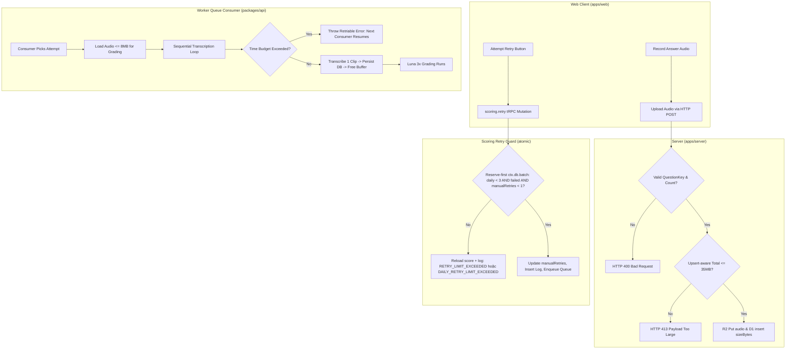

# Plan: Hardening Scoring Limits and Worker Memory (Issue #91)

## Executive Summary
Pipeline chấm forecast hiện chưa giới hạn số câu trả lời mỗi lượt, tổng dung lượng audio đưa vào chấm, và tần suất gọi `scoring.retry`. Người dùng có thể upload audio lớn gây tốn chi phí Whisper/GPT và nguy cơ làm sập Cloudflare Worker (128MB RAM limit) do tải song song toàn bộ audio từ R2.

1. **Shared Key Helper**: Chuẩn hoá sinh và kiểm tra `validQuestionKeys` dùng chung giữa Web và Server (hỗ trợ cả raw string và parsed JSON), tự động nhận diện Part 1, Part 2, Part 3 (kể cả admin-created), câu hỏi phụ (`-f`), và single-question practice. Xóa bỏ endpoint tRPC `attempt.uploadAnswer` thừa và cập nhật các test liên quan trong `attempt.test.ts`.
2. **Schema & Migration**: Bổ sung `sizeBytes` vào `attempt_answer`, `manualRetries` vào `attempt_score`, và tạo bảng `scoring_retry_log` có index `(user_id, created_at)` cùng khai báo `TablePersonalDataHandler` trong `data-registry.ts`.
3. **Upload & Submit Guard**: Kiểm tra chặt chẽ `questionKey` hợp lệ theo đề thi, kiểm soát số câu tối đa (trần an toàn 18 câu; single-question tối đa 2; full-mock tối đa 20). Kế toán dung lượng ghi đè (upsert-aware) với trần $\le 35\text{MB}$. Lưu dung lượng thực tế từ `R2Object.size`. Điểm chốt chặn phòng thủ cuối cùng và có thẩm quyền (authoritative barrier) được thực thi tại `attempt.submit`.
4. **Worker Sequential Transcription**: Chuyển đổi tải audio và transcribe từ `Promise.allSettled` sang vòng lặp tuần tự từng file, giữ RAM Worker $< 40\text{MB}$. Bổ sung ngân sách thời gian (time budget 5 phút) và cập nhật phân tích lease math chính xác.
5. **Retry Rate Limiting**: Áp dụng giới hạn tối đa 1 lần retry thủ công / bài thi và tối đa 3 lần retry thủ công / ngày / tài khoản (theo giờ Việt Nam UTC+7). Miễn trừ rescue path cho các bài nộp bị thiếu bản ghi score. Đồng bộ UI hiển thị trạng thái vô hiệu hóa và thông báo thân thiện cho cả 2 loại giới hạn.

## Phases
- [Phase 1: DB Schema Migration & Data Registry](phase-01-schema-and-migration.md)
- [Phase 2: Shared Question Keys Helper & Upload Guard](phase-02-keys-helper-and-upload-guard.md)
- [Phase 3: Sequential Worker Transcription with Time Budget](phase-03-sequential-worker-transcription.md)
- [Phase 4: Scoring Retry Rate Limit & Frontend UX](phase-04-retry-rate-limit-and-frontend.md)

## Architecture & Data Flow

## Verification Strategy
- **Type Checking**: `pnpm check-types` passes across all workspace packages (`apps/web`, `apps/server`, `packages/api`, `packages/db`).
- **Tests**:
  - `packages/db`: Migration schema validation & test data registry.
  - `packages/api`: `forecast-keys.test.ts` covers full topic, Part 1, Part 2/3, follow-up, and single question.
  - `apps/server`: Upload tests for invalid keys (400), excess question count (400), upsert audio accounting (size replaced), and payload exceeding 35MB (413).
  - `packages/api`: Sequential transcription tests in `score-attempt.test.ts` verifying one-by-one buffer loading and time-budget threshold handling.
  - `packages/api`: Rate limit tests in `scoring.test.ts` verifying per-attempt limit (1x) and daily account limit (3x/day UTC+7).

## Red Team Review

| # | Lens | Finding | Disposition | Rationale & Fix |
|---|---|---|---|---|
| 1 | Security / Failure Mode | Check-then-act upload byte/count bypass qua concurrent requests | **Accept** | Ghi nhận upload route là advisory guard; `attempt.submit` là authoritative barrier (kiểm tra `sum(sizeBytes) <= 35MB` và `count <= maxAllowed` trước khi finalize). |
| 2 | Security / Failure Mode | Concurrent daily retry bypass nếu chỉ SELECT count rồi INSERT riêng | **Accept** | Reserve-first trong 1 `ctx.db.batch`: `insert(...).select(sql...)` có guard daily count + EXISTS, và UPDATE có guard `EXISTS(log id)`. Thêm test 4 retry song song chứng minh chỉ 3 thành công. |
| 3 | Assumptions | Xóa `attempt.uploadAnswer` làm vỡ `attempt.test.ts` (5+ call sites) và refactor `p23` ảnh hưởng `state-and-data.test.ts` | **Accept** | Đưa cả `attempt.test.ts` và `state-and-data.test.ts` vào phạm vi cập nhật của Phase 2. |
| 4 | Assumptions | Helper `questions: string` không khớp web (nhận parsed JSON) và thiếu topic Part 3 dạng flat array từ admin | **Accept** | Helper hỗ trợ `questions: string | unknown`, áp dụng quy tắc fallback đồng bộ với web mapper. |
| 5 | Failure Mode / Assumptions | Lease math comment đánh giá thấp worst-case Whisper + grading | **Accept** | Budget 240s (margin 60s dưới lease 720s); worst-case 660s delivery; dùng `now()` inject. Progress lưu từng câu giúp retry resume tức thì. |
| 6 | Security / Failure Mode | Rescue path bị daily limit chặn nhầm | **Accept** | Đặt nhánh rescue path độc lập, bỏ qua cả per-attempt manualRetries và daily limit log. |
| 7 | Assumptions | Task 1.3 mô tả schema registry không khớp `TablePersonalDataHandler` | **Accept** | Sửa Task 1.3 theo đúng interface `TablePersonalDataHandler` (`tableName`, `export`, `erase`). |
| 8 | Failure Mode | Polling `use-scoring-job.ts` có 3 vị trí set `kind: "failed"` | **Accept** | Cập nhật đầy đủ cả 3 call sites trong `use-scoring-job.ts` để truyền `manualRetries` và `canRetry`. |
| 9 | Advisory | Hook `sendSubmit` tự gọi `scoring.retry` cho trạng thái `failed` tiêu tốn lượt retry thủ công | **Accept** | Loại bỏ auto-retry 'failed' trong `sendSubmit`; chỉ giữ auto-retry cho `not_scored` (rescue path). Thêm Task 4.2. |

### Whole-Plan Consistency Sweep
- Phase-04 Task 4.1 dùng reserve-first atomic trong 1 `ctx.db.batch`: `insert(...).select(sql...)` với guard `(daily count < 3) AND EXISTS(failed, manual_retries < 1)` + conditional UPDATE với guard `EXISTS(log id)`; `created_at = nowMs` ghi rõ từ đồng hồ inject; phân loại lỗi reload lại score + log sau batch.
- Đồng hồ inject duy nhất: `ctx.now?: () => Date` trên `Context` (cùng shape với `score-attempt.ts:56`); hàm thuần `startOfVietnamDayMs` được unit test riêng.
- Phase-02 mapper web `builders.ts` gọi trực tiếp shared helper `parseTopicQuestions` + key builders từ `@vox-flow/api/scoring/forecast-keys` (single source of truth); parity test đảm bảo step keys của mapper luôn là tập con của helper keys cho mọi topic trong seed.
- Phase-03 `TRANSCRIPTION_TIME_BUDGET_MS = 240_000` (margin 60s dưới lease 720s), dùng injected `now()` từ `runPipeline`.
- Phase-04 Task 4.2 loại bỏ auto-retry 'failed' trong `sendSubmit`; set view failed trực tiếp.
- Phase-04 Task 4.3 thêm test retry song song và clock injection qua `ctx.now`.
- `canRetry` trong `scoring.status` tính cả daily count (cheap index scan) chứ không chỉ per-attempt.
- Toàn bộ các file phase đã được đồng bộ với quyết định của Red Team Review và Advisory feedback.
- Không còn mâu thuẫn về API signature, số lần retry, quy tắc xử lý concurrency hoặc phạm vi test files.

## Validation Log

### Verification Results
- Claims checked: 16 (symbols, paths, schema columns, test files).
- Verified: 16 | Failed: 0 | Unverified: 0
- Tier: Standard
- All paths confirmed: `packages/db/src/schema/attempt.ts`, `packages/db/src/schema/score.ts`, `packages/api/src/data-registry.ts`, `packages/api/src/routers/attempt.ts`, `packages/api/src/scoring/score-attempt.ts`, `packages/api/src/routers/scoring.ts`, `apps/server/src/index.ts`, `apps/web/src/features/scoring/scoring-screen.tsx`, `apps/web/src/features/scoring/use-scoring-job.ts`.

