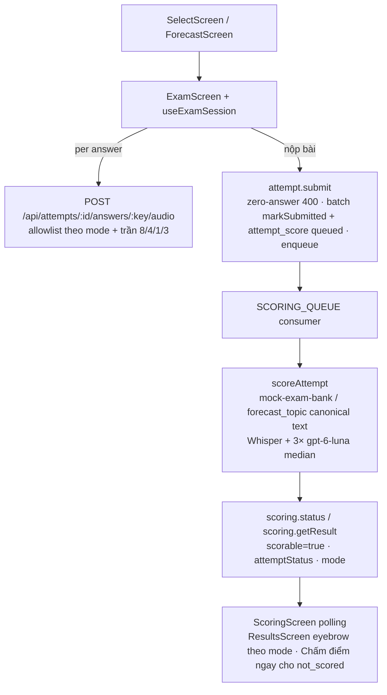

## Outcome

Mọi lượt làm bài có ghi âm trên máy chủ — bao gồm cả **Thi thử (`Full Test`, `Part 1`, `Part 2`, `Part 3`)** lẫn **Luyện đề Forecast (cả chủ đề và từng câu lẻ)** — đều tự động đưa vào hàng đợi chấm điểm AI (`Whisper` + 3 lượt `gpt-6-luna` lấy trung vị), hiển thị tiến trình chấm thời gian thực và trả kết quả band tổng, 4 tiêu chí, bằng chứng nguyên văn kèm nhãn chế độ thi chính xác.

## How It Works

- **Server**: gỡ bỏ điều kiện `topicId !== null` tại 4 điểm (`attempt.submit`, `scoring.status`, `scoring.retry`, `scoreAttempt`) để mọi `attempt` đều tạo dòng `attempt_score` và đẩy message vào `SCORING_QUEUE` (submit 0 câu trả lời bị chặn `400`).
- **Chấm điểm an toàn**: bài thi thử dùng văn bản câu hỏi chuẩn từ `@vox-flow/api/scoring/mock-exam-bank` (kèm cue card Part 2 và follow-up tĩnh), không bao giờ tin `questionText` do client gửi (`#93`); key/trần số câu bị chặn theo mode (`full: 8`, `part1: 4`, `part2: 1`, `part3: 3` — `#91`).
- **Web**: nộp bài thi thử giữ nguyên modal flush/submit của `#109`, sau khi submit thành công chuyển sang màn chấm với `scoringAttempt = { kind: "attempt", attemptId, submitted: true }`; `ResultsScreen` hiển thị đúng nhãn "Thi thử Full Test / Part 1 / Part 2 / Part 3" và cho phép "Chấm điểm ngay" cho bài `submitted` chưa có điểm.

## Architecture / Flow

## Advisor Scope Lock (`--advice`)

- Locked Scope: gỡ 4 cổng `topicId` + hand-off `submitted: true` trên web + ngân hàng câu hỏi mock chuẩn + allowlist/trần theo mode + `attemptStatus`/`mode` trong `ScoreStatusResult`/`ScoringResult` + card `not_scored` trên `ResultsScreen`.
- Explicit Non-Goals: không thêm quota chi phí submit (thuộc `#18`, rủi ro Beta đã ghi nhận); không đổi cấu hình Queue/Paywall; không gộp luồng submit Forecast/Mock; không sửa schema D1; không nối API lịch sử server cho History/Dashboard (`#22`); `getFollowUp` giữ nguyên theo quyết định `#93`.

## Implementation

- Branch: `feat/ai-scoring-all-modes`
- Plan: `plans/261111-0035-ai-scoring-all-modes/plan.md`
- Mode: `beta`
- Route: `feature` (via `/ak-cook`)
- PR: pending

## Acceptance Criteria

- [ ] AC1: Nộp bài ở bất kỳ chế độ thi thử nào (`full`, `part1`, `part2`, `part3` với `topicId = null`) cũng như luyện đề Forecast đều ghi nguyên tử `attempt.status = "submitted"` + `attempt_score (status = "queued")` và đẩy message vào `SCORING_QUEUE`; submit với 0 câu trả lời được chặn `400` trước khi ghi trạng thái.
- [ ] AC2: Worker `scoreAttempt` chấm thành công bài thi thử (`topicId = null`) bằng văn bản câu hỏi chuẩn từ `mock-exam-bank.ts`, không bao giờ đưa `questionText` do client gửi vào prompt chấm điểm; key lạ rơi về `"(question unavailable)"` không ném lỗi.
- [ ] AC3: Route upload audio và `findAnswerLimitViolation` chặn key không thuộc mode thi thử (`400`, kể cả mode lạ — fail-closed) và áp đúng trần số câu theo mode (`full: 8`, `part1: 4`, `part2: 1`, `part3: 3`), đồng thời giữ nguyên trần `TOPIC_LESS_CAP = 20` khi bài forecast bị thiếu dòng `forecast_topic`.
- [ ] AC4: `scoring.status` và `scoring.retry` trả `scorable: true` cho mọi attempt kèm `attemptStatus`; rescue path của `scoring.retry` cho phép tạo dòng `attempt_score` cho mọi bài `submitted` chưa có điểm mà không tốn lượt retry thủ công; `scoring.getResult` trả thêm `mode`.
- [ ] AC5: Trên web, nộp bài thi thử thành công trong `ExamScreen` chuyển sang `/scoring` với `scoringAttempt = { kind: "attempt", attemptId, submitted: true }` để theo dõi tiến trình chấm và tự động mở màn kết quả khi `done` (giữ nguyên toàn bộ guard flush/hủy/thoát của `#109` và `local_only` của `#119`).
- [ ] AC6: `ResultsScreen` hiển thị đúng nhãn chế độ thi thử (`Thi thử Full Test`, `Thi thử Part 1`, `Thi thử Part 2`, `Thi thử Part 3`) khi `scored.topicId === null`, giữ `"Luyện đề Forecast"` khi `scored.topicId !== null`, và hiển thị trạng thái `"Bài thi chưa được chấm điểm"` kèm nút `"Chấm điểm ngay"` khi gặp bài `submitted` ở trạng thái `not_scored` (bài `in_progress`/`abandoned` giữ card lưu trữ trung lập).
- [ ] AC7: `mock-exam-bank.test.ts` khóa nội dung golden literal của cả 6 mục đề (text/cue/followUp); test parity xác nhận tập key của `ITEMS` sau khi dựng từ `MOCK_EXAM_PROMPTS` khớp tuyệt đối `buildMockExamStepKeys` cho cả 4 mode; toàn bộ test `packages/api`, `apps/server`, `apps/web` và `pnpm check-types` đều pass.

## Pipeline State

- [x] Worktree and branch created or reused (`feat/ai-scoring-all-modes`)
- [x] Pre-plan investigation (scout toàn diện + kongming Checkpoint #1 GO)
- [x] TDD plan created (2 phases, handover-ready)
- [x] Plan validated and red-teamed (2 reviewer lens; 11 findings → 6 accept / 5 reject / 1 note; sweep 0 unresolved)
- [ ] Issue labeled `in progress` before implementation
- [ ] Implementation complete
- [ ] Local review passed
- [ ] Test audit / optimization complete (if applicable)
- [ ] Docs updated or follow-up issue filed (if applicable)
- [ ] PR reviewed and fixed
- [ ] Merged and CI green (beta)
