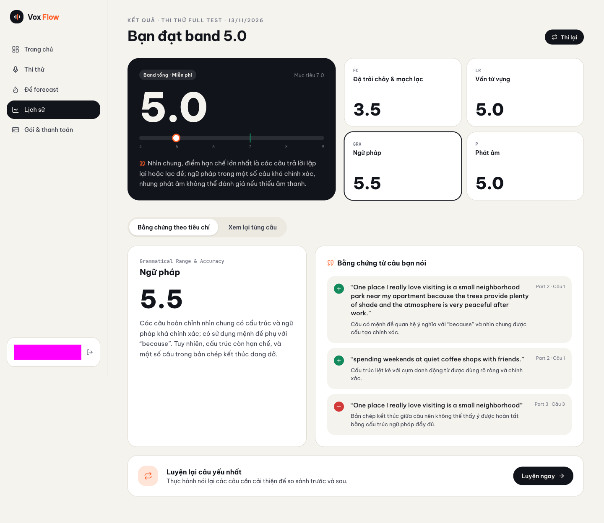
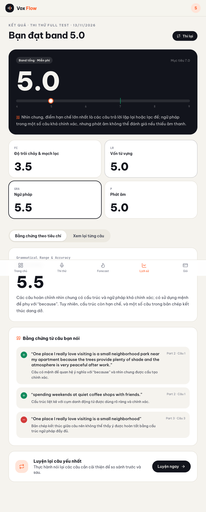
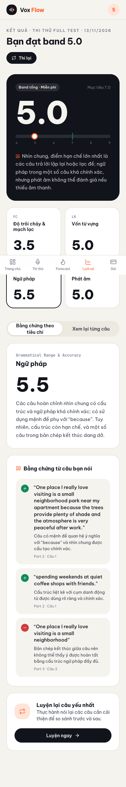
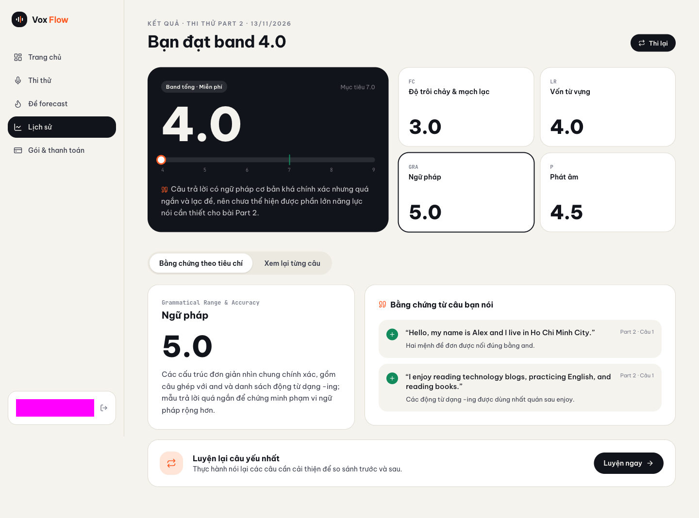
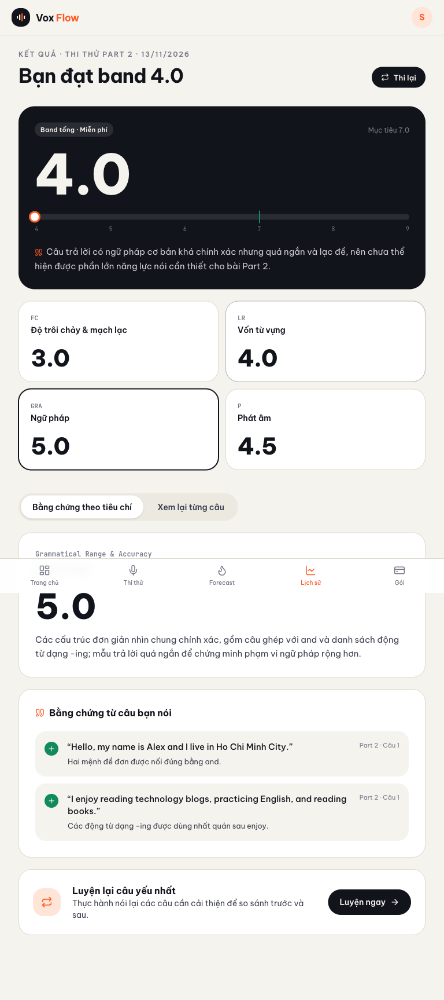
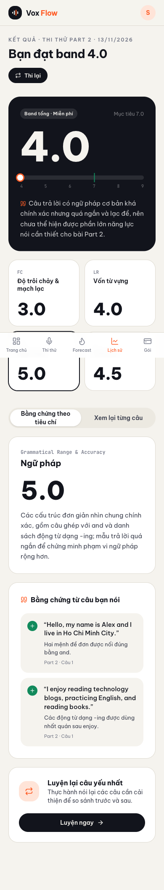
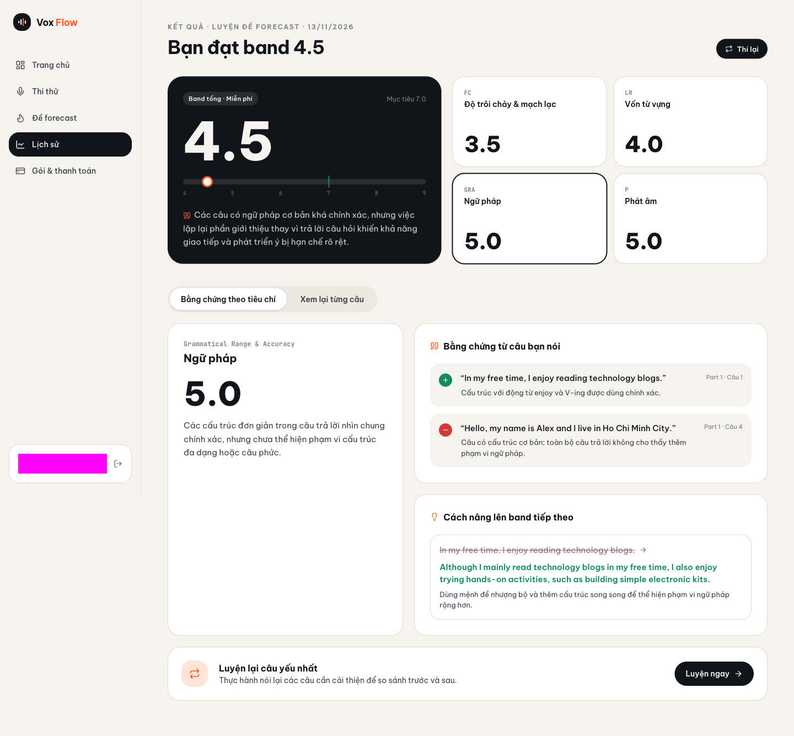
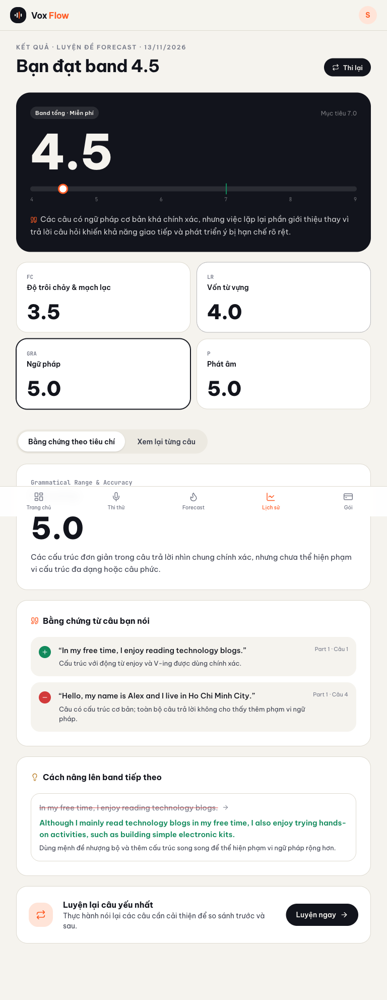
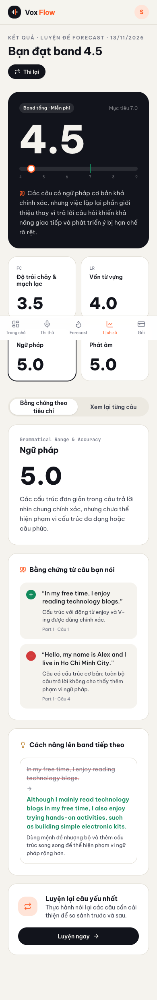

# Proof of Test (POT) — Nghiệm thu Beta & Đo Unit Cost cho #130

- **Môi trường kiểm chứng:** Beta (`https://vox.vinhtran.io.vn` · API `https://api.vox.vinhtran.io.vn`)
- **Commit đang chạy trên Beta:** `96bc94aea7c3920155c523a5bcd2f493ff1fcf3d`
- **Workflow Deploy Beta:** [43371322880](https://github.com/vinh19410/vox-flow/actions/runs/43371322880) (`completed / success`)
- **D1 Database (remote):** `vox-flow-database-prod-zyrewf3xlu77jmqc`
- **Mốc thời gian test Beta:** `TEST_START_MS = 1794549615182` (`2026-11-13T06:00:15Z` → `06:13:21Z`)
- **Lưu ý dữ liệu:** Đã ẩn PII (`UserCard` được mask khi chụp desktop; tablet/mobile chỉ hiện avatar chữ cái đầu); không dán email, token hay presigned URL.

---

## 1. Kết quả kiểm chứng theo kịch bản (`#130`)

### A. 6 luồng chính trên Beta (`6/6` đạt)

| # | Chế độ | Attempt ID | Trạng thái & Giao diện kết quả | Bằng chứng chi tiết |
|---|---|---|---|---|
| 1 | `Full Test` (`mock`, 8 bước, audio gần thật `131.0s`) | `e89dd165-7ef0-4943-9e64-96802edc448a` | `done` · `"KẾT QUẢ · THI THỬ FULL TEST · 13/11/2026"` · `"Bạn đạt band 5.0"` | Cue card Part 2 hiện ở lúc thi & tab `Xem lại từng câu` (`reviewContainsCueCard = true`), `reviewCount = 8` |
| 2 | `Part 1` (`mock`, 4 bước) | `57ca0216-4aaf-4d0c-bf22-6cb534b1c2c1` | `done` · `"KẾT QUẢ · THI THỬ PART 1 · 13/11/2026"` · `"Bạn đạt band 4.0"` | `reviewCount = 4` |
| 3 | `Part 2` (`mock`, 1 cue card) | `0fb0c02a-a999-41cf-afb8-3299e8393ca1` | `done` · `"KẾT QUẢ · THI THỬ PART 2 · 13/11/2026"` · `"Bạn đạt band 4.0"` | `cueCardVisible = true`, `reviewCount = 1`, `reviewContainsCueCard = true` |
| 4 | `Part 3` (`mock`, 3 bước) | `165cfafa-bd66-47b3-b4db-575984b7f0ff` | `done` · `"KẾT QUẢ · THI THỬ PART 3 · 13/11/2026"` · `"Bạn đạt band 3.0"` | `reviewCount = 3` |
| 5 | `Forecast` cả chủ đề (`Opportunities`, 4 câu) | `d98f2956-0f6c-4b53-a567-80788bacc093` | `done` · `"KẾT QUẢ · LUYỆN ĐỀ FORECAST · 13/11/2026"` · `"Bạn đạt band 4.5"` | `topicId = 2585f96a-f10d-eae4-e6bd-902a610bf5d3`, `reviewCount = 4` |
| 6 | `Forecast` 1 câu lẻ (`Travelling`, 1 câu) | `b7fdde8a-ff8f-4429-80ff-57bfa1c503c4` | `done` · `"KẾT QUẢ · LUYỆN ĐỀ FORECAST · 13/11/2026"` · `"Bạn đạt band 4.5"` | `topicId = 4a058b5c-8d74-daf6-b274-da666ea6f511`, `reviewCount = 1` |

### B. 4 Edge cases (`3/4` trực tiếp trên Beta + `1/4` kiểm chứng trên local D1)

| # | Edge case | Môi trường | Kết quả quan sát |
|---|---|---|---|
| 7 | Zero-answer submit (`attempt.submit` khi chưa có answer) | Beta | HTTP `400` (`"Attempt has no recorded answers"`); `scoring.status` giữ `status: "not_scored"`, `scorable: true`, `attemptStatus: "in_progress"`, `canRetry: true` |
| 8 | `F5` giữa chừng trên `/scoring` (`0fb0c02a-a999-41cf-afb8-3299e8393ca1`) | Beta | Reload tại `https://vox.vinhtran.io.vn/scoring` tiếp tục poll đúng job (`fellBackToRecorded = false`), chuyển sang `/app/history/...` khi `done` |
| 9 | Double-click nút nộp bài (`Part 3` `165cfafa-bd66-47b3-b4db-575984b7f0ff`) | Beta | Chỉ gửi `1` request `attempt.submit`, D1 ghi đúng `runs = 3` (không enqueue/chấm trùng) |
| 10 | Rescue path `"Chấm điểm ngay"` trên bài `submitted` chưa có `attempt_score` | Local D1 + Unit test *(giải thích Beta bên dưới)* | Trên Beta có 2 dòng legacy `submitted` chưa có `attempt_score` (`ccd5f185-8270-41f7-a335-c7f71144ead8`, `e6af47b8-eb18-4d87-afc3-acce4eaae792`) nhưng đều thuộc tài khoản khác (`403 FORBIDDEN`) nên không can thiệp sửa tay prod D1. Luồng rescue đã được xác minh E2E trên D1 local (`4a83c1ec-4932-47dd-9c6f-62f7e86660da` → card `results-not-scored` → bấm `"Chấm điểm ngay"` → `"Bạn đạt band 3.0"`, `runs = 3`) và unit test `scored-results.test.tsx` (`16/16 passed`). |

### C. Quan sát bổ sung: ElevenLabs TTS (`#138`) trên Beta
- Toàn bộ **20/20** request `/api/tts/{mock,forecast,attempt}/...` trong phiên chạy Beta đều trả **HTTP `200`** với `Content-Type: audio/mpeg`.

---

## 2. Số liệu D1 Remote (`vox-flow-database-prod-zyrewf3xlu77jmqc`) & Unit Cost

> Lưu ý SQL: tổng hợp `attempt_answer` và `score_run` trong 2 subquery tách biệt trước khi `JOIN` để tránh nhân chéo `SUM(input_tokens)` / `SUM(output_tokens)` theo số câu trả lời.

| Mode / Kind | Attempt ID | `status` | `overall` | `tries` / `manual` | `answers` | `audio_sec` | `total_bytes` | `runs` / `model` | `in_tokens` | `out_tokens` | `cost_usd` |
|---|---|---|---:|---:|---:|---:|---:|---|---:|---:|---|
| `full` / `mock` | `e89dd165-...` | `done` | `5.0` | `1` / `0` | `8` | `131.0` | `2,103,760` | `3` / `gpt-6-luna` | `4,446` | `8,349` | `null` |
| `part1` / `mock` | `57ca0216-...` | `done` | `4.0` | `1` / `0` | `4` | `28.0` | `445,156` | `3` / `gpt-6-luna` | `2,631` | `6,631` | `null` |
| `part2` / `mock` | `0fb0c02a-...` | `done` | `4.0` | `1` / `0` | `1` | `7.8` | `125,175` | `3` / `gpt-6-luna` | `2,040` | `5,599` | `null` |
| `part3` / `mock` | `165cfafa-...` | `done` | `3.0` | `1` / `0` | `3` | `22.5` | `360,045` | `3` / `gpt-6-luna` | `2,415` | `7,370` | `null` |
| `part1` / `forecast` (`Opportunities`) | `d98f2956-...` | `done` | `4.5` | `1` / `0` | `4` | `28.1` | `445,172` | `3` / `gpt-6-luna` | `2,898` | `6,601` | `null` |
| `part1` / `forecast` (`Travelling`) | `b7fdde8a-...` | `done` | `4.5` | `1` / `0` | `1` | `7.0` | `111,289` | `3` / `gpt-6-luna` | `2,007` | `4,867` | `null` |

Ghi nhận chi phí & cấu hình:
- Toàn bộ `18/18` dòng `score_run` đều có `audio_used = 0` (`gpt-6-luna` chấm dựa trên transcript sau bước Whisper STT), `last_error = null`, `runs = 3`.
- Cột `attempt_score.cost_usd` và `score_run.cost_usd` đều đang là **`null`** vì `.github/workflows/deploy-beta.yml` chưa truyền `SCORING_PRICE_INPUT_PER_1M` và `SCORING_PRICE_OUTPUT_PER_1M` (và `computeCostUsd` chỉ tính phần LLM tokens, chưa gồm phí Whisper STT + ElevenLabs TTS).
- Công thức quy đổi COGS thực tế cho 1 bài chấm khi áp đơn giá nhà cung cấp:
  `COGS = (in_tokens × Price_in + out_tokens × Price_out) / 1_000_000 + (audio_sec / 60) × Price_whisper_per_min + Price_tts_uncached`

---

## 3. Ảnh chụp màn hình kiểm chứng (3 viewport trên Beta, đã che PII)

### Full Test (`e89dd165-7ef0-4943-9e64-96802edc448a`)
- Desktop (`1440×900`):

- Tablet (`768×1024`):

- Mobile (`390×844`):

### Part 2 (`0fb0c02a-a999-41cf-afb8-3299e8393ca1`)
- Desktop (`1440×900`):

- Tablet (`768×1024`):

- Mobile (`390×844`):

### Forecast cả chủ đề (`Opportunities` · `d98f2956-0f6c-4b53-a567-80788bacc093`)
- Desktop (`1440×900`):

- Tablet (`768×1024`):

- Mobile (`390×844`):

---

## 4. Cổng kiểm tra (Gates)

- **Smoke Beta:**
  - `curl -fsS https://api.vox.vinhtran.io.vn/trpc/healthCheck` → `{"result":{"data":"OK"}}`
  - `curl -fsSI https://vox.vinhtran.io.vn/` → `HTTP/2 200`
- **Unit / Integration tests (đã chạy trên commit `96bc94a`, không sửa code ứng dụng):**
  - `pnpm --filter @vox-flow/api test` → **30 files / 340 passed**
  - `pnpm --filter server test` → **4 files / 62 passed**
  - `pnpm --filter web test` (4 file liên quan): `exam-submit.test.tsx` (`29 passed`), `use-scoring-job.test.ts` (`3 passed`), `results-gate.test.tsx` (`1 passed`), `scored-results.test.tsx` (`16 passed`)
- **Type check:**
  - CI Beta ([43371322880](https://github.com/vinh19410/vox-flow/actions/runs/43371322880)) đã deploy xanh lên Beta.
  - Trên máy local: `@vox-flow/infra`, `@vox-flow/api`, `server` pass `check-types`; `pnpm check-types` tổng và `web` `vite build` gặp lỗi thiếu dependency trong `node_modules` cục bộ của `packages/auth` (`vitest` và `@vox-flow/auth/image-validation`) do chưa chạy `pnpm install` lại cục bộ.
