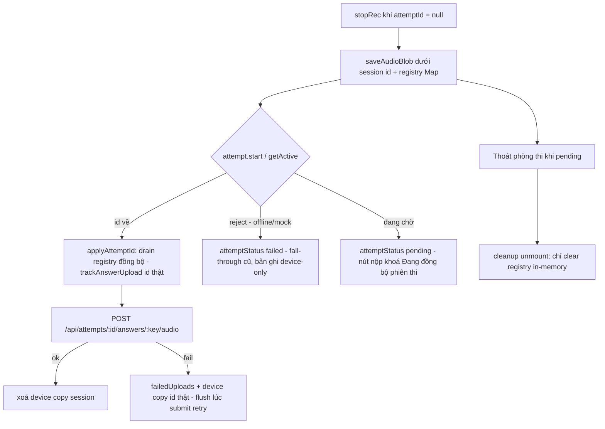

## Plan đã validate + red-team + kongming ×2 — sẵn sàng thực hiện (ak-vibe)

**Route:** bugfix qua `/ak-fix` · **Branch:** `fix/94-attempt-start-race-upload` · **Ship mode:** beta · **Plan:** [plans/261110-0635-94-attempt-start-race-upload/plan.md](../blob/dev/plans/261110-0635-94-attempt-start-race-upload/plan.md)

### Outcome
Bản ghi âm dừng khi `attemptId` chưa về được upload bù lên server dưới `attemptId` thật ngay khi id trả về (từ `attempt.start` lẫn `attempt.getActive`); nút nộp bị khoá trong lúc phiên đồng bộ nhưng vẫn nộp được khi offline (tri-state) — câu trả lời luôn được chấm và có trong lịch sử, không regression cho luồng offline/mock.

### How It Works
- Hook `useExamSession` giữ registry in-memory `Map<questionKey, Promise<AnswerUpload|null>>` cho bản ghi dừng khi chưa có `attemptId` (vẫn `saveAudioBlob` giữ device copy như cũ; entry chỉ settle sau khi device copy ghi xong).
- `attemptIdRef` quyết nhánh lúc encode resolve: id về trong lúc ghi → track thẳng dưới id thật. Khi id về, **drain chạy đồng bộ trong `applyAttemptId`** (trước `setAttemptId`): từng bản ghi pending được `trackAnswerUpload(id, promise)` — ticket và `inFlight` cấp trước mọi thao tác ghi lại/submit theo cấu trúc (đóng 3 race: encode, ticket inversion, submit chen).
- `attemptStatus` tri-state (kongming #2): `pending` → nút nộp khoá "Đang đồng bộ phiên thi…"; `ready` → nộp bình thường; `failed` (offline, `attempt.start` reject) → fall-through giữ nguyên hành vi cũ — không khoá học viên offline vĩnh viễn.
- Session copy chỉ bị xoá khi server xác nhận (`trackAnswerUpload === true`); thoát phòng thi khi pending chỉ clear registry in-memory (giữ bản sao — data-safety, follow-up recovery sẽ cần). `answer-uploads.ts` không đổi.

### Architecture / Flow

### Acceptance Criteria (từ plan)
- [ ] AC1: Đúng 1 lần track dưới id thật sau khi `attempt.start` resolve; xoá session copy đúng 1 lần, dưới session id (assert chính xác), chỉ khi track resolve `true`
- [ ] AC2: Encode race — encode resolve sau khi id về vẫn track dưới id thật, không save session copy
- [ ] AC3: Offline — không track/POST, bản ghi device-only
- [ ] AC4: Drain qua nhánh `attempt.getActive` — test runtime riêng
- [ ] AC5: Hai take cùng câu pending → chỉ take MỚI được track (last-write-wins)
- [ ] AC6: Nộp ngay khi id vừa về — drain đã chạy trước handler submit (test khóa)
- [ ] AC7: Tri-state — `pending` khoá nộp; `ready` mở, hai path nộp giữ nguyên; `failed` mở với nhãn thường + fall-through cũ
- [ ] AC8: Unmount khi pending → chỉ clear registry in-memory, giữ device copy
- [ ] AC9: `pnpm check-types` + toàn bộ test `features/exam` + `features/scoring` pass

### Follow-up (ngoài PR, sẽ tạo issue riêng)
Reload-recovery (meta trail cross-mount) · mock submit-vs-in-flight-upload 400 · `questionText` trong URL query (privacy) · fallback `"session-local"` cross-tab · `attempt.start` treo vĩnh viễn (pending kéo dài).

### Pipeline State
- [x] Worktree + branch
- [x] Investigation (ak-debug inline + kongming checkpoint #1: go backfill, registry)
- [x] Plan + validate + red-team 2 persona (10 findings: 6 accept, 4 follow-up) + consistency sweep + kongming checkpoint #2 (tri-state, drain đồng bộ, delete-on-true)
- [ ] Cook/fix
- [ ] Code review
- [ ] Ship (beta) + PR review
- [ ] Merge + CI
