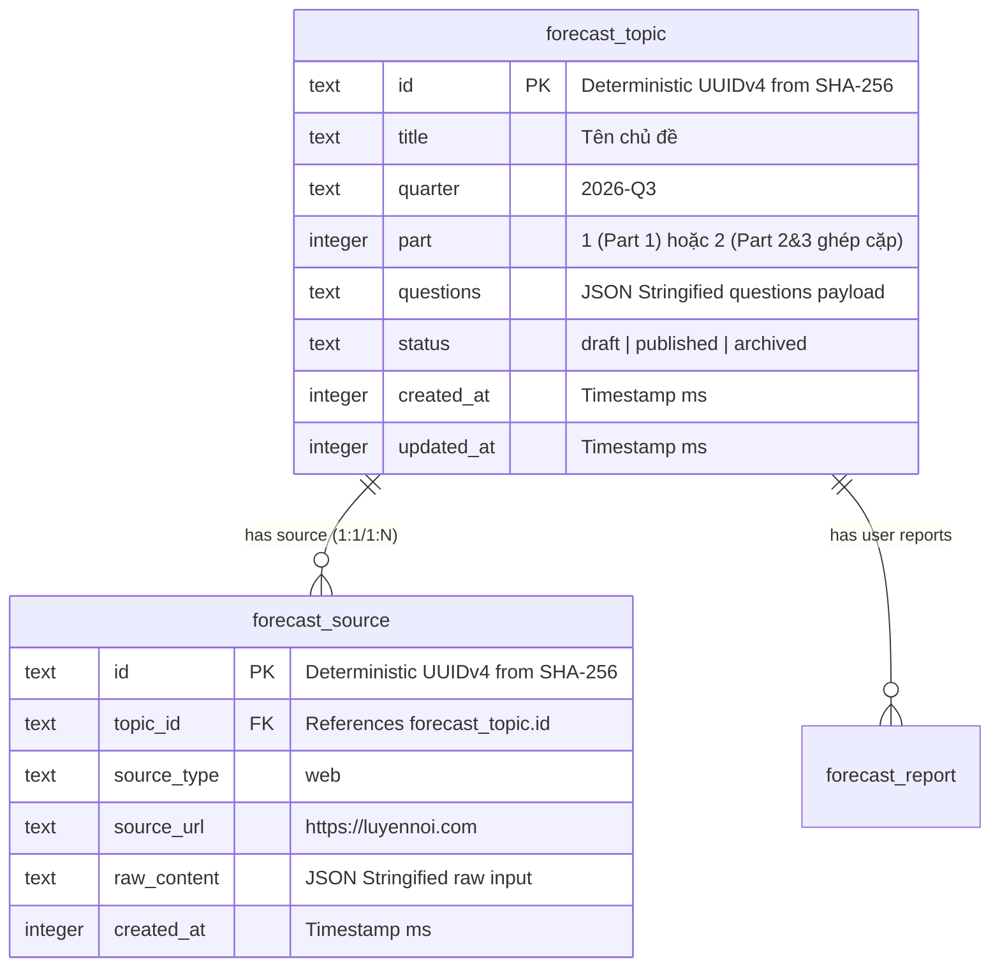
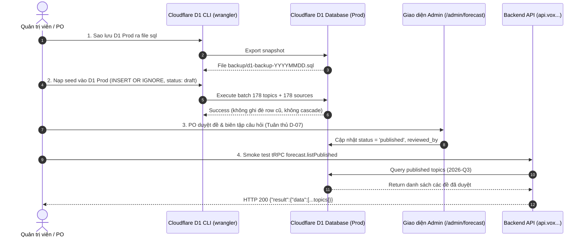

# Báo cáo Đối chiếu & Đánh giá Dữ liệu Bộ đề Speaking Forecast 2026-Q3

* **Thời gian thực hiện:** 09/11/2026
* **Tài liệu nguồn:** `raw-data/speaking-forecast-full.json`
* **Mã nguồn liên quan:** `packages/db/scripts/seed-forecast.ts`, `packages/db/scripts/seed-forecast.sql`, `packages/db/src/schema/forecast.ts`
* **Hệ thống đối chiếu:** API Live Production (`https://api.vox.vinhtran.io.vn`) & Web SPA (`https://vox.vinhtran.io.vn`)
* **Trạng thái kết luận:** **DỮ LIỆU ĐÃ ĐƯỢC CHUẨN HÓA TRONG MÃ NGUỒN (LOCAL/TEST) NHƯNG CHƯA ĐỒNG BỘ LÊN CLOUDFLARE D1 PRODUCTION**

---

## 1. Tóm tắt điều hành (Executive Summary)

1. **Tập dữ liệu gốc (`raw-data/speaking-forecast-full.json`):** Chứa trọn vẹn bộ đề IELTS Speaking Forecast kỳ Quý 3/2026 (áp dụng từ tháng 9 đến tháng 12/2026) được tổng hợp từ nguồn `luyennoi.com` (ngày cập nhật 26/10/2026). Dữ liệu bao gồm:
   - **Part 1:** 65 chủ đề, tổng cộng 394 câu hỏi.
   - **Part 2:** 113 thẻ đề (gồm 51 đề mới và 62 đề cũ).
   - **Part 3:** 113 nhóm câu hỏi thảo luận chuyên sâu đi kèm Part 2, tổng cộng 782 câu hỏi.
2. **Trạng thái mã nguồn (`packages/db`):**
   - Script chuẩn hóa `seed-forecast.ts` đã phân tích và ánh xạ 100% dữ liệu gốc thành **178 bản ghi** `forecast_topic` (65 Part 1 + 113 Part 2&3 ghép cặp) và **178 bản ghi** `forecast_source` với UUID định danh xác định (`deterministicUuid`).
   - File `packages/db/scripts/seed-forecast.sql` hoàn toàn đồng bộ và sẵn sàng 100% với dữ liệu JSON gốc.
3. **Trạng thái hệ thống thực tế (Live Cloudflare D1 Production):**
   - Truy vấn trực tiếp API công khai `https://api.vox.vinhtran.io.vn/trpc/forecast.listPublished?input=%7B%22quarter%22%3A%222026-Q3%22%7D`: Trả về `{"result":{"data":[]}}` (0 bản ghi `status = 'published'` của kỳ 2026-Q3 qua public API; các bản ghi `draft` hoặc các quý khác chưa được kiểm chứng do yêu cầu quyền admin).
   - **Hiện trạng mã nguồn & môi trường local:** Mã nguồn có sẵn script seed (`seed-forecast.ts`) và test helper (`seedForecastTestDb`), tuy nhiên trạng thái cơ sở dữ liệu D1 Local hiện tại chưa được nạp/kiểm chứng trong phiên làm việc này.
   - **Hệ quả trên giao diện người dùng:** Trang luyện đề `/app/forecast` trên môi trường live hiện chưa có đề để thí sinh luyện tập.

---

## 2. Thống kê định lượng chi tiết dữ liệu JSON gốc

### 2.1 Metadata tổng quan
* **Nguồn trích xuất:** `luyennoi.com` (từ bundle JS client chunk).
* **Ngày phát hành bộ đề:** 26/10/2026.
* **Kỳ áp dụng hệ thống:** `2026-Q3` (Tháng 9 – Tháng 12/2026).

### 2.2 Phân tích Part 1 (Short Q&A)
* **Tổng số chủ đề:** 65 chủ đề.
* **Tổng số câu hỏi:** 394 câu hỏi.
* **Số câu trung bình mỗi chủ đề:** 6.1 câu/chủ đề (Thấp nhất: 4 câu; Cao nhất: 17 câu).
* **Phân bố các chủ đề tiêu biểu:** *Tidiness* (8 câu), *Opportunities* (4 câu), *Travelling* (4 câu), *Advertisement* (6 câu), *Tiredness* (4 câu), *Friends* (9 câu), *Food* (6 câu), *Studies* (17 câu), *Work* (10 câu), *Home & Accommodation* (16 câu), *Hometown* (14 câu)...

### 2.3 Phân tích Part 2 (Long Turn / Cue Cards)
* **Tổng số chủ đề (cards):** 113 cards.
* **Phân loại thẻ mới / cũ:**
  - **Đề mới (`isNew: true`):** 51 đề (chiếm 45.1%).
  - **Đề cũ (`isNew: false`):** 62 đề (chiếm 54.9%).
* **Phân loại theo 4 nhóm chủ đề lớn:**
  - **Person (Con người):** 30 đề (26.5%).
  - **Object (Đồ vật, sự việc, công nghệ):** 34 đề (30.1%).
  - **Activity (Hoạt động, trải nghiệm, quyết định):** 34 đề (30.1%).
  - **Place (Địa điểm, tòa nhà, danh lam):** 15 đề (13.3%).

### 2.4 Phân tích Part 3 (Discussion Topics)
* **Tổng số nhóm câu hỏi:** 113 nhóm (tương ứng 1:1 với 113 Part 2 cards).
* **Tổng số câu hỏi thảo luận:** 782 câu hỏi.
* **Số câu trung bình mỗi nhóm:** 6.9 câu/nhóm (Thấp nhất: 1 câu; Cao nhất: 13 câu).

### 2.5 Độ khớp dữ liệu ghép cặp Part 2 & Part 3
* **Tỷ lệ khớp:** **113 / 113 cards khớp tuyệt đối 100%**.
* Không phát hiện bất kỳ Part 2 card nào bị thiếu nhóm câu hỏi Part 3 đi kèm.
* Không có nhóm câu hỏi Part 3 nào bị mồ côi (không tìm thấy Part 2 tương ứng).

---

## 3. Phân tích mô hình dữ liệu & Quy tắc ánh xạ (Schema Mapping)

Trong cơ sở dữ liệu SQLite / Cloudflare D1 (`packages/db/src/schema/forecast.ts`), dữ liệu forecast được chuẩn hóa vào 2 bảng chính:



### Quy tắc chuẩn hóa trường `questions`:
1. **Đối với Part 1 (`part = 1`):**
   * Lưu mảng chuỗi trực tiếp:
     ```json
     ["Were you a tidy person when you were a child?", "Do you like to keep things tidy?", "..."]
     ```
2. **Đối với Part 2 & 3 (`part = 2`):**
   * Ghép Part 2 cue cards và Part 3 questions vào cùng một chủ đề theo cấu trúc:
     ```json
     {
       "cueCards": [
         "Who the person is",
         "How this person encourages people to protect the environment",
         "..."
       ],
       "part3": [
         "What can individuals do to protect the environment?",
         "Do schools teach children to protect nature?",
         "..."
       ],
       "isNew": true
     }
     ```

---

## 4. Bảng ma trận đối chiếu 3 môi trường (Cross-Environment Matrix)

| Tiêu chí đối chiếu | 1. File JSON gốc (`raw-data/...`) | 2. Mã nguồn Seed (`packages/db/...`) | 3. Hệ thống Live Production (`api.vox...`) | Đánh giá đồng bộ |
| :--- | :--- | :--- | :--- | :--- |
| **Tổng số chủ đề** | 178 (65 P1 + 113 P2&3) | 178 bản ghi `forecast_topic` | 0 bản ghi | ⚠️ **CHƯA ĐỒNG BỘ LÊN PROD** |
| **Số chủ đề Part 1** | 65 topics | 65 bản ghi (`part = 1`) | 0 bản ghi | ⚠️ **CHƯA ĐỒNG BỘ LÊN PROD** |
| **Số câu hỏi Part 1** | 394 câu | 394 câu (đầy đủ trong JSON string) | 0 câu | ⚠️ **CHƯA ĐỒNG BỘ LÊN PROD** |
| **Số chủ đề Part 2** | 113 cards | 113 bản ghi (`part = 2`) | 0 bản ghi | ⚠️ **CHƯA ĐỒNG BỘ LÊN PROD** |
| **Số câu hỏi Part 3** | 782 câu | 782 câu (trong thuộc tính `part3`) | 0 câu | ⚠️ **CHƯA ĐỒNG BỘ LÊN PROD** |
| **Nhãn phân loại đề mới** | 51 đề mới | 51 đề có `isNew: true` | Không có | ⚠️ **CHƯA ĐỒNG BỘ LÊN PROD** |
| **Bản ghi nguồn (Sources)** | `luyennoi.com` | 178 bản ghi `forecast_source` | 0 bản ghi | ⚠️ **CHƯA ĐỒNG BỘ LÊN PROD** |
| **Mã kỳ (Quarter)** | `2026-Q3` | `quarter = '2026-Q3'` | Không có dữ liệu | ⚠️ **CHƯA ĐỒNG BỘ LÊN PROD** |
| **Trạng thái xuất bản** | Web thô chưa biên tập | `status = 'published'` (dev seed) | 0 bản ghi published qua public API | ⚠️ **CẦN QUYẾT ĐỊNH CỦA PO (D-07)** |
| **Độ nhất quán Hash/UUID** | Chuẩn hóa theo tiêu đề | Deterministic UUID (SHA-256) | Không có | ✅ Sẵn sàng 100% để nạp |

---

## 5. Bằng chứng thực nghiệm (Proof of Audit)

### 5.1 Kiểm tra file Seed SQL trong mã nguồn
Chạy lệnh `seed:forecast` từ mã nguồn để tái tạo và kiểm tra tính toàn vẹn:
```bash
$ pnpm --filter @vox-flow/db run seed:forecast
> @vox-flow/db@ seed:forecast /root/projects/vox-flow/packages/db
> node --experimental-strip-types ./scripts/seed-forecast.ts

Generated 178 topics and 178 sources.
Saved SQL seed to: /root/projects/vox-flow/packages/db/scripts/seed-forecast.sql
```
* **Kết quả:** File `seed-forecast.sql` chứa đúng 361 dòng (178 INSERT `forecast_topic` + 178 INSERT `forecast_source` + comments), không có sai lệch.

### 5.2 Kiểm tra đối chiếu sâu từng trường nội dung per-ID (Content-Level Verification)
Đã thực thi script đối chiếu tự động toàn bộ 178 câu lệnh INSERT trong `seed-forecast.sql` với file JSON gốc:
* Phân tích và giải mã JSON của từng bản ghi: kiểm tra `title`, `quarter`, `part`, `status`, danh sách câu hỏi Part 1, `cueCards`, `part3`, và nhãn `isNew`.
* **Kết quả:**
  - Tổng số bản ghi `forecast_topic` trong SQL: 178 (65 Part 1 + 113 Part 2&3).
  - Tổng số bản ghi `forecast_source` trong SQL: 178.
  - Số lượng bản ghi sai lệch nội dung: **0 sai lệch (0 mismatches)**.
  - Toàn bộ 394 câu hỏi Part 1 và 782 câu hỏi Part 3 đều khớp chính xác 100% với JSON gốc.

### 5.3 Truy vấn trực tiếp API Live Production
Thực hiện truy vấn tRPC endpoint công khai của backend Vox Flow:
```bash
$ curl -s -i "https://api.vox.vinhtran.io.vn/trpc/forecast.listPublished?input=%7B%22quarter%22%3A%222026-Q3%22%7D"

HTTP/2 200 
date: Mon, 09 Nov 2026 02:26:46 GMT
content-type: application/json
server: cloudflare
...
{"result":{"data":[]}}
```

Kiểm tra tổng quan không lọc kỳ:
```bash
$ curl -s "https://api.vox.vinhtran.io.vn/trpc/forecast.listPublished"
{"result":{"data":[]}}
```

Kiểm tra trạng thái hoạt động chung của API:
```bash
$ curl -s "https://api.vox.vinhtran.io.vn/trpc/healthCheck"
{"result":{"data":"OK"}}
```

### 5.4 Các hạng mục chưa kiểm chứng (Unverified)
1. **Trạng thái database D1 Local thực tế:** Trong phiên này chưa khởi chạy database runtime local (Miniflare/D1 dev emulator) nên trạng thái các bảng trong database local chưa được truy vấn trực tiếp; chỉ xác nhận qua script seed và test runner trong code.
2. **Trạng thái bản ghi `draft` hoặc các quý khác trên Cloudflare D1 Production:** Endpoint công khai `forecast.listPublished` chỉ trả về các đề có `status = 'published'` của quý được chỉ định. Do đó, hiện chưa kiểm chứng được liệu trên D1 Production có bản ghi `draft` hay bản ghi của các quý khác hay không (cần quyền admin hoặc Cloudflare D1 direct access token để chạy câu lệnh `SELECT status, quarter, COUNT(*) FROM forecast_topic GROUP BY 1,2`).
---

## 6. Đánh giá rủi ro & Khoảng cách (Gap & Risk Analysis)

### 6.1 Khoảng cách chức năng (Functional Gap)
* Người dùng truy cập trang `/app/forecast` trên production thấy màn hình không có chủ đề nào để chọn luyện tập.
* Tính năng "Bốc ngẫu nhiên đề hot" bị vô hiệu hóa (`disabled`) do `topics.length === 0`.

### 6.2 Rủi ro kỹ thuật: Hành vi của SQLite `INSERT OR REPLACE`
* Script `seed-forecast.sql` hiện tại sử dụng cú pháp `INSERT OR REPLACE INTO`. Trong SQLite, `REPLACE` hoạt động bằng cách **xóa bản ghi cũ (`DELETE`) trước khi chèn bản ghi mới (`INSERT`)** khi xảy ra xung đột khóa chính (`id`).
* **Rủi ro mất dữ liệu quản trị:** Nếu trên Production đã có bản ghi được quản trị viên biên tập lại nội dung câu hỏi, duyệt (`reviewed_by`, `reviewed_at`) hoặc thay đổi trạng thái (`draft`/`archived`), lệnh `REPLACE` sẽ xóa sạch các thay đổi đó và ghi đè bằng dữ liệu gốc.
* **Rủi ro xóa dây chuyền (Cascading Deletes):** Khi kích hoạt ràng buộc khóa ngoại (`PRAGMA foreign_keys = ON`), thao tác `DELETE` ngầm của `REPLACE` trên bảng `forecast_topic` sẽ kích hoạt `ON DELETE CASCADE` tới:
  - `forecast_source` (tham chiếu `topic_id`).
  - `forecast_report` (tham chiếu `topic_id`).
  Toàn bộ báo cáo lỗi của học viên (`forecast_report`) liên quan đến chủ đề đó sẽ bị xóa vĩnh viễn khỏi hệ thống.
* **Khuyến nghị kỹ thuật:** Tuyệt đối không dùng `INSERT OR REPLACE` trên Production. Thay vào đó, sử dụng `INSERT OR IGNORE INTO` để giữ nguyên các bản ghi đã tồn tại và không kích hoạt trigger xóa dây chuyền.

### 6.3 Rủi ro nghiệp vụ & Xung đột Quyết định đã chốt D-07
* **Quy định tại D-07 (`docs/roadmap-chamro.md` Mục 7) & `prd.md:123`:** Nguồn đề thu thập từ web phải được AI gộp trùng, người sở hữu sản phẩm (PO) biên tập/viết lại câu hỏi và bắt buộc phải được duyệt trước khi xuất bản (`published`).
* Việc script `seed-forecast.sql` gán cứng `status = 'published'` cho 178 chủ đề cào thô từ web là ngoại lệ áp dụng ở môi trường dev (Issue #59), nhưng nếu áp dụng trực tiếp lên Production sẽ vi phạm trực tiếp quyết định D-07 và yêu cầu bản quyền trong PRD.
* **Lựa chọn cho Người sở hữu sản phẩm (PO Decision):**
  1. **Phương án A (Khuyến nghị chuẩn theo D-07):** Sửa script nạp với `status = 'draft'`. Sau khi nạp, PO sử dụng giao diện quản trị `/admin/forecast` để rà soát, viết lại câu hỏi và duyệt từng đề sang `published`.
  2. **Phương án B (Ngoại lệ phát hành nhanh):** Nếu PO chấp thuận bỏ qua khâu viết lại câu hỏi cho kỳ 2026-Q3 để mở tính năng luyện tập ngay, PO cần xác nhận chính thức ngoại lệ này, và script nạp phải dùng `INSERT OR IGNORE` thay vì `REPLACE`.

### 6.4 Ràng buộc an toàn theo AGENTS.md
* Không triển khai, không chạy `destroy` và không áp migration hay seed lên môi trường thật khi chưa được xác nhận.
* Bắt buộc sao lưu Cloudflare D1 trước khi nạp dữ liệu thật.

---

## 7. Lộ trình Đồng bộ An toàn vào Production (Production Sync Runbook)

Khi được Người sở hữu sản phẩm phê duyệt thực hiện nạp dữ liệu lên Cloudflare D1 Production, quy trình chuẩn hóa gồm 4 bước:



### Chi tiết các bước thực thi kỹ thuật:

#### Bước 1: Sao lưu Cloudflare D1 Production (Bắt buộc)
```bash
# Xác định tên D1 database production
DB_NAME=$(pnpm dlx --silent wrangler@4.158.0 d1 list --json | jq -r '.[]? | select(.name|startswith("vox-flow-database-prod-")) | .name' | head -n 1)

# Sao lưu database
mkdir -p backups
pnpm dlx --silent wrangler@4.158.0 d1 export "$DB_NAME" --remote --output="backups/pre-seed-forecast-$(date +%Y%m%d%H%M%S).sql"
```

#### Bước 2: Chuẩn bị script seed an toàn & Nạp vào D1 Production
Tạo phiên bản script an toàn tuân thủ D-07 và an toàn khóa ngoại (dùng `status = 'draft'` và `INSERT OR IGNORE`):
```bash
# Tạo script nạp an toàn cho Production
node -e '
const fs = require("fs");
let sql = fs.readFileSync("packages/db/scripts/seed-forecast.sql", "utf-8");
// 1. Chuyển INSERT OR REPLACE thành INSERT OR IGNORE
sql = sql.replace(/INSERT OR REPLACE INTO/g, "INSERT OR IGNORE INTO");
// 2. Chuyển status published thành draft để PO duyệt theo D-07
sql = sql.replace(/\x27published\x27/g, "\x27draft\x27");
fs.writeFileSync("packages/db/scripts/seed-forecast-prod.sql", sql, "utf-8");
console.log("Đã tạo packages/db/scripts/seed-forecast-prod.sql an toàn cho Prod.");
'

# Nạp vào D1 Production
pnpm dlx --silent wrangler@4.158.0 d1 execute "$DB_NAME" --remote --file=packages/db/scripts/seed-forecast-prod.sql
```

#### Bước 3: PO duyệt và xuất bản đề (Tuân thủ D-07)
* PO đăng nhập bằng tài khoản Admin truy cập `/admin/forecast`.
* Xem danh sách các đề ở trạng thái `draft`, biên tập lại câu hỏi nguồn web nếu cần và bấm "Duyệt / Xuất bản".

#### Bước 4: Xác thực smoke test qua API & Web
```bash
# Kiểm tra số lượng đề đã xuất bản trả về qua API công khai
curl -s "https://api.vox.vinhtran.io.vn/trpc/forecast.listPublished?input=%7B%22quarter%22%3A%222026-Q3%22%7D" | jq '.result.data | length'
```
* Kiểm tra trên giao diện web `https://vox.vinhtran.io.vn/app/forecast` để xác nhận các chủ đề đã xuất bản hiển thị chính xác.
