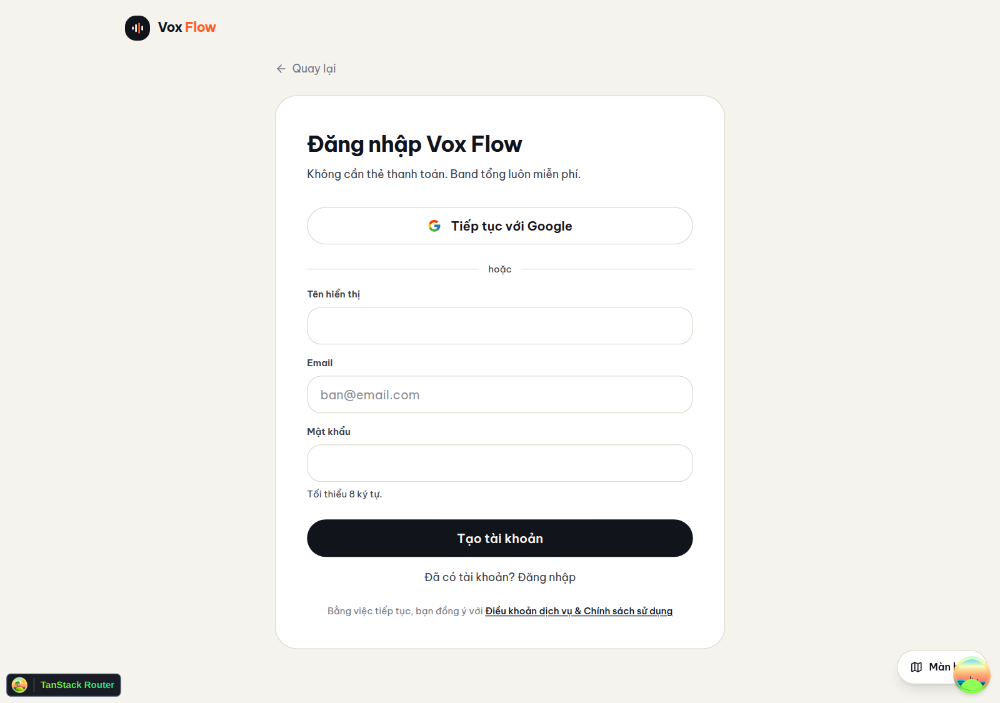
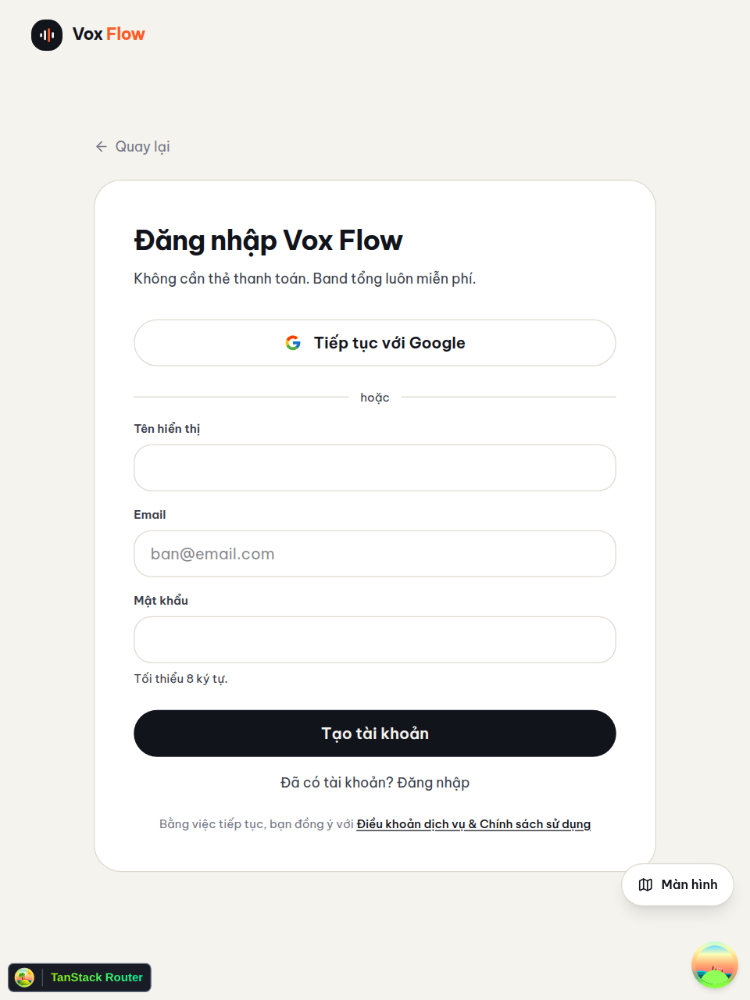
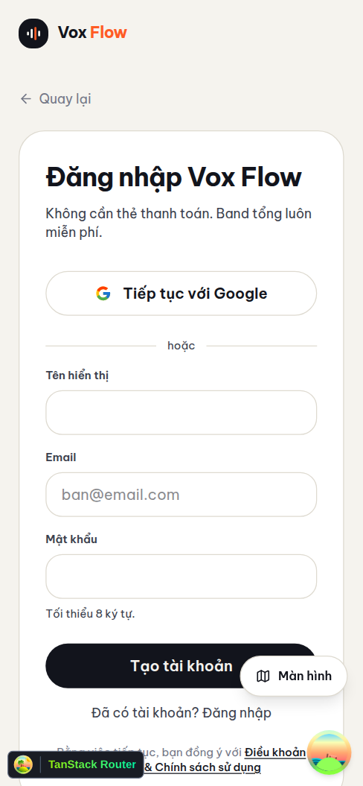

# Proof of Test (POT) — #134 khóa đặc tả `auth-account` SRS, gỡ `_app-legacy` & hardening xác thực

**PR/commit:** [PR #136](https://github.com/vinh19410/vox-flow/pull/136) (commit `da87a0829820b299918937a10121a0d3b656db1b`, nhánh `feat/auth-account-srs-hardening` → `dev`) · **Plan:** `plans/261112-auth-account-srs-hardening/plan.md` · **Isolated Review:** `VERDICT: CLEAN` (Round 2 sau khi sửa triệt để B1..B4 ở `da87a08`)

---

## Done-means → Bằng chứng kiểm chứng

### AC1 — Gỡ sạch khu `_app-legacy` (routes + 6 component) & tham số `desktopOrigins` (`OQ-5`, `OQ-16`, `C-2`, `C-3`)
- **Xóa 10 file legacy:** `apps/web/src/routes/_app-legacy/{route,login,_auth/route,_auth/dashboard}.tsx` và `apps/web/src/components/{header,user-menu,sign-in-form,sign-up-form,mode-toggle,theme-provider}.tsx` (`apps/web/src/components/loader.tsx` giữ nguyên cho `main.tsx`).
- **Xóa `desktopOrigins`:** `packages/auth/src/index.ts` đổi sang `createAuth(env, database, options?: CreateAuthOptions)` với `trustedOrigins: [cleanCorsOrigin]`.
- **Kiểm chứng bề mặt trình duyệt thật (`/login` trả Not Found, cây route không còn legacy):**
  - `grep -c "_app-legacy\|/login\b" apps/web/src/routeTree.gen.ts` (sau `vite build`) → `0`.
  - Truy cập `http://localhost:3001/login` trên Chromium thật hiển thị màn Not Found:


---

### AC2 — Hardening `@vox-flow/auth`: `minPasswordLength`/`maxPasswordLength`, `validateUserName` & `normalizeOAuthUserName` (`1..50`), `rateLimit` in-memory + `cf-connecting-ip` (`OQ-1`, `OQ-11`, `OQ-12`, `C-4`)
- **Cấu hình & kiểm tra dữ liệu (`packages/auth/src/index.ts`, `packages/auth/src/name-validation.ts`):**
  - `emailAndPassword: { enabled: true, autoSignIn: true, minPasswordLength: 8, maxPasswordLength: 128 }`.
  - `validateUserName` & `normalizeOAuthUserName`: chuẩn hóa `trim()`, bắt buộc `1..50` ký tự; vi phạm ném `APIError("BAD_REQUEST", { message: "INVALID_NAME", code: "INVALID_NAME" })` tại `databaseHooks.user.{create,update}.before`; đồng thời chuẩn hóa `profile.name` của Google OAuth qua `socialProviders.google.mapProfileToUser` để tài khoản Google có tên dài `> 50` ký tự hoặc rỗng vẫn tạo user thành công.
  - `rateLimit: { enabled: options.enableRateLimit ?? nodeEnv !== "test", window: 10, max: 100, storage: "memory" }` (Better Auth áp luật đặc biệt `3 lần/10s` cho `/sign-in*`, `/sign-up*`) kết hợp `advanced.ipAddress.ipAddressHeaders: ["cf-connecting-ip"]`.
- **Kết quả test:**
```text
pnpm --filter @vox-flow/auth test                       → 1 file / 18 passed (18)
pnpm --filter @vox-flow/api test src/test/auth.test.ts  → 1 file / 14 passed (14)
  ✓ enables email/password with auto sign-in and password length bounds
  ✓ updateUser accepts /avatars/ static path ... (kèm kiểm chứng Set-Cookie HttpOnly, Secure, SameSite=None)
  ✓ rejects sign-in with a non-existent email with INVALID_EMAIL_OR_PASSWORD
  ✓ validates display name length (1..50 trimmed) on signUpEmail and updateUser
  ✓ normalizes empty or >50-char Google OAuth profile names via mapProfileToUser so user creation succeeds
  ✓ enforces in-memory rate limit per cf-connecting-ip when enableRateLimit is true (3 lần 401 → lần 4 trả 429; IP khác vẫn 401)
```

---

### AC3 — Chuẩn hóa `/auth` (`redirectIfOnboarded`), Google `newUserCallbackURL`, `maxLength=50`, báo lỗi `429`/`INVALID_NAME` & cache onboarding (`OQ-8`, `OQ-13`, `N-6`)
- **Kiểm chứng bề mặt UI `/auth` trên 3 viewport (chế độ đăng ký, `#auth-name` có `maxlength="50"` trên DOM thật):**

**Desktop (`1280x900`):**


**Tablet (`768x1024`):**


**Mobile (`390x844`):**


- **Kiểm chứng hành vi chuyển hướng `/auth` trên trình duyệt thật (mock mạng ngoài cây cho `get-session` & `profile.get`):**
  - Phiên **đã onboard** (`onboardedAt: 1730000000000`) mở `http://localhost:3001/auth` → tự chuyển tới `http://localhost:3001/app/dashboard` (hỗ trợ cả `redirect` có `?query` hoặc `#hash` qua `redirect({ href })`).
  - Phiên **chưa onboard** (`onboardedAt: null`) mở `http://localhost:3001/auth` → giữ nguyên ở `/auth` (bảo toàn nút *Quay lại* từ bước 1 `/onboarding`).


---

### AC4 — Khóa toàn bộ test biên còn thiếu (`OQ-17`, `OQ-18`, `G-5`, `G-6`, `N-7`) & cổng kiểm tra toàn monorepo
```text
pnpm --filter @vox-flow/auth test                       → 1 file   /  18 passed
pnpm --filter @vox-flow/api test                        → 28 files / 292 passed
pnpm --filter server test                               → 4 files  /  51 passed (gồm GET audio download 401 "Unauthorized")
pnpm --filter web test                                  → 40 files / 362 passed (gồm auth-guard 16, route-guards 26, use-sign-out 4, slice-a)
pnpm check-types                                        → 7/7 tasks successful (gồm vite build + tsc --noEmit)
```

---

### AC5 — Duyệt bộ tài liệu `docs/_reverse/auth-account/`, cập nhật `README.md` & `docs/roadmap-work-items.md`
- `grep -En "^\s*[-*]\s*\[ \]" docs/_reverse/auth-account/reverse-gaps.md docs/_reverse/auth-account/auth-account-reverse-spec.md` → **0 dòng mở**.
- `docs/_reverse/auth-account/auth-account-reverse-spec.md` & trọn bộ `srs/{erd,flows,states}.md`, `usecases/*.md`: `status: approved`, `confidence_summary: "✅128 🔵0 🟡0"`, gán đầy đủ Priority `P0/P1/P2`, ghi rõ giới hạn per-isolate của bộ đếm `memory` trên Cloudflare Workers và điều kiện đi qua Cloudflare proxy (`api.vox.vinhtran.io.vn`) cho `cf-connecting-ip`.
- Đã xóa `docs/_reverse/auth-account/usecases/uc-dung-khu-legacy.md`, cập nhật `README.md` và `docs/roadmap-work-items.md:22`.
- Đã tạo issue riêng gắn nhãn `ai-handle` cho phát hiện ngoài phạm vi ở màn Hồ sơ: **#135** (*huy hiệu "Đã xác thực" trên `/app/profile` luôn hiển thị cố định kể cả khi `emailVerified = false`*).
