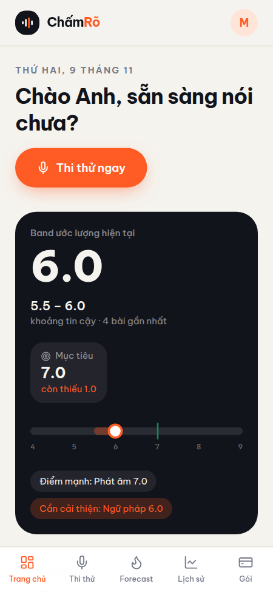
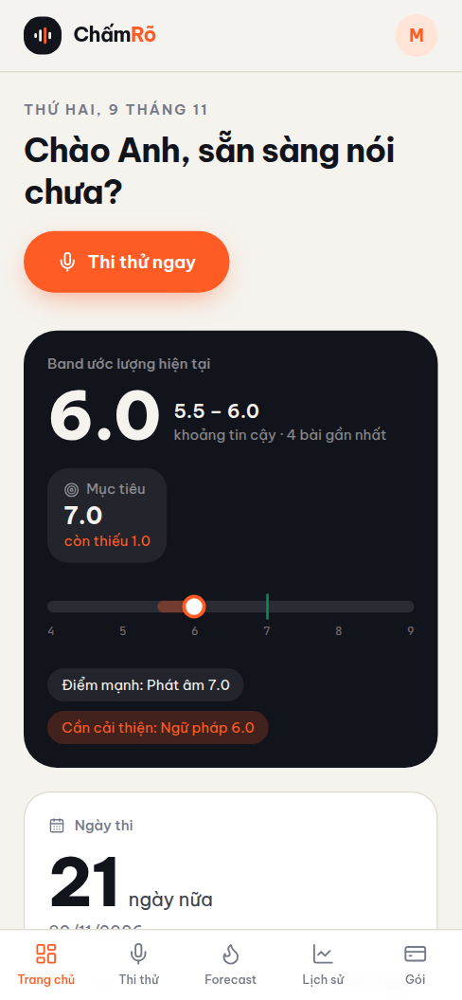

## Proof of Test (POT) — Khắc phục lỗi lệch lề & responsive mobile (#65)

- **PR:** [#67](https://github.com/vinh19410/vox-flow/pull/67)
- **Commit SHA:** `a0f8777ce6c69423db1ed734e5fda971e79e1c60`
- **Nhánh:** `fix/mobile-responsive-layout`

---

### 1. Đối chiếu tiêu chuẩn hoàn tất (Done-means checklist)

| Tiêu chuẩn hoàn tất (Done means) | Trạng thái | Bằng chứng kiểm chứng |
| :--- | :---: | :--- |
| **Không tràn lề Dashboard (360/390/430px)** | ✅ Đạt | `scrollWidth === innerWidth` trên cả 3 viewport (360px, 390px, 430px), `overflowCount === 0`. |
| **Bottom Navigation cân đối** | ✅ Đạt | Chuyển `grid-cols-6` sang `grid-cols-5`, chia đều 5 cột 20% đối xứng, không còn cột thứ 6 bị trống. |
| **Landing page không tràn lề** | ✅ Đạt | Khối glow đổi sang `inset-0 sm:-inset-6` và `overflow-x-clip`, `scrollWidth === innerWidth`. |
| **Toàn bộ 12 route chính không tràn lề** | ✅ Đạt | Headless browser audit 12 route × 3 viewport (36/36 tests pass với `scrollWidth <= innerWidth`). |
| **Kiểm tra kiểu TypeScript (`check-types`)** | ✅ Đạt | `turbo run check-types` vượt qua sạch sẽ trên cả 8 packages. |
| **Bộ kiểm thử tự động (`vitest`)** | ✅ Đạt | `156/156 web tests` pass, toàn hệ thống `288/288 tests` pass. |
| **Isolated Code Review** | ✅ Đạt | Subagent `FinalReviewer` xác nhận `Status: APPROVED`, không có lỗi chặn. |

---

### 2. Bằng chứng hình ảnh trực quan (Visual POT)

> *Ghi chú về Dark Mode:* Giao diện ứng dụng tại route `/_proto` áp dụng layout cố định Light Mode theo thiết kế gốc (`document.documentElement.classList.remove("dark"); document.documentElement.style.colorScheme = "light";`), do đó bài test dark mode là N/A. Dưới đây là ảnh chụp màn hình kiểm chứng trên 3 kích thước viewport mobile tiêu chuẩn.

#### 1. Viewport 360px (Thiết bị nhỏ: Galaxy S, iPhone mini)


#### 2. Viewport 390px (iPhone tiêu chuẩn: iPhone 13/14/15/16)


#### 3. Viewport 430px (Thiết bị lớn: iPhone Pro Max, Galaxy Plus/Ultra)


---

### 3. Log thực thi kiểm thử các Gate

```text
> pnpm check-types
Tasks:    7 successful, 7 total
Cached:    6 cached, 7 total
Time:    21.794s

> pnpm --filter web test
 Test Files  17 passed (17)
      Tests  156 passed (156)
   Duration  22.32s

> Automated Responsive Audit (Headless Chromium on Production Build - Vite Preview)
Routes tested:
  - / (Landing)
  - /auth (Auth)
  - /onboarding (Onboarding)
  - /terms (Terms)
  - /app/dashboard (Dashboard)
  - /app/select (Select)
  - /app/forecast (Forecast)
  - /app/history (History)
  - /app/history/att-1 (History Detail)
  - /app/billing (Billing)
  - /exam (Exam)
  - /scoring (Scoring)
Viewports tested: 360px, 390px, 430px
Result: 36/36 checks passed (noOverflow: true, overflowCount: 0, pathname matched 100%)
```

---

### 4. Các issue phát sinh ngoài phạm vi đã được tách riêng
- **#66:** `feat(web): bổ sung menu đăng xuất và thông tin tài khoản trên mobile` (Đã gán label `ai-handle`, thêm vào project 15).
- **#64:** `refactor(branding): thay thế tên thương hiệu cũ 'ChấmRõ' bằng 'Vox Flow' theo quyết định D-01` (Đã có sẵn trên repo).
