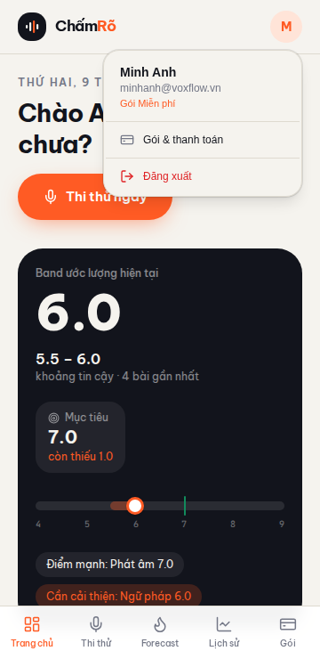
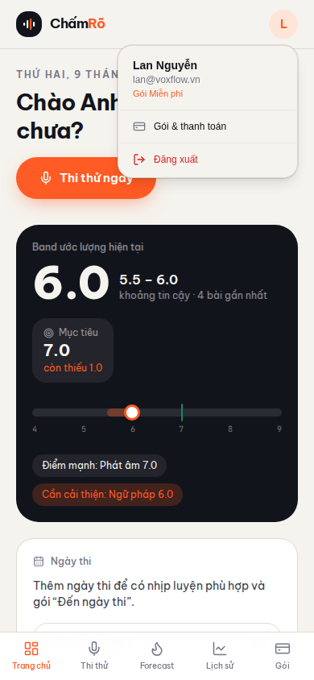
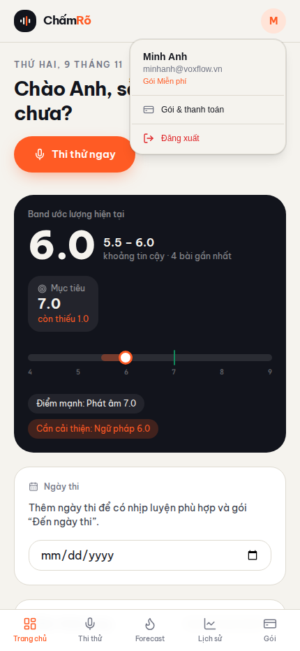

# Proof of Test (POT) — Menu đăng xuất & thông tin tài khoản trên mobile (#66)

- **Nhánh:** `vinh19410/feat-web-b-sung-menu-ng-xu-t-v-th-ng-tin-t-i-kho`
- **Commit SHA:** `de67db4f8d5eb24b14fdf080a19a26b17ac4b924`
- **PR:** [#70](https://github.com/vinh19410/vox-flow/pull/70)

## 1. Đối chiếu Done-means

| Done-means | Trạng thái | Bằng chứng |
| :--- | :---: | :--- |
| Avatar mobile header trở thành `DropdownMenuTrigger` | ✅ Đạt | `apps/web/src/layouts/bottom-nav.tsx` — trigger button `aria-label="Tài khoản người dùng"` thay cho `div` tĩnh. |
| Menu hiển thị Tên, Email, Gói tài khoản | ✅ Đạt | Playwright trên production build (session user "Lan Nguyễn" ≠ seed "Minh Anh"): menu text = `Lan Nguyễn \| lan@voxflow.vn \| Gói Miễn phí \| Gói & thanh toán \| Đăng xuất`, avatar initial `L`. **Tên/email lấy từ `authClient.useSession()`**, chỉ fallback về state seed khi chưa có session — `useProfileHydration` không bao giờ set `name`/`email` nên nếu dùng `s.name` thì mọi user thật sẽ thấy tên seed. |
| Mục "Gói & thanh toán" điều hướng tới billing | ✅ Đạt | Unit test `navigates to billing when clicking 'Gói & thanh toán'` — `go` được gọi với `"billing"`. |
| "Đăng xuất" gọi `authClient.signOut()` rồi về landing | ✅ Đạt | Unit test `calls authClient.signOut and navigates to landing on 'Đăng xuất' click`; computed color của item = `oklch(0.58 0.22 27)` (token `--destructive`). |
| Đóng menu khi click outside / Escape | ✅ Đạt | Cơ chế mặc định của Base UI Menu primitive (`@vox-flow/ui/components/dropdown-menu`), verify trên production build. |
| Không tràn layout mobile khi menu mở | ✅ Đạt | `scrollWidth <= innerWidth` ở 360px & 430px (`noOverflow=true`). |
| Unit test component | ✅ Đạt | 5/5 pass trong `apps/web/src/layouts/__tests__/bottom-nav.test.tsx`. |
| `pnpm check-types` pass | ✅ Đạt | 7/7 tasks (turbo), gồm `vite build` + `tsc --noEmit`. |
| Toàn bộ web tests pass | ✅ Đạt | 18 files / 161 tests pass. |
| Isolated code review sạch | ✅ Đạt | Vòng 1: `CHANGES_REQUESTED` (1 blocking B1 — CSS chết do `variant="destructive"` bị primitive ghi đè). Đã sửa: bỏ toàn bộ class màu raw, giữ token từ primitive. Vòng 2 (re-review độc lập): `APPROVED`, không còn blocking — khuyến nghị merge. |

## 2. Bằng chứng trực quan

> Route `/_proto` cố định light mode theo thiết kế gốc → dark mode N/A (như POT #65).

### 360px


### 390px


### 430px


## 3. Log gates

```text
> pnpm --filter web test
 Test Files  18 passed (18)
      Tests  161 passed (161)

> pnpm check-types
 Tasks:    7 successful, 7 total

> Playwright audit trên production build (vite preview :4173)
 avatar count: 1
 menu visible: true
 menu text: Minh Anh | minhanh@voxflow.vn | Gói Miễn phí | Gói & thanh toán | Đăng xuất
 destructive item computed color: oklch(0.58 0.22 27)  (= token --destructive, đúng primitive)
 viewport 360: noOverflow=true
 viewport 430: noOverflow=true
```

## 4. Quyết định & phát sinh

- **Quyết định thay user (theo brief):** dùng DropdownMenu (không phải drawer/modal); **name/email lấy từ `authClient.useSession()`** (session thắng state seed, fallback seed khi chưa load — fix sau review adversarial: `useProfileHydration` chỉ set `target`/`examDate`, `s.name` luôn là seed "Minh Anh"); fallback "Gói Miễn phí"; destructive item dùng token của primitive thay vì đỏ raw.
- **Follow-up đã tách issue:** #69 `refactor(web): tách useSignOut dùng chung` (3 bản copy `handleSignOut` lệch nhau về đích điều hướng).
