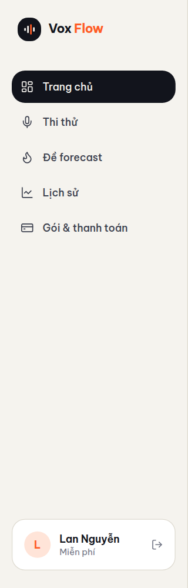
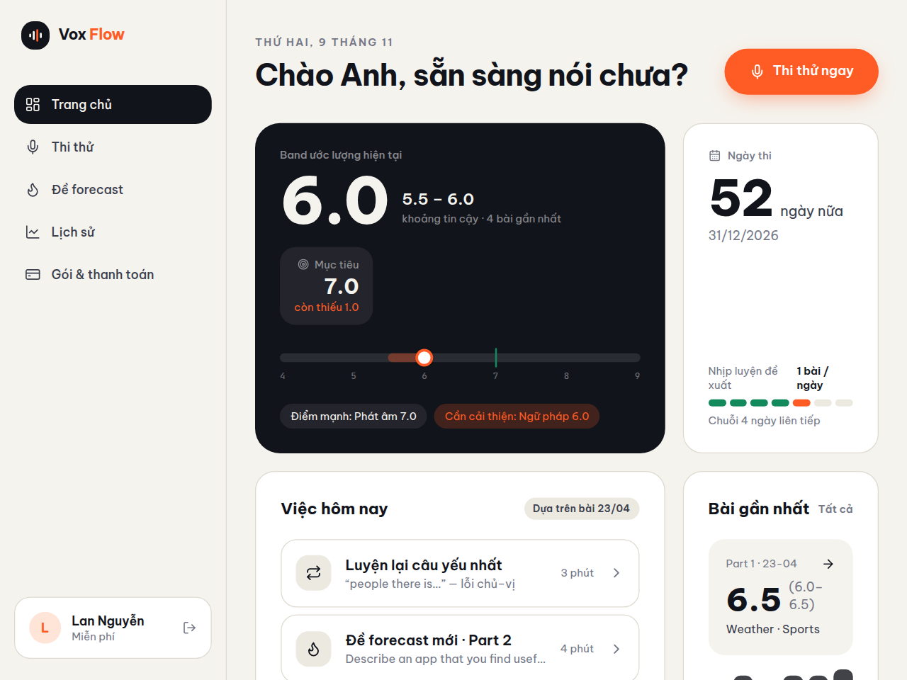
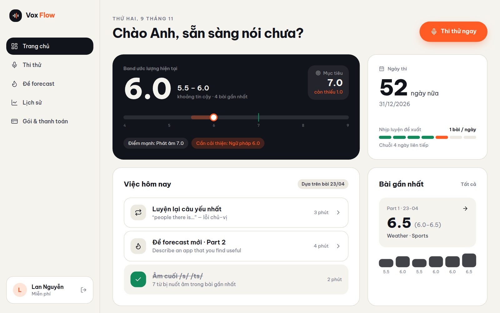
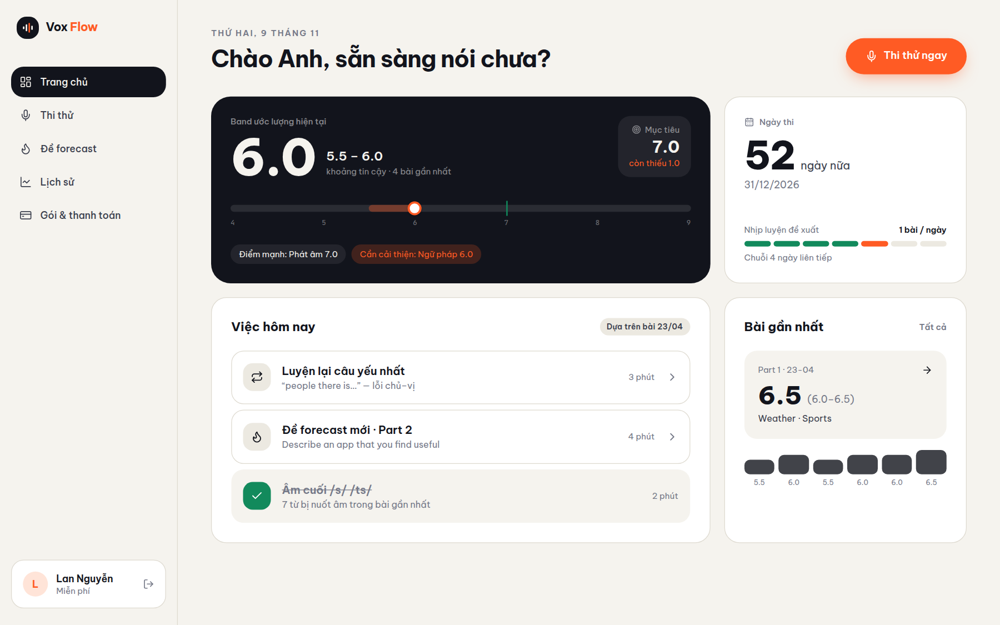

# Proof of Test (POT) — UserCard desktop hiển thị tên user thật từ session (#71)

- **Nhánh:** `fix/web-user-card-session-name-71`
- **Commit SHA:** `d22f6341769d43302e60381c09b200e84138c2ce`
- **PR:** [#74](https://github.com/vinh19410/vox-flow/pull/74)

## 1. Đối chiếu Done-means

| Done-means | Trạng thái | Bằng chứng |
| :--- | :---: | :--- |
| Ưu tiên tên user từ `session?.user?.name` | ✅ Đạt | `apps/web/src/layouts/user-card.tsx` — sử dụng `const displayName = session?.user?.name || s.name;` cho cả avatar initial và tên hiển thị. Khi session có dữ liệu thật (VD: "Lan Nguyễn"), avatar hiển thị "L" và tên hiển thị "Lan Nguyễn" thay vì seed "Minh Anh". |
| Fallback về seed khi session chưa có | ✅ Đạt | Khi session null hoặc user không có name, fallback an toàn về `s.name` và chữ cái đầu của `s.name`. |
| Giữ nguyên layout và tính năng hiện có | ✅ Đạt | Giữ nguyên thẻ gói tài khoản (`Gói ...` hoặc `Miễn phí`) và nút Đăng xuất tích hợp `useSignOut()`. |
| Unit test đầy đủ | ✅ Đạt | 5/5 pass trong `apps/web/src/layouts/__tests__/user-card.test.tsx` (session precedence, absent session, empty user name, plan display, sign-out). |
| Full web test suite pass | ✅ Đạt | 20 test files / 170 tests pass (`pnpm --filter web test`). |
| `pnpm check-types` pass | ✅ Đạt | 7/7 tasks turbo pass, gồm `vite build` và `tsc --noEmit`. |
| Isolated code review sạch | ✅ Đạt | Sub-session code review độc lập (`code-reviewer`): **APPROVED, 0 blocking**. |

## 2. Bằng chứng trực quan (3 Viewports & Sidebar Close-up)

> Route `/_proto` cố định light mode theo thiết kế nguyên mẫu → dark mode N/A (tương tự precedent POT #65, #66).

### Sidebar Desktop Close-up


### Viewport 1024px (Điểm bắt đầu hiển thị desktop sidebar)


### Viewport 1280px (Chuẩn laptop desktop)


### Viewport 1440px (Màn hình rộng)


## 3. Log gates

```text
> pnpm --filter web test src/layouts/__tests__/user-card.test.tsx --reporter=verbose

 RUN  v5.1.0 /root/projects/vox-flow/apps/web

 ✓ src/layouts/__tests__/user-card.test.tsx > UserCard component > renders session user name and avatar initial over app state seed 96ms
 ✓ src/layouts/__tests__/user-card.test.tsx > UserCard component > falls back to app state seed name when session is absent 16ms
 ✓ src/layouts/__tests__/user-card.test.tsx > UserCard component > falls back to app state seed name when session user has no name 12ms
 ✓ src/layouts/__tests__/user-card.test.tsx > UserCard component > renders active plan name or default 'Miễn phí' 22ms
 ✓ src/layouts/__tests__/user-card.test.tsx > UserCard component > calls signOut and navigates to /auth when clicking 'Đăng xuất' button 193ms

 Test Files  1 passed (1)
      Tests  5 passed (5)

> pnpm --filter web test
 Test Files  20 passed (20)
      Tests  170 passed (170)

> pnpm check-types
 Tasks:    7 successful, 7 total
```

## 4. Quyết định trong run

- **Đồng bộ hóa với pattern của mobile BottomNav (#66 / PR #70):** Dùng `authClient.useSession()` tại `UserCard` để lấy `displayName`, không thay đổi cấu trúc prototype app-state toàn cục hay `useProfileHydration`.
- **YAGNI & Zero Regression:** Không chèn thêm email hay tooltip vào UserCard để bảo vệ độ rộng cố định 256px của sidebar desktop.

## 5. Chưa kiểm chứng & Ghi chú

- **Dữ liệu phiên chạy thực tế:** Ảnh chụp màn hình kiểm chứng trực quan được chạy trên bản build production (`vite preview`) với session và profile được giả lập qua Playwright route interception (user "Lan Nguyễn", targetBand 7.0), chưa kiểm thử end-to-end với backend server thật. Logic component đã được bảo đảm qua 5 unit tests pass.
- **Theme:** Nhánh `/_proto` cố định light theme theo thiết kế nguyên mẫu → dark mode N/A.
- **Issue phát hiện ngoài scope:** Tiêu đề chào mừng tại DashboardScreen (`apps/web/src/features/dashboard/dashboard-screen.tsx:19,37`) vẫn đọc `s.name.split(" ").pop()` nên hiển thị "Chào Anh". Vấn đề này đã được tách thành issue riêng theo quy định: [#73](https://github.com/vinh19410/vox-flow/issues/73) (`fix(web): DashboardScreen hiển thị lời chào 'Chào Anh' từ seed thay vì tên user thật`).
