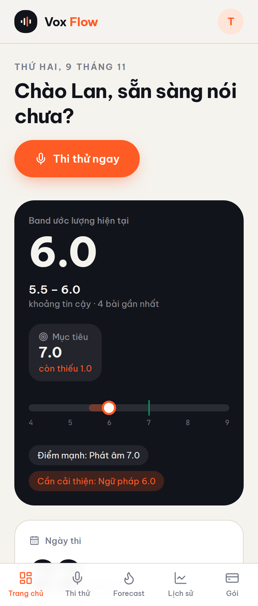
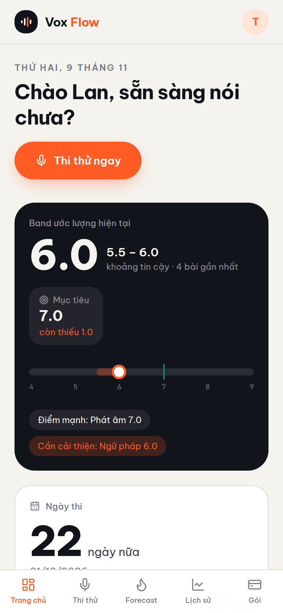
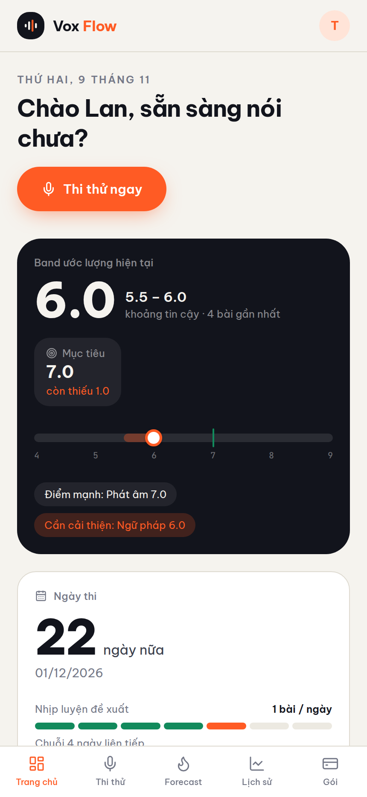
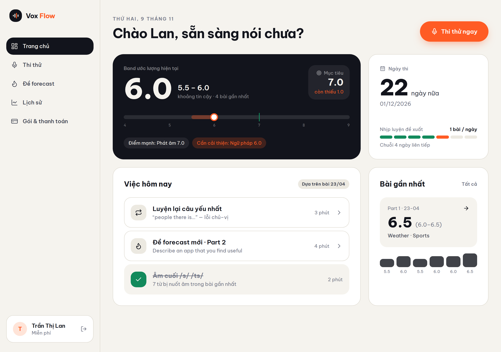

# Proof of Test (POT) — DashboardScreen chào tên user thật từ session (#73)

- **Nhánh:** `vinh19410/fix-web-dashboardscreen-hi-n-th-l-i-ch-o-ch-o-an`
- **Commit SHA (code):** `5eec75c2dd3659b8eb5e15b1199bf0f473703f8b`
- **Commit SHA (ảnh POT):** `9d457b8c80196163c18b183a4dfc72334a2e9691`
- **PR:** [#75](https://github.com/vinh19410/vox-flow/pull/75)

## 1. Đối chiếu Done-means

| Done-means | Trạng thái | Bằng chứng |
| :--- | :---: | :--- |
| Ưu tiên tên user từ `session?.user?.name` (từ cuối cùng) cho cả 2 trạng thái tiêu đề | ✅ Đạt | `apps/web/src/features/dashboard/dashboard-screen.tsx:15-19` — `const firstName = (session?.user?.name?.trim() \|\| s.name).trim().split(/\s+/).pop() \|\| s.name;`, dùng ở cả title empty-state (`Chào ${firstName}!`) lẫn title có bài thi (`Chào ${firstName}, sẵn sàng nói chưa?`). |
| Fallback an toàn về `s.name` khi session null / user không có name / name whitespace-only | ✅ Đạt | `trim()` chặn whitespace-only trước khi fallback; 3/5 unit test phủ đúng 3 đường này, gồm assert âm `queryByText("Chào !")` chống suy biến. |
| Unit test suite mới cho DashboardScreen pass 100% | ✅ Đạt | 5/5 pass trong `apps/web/src/features/dashboard/__tests__/dashboard-screen.test.tsx` (precedence 2 nhánh, fallback absent/unnamed/whitespace-only). |
| Full web test suite + `pnpm check-types` pass | ✅ Đạt | 21 test files / 175 tests pass; check-types 7/7 turbo tasks (gồm `vite build`). |
| Isolated code review sạch | ✅ Đạt | Sub-session code review độc lập (`code-reviewer`): **APPROVED, 0 blocking** (3 non-blocking nits, reviewer xác nhận không cần sửa). |
| POT screenshots đa viewport + log gates đăng comment lên Issue #73 | ✅ Đạt | 4 ảnh bên dưới (360/390/430/1280) + log gates Mục 3, đăng kèm comment issue #73. |
| Pull Request liên kết Issue #73 | ✅ Đạt | Xem link PR ở comment issue. |

## 2. Bằng chứng trực quan (4 viewports)

> Route `/app/dashboard` cố định light mode theo thiết kế nguyên mẫu → dark mode N/A (tương tự precedent POT #65, #66, #71). Session giả lập qua server harness phục `get-session` + `profile.get` (user **"Trần Thị Lan"**, targetBand 7.0 — thứ tự họ-trước-tên tiếng Việt đúng chuẩn).

### Viewport 360px (màn hình nhỏ)


### Viewport 390px (chuẩn mobile)


### Viewport 430px (mobile lớn)


### Viewport 1280px (desktop, kèm sidebar UserCard từ #71)


Lời chào hiển thị **"Chào Lan, sẵn sàng nói chưa?"** (từ cuối của "Trần Thị Lan") thay vì "Chào Anh" từ seed — đồng bộ với UserCard desktop (#71) và BottomNav mobile (#66).

## 3. Log gates

```text
> pnpm --filter web test src/features/dashboard/__tests__/dashboard-screen.test.tsx --reporter=verbose

 ✓ src/features/dashboard/__tests__/dashboard-screen.test.tsx > DashboardScreen greeting name > greets the session user's given name instead of the seed name
 ✓ src/features/dashboard/__tests__/dashboard-screen.test.tsx > DashboardScreen greeting name > greets the session user's given name in the empty state and starts the first attempt
 ✓ src/features/dashboard/__tests__/dashboard-screen.test.tsx > DashboardScreen greeting name > falls back to the seed name when the session is absent
 ✓ src/features/dashboard/__tests__/dashboard-screen.test.tsx > DashboardScreen greeting name > falls back to the seed name when the session user has no name
 ✓ src/features/dashboard/__tests__/dashboard-screen.test.tsx > DashboardScreen greeting name > falls back to the seed name when the session name is whitespace only

 Test Files  1 passed (1)
      Tests  5 passed (5)

> pnpm --filter web test
 Test Files  21 passed (21)
      Tests  175 passed (175)

> pnpm check-types
 Tasks:    7 successful, 7 total
```

## 4. Quyết định trong run

- **Tái dùng pattern #66/#71:** `authClient.useSession()` ngay trong `DashboardScreen`, không thay đổi app-state toàn cục hay `useProfileHydration`.
- **`split(/\s+/)` thay cho `split(" ")`:** xử lý đúng khoảng trắng kép/nhiều dấu cách trong tên.
- **Trim trước fallback:** chặn edge case session name whitespace-only làm title thành "Chào !" — vượt yêu cầu tối thiểu của issue.
- **Mock `@/lib/auth-client` trong slice-b:** bắt buộc để giữ suite hermetic sau khi component gọi `useSession` (advisory từ review).
- **YAGNI:** không gom logic trích tên vào helper dùng chung (nợ kỹ thuật ghi nhận ở review, 2 nơi cùng pattern).

## 5. Chưa kiểm chứng & Ghi chú

- **Dữ liệu phiên chạy thực tế:** Ảnh POT chạy trên bản build production (`dist` + server harness tĩnh tại `localhost:3000` phục `get-session`/`trpc profile.get` giả lập), chưa chạy end-to-end với backend better-auth thật. Logic component được bảo đảm bởi 5 unit test + 14 test slice-b.
- **Hạn chế đã biết (thừa nhận từ review):** thứ tự tên *given-name-first* (ví dụ OAuth name "Lan Nguyễn") sẽ được chào là "Chào Nguyễn" (họ) vì quy tắc lấy từ cuối cùng do user chốt ở phỏng vấn yêu cầu. Fixture test/POT dùng thứ tự tiếng Việt "Trần Thị Lan" → "Lan". Nếu sau này gặp tên first-name-first, sửa tập trung tại `dashboard-screen.tsx:19` (và các nơi cùng pattern #66/#71 nếu muốn đồng bộ).
- **Theme:** route `/app` cố định light theme theo thiết kế nguyên mẫu → dark mode N/A.
