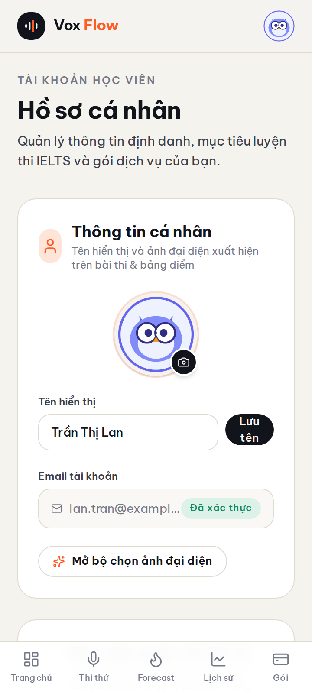
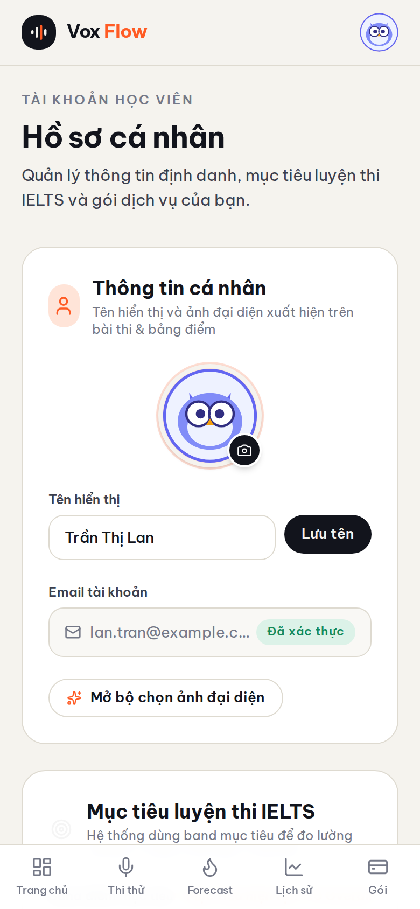
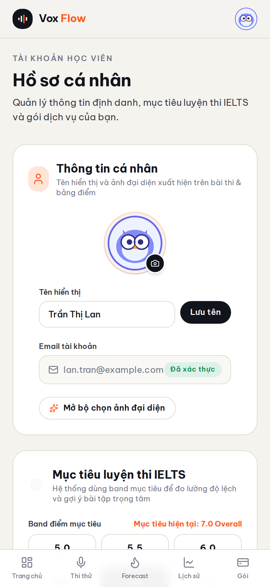
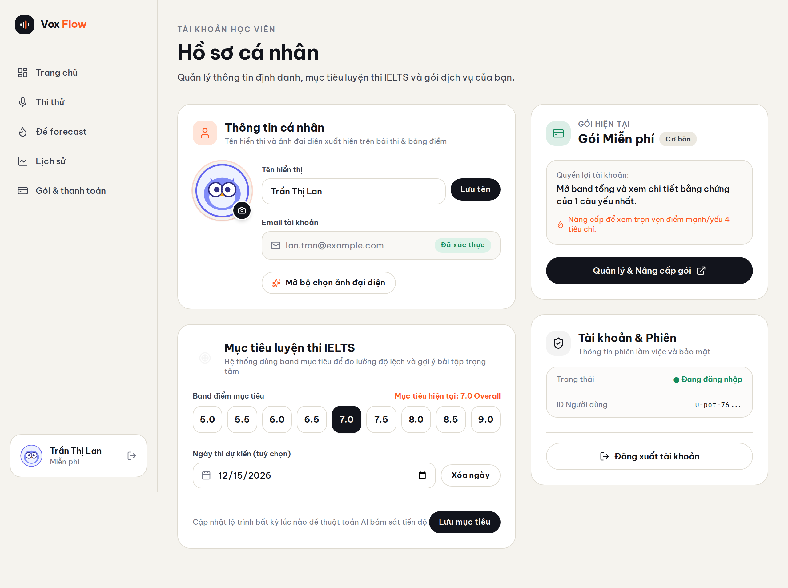
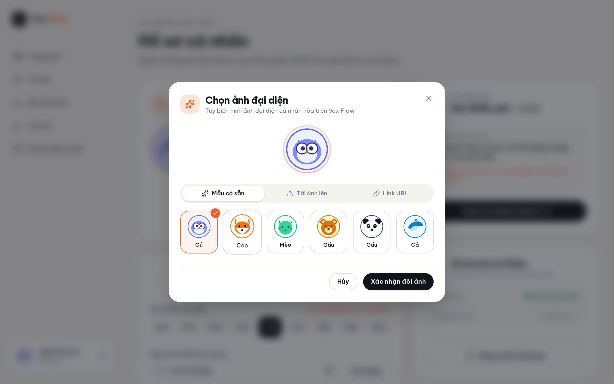

# Proof of Test (POT) — Màn hình hồ sơ cá nhân `/app/profile` (#76)

- **Nhánh:** `feat/web-user-profile-screen`
- **Commit SHA (code):** `290d879d` (tip nhánh, đã merge)
- **Merge commit:** `99dec1b6c2366595a08acebb97bfe92bf665c29d`
- **PR:** [#77](https://github.com/vinh19410/vox-flow/pull/77)

## 1. Đối chiếu Done-means

| Done-means | Trạng thái | Bằng chứng |
| :--- | :---: | :--- |
| Route `/app/profile` hoạt động dưới guard `_proto/app` (`requireOnboarded`) | ✅ Đạt | `apps/web/src/routes/_proto/app/profile.tsx` ≡ pattern billing; routeTree được TanStack Router plugin sinh khi build (`pnpm check-types` pass = route hợp lệ). |
| Đổi tên hiển thị thành công, xử lý cả lỗi server | ✅ Đạt | `profile-screen.tsx` `handleSaveIdentity` — `authClient.updateUser({ name, image })`, kiểm tra `res.error` → toast lỗi, KHÔNG sync state khi lỗi (test `shows failure toast and does not sync state when updateUser returns { error }`). |
| Đổi avatar: 6 mẫu tĩnh `/avatars/*.svg`, upload nén vuông WebP, URL ngoài | ✅ Đạt | `avatar-modal.tsx` 3 tab; `image-compress.ts` cắt vuông tâm + nén WebP 180px, **không còn fallback trả ảnh gốc** (6 nhánh reject có test); 6 file SVG thuần (vector, không script) tại `apps/web/public/avatars/`. |
| Server-side validate `user.image` (tạo + cập nhật) | ✅ Đạt | `packages/auth/src/image-validation.ts` + hook `user.create.before`/`update.before` → `APIError INVALID_IMAGE`. Test e2e qua handler thật (`packages/api/src/test/auth.test.ts`, 10/10): Google `https://lh3...` pass; SVG data URL, `javascript:`, oversized bị chặn; `updateUser` nhận `/avatars/` + webp data URL + null, giữ nguyên ảnh khi reject. |
| Cập nhật Target Band 5.0–9.0 + ngày thi qua tRPC `profile.upsert` | ✅ Đạt | `profile-screen.tsx` `handleSaveGoal` validate ngày quá khứ client-side (test riêng) + server đã validate sẵn (`packages/api/src/routers/profile.ts` `VALID_BANDS`, regex ngày). |
| Điều hướng từ Sidebar desktop + Mobile header → `/app/profile` | ✅ Đạt | `user-card.tsx` UserCard bấm được (`go("profile")`, test); `bottom-nav.tsx` mục "Hồ sơ cá nhân" (test `navigates to profile...`); avatar image hiển thị khi session có ảnh (test cả 2). |
| Thẻ "Gói học viên" + nút "Quản lý & Nâng cấp gói" → `/app/billing` | ✅ Đạt | `profile-screen.tsx` card gói + `go("billing")` (test); hiển thị "Gói Miễn phí" khi không có gói (test). |
| Tests + `pnpm check-types` pass 100% | ✅ Đạt | `pnpm test` root (turbo): **347/347 pass** (auth 9, api 119, server 17, web 202 — trong đó 34 test mới cho profile/auth). `pnpm check-types` root: **7/7 tasks** (web gồm cả `vite build`). |
| Isolated code review sạch | ✅ Đạt | 2 vòng review độc lập (sub-session `code-reviewer`, không cùng context người viết): vòng 2 **APPROVED, 0 blocking** (1 non-blocking residual đã fix ở commit `290d879`). |
| PR merge theo `--merge` | ✅ Đạt | Merge commit `99dec1b` trên `main`. |

## 2. Bằng chứng trực quan (4 viewports + modal)

> Chụp trên bản build production (`pnpm --filter web build`) phục qua static harness có giả lập `get-session` (user **"Trần Thị Lan"**, avatar mẫu cú) và `profile.get` (targetBand 7.0, examDate 2026-12-15) — đúng pattern POT #73. Route `/app` cố định light theme theo thiết kế nguyên mẫu → **dark mode N/A** (precedent POT #65, #66, #71, #73).

### Viewport 360px (màn hình nhỏ)


### Viewport 390px (chuẩn mobile)


### Viewport 430px (mobile lớn)


### Viewport 1280px (desktop, Sidebar UserCard bấm được)


### Modal chọn ảnh đại diện (3 tab: mẫu có sẵn / tải ảnh lên / URL)


## 3. Log gates

```text
> pnpm test   (turbo, root)
@vox-flow/auth:test:  Test Files  1 passed (1)   |  Tests  9 passed (9)
server:test:          Test Files  1 passed (1)   |  Tests  17 passed (17)
@vox-flow/api:test:   Test Files  16 passed (16) |  Tests  119 passed (119)
web:test:             Test Files  25 passed (25) |  Tests  202 passed (202)
 Tasks:    4 successful, 4 total

> pnpm check-types   (turbo, root — web chạy cả vite build)
 Tasks:    7 successful, 7 total
```

Lưu ý: repo không có script `pnpm check` — cặp lệnh tương đương theo cấu hình turbo là `pnpm test` + `pnpm check-types`, cả hai đã chạy ở root không pipe, exit code 0.

## 4. Quyết định trong run (những lựa chọn tự quyết + lý do)

- **Cap `user.image` 32KB** (không phải 200KB đề xuất đầu): `user.image` được trả về trong mọi session payload; 32.000 chars ≈ ~24KB binary, dư cho WebP 180×180 (~3–10KB). Enforce cả server (hook) lẫn client (sau nén) từ **một hằng dùng chung** `MAX_USER_IMAGE_LENGTH` (`packages/auth/src/image-validation.ts`).
- **Chặn SVG data URL server-side** nhưng vẫn dùng file SVG tĩnh cho preset: file tĩnh same-origin (`/avatars/*.svg`, vector thuần không script) tin cậy được; data URL do client nhập thì không (SVG có thể chứa `<script>`).
- **M1 không gửi `name` rỗng** khi chọn avatar — tránh ghi đè tên trong DB bằng chuỗi rỗng khi ô tên đang trống (finding review, đã fix + test).
- **`--merge` giữ merge commit** (không squash) theo đúng cờ người dùng chỉ định.

## 5. Chưa kiểm chứng & Ghi chú

- **Ảnh POT chạy trên harness giả lập session** (`get-session` + `profile.get` tĩnh), chưa chạy end-to-end với Google OAuth/email thật trên môi trường có secrets — logic server đã phủ bằng test e2e qua `auth.handler` thật (cookie signed thật) trong `packages/api/src/test/auth.test.ts`.
- Luồng upload ảnh từ máy (FileReader + Canvas) được verify bằng unit test với stub `Image`/`Canvas` (jsdom không decode ảnh thật); hành vi nén thực tế trên trình duyệt thật chưa đo bằng tay.
- Điểm truy cập desktop vào Profile là **bấm thẻ UserCard** trong sidebar (không thêm nav item mới — NAV_ITEMS giữ nguyên 5 mục theo thiết kế prototype); nếu muốn entry điểm tách bạch hơn (icon riêng), cần quyết định thiết kế mới.
