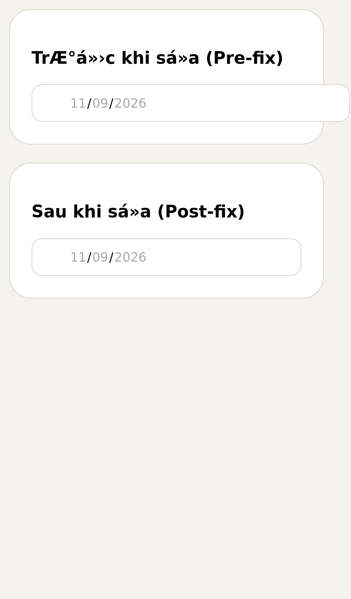
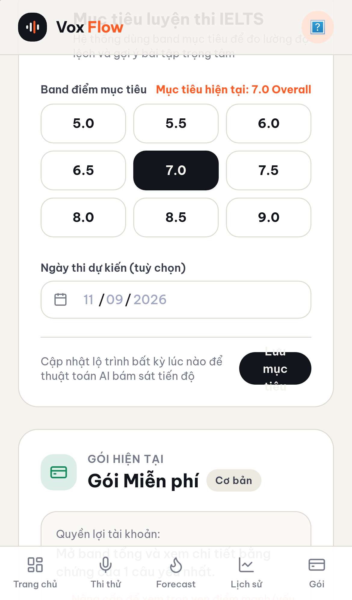
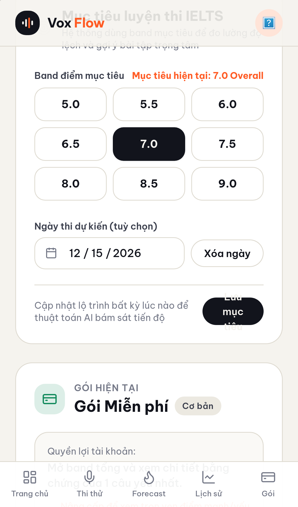
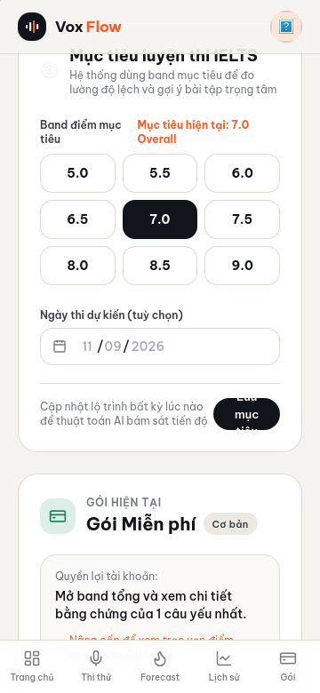
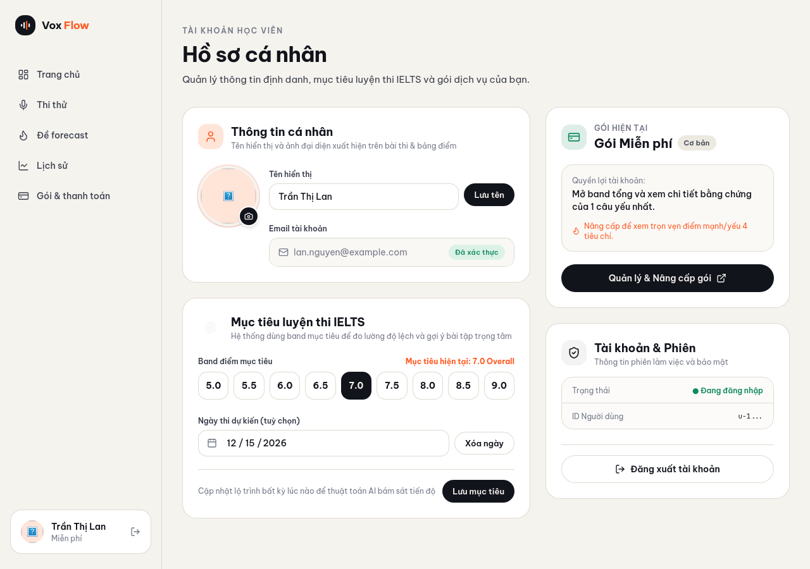

# Proof of Test (POT) — Bỏ nút avatar dư thừa & sửa lỗi tràn viền input ngày thi dự kiến (#80)

- **Issue:** [#80](https://github.com/vinh19410/vox-flow/issues/80)
- **Nhánh:** `fix/profile-date-input-and-avatar-cleanup`
- **Commit SHA (ảnh & code):** `d1348c39ba33a5c655f8d7225c5806a678929688`

---

## 1. Đối chiếu Done-means / Acceptance Criteria

| Tiêu chí | Trạng thái | Bằng chứng kiểm chứng |
| :--- | :---: | :--- |
| **Loại bỏ nút "Mở bộ chọn ảnh đại diện"** | ✅ Đạt | Đã xóa phần tử `<Button>` dư thừa dưới email trong `profile-screen.tsx`. DOM test `screen.queryByRole("button", { name: "Mở bộ chọn ảnh đại diện" }) === null`. |
| **Giữ nguyên nút camera đổi avatar** | ✅ Đạt | Nút Camera tròn overlay trên vòng tròn avatar (`aria-label="Đổi ảnh đại diện"`) vẫn hoạt động 100%, test click mở AvatarModal pass. |
| **Sửa lỗi tràn ngang input ngày thi trên mobile (iOS Safari/WebKit)** | ✅ Đạt | Bổ sung `w-full min-w-0` cho container flex, `min-w-0 flex-1` cho wrapper, và `w-full min-w-0 max-w-full` cho thẻ `<input type="date">`. Đo đạc bounding rect trên WebKit engine: **overflow = 0px** (trước khi sửa tràn 29px). |
| **Nút "Xóa ngày" không bị co méo** | ✅ Đạt | Thêm `shrink-0` cho Button "Xóa ngày". |
| **Bảo vệ toàn cục cho `input[type="date"]`** | ✅ Đạt | Bổ sung `.proto-root input[type="date"] { min-width: 0; max-width: 100%; box-sizing: border-box; }` vào `prototype-theme.css`. |
| **Đồng bộ giá trị rỗng khi DB không có ngày thi** | ✅ Đạt | Sửa `if (s.examDate) setExamDate(s.examDate)` thành `setExamDate(s.examDate ?? "")` để khi `s.examDate` là null thì input hiển thị rỗng chính xác. |
| **Unit tests pass 100%** | ✅ Đạt | `pnpm --filter web test src/features/profile/__tests__/profile-screen.test.tsx` (11/11 passed). |
| **Kiểm tra kiểu & Vite build** | ✅ Đạt | `pnpm check-types` pass 8/8 package trong monorepo. |

---

## 2. Bằng chứng đo đạc & hình ảnh trực quan (WebKit Engine)

> Tất cả ảnh được chụp thực tế bằng **WebKit 27.2 (Playwright WebKit)** với device descriptor `iPhone 13` và các viewport tương ứng.

### So sánh trực tiếp Trước và Sau khi sửa trên WebKit (iPhone 13 viewport)
- **Trước khi sửa (Pre-fix):** Input date width = 354px, right = 389px, cardRight = 360px $\rightarrow$ **Tràn 29px ra ngoài viền Card** (chính xác với ảnh chụp lỗi người dùng gửi).
- **Sau khi sửa (Post-fix):** Input date width = 300px, right = 335px, cardRight = 360px $\rightarrow$ **Tràn 0px** (cách lề phải an toàn 25px).



---

### Màn hình Profile trên iPhone 13 (390px) — Trạng thái ô ngày thi TRỐNG
Input ngày thi nằm gọn hoàn toàn trong viền Card, nút "Mở bộ chọn ảnh đại diện" dưới email đã được loại bỏ gọn gàng:



---

### Màn hình Profile trên iPhone 13 (390px) — Trạng thái ĐÃ CÓ NGÀY THI
Input hiển thị ngày đã chọn kèm nút "Xóa ngày" nằm cùng hàng, không gây tràn viền:



---

### Màn hình Profile trên Mobile hẹp (360px)
Độ rộng Card: 320px (cardRight: 340px). Input right: 315px $\rightarrow$ Overflow: 0px.



---

### Màn hình Profile trên Desktop (1280px)
Giao diện hiển thị chuẩn xác, không còn nút thừa, bố cục 2 cột cân đối:



---

## 3. Log Gates

```text
> pnpm --filter web test src/features/profile/__tests__/profile-screen.test.tsx

 RUN  v5.1.0 /root/projects/worktrees/vox-flow-profile-date-input-and-avatar-cleanup/apps/web

 Test Files  1 passed (1)
      Tests  11 passed (11)
   Duration  3.26s

> pnpm check-types
 turbo run check-types
   • Running check-types in 8 packages
   • web: vite build && tsc --noEmit (✓ built in 1.94s)
 Tasks:    7 successful, 7 total
```
